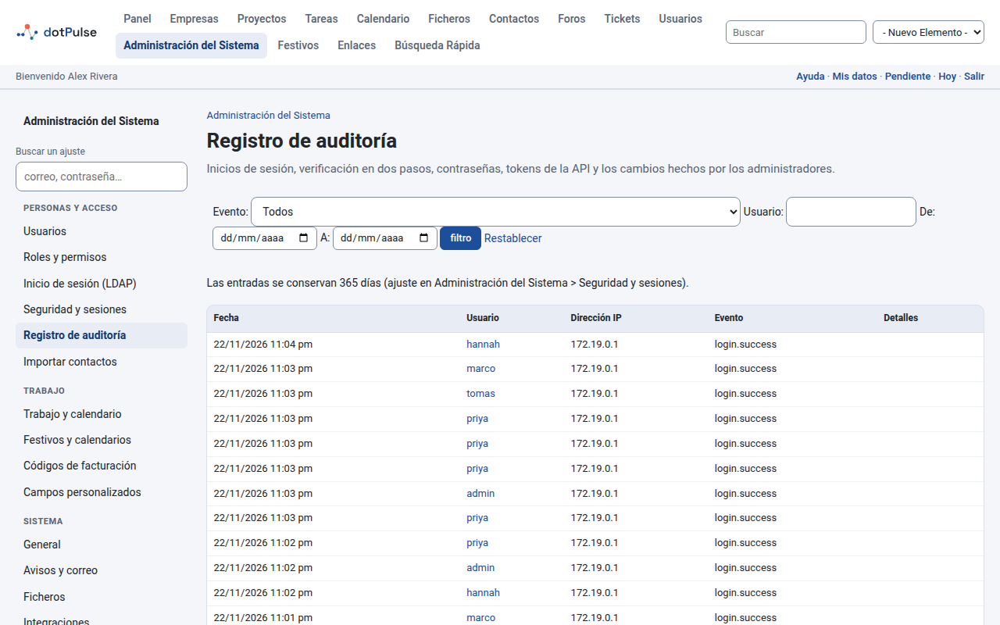

# Auditoría y mantenimiento { #audit-and-maintenance }

Esta página trata del registro de auditoría de seguridad, de la importación de
contactos desde LDAP y del trabajo rutinario que mantiene en buen estado un
sitio dotPulse: la tarea de cron, las copias de seguridad, las actualizaciones y
una revisión de seguridad.

## Registro de auditoría { #audit-log }

El registro de auditoría guarda los inicios de sesión y los cambios que hacen
los administradores. Está siempre activo, y nadie puede editar ni borrar sus
entradas desde dotPulse.

Abra **Administración del Sistema › Registro de auditoría**. Necesita permiso de
lectura sobre **Administración del Sistema**, que en un sitio nuevo solo tienen
los administradores. Las entradas más recientes aparecen primero, 100 por
página; **Más antiguas** y **Más recientes**, al final, pasan de una página a
otra.

{ .shot }

Cada entrada tiene la **Fecha**, el **Usuario**, la **Dirección IP**, el
**Evento** y los **Detalles**. En un inicio de sesión fallido, **Usuario** es el
nombre que se intentó. Los intentos fallidos y bloqueados se muestran en rojo.
Señale un evento para ver qué significa.

Las contraseñas, los tokens y los valores de los ajustes no se escriben nunca en
el registro. Un cambio de configuración solo lista los nombres de los ajustes
que cambiaron.

### Qué se registra { #what-is-recorded }

| Eventos | Cuándo |
|--------|------|
| `login.success`, `logout` | Alguien inició o cerró sesión. |
| `login.failure` | Usuario o contraseña incorrectos. |
| `login.blocked` | Una dirección hizo demasiados inicios de sesión fallidos y se rechaza durante un tiempo. |
| `twofactor.failure`, `twofactor.blocked` | Códigos de inicio de sesión en dos pasos incorrectos. |
| `twofactor.recovery_used` | Alguien inició sesión con un código de recuperación. |
| `twofactor.enabled`, `twofactor.disabled`, `twofactor.recovery_renewed` | Un usuario cambió su inicio de sesión en dos pasos. |
| `twofactor.reset` | Un administrador restableció el inicio de sesión en dos pasos de alguien. |
| `password.changed` | Se cambió una contraseña, por su usuario o por un administrador. |
| `password.reset_requested`, `password.reset` | Alguien pidió un enlace para restablecer la contraseña, y lo usó. |
| `api.token_created`, `api.token_revoked` | Tokens de la REST API. |
| `api.blocked` | Una dirección hizo demasiadas llamadas fallidas a la API. |
| `user.created`, `user.updated`, `user.deleted` | Cuentas de usuario. |
| `user.role_added`, `user.role_removed` | Los roles de un usuario. |
| `user.transferred` | Los proyectos y tareas de un usuario se pasaron a otro usuario. |
| `permission.added`, `permission.removed` | Permisos de un usuario o de un rol. |
| `role.saved`, `role.deleted` | Roles. |
| `config.changed` | Alguien guardó la configuración de **Administración del Sistema**. |
| `module.changed` | Se instaló, eliminó, actualizó, activó o desactivó un módulo. |

Los cambios en proyectos, tareas y otros registros no están en el registro de
auditoría. Tampoco los cambios en las listas de valores, los campos
personalizados, los códigos de facturación, las preferencias por defecto ni las
traducciones.

### Filtrar el registro { #filter-the-log }

En la parte superior de la página:

- **Evento**: un evento, o un grupo entero, como `login.*` para todos los
  eventos de inicio de sesión.
- **Usuario**: un nombre de usuario, escrito exactamente igual.
- **De** y **A**: un intervalo de fechas, ambas incluidas.

Haga clic en **filtro**. **Restablecer** borra los filtros.

### Cuánto tiempo se conservan las entradas { #how-long-entries-are-kept }

Las entradas más antiguas que **Días que se conserva el registro de auditoría**
(`audit_log_days`) se borran. El valor por defecto es 365 días; `0` las
conserva para siempre. El ajuste está en
[**Administración del Sistema › Seguridad y sesiones**](settings.md#api-and-audit),
y la página le recuerda el valor actual encima de la tabla.

Las entradas antiguas no se borran a una hora fija, sino de vez en cuando, al
escribirse entradas nuevas. Si tiene que conservar el registro más tiempo que
dotPulse, copie con regularidad la tabla `audit_log` de la base de datos.

!!! tip "Detrás de un proxy inverso"
    Si dotPulse funciona detrás de un proxy inverso o de un balanceador de
    carga, configure el servidor web para que transmita las direcciones de sus
    usuarios (`mod_remoteip` de Apache, `real_ip` de nginx). Si no, todas las
    entradas muestran la dirección del proxy.

### Inicios de sesión y sesiones abiertas { #logins-and-open-sessions }

El registro de auditoría es el registro de seguridad. Para ver de un vistazo
quién usa el sitio, **Administración del Sistema › Usuarios** también tiene una
pestaña **Registro de Usuario** (inicios y cierres de sesión entre dos fechas) y
una pestaña **Sesiones activas**, donde puede cerrar una sesión. Consulte
[Ver quién ha iniciado sesión](users.md#see-who-logged-in) y
[Cerrar una sesión](users.md#end-a-session).

## Importar contactos desde LDAP { #import-contacts-from-ldap }

**Administración del Sistema › Importar contactos** copia personas de un
directorio LDAP, como Active Directory u OpenLDAP, al módulo **Contactos**. Solo
crea contactos, no usuarios. Para que la gente pueda entrar con la contraseña
de su directorio, consulte [Inicio de sesión (LDAP)](settings.md#login-ldap).

La página necesita la extensión `ldap` de PHP. Si no está, la página lo indica.

### Probar la conexión { #test-the-connection }

1. Rellene el formulario:

    | Campo | Qué escribir |
    |-------|---------------|
    | **Servidor** | El servidor del directorio, por ejemplo `ldap.example.com` o `ldaps://ldap.example.com`. |
    | **Puerto** | `389` por defecto; `636` para LDAPS. |
    | **Protocolo** | **Versión 3** para cualquier directorio actual. |
    | **Usuario de conexión** | Una cuenta que pueda leer el directorio, por ejemplo `cn=reader,dc=example,dc=com`. Déjelo vacío para una conexión anónima. |
    | **Contraseña de conexión** | Su contraseña. |
    | **DN base** | Dónde buscar, por ejemplo `ou=People,dc=example,dc=com`. |
    | **Filtro** | Qué entradas tomar. El valor por defecto, `(objectclass=Person)`, toma todas las personas. |

2. Haga clic en **Comprobar conexión y consulta**. La página muestra si
   funcionaron la conexión, la autenticación y la búsqueda, cuántas entradas se
   encontraron y una tabla con los valores que se importarían. No se guarda
   nada.

dotPulse recuerda lo que ha escrito, salvo la contraseña, hasta que cierre la
sesión.

### Importar { #import }

Haga clic en **Importar contactos**. Para cada entrada
encontrada, dotPulse:

- **actualiza** el contacto que tiene el mismo nombre y apellidos, si lo hay, y
  sustituye los campos siguientes por los valores del directorio;
- si no, **añade** un contacto nuevo.

Los atributos del directorio se copian en estos campos del contacto:

| Atributo LDAP | Campo del contacto |
|----------------|---------------|
| `givenname` | Nombre |
| `sn` | Apellidos |
| `title` | Cargo |
| `mail` | Correo electrónico |
| `telephonenumber` | Teléfono |
| `physicaldeliveryofficename` | Teléfono 2 |
| `postaladdress` | Dirección |
| `l`, `st`, `postalcode`, `c` | Ciudad, provincia, código postal, país |
| `companyname`, `department` | Empresa y departamento: la empresa con ese nombre, y su departamento con ese nombre; se dejan vacíos si no existen |
| `employeeid` | Tipo |

!!! warning "Antes de importar"
    - Haga primero la prueba y revise la tabla.
    - Haga una copia de seguridad de la base de datos. No se puede deshacer, y
      la importación sobrescribe los contactos con el mismo nombre, incluidos
      los contactos de sus usuarios.
    - Cree antes las empresas y los departamentos, con los nombres que usa el
      directorio, para que los contactos queden enlazados con ellos.
    - Los apóstrofos se eliminan de los valores (`O'Neil` pasa a ser `ONeil`).
    - La correspondencia de campos solo se puede cambiar en el código
      (`modules/system/contacts_ldap.php`).

## La tarea de cron { #the-cron-job }

dotPulse no envía las notificaciones de tareas, los correos de asignación ni
los recordatorios de tareas mientras el usuario espera. Los pone en una cola, y
el script `queuescanner.php` los envía. Cuando **Enviar correo a la cola para su
envío posterior** está activado, todos los demás correos pasan también por la
cola.

Ejecute `queuescanner.php` desde cron cada pocos minutos. Sin él, estos correos
no se envían nunca. [Instalación](../getting-started/install.md#set-up-the-cron-job)
da la línea de cron, y
[Configuración](settings.md#the-event-queue-and-cron) explica la cola.

Para comprobar que la tarea se ejecuta, asigne una tarea a un usuario de prueba
y compruebe si el correo llega en pocos minutos.

## Hacer copias de seguridad del sitio { #back-up-the-site }

Haga copias de seguridad con regularidad, y siempre antes de una actualización:

| Qué | Por qué |
|------|-----|
| La **base de datos** | Todo salvo los ficheros subidos. Use su herramienta habitual, por ejemplo `mysqldump --single-transaction`. |
| El directorio **`files/`** | Los ficheros que sube la gente. |
| **`includes/config.php`** | La conexión a la base de datos y los ajustes secretos del sitio. |
| **`locales/`** y **`modules/*/locales/`** | Solo si ha cambiado traducciones en **Administración del Sistema › Traducciones** (consulte [Traducciones](translations.md#let-the-web-server-write-the-files)). |

Haga la copia de la base de datos y de `files/` al mismo tiempo: el registro de
un fichero y su contenido deben coincidir.

Pruebe de vez en cuando a restaurar una copia, en otro servidor o en una copia
del sitio.

!!! note "El módulo Copia de Seguridad"
    dotPulse incluye un módulo opcional **Copia de Seguridad**, heredado de
    dotProject. Cuando está instalado, los administradores pueden descargar
    desde él la base de datos, como fichero SQL (normal o comprimido) o como
    fichero XML, y restaurar un fichero XML. No guarda el directorio `files/`
    ni `includes/config.php`, y nadie debería depender de que alguien se
    acuerde de pulsar un botón. Úselo para una copia rápida antes de un cambio
    arriesgado; para lo demás, mantenga sus copias de seguridad programadas de
    la base de datos.

## Mantener el sitio al día { #keep-the-site-up-to-date }

Las nuevas versiones corrigen problemas de seguridad además de errores. Siga las
[versiones en GitHub](https://github.com/davmont/dotPulse/releases) y lea las
notas de cada versión. [Actualización](../getting-started/upgrade.md) describe
los pasos.

Mantenga también al día PHP, el servidor de base de datos y el sistema
operativo.

## Lista de comprobación de seguridad { #security-checklist }

Repase esta lista después de instalar, y de nuevo de vez en cuando.
[Instalación](../getting-started/install.md#secure-the-installation) y la
[guía de seguridad del despliegue](https://github.com/davmont/dotPulse/blob/master/docs/deployment-security.md)
explican cada punto.

- La carpeta `install/` está borrada.
- La contraseña de `admin` ya no es la que eligió otra persona al instalar, y
  todos los administradores usan una contraseña robusta.
- Los administradores usan el [inicio de sesión en dos pasos](../user-guide/preferences.md#set-up-two-step-login).
- El sitio se sirve solo por HTTPS.
- El servidor web rechaza las peticiones de ficheros internos
  (`includes/config.php`, `files/`, `vendor/`).
- El servidor web solo puede escribir donde debe: `files/`, `files/temp/` y los
  archivos de traducción si traduce en el navegador. Una vez terminada la
  instalación, ya no necesita escribir en `includes/`.
- La REST API está desactivada salvo que algo la use.
- Las personas que se han ido están [desactivadas](users.md#deactivate-a-user).
- El registro de auditoría no muestra entradas `login.failure` ni
  `login.blocked` inesperadas, ni cambios de configuración o de permisos que
  usted desconozca.
- Las copias de seguridad se ejecutan, y ha probado a restaurar una.
- dotPulse, PHP y el servidor están al día.
