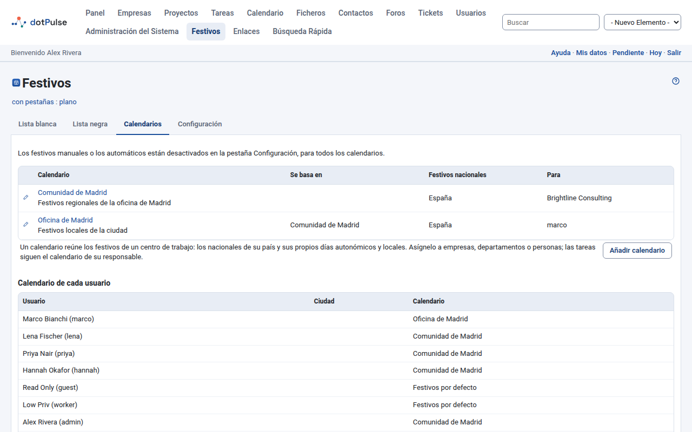

# Festivos y calendarios { #holidays-and-calendars }

El módulo de festivos indica a dotPulse qué días no trabaja nadie, además del
fin de semana: festivos nacionales, autonómicos y locales, y cierres. Las fechas
de las tareas se los saltan, los recordatorios no se envían esos días y el
calendario los marca.

Cada centro de trabajo puede tener su propio **calendario**: una oficina en
Madrid y otra en Lisboa no comparten sus festivos. Cada persona sigue el
calendario de su centro de trabajo.

[Primeros pasos](../getting-started/first-steps.md#6-set-up-holiday-calendars)
tiene la versión breve. Esta página es la referencia completa.

## Instalar y abrir el módulo { #install-and-open-the-module }

El módulo de festivos es un complemento: un sitio nuevo no lo tiene.

1. Abra **Administración del Sistema › Módulos**.
2. En **Sin instalar**, haga clic en **instalar** junto a `holiday`.
3. Haga clic en **Activar** en su fila. Haga clic en **Mostrar en el menú** si
   quiere una entrada **Festivos** en el menú principal.

Consulte [Módulos](modules.md) para los detalles. Antes de activarlo, lea
[Quién puede cambiar los festivos](#who-can-change-the-holidays).

Con el módulo activado, ábralo desde **Administración del Sistema › Festivos y
calendarios** (en el grupo **Trabajo**), desde la tarjeta del final de la
sección **Horario** de **Administración del Sistema › Trabajo y calendario**, o
desde **Festivos** en el menú principal. La página se llama **Festivos** y tiene
cuatro pestañas: **Lista blanca**, **Lista negra**, **Calendarios** y
**Configuración**.

{ .shot }

!!! note
    Los festivos solo cuentan mientras el módulo está activado. Si lo desactiva,
    todas las fechas de las tareas, los recordatorios y las vistas del
    calendario vuelven a no tenerlos en cuenta; los calendarios y los días que
    haya introducido se conservan.

## Cómo decide dotPulse que un día no es laborable { #how-dotpulse-decides-that-a-day-is-off }

Un día no es laborable cuando:

1. no es uno de los días laborables de la semana del sitio (**Días Laborables
   en el Calendario** en
   [Administración del Sistema › Trabajo y calendario](settings.md#work-and-calendar)), o
2. es festivo en el calendario de la persona.

Un día es festivo en un calendario cuando, en este orden:

- lo cubre un día de la **lista negra** (un día laborable): entonces **no** es
  festivo, diga lo que diga lo demás;
- si no, lo cubre un día de la **lista blanca** (un festivo añadido a mano o
  importado);
- si no, es un festivo nacional del país del calendario.

Los días que cuentan para un calendario son los suyos, los de los calendarios en
que se basa y los introducidos para **Todos los calendarios**.

## Pestaña Configuración { #settings-tab }

| Ajuste | Qué hace | Por defecto |
|---|---|---|
| **Activar festivos manuales** | Usa los días introducidos a mano o importados: la lista blanca, la lista negra y los días de todos los calendarios. Si lo desmarca, se ignoran todos. | Activado |
| **Activar festivos automáticos** | Usa los festivos nacionales que dotPulse calcula para un país. Si lo desmarca, ningún calendario tiene festivos nacionales. | Desactivado |
| **País por defecto** | El país de los festivos nacionales de las personas sin calendario y de los calendarios que no indican país. | Ninguno |

Haga clic en **guardar** para aplicarlo. Los cambios afectan a todos los
usuarios de inmediato.

!!! warning "Marque Activar festivos automáticos"
    Una instalación nueva tiene los festivos automáticos **desactivados**.
    Elegir un **País por defecto**, o un país en un calendario, no sirve de
    nada hasta que marque **Activar festivos automáticos** y guarde. La pestaña
    **Calendarios** le avisa cuando uno de los dos tipos de festivos está
    desactivado.

Cuando hay un país por defecto, la pestaña muestra sus festivos nacionales de
este año y del siguiente, para que pueda comprobarlos.

### Países admitidos { #supported-countries }

dotPulse calcula los festivos nacionales de estos países para cualquier año:

- Alemania, Austria, Bélgica, España, Francia, Italia, Noruega, los Países
  Bajos, Portugal y Suecia;
- Irlanda, con los días sustitutorios cuando un festivo cae en fin de semana;
- **Reino Unido (Inglaterra y Gales)**: los *bank holidays*, con los
  excepcionales (jubileos, coronación) y los días sustitutorios;
- **Estados Unidos (federales)**: los festivos federales, trasladados al día
  laborable más cercano cuando caen en fin de semana (se muestran como
  *trasladado*).

Solo se incluyen los festivos **nacionales**. Los autonómicos y locales cambian
de un año a otro por decreto, así que se introducen en un calendario, a mano o
desde un archivo iCalendar. Para un país que no está en la lista, deje el país
vacío e introduzca usted todos los festivos.

## Pestaña Calendarios { #calendars-tab }

La pestaña **Calendarios** lista los calendarios, con:

| Columna | Qué muestra |
|---|---|
| **Calendario** | El nombre (haga clic en él para editarlo) y la descripción. |
| **Se basa en** | El calendario cuyos festivos incluye. |
| **Festivos nacionales** | El país de sus festivos nacionales: el suyo propio, o el que toma del calendario en que se basa o del **País por defecto**. |
| **Para** | Las empresas, departamentos y usuarios a los que está asignado. |

Debajo, **Calendario de cada usuario** lista todos los usuarios con su ciudad y
el calendario que les corresponde al final. **Festivos por defecto** significa
que no se les aplica ningún calendario. Use esta lista para comprobar la
configuración.

### Añadir un calendario { #add-a-calendar }

1. En la pestaña **Calendarios**, haga clic en **Añadir calendario**.
2. Rellene el formulario y haga clic en **guardar**.

| Campo | Qué es |
|---|---|
| **Nombre** | Obligatorio, por ejemplo *Oficina de Madrid*. |
| **Se basa en** | Otro calendario cuyos festivos tiene también este. Una ciudad puede basarse en su comunidad autónoma, y la comunidad en el país: *Madrid* se basa en *Comunidad de Madrid*, que tiene los festivos nacionales de España. No puede elegir el propio calendario ni uno que se base en él. |
| **Festivos nacionales** | Un país, o **Como el calendario en que se basa, o el país por defecto**. |
| **Descripción** | Opcional. |
| **Para** | Las **Empresas**, los **Departamentos** y los **Usuarios** que siguen este calendario. Mantenga pulsada ++ctrl++ (++cmd++ en un Mac) para seleccionar varios en cada lista. |

Una empresa, un departamento o un usuario solo tiene un calendario. Si lo elige
en el campo **Para** de un calendario, se lo quita al calendario que tenía
antes.

Después de guardar, la página sigue en el calendario y muestra más cosas:

- **Días de este calendario**: sus propios festivos y días laborables, con los
  botones **Añadir festivo** y **Añadir día laborable**;
- la importación de iCalendar (vea más abajo);
- **Festivos** de este año y del siguiente: todos los días que este calendario
  no trabaja, de todas las fuentes. Es exactamente lo que se saltarán las
  fechas de las tareas.

### Editar o borrar un calendario { #edit-or-delete-a-calendar }

Haga clic en el nombre del calendario o en el lápiz de la pestaña
**Calendarios**. Cambie los campos y haga clic en **guardar**.

**eliminar** pregunta *¿Borrar este calendario y sus días?* y después borra el
calendario, sus propios días y sus asignaciones. Esas personas pasan al
siguiente calendario que les corresponda, o a los festivos por defecto. Los
calendarios que se basaban en él pasan a ser independientes.

### Importar festivos desde un archivo iCalendar { #import-holidays-from-an-icalendar-file }

Muchas comunidades autónomas y ayuntamientos publican sus festivos como un
archivo iCalendar (`.ics`), y las aplicaciones de calendario, como Google
Calendar u Outlook, los exportan.

1. Abra el calendario (antes tiene que estar guardado).
2. Debajo de los días, elija el archivo en **Importe los festivos de un archivo
   iCalendar (.ics)** y haga clic en **Importar**.

La página indica cuántos días ha añadido y cuántos ya estaban.

- Cada evento se convierte en un festivo de este calendario, con el nombre del
  evento.
- Un evento de día completo cubre sus días; un evento con horas cubre los días
  que toca.
- Un evento que se repite cada año se convierte en un festivo **Anual**. Los
  eventos que se repiten de otra forma (cada semana, cada mes) y los eventos
  cancelados se descartan.
- Importar otra vez el mismo archivo no añade nada: un día con las mismas
  fechas y el mismo nombre se omite.
- El archivo puede ocupar 1 MB como máximo.

Revise después la lista **Festivos** y borre los eventos que no quiera (algunos
calendarios publicados incluyen celebraciones que no son días festivos).

## Lista blanca y lista negra { #whitelist-and-blacklist }

Estas dos pestañas listan todos los días introducidos a mano o importados, de
todos los calendarios, primero los más recientes. Cuando hay calendarios, una
columna **Calendario** indica a qué calendario pertenece cada día, o **Todos los
calendarios**.

- **Lista blanca**: días no laborables adicionales, como un cierre de la
  empresa o un festivo que no está en la lista nacional. Haga clic en **Añadir
  festivo**.
- **Lista negra**: días que son laborables aunque serían festivos, por ejemplo
  un festivo nacional en el que su oficina trabaja. Haga clic en **Añadir día
  laborable**.

Un día añadido desde la página de un calendario (con **Añadir festivo** o
**Añadir día laborable** de esa página) va a ese calendario; también lo verá en
estas pestañas.

### Añadir un festivo o un día laborable { #add-a-holiday-or-a-workday }

| Campo | Qué es |
|---|---|
| **Fecha de inicio** y **Fecha de fin** | El primer y el último día. Use la misma fecha para un solo día. Elíjalas con el icono del calendario. |
| **Anual** | Los mismos días todos los años, para los festivos de fecha fija. |
| **Calendario** | **Todos los calendarios**, o un calendario. Aparece cuando ya tiene calendarios. |
| **Descripción** | El nombre del festivo, que se muestra en las vistas del calendario. |

Haga clic en **guardar**. Para cambiar o borrar un día, haga clic en el lápiz
que tiene al lado y luego en **guardar** o en **Borrar festivo** (**Borrar día
laborable**).

Un día **Anual** puede pasar de un año al siguiente, por ejemplo del 24 de
diciembre al 2 de enero.

!!! tip
    Los festivos que cambian de fecha cada año, como la Semana Santa o un día
    autonómico fijado por decreto, no pueden ser **Anual**: introdúzcalos cada
    año, o importe el archivo iCalendar del año.

## Qué calendario se aplica a una persona { #which-calendar-applies-to-a-person }

dotPulse busca el calendario de una persona en este orden:

1. el calendario asignado al **usuario**;
2. si no, el calendario de su **departamento**, o del departamento superior más
   cercano que tenga uno;
3. si no, el calendario de su **empresa**;
4. si no, los **festivos por defecto**: los días introducidos para **Todos los
   calendarios** y los festivos nacionales del **País por defecto**.

El departamento y la empresa son los de la ficha de contacto de la persona
(consulte [Usuarios](users.md)). Compruebe el resultado en **Calendario de cada
usuario**, en la pestaña **Calendarios**.

## Qué cambian los festivos { #what-holidays-change }

- **Fechas de las tareas.** En el formulario de la tarea, **Calcular › Fecha de
  Finalización** cuenta la duración en días laborables y se salta los festivos
  del **responsable de la tarea** (salvo que la duración esté en **Días del
  calendario**). **Calcular › Duración** también los descuenta. Si cambia el
  responsable, el cálculo usa el calendario del nuevo responsable. Consulte
  [Días laborables y festivos](../user-guide/tasks.md#working-days-and-holidays).
- **Dependencias y copias.** Cuando dotPulse mueve una tarea para que vaya
  detrás de las tareas de las que depende, o desplaza las fechas al copiar un
  proyecto, las nuevas fechas se saltan los festivos del responsable.
- **Recordatorios.** Los correos de recordatorio de las tareas llegan a cada
  persona solo en sus propios días laborables.
- **Informes.** El informe de horas asignadas cuenta los días laborables de
  cada persona.
- **Vistas del calendario.** Las vistas de mes, semana y día marcan los festivos
  del calendario de la persona que las consulta. Consulte
  [los festivos del calendario](../user-guide/calendar.md#holidays).

Los festivos no cambian las tareas existentes. Las fechas y duraciones ya
guardadas se quedan como están hasta que alguien vuelve a calcular y guarda la
tarea. Después de añadir festivos, revise las tareas que pasan por ellos.

## Quién puede cambiar los festivos { #who-can-change-the-holidays }

Cualquier persona cuyo rol le permita editar el módulo **Festivos** puede añadir
y borrar calendarios, festivos y días laborables, y cambiar la configuración. El
módulo es uno de los módulos de administración, así que, con los roles por
defecto, solo puede hacerlo el rol **Administrator**. Para que otra persona
gestione los festivos, dé a su rol derechos sobre el módulo **Festivos** en
**Administración del Sistema › Roles y permisos** (consulte
[Roles y permisos](roles-permissions.md)).
Las personas no necesitan ningún derecho sobre el módulo para que se les
apliquen sus festivos.

## Actualizar desde una versión anterior { #upgrade-from-an-older-version }

La versión actual del módulo es la 0.4. **Administración del Sistema › Módulos**
muestra **Actualización disponible** en una versión anterior; haga clic en
**actualizar**. Consulte [Actualizar un módulo](modules.md#upgrade-a-module).

- **Desde la 0.1** (dotPulse anterior a 3.1.1): los festivos nacionales venían
  de una biblioteca que ya no funciona. La actualización añade el ajuste del
  país: abra la pestaña **Configuración**, vuelva a elegir el **País por
  defecto** y guarde. Hasta que actualice, la pestaña **Configuración** dice
  *Actualice el módulo Holiday en Administración del sistema, Módulos, para
  elegir un país.*
- **Desde la 0.2**: la actualización añade los calendarios. Todos los días de la
  lista blanca y de la lista negra se conservan y se aplican a **Todos los
  calendarios**. Hasta que actualice, la pestaña **Calendarios** le pide que
  actualice.
- **Desde la 0.3**: el módulo pasa de los módulos que no son de administración a
  los de administración, así que los trabajadores de los proyectos ya no pueden
  cambiar los festivos. Si algunos de sus roles deben poder hacerlo, deles
  derechos sobre el módulo **Festivos** después de la actualización.
