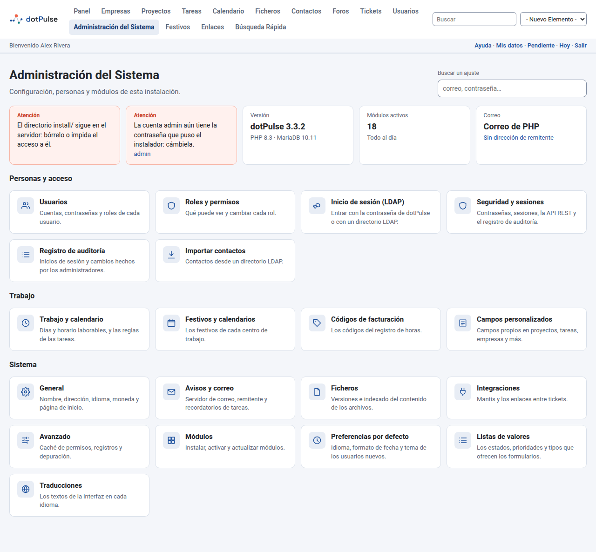

# Administración { #administration }

Esta sección es para las personas que gestionan un sitio dotPulse: dan de alta
a los usuarios, deciden qué puede hacer cada rol, activan y desactivan módulos
y eligen la configuración que se aplica a todos.

Para ello necesita derechos de administrador. En una instalación nueva, eso
significa un usuario con el rol **Administrador**, como la cuenta `admin` que
crea el instalador. En rigor, lo que cuenta es el permiso sobre el módulo
**Administración del Sistema**: un rol que puede verlo abre la página de
inicio, y un rol que además puede editarlo puede cambiar la configuración.
Consulte [Roles y permisos](roles-permissions.md).

Si acaba de instalar dotPulse, empiece por la breve lista de comprobación de
[Primeros pasos](../getting-started/first-steps.md). Las páginas de esta
sección son la referencia completa.

## Abrir Administración del Sistema { #open-system-admin }

Haga clic en **Administración del Sistema** en el menú de módulos. La página de
inicio, **Administración del Sistema**, muestra arriba el estado del sitio y,
debajo, una tarjeta por cada página de administración.

{ .shot }

## Los recuadros de estado { #the-status-tiles }

Los recuadros de arriba le indican de un vistazo si algo requiere su atención.

| Recuadro | Qué muestra |
| --- | --- |
| **Atención** | Solo aparece cuando hay un problema. *El directorio install/ sigue en el servidor* aparece mientras exista la carpeta `install/`: cualquiera que llegue a ella puede ver el instalador, así que bórrela o impida el acceso a ella en el servidor web cuando el sitio funcione. *La cuenta admin aún tiene la contraseña que puso el instalador* aparece mientras el usuario `admin` siga entrando con la contraseña `passwd`: haga clic en **admin** en el recuadro para abrir ese usuario y cambiar la contraseña. |
| **Versión** | La versión de dotPulse y, debajo, las versiones de PHP y de la base de datos (MySQL o MariaDB). Indíquelas cuando informe de un problema. |
| **Módulos activos** | Cuántos módulos están activados. Debajo, **Todo al día**, o un enlace como **2 actualizaciones por instalar** cuando el código de algunos módulos es más reciente que la versión instalada en la base de datos (después de actualizar dotPulse, por ejemplo). El enlace abre [Módulos](modules.md), donde se ejecutan las actualizaciones. |
| **Correo** | Cómo envía dotPulse el correo: **Correo de PHP** o **SMTP**. Debajo aparece la dirección del remitente, o un enlace **Sin dirección de remitente** a la configuración del correo. Consulte [Avisos y correo](settings.md#notifications-and-email). |

!!! note
    La comprobación de la contraseña predeterminada solo mira la cuenta cuyo
    nombre de acceso es `admin`. Si le cambió el nombre, el recuadro no puede
    avisarle.

## Las tarjetas { #the-cards }

Las tarjetas llevan a todas las páginas de administración, en tres grupos.

**Personas y acceso**

| Tarjeta | Qué se hace allí |
| --- | --- |
| **Usuarios** | Dar de alta usuarios, cambiar sus contraseñas y roles, y restablecer el inicio de sesión en dos pasos. Consulte [Usuarios](users.md). |
| **Roles y permisos** | Decidir qué puede ver y cambiar cada rol. Consulte [Roles y permisos](roles-permissions.md). |
| **Inicio de sesión (LDAP)** | Permitir que la gente entre con la contraseña de su directorio. Consulte [Inicio de sesión (LDAP)](settings.md#login-ldap). |
| **Seguridad y sesiones** | Longitud de contraseñas y nombres de usuario, cuánto tiempo sigue conectada la gente, la API REST y cuánto tiempo se conserva el registro de auditoría. Consulte [Seguridad y sesiones](settings.md#security-and-sessions). |
| **Registro de auditoría** | Inicios de sesión, cambios de contraseña y cambios hechos por los administradores. Consulte [Registro de auditoría](audit-and-maintenance.md#audit-log). |
| **Importar contactos** | Copiar contactos de un directorio LDAP. Consulte [Importar contactos desde LDAP](audit-and-maintenance.md#import-contacts-from-ldap). |

**Trabajo**

| Tarjeta | Qué se hace allí |
| --- | --- |
| **Trabajo y calendario** | Días y horario laborables, y las reglas de las tareas. Consulte [Trabajo y calendario](settings.md#work-and-calendar). |
| **Festivos y calendarios** | Los festivos de cada centro de trabajo. Solo aparece mientras el módulo Holiday esté activado. Consulte [Festivos y calendarios](holidays.md). |
| **Códigos de facturación** | Los códigos que la gente elige al registrar horas. Consulte [Códigos de facturación](lists-and-fields.md#billing-codes). |
| **Campos personalizados** | Campos adicionales en proyectos, tareas, empresas y otros registros. Consulte [Campos personalizados](lists-and-fields.md#custom-fields). |

**Sistema**

| Tarjeta | Qué se hace allí |
| --- | --- |
| **General** | Nombre del sitio, idioma, tema, moneda y la página que se ve tras el acceso. Consulte [General](settings.md#general). |
| **Avisos y correo** | El servidor de correo, la dirección del remitente y los recordatorios de tareas. Consulte [Avisos y correo](settings.md#notifications-and-email). |
| **Ficheros** | Versiones de ficheros e indexado de su contenido. Consulte [Ficheros](settings.md#files). |
| **Integraciones** | Mantis y los enlaces entre tickets. Consulte [Integraciones](settings.md#integrations). |
| **Avanzado** | Caché de permisos, registros y depuración. Consulte [Avanzado](settings.md#advanced). |
| **Módulos** | Instalar, activar, desactivar y actualizar módulos. Consulte [Módulos](modules.md). |
| **Preferencias por defecto** | El idioma, el formato de fecha, el tema y otras preferencias de los usuarios nuevos. Consulte [Preferencias por defecto](lists-and-fields.md#default-user-preferences). |
| **Listas de valores** | Los estados, prioridades y tipos que ofrecen los formularios. Consulte [Listas de valores](lists-and-fields.md#lookup-values). |
| **Traducciones** | Los textos de la interfaz en cada idioma. Consulte [Traducciones](translations.md). |

En las demás páginas de administración, los mismos enlaces aparecen como un
menú lateral a la izquierda, en los mismos tres grupos, con la página actual
resaltada. Haga clic en **Administración del Sistema** en la parte superior del
menú, o en la línea que hay encima del título de la página, para volver a la
página de inicio.

## Buscar un ajuste { #find-a-setting }

No necesita saber en qué sección está un ajuste. Escriba una palabra en
**Buscar un ajuste** (en la página de inicio y en la parte superior del menú
lateral) y pulse ++enter++. dotPulse muestra todos los ajustes cuya etiqueta,
texto de ayuda o nombre interno contiene esa palabra, por ejemplo `email`,
`password` o `ldap`. Cada resultado indica la sección a la que pertenece. Puede
cambiar y guardar los ajustes allí mismo.

## Cambiar la configuración { #change-settings }

Cada página de configuración muestra sus ajustes en paneles. Cada ajuste tiene
su etiqueta, un texto de ayuda y, en letra pequeña, su nombre interno (el
nombre que se usa en la base de datos y en esta documentación, por ejemplo
`mail_from`).

1. Cambie los valores que desee.
2. Haga clic en **Guardar cambios** al final de la página.

Para descartar lo que ha cambiado y volver a cargar los valores guardados, haga
clic en **Descartar cambios**.

!!! warning "Los cambios se aplican a todos los usuarios"
    La configuración es para todo el sitio. En cuanto guarde, se aplica a todos
    los usuarios, en su siguiente página.

Al guardar solo se tocan los ajustes que muestra la página: la sección, o los
resultados de la búsqueda. Los campos de contraseña (las contraseñas de SMTP y
de LDAP) no se vuelven a mostrar nunca; déjelos vacíos para conservar la
contraseña guardada, o escriba una nueva para sustituirla.

Cada vez que se guarda algún cambio, se anota en el
[registro de auditoría](audit-and-maintenance.md#audit-log) con los nombres de
los ajustes que cambiaron (no sus valores, que pueden ser contraseñas).

## Páginas de esta sección { #pages-in-this-section }

- [Administración del Sistema](index.md): esta página.
- [Configuración](settings.md): todos los ajustes de las ocho secciones de configuración, lo que hacen de verdad y su valor predeterminado.
- [Usuarios](users.md): alta de usuarios, contraseñas, roles, inicio de sesión en dos pasos y tokens de API.
- [Roles y permisos](roles-permissions.md): qué puede ver y cambiar cada rol.
- [Módulos](modules.md): instalar, activar, ordenar y actualizar módulos.
- [Festivos y calendarios](holidays.md): los festivos y el calendario laboral de cada centro de trabajo.
- [Listas, campos y valores por defecto](lists-and-fields.md): listas de valores, campos personalizados, códigos de facturación y preferencias por defecto de los usuarios.
- [Traducciones](translations.md): cambiar los textos de la interfaz y añadir un idioma.
- [Auditoría y mantenimiento](audit-and-maintenance.md): el registro de auditoría, la importación de contactos desde LDAP y el mantenimiento del sitio.
