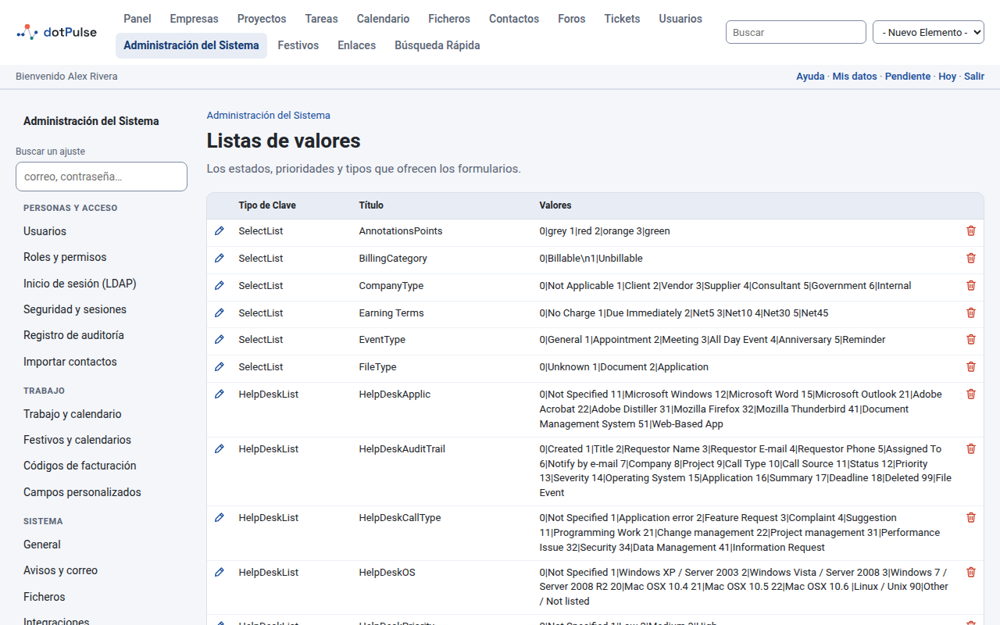
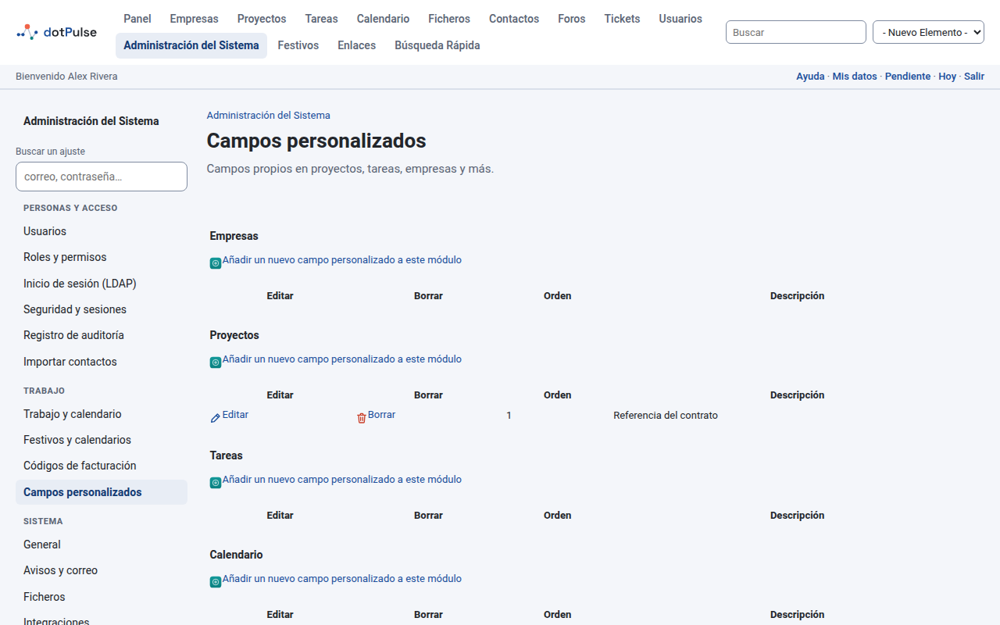
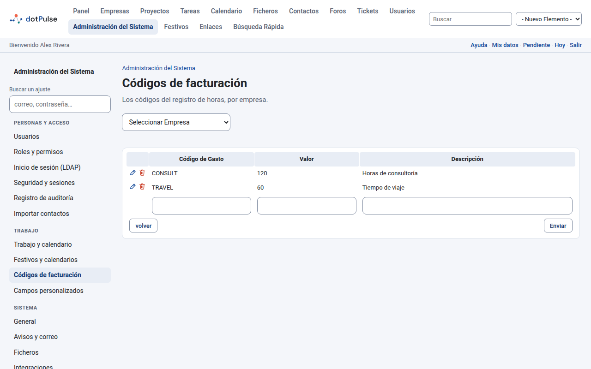

# Listas, campos y valores por defecto { #lists-fields-and-defaults }

Cuatro páginas de **Administración del Sistema** dan forma a los formularios que
usa todo el mundo:

- **Listas de valores**: las opciones de las listas desplegables, como los
  estados de los proyectos, las prioridades de las tareas y los tipos de
  empresa.
- **Campos personalizados**: campos propios en las empresas, los proyectos, las
  tareas y los eventos.
- **Códigos de facturación**: los códigos de coste a los que la gente imputa su
  tiempo.
- **Preferencias por defecto**: el idioma, el formato de fecha, el tema y las
  demás preferencias de los usuarios que no han elegido las suyas.

## Listas de valores { #lookup-values }

Abra **Administración del Sistema › Listas de valores**. Cada fila es una lista.
Las columnas son:

- **Tipo de Clave**: cómo se lee la lista. Casi todas las listas son
  **SelectList** (una opción por línea). **ColorSelection** guarda colores, y
  **CustomField** es un formato antiguo que se mantiene por compatibilidad.
- **Título**: el nombre de la lista. El código busca las listas por este
  nombre, así que no lo cambie nunca.
- **Valores**: las entradas, una por línea, cada una como `key|label`.

{ .shot }

### Las listas de un sitio nuevo { #the-lists-of-a-new-site }

Una instalación nueva tiene estas listas. Los módulos complementarios añaden las
suyas al instalarse (por ejemplo `HelpDesk...`, `Risk...` u `Opportunities...`).

| Lista | Dónde se usa |
|------|------------------|
| `ProjectStatus` | **Estado** de un proyecto, y las pestañas de estado de la lista de proyectos. Consulte [Estados de los proyectos](../user-guide/projects.md#project-statuses). |
| `ProjectType` | **Tipo** de un proyecto. |
| `ProjectPriority` | **Prioridad** de un proyecto. |
| `ProjectPriorityColor` | El color de fondo de la prioridad de un proyecto, en la página del proyecto. Las claves coinciden con las de `ProjectPriority`. |
| `ProjectColors` | Los colores que ofrece el selector de color del formulario del proyecto, como `name|RRGGBB`. |
| `ProjectRequiredFields` | Las comprobaciones que hace el formulario del proyecto antes de guardar. Vea el aviso más abajo. |
| `TaskPriority` | **Prioridad** de una tarea. |
| `TaskStatus` | **Estado** de una tarea: **Activo** o **Inactiva**. |
| `TaskType` | **Tipo** de una tarea. |
| `TaskDurationType` | Las unidades de la duración de una tarea: horas y días. |
| `TaskLogReference` | **Referencia** de un registro de tarea (correo electrónico, llamada telefónica...). |
| `TaskLogReferenceImage` | Iconos para las referencias. |
| `CompanyType` | **Tipo** de una empresa, y las pestañas de la lista de empresas (una por tipo). |
| `EventType` | **Tipo** de un evento del calendario. |
| `FileType` | **Categoría** de un fichero. |
| `UserType` | **Tipo de Usuario** de un usuario. |
| `TicketNotify`, `TicketPriority`, `TicketStatus` | El antiguo complemento Ticketsmith. |

### Editar una lista { #edit-a-list }

1. Haga clic en el icono del lápiz al principio de la fila. La fila se convierte
   en un formulario.
2. Cambie el cuadro **Valores**. Escriba una entrada por línea, como
   `key|label`, por ejemplo:

    ```text
    0|Not Defined
    1|Proposed
    2|In Planning
    ```

3. Haga clic en **editar**.

Para añadir una lista nueva, rellene la fila vacía del final de la página: elija
el **Tipo de Clave**, escriba el **Título** y los **Valores**, y haga clic en
**añadir**. Una lista nueva solo sirve si algún código o módulo complementario
la lee con ese título.

Haga clic en el icono de la papelera al final de una fila para borrar una lista
entera. No lo haga con las listas de la tabla anterior: los formularios que las
usan se quedan sin opciones.

### Qué se puede cambiar sin riesgo { #what-is-safe-to-change }

Los registros guardan la **clave**, no la etiqueta. Un proyecto con el estado
`3` muestra la etiqueta que tenga hoy la clave `3`.

- **Cambiar el texto de una etiqueta** (lo que va después de `|`) no tiene
  riesgo. Todos los registros con esa clave muestran la nueva etiqueta de
  inmediato.
- **Añadir una entrada** con una clave nueva no tiene riesgo.
- **Quitar una entrada** deja los registros que la usan con una clave que nadie
  puede leer: muestran un valor vacío, y la próxima vez que alguien edita uno de
  ellos el formulario elige otro valor. Pase antes esos registros a otro valor.
- **Cambiar una clave** tiene el mismo efecto que quitar la entrada y añadir una
  nueva. No lo haga.

Algunas claves y etiquetas significan algo para el código. Déjelas como están:

- `ProjectStatus`: la lista de proyectos elige su diseño a partir de tres
  etiquetas: **In Progress**, **Complete** y **Archived**. Si cambia una de
  ellas, su pestaña toma el diseño de los demás estados. La clave `7` (Archived)
  se excluye de los diagramas de Gantt, y la clave `4` (On Hold) se puede ocultar
  en ellos.
- `TaskDurationType`: las claves son el número de horas de una unidad (`1` para
  las horas, `24` para los días).
- `TaskStatus`: `0` es activa y `-1` es inactiva.
- `UserType`: la clave `1` es **Administrador**. Algunas páginas, como
  **Traducciones**, lo comprueban.

!!! warning "`ProjectRequiredFields` es JavaScript"
    Cada línea de `ProjectRequiredFields` es un fragmento de JavaScript que
    ejecuta el formulario del proyecto, por ejemplo
    `f.project_name.value.length|<3`. Un error rompe el formulario del proyecto
    para todo el mundo. Cámbielo solo si sabe JavaScript, y guarde una copia del
    valor original.

## Campos personalizados { #custom-fields }

Los campos personalizados añaden campos propios a los formularios de cuatro
módulos: **Empresas**, **Proyectos**, **Tareas** y **Calendario** (eventos).
Cada campo aparece en el formulario de edición del registro y en su página.

Abra **Administración del Sistema › Campos personalizados**. La página tiene una
sección por módulo, con sus campos en orden.

{ .shot }

### Añadir un campo personalizado { #add-a-custom-field }

1. Bajo el módulo, haga clic en **Añadir un nuevo campo personalizado a este
   módulo**.
2. Rellene el formulario (vea la tabla siguiente).
3. Para un **Seleccionar listado**, escriba cada opción en **Lista de opciones**
   y haga clic en **Añadir** después de cada una.
4. Haga clic en **Guardar**.

| Campo | Qué hace |
|-------|--------------|
| **Nombre/Identificador de campo** | El nombre interno. Solo letras y cifras, sin espacios. Debe ser único en el módulo. |
| **Descripción del campo** | La etiqueta que se muestra junto al campo en los formularios. |
| **Orden de campos** | La posición entre los campos personalizados del módulo. Los números más bajos van primero; los campos con el mismo número se ordenan por nombre. |
| **Tipo de dato del campo** | **Texto** o **Numérico**. Un campo **Numérico** rechaza un valor que no sea un número. |
| **Tipo de display de campo** | El tipo de campo (vea más abajo). |
| **Opciones de etiquetas HTML** | Atributos HTML adicionales para el campo, por ejemplo `size="40"` o `maxlength="10"`. Normalmente vacío. |

Los tipos de visualización son:

| Tipo de visualización | En el formulario de edición | En la página del registro |
|--------------|------------------|----------------------|
| **Entrada de texto** | Un cuadro de una línea. | El texto. |
| **Área de texto** | Un cuadro más grande. | El texto. |
| **Casilla** | Una casilla de verificación. | Sí o no. |
| **Seleccionar listado** | Una lista con las opciones que haya introducido. | La opción elegida. |
| **Enlace web** | Un cuadro para una dirección. | Un enlace. |
| **Fichero** | Una subida de fichero. El fichero se guarda en el módulo **Ficheros**. | Un enlace al fichero. |
| **Etiqueta** | Solo la descripción, sin campo de entrada. | La descripción. |
| **Separador** | Una línea horizontal. | Una línea. |

Las opciones de un **Seleccionar listado** se muestran siempre por orden
alfabético.

### Dónde aparecen los campos personalizados { #where-custom-fields-appear }

| Módulo | Formulario de edición | Página |
|--------|-----------|------|
| Empresas | **Agregar Empresa** / **Editar Empresa** | la página de la empresa |
| Proyectos | el formulario del proyecto, debajo de **URL de pruebas** | la página del proyecto, **Detalles** |
| Tareas | el formulario de la tarea, pestaña **Detalles** | la página de la tarea |
| Calendario | el formulario del evento | la página del evento |

La búsqueda global también busca en los campos personalizados de las tareas.

### Editar un campo personalizado { #edit-a-custom-field }

Haga clic en **Editar** junto al campo, cámbielo y haga clic en **Guardar**.
Cambiar el nombre, la descripción, el orden o las opciones HTML no afecta a los
valores ya introducidos.

!!! warning "Cambiar opciones y borrar campos"
    - Un **Seleccionar listado** guarda la opción que eligió cada registro, no
      su texto. Si borra una opción, los registros que la eligieron no muestran
      nada. Para cambiar el nombre de una opción hay que borrarla y añadir una
      nueva, así que ocurre lo mismo.
    - Cambiar el **Tipo de display de campo** de un campo que ya tiene valores
      puede dejarlos ilegibles: un valor de texto no encaja en un listado.

### Borrar un campo personalizado { #delete-a-custom-field }

Haga clic en **Borrar** junto al campo. El campo desaparece, con los valores
introducidos en él y las opciones de un listado. No se puede deshacer.

## Códigos de facturación { #billing-codes }

Los códigos de facturación son los códigos de coste que la gente elige en el
campo **Código del costo** cuando registra horas en una tarea (consulte
[Registrar el trabajo](../user-guide/task-logs.md#log-fields)). Úselos para
distinguir el trabajo facturable del interno, o para imputar el tiempo a
distintos presupuestos.

Cada código pertenece a una empresa, o a todas. Cuando alguien registra horas,
la lista ofrece los códigos de la empresa del proyecto más los códigos
compartidos por todas las empresas.

Abra **Administración del Sistema › Códigos de facturación**.

{ .shot }

### Añadir un código de facturación { #add-a-billing-code }

1. En la lista de arriba, elija la empresa. Deje **Seleccionar Empresa** para
   crear un código compartido por todas las empresas.
2. En la fila vacía del final, escriba:
    - **Código de Gasto**: el nombre que ve la gente, de hasta 25 caracteres.
      Debe ser único para la empresa.
    - **Valor**: un número, por ejemplo una tarifa por hora. El núcleo de
      dotPulse solo lo guarda; algunos informes de complementos lo multiplican
      por las horas.
    - **Descripción**: una nota para usted.
3. Haga clic en **Enviar**.

### Editar o borrar un código de facturación { #edit-or-delete-a-billing-code }

Elija la empresa, haga clic en el icono del lápiz junto al código, cambie la
fila y haga clic en **Enviar**.

Haga clic en el icono de la papelera y confirme para borrar un código. Un código borrado no desaparece: sigue en la lista marcado como **(deleted)**, los
registros que lo usan lo conservan y todavía se puede elegir en el **Filtrar
Código de Costo** de los registros de las tareas de un proyecto. Ya no se ofrece
cuando la gente registra horas.

Para recuperar un código borrado, haga clic en su icono del lápiz y en
**Enviar**: al guardar un código, vuelve a estar activo.

## Preferencias por defecto { #default-user-preferences }

Abra **Administración del Sistema › Preferencias por defecto**. La página tiene
las mismas preferencias que cada usuario configura para sí mismo con **Mis
datos › editar preferencias**. La [guía de uso](../user-guide/preferences.md#edit-your-preferences)
describe cada una.

| Preferencia | Valor por defecto de un sitio nuevo |
|------------|-----------------------|
| [**Configuración Regional**](../user-guide/preferences.md#locale) | **Inglés (US)** |
| [**Vista con Pestañas**](../user-guide/preferences.md#tabbed-box-view) | **cualquiera** |
| [**Formato de Fechas Corto**](../user-guide/preferences.md#short-date-format) | día/mes/año |
| [**Formato de hora**](../user-guide/preferences.md#time-format) | 12 horas con AM/PM |
| [**Formato de moneda**](../user-guide/preferences.md#currency-format) | la primera de la lista |
| [**Estilo de la Interfaz de Usuario**](../user-guide/preferences.md#user-interface-style) | **dotPulse** |
| [**Máxima Asignación de Tareas al Usuario**](../user-guide/preferences.md#user-task-assignment-maximum) | 100% |
| [**Filtro de Eventos Predeterminado**](../user-guide/preferences.md#default-event-filter) | **Mis Eventos** |
| [**Método de Notificaciones de Historial**](../user-guide/preferences.md#task-notification-method) | **No incluir al dueño de tarea/evento** |
| [**Enviarme un correo cuando me asignen una tarea**](../user-guide/preferences.md#email-me-when-i-am-assigned-to-a-task) | **Sí** |
| [**Predeterminados de las Notificaciones de Historial**](../user-guide/preferences.md#task-log-email-defaults) | ninguna casilla marcada |
| [**Asunto de las Notificaciones de Historial**](../user-guide/preferences.md#task-log-email-subject) | vacío |
| [**Método de Almacenamiento de las Notificaciones de Historial**](../user-guide/preferences.md#task-log-email-recording-method) | **Ninguno** |

Cambie lo que necesite y haga clic en **Enviar**.

!!! note "Ejemplos de Formato de moneda"
    Cada opción de **Formato de moneda** muestra una cantidad con las
    convenciones de un idioma. Los ejemplos salen de las configuraciones
    regionales instaladas en el sistema operativo del servidor. Si el servidor
    no tiene ninguna, todas las opciones muestran el mismo número sin formato.

### A quién se aplican los valores por defecto { #who-the-defaults-apply-to }

La preferencia propia de un usuario prevalece sobre el valor por defecto. Pero
dotPulse solo guarda la preferencia de un usuario cuando es distinta del valor
por defecto en el momento en que la guarda.

- Los usuarios nuevos siguen los valores por defecto.
- Los usuarios que nunca han guardado sus preferencias siguen los valores por
  defecto.
- Los usuarios que guardaron sus preferencias conservan los valores que
  eligieron **que eran distintos de los valores por defecto de entonces**. En
  todas las demás preferencias siguen los valores por defecto, incluidos sus
  cambios posteriores.

Por ejemplo, si un usuario guardó sus preferencias con el formato de fecha por
defecto y usted cambia después el formato de fecha por defecto, ese usuario
recibe el nuevo formato. Un usuario que eligió otro formato lo conserva.

Para cambiar las preferencias de un usuario, ábralo en **Administración del
Sistema › Usuarios** y haga clic en **editar preferencias**. Consulte
[Usuarios](users.md).
