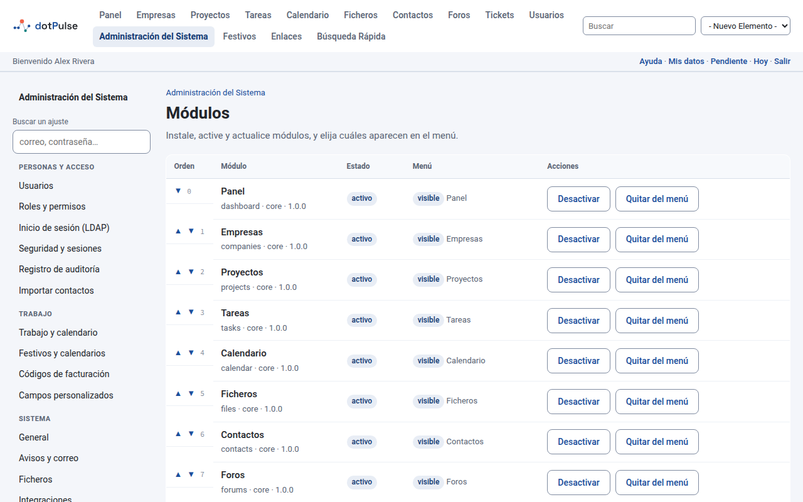

# Módulos { #modules }

En dotPulse todo es un módulo: las empresas, los proyectos, las tareas, el
calendario y los complementos opcionales, como los riesgos, las hojas de horas
o los calendarios de festivos. En **Administración del Sistema › Módulos** se
instalan los módulos, se activan y desactivan, se elige cuáles aparecen en el
menú principal y en qué orden, se actualizan y se eliminan.

{ .shot }

## La lista de módulos { #the-modules-list }

La tabla muestra todos los módulos instalados, en el orden del menú:

| Columna | Qué muestra |
|---|---|
| **Orden** | El lugar del módulo en el menú principal, con flechas para subirlo (▲) o bajarlo (▼). |
| **Módulo** | El nombre del módulo y, debajo, su carpeta, su tipo (`core`, `user`, `admin`, `utility`) y la versión instalada. |
| **Estado** | **activo** o **desactivado**. Al lado aparece **Actualización disponible** cuando el código del módulo es más nuevo que sus tablas. |
| **Menú** | **visible** u **oculto**, con el nombre que se usa en el menú principal. |
| **Acciones** | Los botones que se describen más abajo. |

Debajo de la tabla, **Sin instalar** lista las carpetas de módulos que hay en el
servidor y que aún no están instalados, por nombre de carpeta, cada una con un
botón **instalar**. La sección no aparece cuando todos los módulos están
instalados.

Los módulos **Público** e **install** no aparecen nunca: forman parte del propio
dotPulse.

!!! note
    Solo ven los botones los usuarios que pueden editar el módulo
    **Administración del Sistema**. Los demás, con permiso de lectura, solo ven
    la lista.

## Instalar un módulo { #install-a-module }

1. Abra **Administración del Sistema › Módulos**.
2. En **Sin instalar**, haga clic en **instalar** junto al nombre de la carpeta
   del módulo.

Al instalarlo se crean las tablas del módulo y queda registrado. La página dice
*Módulo instalado* y el módulo sube a la tabla, al final del orden del menú. La
mayoría de los módulos empiezan **desactivado** y **oculto** (Registers y
Document Management empiezan **visible**):

3. Haga clic en **Activar** para que esté disponible.
4. Haga clic en **Mostrar en el menú** si debe tener una entrada en el menú
   principal.

!!! warning "Configure los permisos antes de activarlo"
    Un módulo nuevo queda abierto a todos los roles que tienen derechos sobre
    los módulos que no son de administración (vea más abajo). Si solo deben
    usarlo algunas personas, cambie antes los roles.

### Permisos de un módulo nuevo { #permissions-of-a-new-module }

Los roles de dotPulse dan derechos sobre dos grupos de módulos: los **Admin
Modules** (Administración de usuarios, Administración del Sistema, roles y
usuarios) y los **Módulos No-Admin** (todos los demás). Un módulo recién
instalado entra en los **Módulos No-Admin** (el módulo de festivos, que es una
herramienta de administración, entra en los Módulos Admin), así que todos los
roles que tienen derechos sobre los Módulos No-Admin reciben de inmediato los
mismos derechos sobre él. Con los roles de una instalación nueva:

- **Administrator** puede hacer de todo en él;
- **Project worker** puede ver, añadir, editar y borrar en él;
- **Guest** puede verlo.

Si un módulo debe quedar limitado a algunas personas, cambie sus permisos en
cada rol después de instalarlo. Consulte [Roles y permisos](roles-permissions.md).

## Activar o desactivar un módulo { #turn-a-module-on-or-off }

Haga clic en **Desactivar** para desactivar un módulo, y en **Activar** para
volver a activarlo. Al desactivar un módulo se conservan sus tablas y sus datos.
El módulo sale del menú principal, sus pestañas desaparecen de las páginas de
otros módulos y dejan de funcionar las funciones que otros módulos toman de él:
por ejemplo, cuando el módulo de festivos está desactivado, las fechas de las
tareas no tienen en cuenta los festivos.

Las páginas de un módulo desactivado quedan cerradas: al abrir una aparece
**Acceso Denegado**, sean cuales sean los roles de la persona. **Administración
de usuarios** y **Administración del Sistema** no se pueden desactivar, así que
Administración del Sistema siempre queda abierta a los administradores.

## Mostrar u ocultar un módulo en el menú { #show-or-hide-a-module-in-the-menu }

**Mostrar en el menú** y **Quitar del menú** deciden si el módulo tiene una
entrada en el menú principal. Un módulo oculto que está activado sigue
funcionando: otras páginas enlazan con él. Por eso Departamentos y Ayuda están
ocultos en una instalación nueva: a los departamentos se llega desde su empresa,
y a la ayuda desde el enlace **Ayuda** de la parte superior de cada página.

Los módulos de tipo `utility` (iGantt) nunca tienen entrada en el menú, aunque
estén **visible**: solo añaden vistas a otros módulos.

## Cambiar el orden del menú { #change-the-menu-order }

Use las flechas de la columna **Orden**: ▲ sube un módulo un puesto, ▼ lo baja
un puesto. El número es la posición del módulo. El primer módulo (el número 0,
el panel en una instalación nueva) no tiene flecha ▲.

## Actualizar un módulo { #upgrade-a-module }

Cuando actualiza dotPulse, el código de un módulo puede ser más nuevo que las
tablas que creó al instalarse. El módulo muestra entonces **Actualización
disponible** en la columna **Estado**, y un aviso en la parte superior de la
página cuenta los módulos que tienen una actualización pendiente. La página de
inicio de Administración del Sistema muestra la misma cuenta.

1. Haga antes una copia de seguridad de la base de datos (vea
   [Actualización](../getting-started/upgrade.md)).
2. Haga clic en **actualizar** en la fila del módulo y confirme.

La actualización adapta las tablas del módulo a la nueva versión y conserva sus
datos. Si funciona, la página dice *Módulo actualizado* y la nueva versión
aparece en la lista. Si falla, la página lo indica y da las dos versiones; el
módulo conserva su número de versión antiguo y puede volver a intentarlo cuando
haya corregido la causa.

!!! note
    **Actualización disponible** solo aparece cuando el código es más nuevo que
    la versión instalada. Si vuelve a una versión anterior, un módulo cuyas
    tablas son más nuevas que su código no muestra nada: restaure la copia de
    seguridad de la base de datos de esa versión.

## Configurar un módulo { #configure-a-module }

Algunos complementos tienen un botón **configura**, que abre su propia página de
configuración: **Help Desk**, **Mileage Log**, **ProjectDesigner**, **Unit
Testing**, **Time Card** y **Gallery2**.

Los demás módulos no tienen configuración aquí; algunos, como el módulo de
festivos, tienen su configuración dentro del propio módulo.

## Eliminar un módulo { #remove-a-module }

!!! warning "Al eliminarlo se borran los datos"
    **eliminar** borra las tablas del módulo: todos los registros guardados en
    ese módulo se pierden y no se pueden recuperar sin una copia de seguridad.
    Para dejar de usar un módulo durante un tiempo, use **Desactivar**.

1. Haga una copia de seguridad de la base de datos.
2. Haga clic en **eliminar** en la fila del módulo.
3. Confirme el aviso *¡Esto eliminará toda la información asociada con el
   módulo!*

El módulo pierde también sus permisos en todos los roles. Vuelve a la sección
**Sin instalar**, desde donde puede instalarlo de nuevo, vacío.

Los módulos del núcleo no tienen botón **eliminar**.

## Módulos del núcleo y complementos { #core-modules-and-add-ons }

Los **módulos del núcleo** se instalan con dotPulse y no se pueden eliminar
(aunque sí desactivar u ocultar):

| Módulo | Carpeta |
|---|---|
| Panel | `dashboard` |
| Empresas | `companies` |
| Proyectos | `projects` |
| Tareas | `tasks` |
| Calendario | `calendar` |
| Ficheros | `files` |
| Contactos | `contacts` |
| Foros | `forums` |
| Tickets | `ticketsmith` |
| Administración de usuarios | `admin` |
| Administración del Sistema | `system` |
| Departamentos | `departments` |
| Ayuda | `help` |

Los **complementos** vienen con dotPulse en la carpeta `modules/`, pero no están
instalados en un sitio nuevo. Son muy distintos en antigüedad y calidad. Muchos
los escribieron terceros para dotProject hace años; dotPulse hizo que funcionaran
en PHP 8 y corrigió los problemas de seguridad que se encontraron en ellos, pero
no los ha rehecho ni probado a fondo.

### Complementos mantenidos { #maintained-add-ons }

Se mantienen al día con los módulos del núcleo y se pueden usar sin problema:

| Módulo | Carpeta | Qué es |
|---|---|---|
| Holiday | `holiday` | Calendarios de festivos: días no laborables que las fechas de las tareas se saltan. Consulte [Festivos y calendarios](holidays.md). |
| Mantis | `mantis` | Enlaza los proyectos con un gestor de incidencias MantisBT mediante su REST API, con un token personal de Mantis para cada usuario. |
| Unitcost | `unitcost` | Costes unitarios en los registros de las tareas, y una pestaña del proyecto con el avance de los costes. |
| Historia | `history` | Guarda un registro de los cambios en los elementos. |
| Búsqueda Rápida | `smartsearch` | Busca palabras clave en todos los módulos. |
| Recursos | `resources` | Recursos, como salas o equipos, para asignarlos a tareas. |
| Copia de Seguridad | `backup` | Descarga una copia de seguridad de la base de datos (SQL, XML o zip). Solo pueden usarlo los administradores del sistema. |
| Enlaces | `links` | Enlaces web asociados a proyectos y tareas. Consulte [Ficheros, foros y enlaces](../user-guide/files-forums-links.md#links). |

### Otros complementos { #other-add-ons }

Funcionan en PHP 8 y han superado las comprobaciones de seguridad de dotPulse,
pero se han usado poco y no se desarrollan activamente. La mayoría vienen del
proyecto dotProject+, que añade planificación e informes según los grupos de
procesos del PMBOK. Pruébelos en un sitio de pruebas antes de confiar en ellos:

| Módulo | Carpeta | Qué es |
|---|---|---|
| dotProject+ | `dotproject_plus` | Vistas de planificación y ejecución basadas en los complementos siguientes. |
| Initiating | `initiating` | Actas de constitución de proyectos (grupo de procesos de inicio). |
| Closure | `closure` | Cierre de proyectos y lecciones aprendidas. |
| Costs | `costs` | Planificación de costes y presupuesto. |
| Finanzas | `finances` | Mejoras del presupuesto de los proyectos. |
| Gestión de Riesgos | `risks` | Planificación de riesgos. |
| Human Resources | `human_resources` | Roles y personal de los proyectos. |
| Monitoring and Control | `monitoringandcontrol` | Líneas base, actas de reuniones, seguimiento de cambios y de calidad. |
| Time Planning | `timeplanning` | Desglose del trabajo y planificación del calendario. |
| MacroProjects | `macroprojects` | Grupos de proyectos. |
| Gestión de Recursos | `resource_m` | Muestra y modifica la ocupación de cada recurso. |
| iGantt | `igantt` | Un diagrama de Gantt en el que se arrastran las barras para cambiar las fechas de las tareas. |
| ICal | `ical` | Envía las tareas a los calendarios de los usuarios cuando se añaden o se editan. |
| Invoices | `invoices` | Facturas. |
| Mensajes | `messages` | Mensajes internos entre usuarios. |
| Journal | `journal` | Notas sencillas sobre un proyecto. |
| Document Management | `mngdocument` | Gestión documental. |
| Timesheet | `timesheet` | Hojas de horas. |
| ProjectDesigner | `projectdesigner` | Una página para diseñar un proyecto y sus tareas, con un diagrama de Gantt que se puede arrastrar. |

!!! warning "Costs y Finanzas no se pueden instalar juntos"
    Los dos crean una tabla llamada `budget` con columnas distintas. El que
    instale en segundo lugar falla, y sus páginas de presupuesto muestran
    errores de la base de datos.

### Complementos inactivos: no recomendados { #dormant-add-ons-not-recommended }

Estos complementos antiguos se conservan en el código para recuperarlos más
adelante. Funcionan en PHP 8 y sus problemas de seguridad conocidos están
corregidos, pero no se mantienen, apenas se han probado y pueden fallar en
algunos puntos. No los use en un sitio en producción:

| Módulo | Carpeta | Qué es |
|---|---|---|
| Annotations | `annotations` | Notas asociadas a elementos. |
| Communication | `communication` | Planificación de las comunicaciones. |
| Data Import | `dataimport` | Importa datos de proyectos desde ficheros planos. |
| Earnings | `earnings` | Hojas de horas del personal y facturas de contratistas, aprobadas por la dirección. |
| Gallery2 | `gallery2` | Integración con la galería de fotos Gallery2. |
| Help Desk | `helpdesk` | Informes de errores, peticiones de mejoras y llamadas de soporte. |
| Alojamiento Web | `hosting` | Estado del alojamiento y nombres de dominio de las empresas. |
| Informer | `informer` | Hojas de horas semanales y mensuales a partir de los registros de las tareas. |
| Inventario | `inventory` | Control del hardware y el software. |
| Mileage Log | `mileagelog` | Kilometraje para reembolsos. |
| Opportunities | `opportunities` | Una lista de ideas o asuntos. |
| Payments | `payments` | Pagos. |
| Registers | `registers` | Registros. |
| Reports | `reports` | Informes de nóminas y de facturación. |
| Tasks template | `tasks_template` | Plantillas de tareas, gestionadas por los administradores. |
| Unit Testing | `testing` | Pruebas unitarias de tareas y proyectos. |
| Time Card | `timecard` | Hojas de horas semanales a partir de los registros de las tareas. |
| TimeTrack | `timetrack` | Control de tiempos. |

!!! tip
    Para registrar el tiempo, use el registro de las tareas del módulo Tareas
    del núcleo (vea [Registrar el trabajo](../user-guide/task-logs.md)) en lugar
    de los antiguos complementos de hojas de horas.
