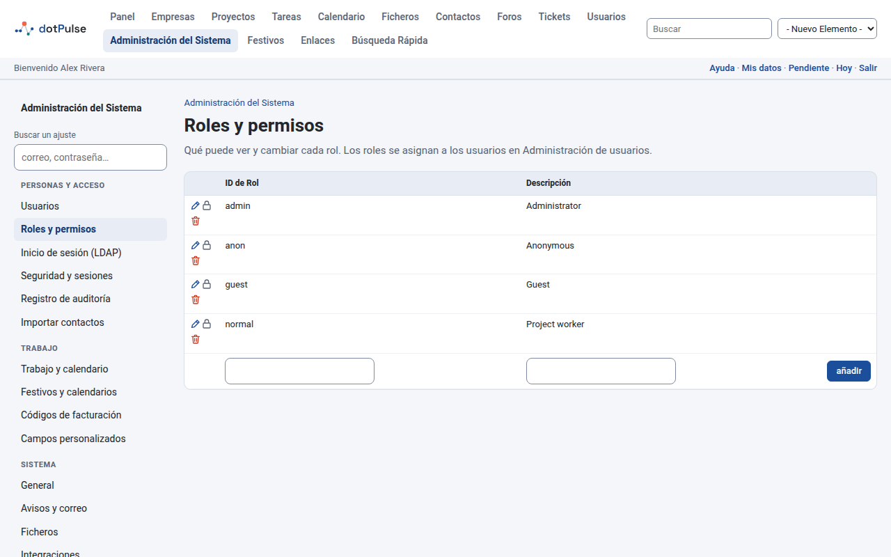
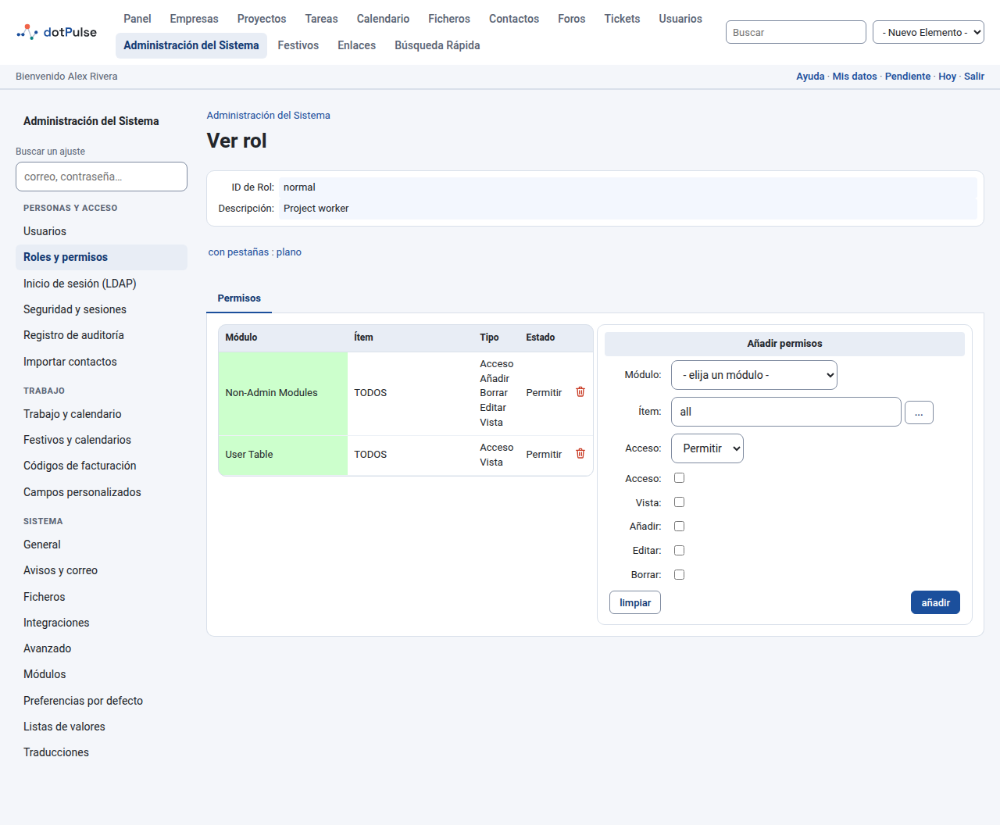

# Roles y permisos { #roles-and-permissions }

Un rol es un conjunto de permisos con nombre, como "Project worker". Los roles
se dan a los usuarios, y los usuarios reciben los permisos del rol. Esta página
explica los roles de un sitio nuevo, cómo cambiarlos y cómo decide dotPulse lo
que puede hacer un usuario.

Abra **Administración del Sistema › Roles y permisos** (`?m=system&u=roles`).
Para dar un rol a un usuario, consulte [Pestaña Roles](users.md#roles-tab).

## Qué es un rol { #what-a-role-is }

- Un usuario puede tener **varios roles**. Un usuario **sin ningún rol** no
  puede entrar (consulte [Desactivar un usuario](users.md#deactivate-a-user)).
- Un rol contiene una lista de **reglas de permisos**. Cada regla dice: sobre
  este módulo, grupo de módulos o registro concreto, **permitir** o **denegar**
  estas acciones.
- Las acciones son **Acceso**, **Vista**, **Añadir**, **Editar** y **Borrar**.

| Acción | Significa |
|---|---|
| Acceso | El módulo aparece en el menú y sus páginas se abren. |
| Vista | El usuario puede ver los registros. |
| Añadir | El usuario puede crear registros. |
| Editar | El usuario puede cambiar registros. |
| Borrar | El usuario puede borrar registros. |

Un usuario necesita **Acceso** a un módulo antes de que funcione cualquier otra
cosa en él, incluso para los registros que tiene permitido ver.

## Los roles de un sitio nuevo { #the-roles-of-a-new-site }

Una instalación nueva tiene cuatro roles:

| ID de Rol | Descripción | Qué puede hacer |
|---|---|---|
| `admin` | Administrator (en las listas de roles del usuario: **Administrador**) | Todo, en todos los módulos, incluidos **Administración del Sistema** y **Usuarios**. |
| `normal` | Project worker (en las listas de roles del usuario: **Trabajador**) | Acceso, vista, añadir, editar y borrar en todos los módulos que no son de administración. También puede ver la lista de usuarios. |
| `guest` | Guest (en las listas de roles del usuario: **Invitado**) | Acceso y vista en todos los módulos que no son de administración, y ver la lista de usuarios. No puede añadir, cambiar ni borrar nada. |
| `anon` | Anonymous (en las listas de roles del usuario: **Anónimo**) | Acceso a los módulos que no son de administración, sin vista. Abre los módulos pero no ve ningún registro. |

Cuatro módulos son **módulos de administración**: **Administración del
Sistema**, **Administración de usuarios**, **User Table** (los registros de
los usuarios) y **Roles Administration**. Solo el rol Administrator llega a
ellos. Todos los demás módulos son módulos que no son de administración,
incluidos los módulos complementarios que instale más adelante.

Todos los roles pueden entrar. Esa regla viene incorporada y no aparece en las
páginas de los roles.

!!! tip
    Dé a su personal el rol **Trabajador** (Project worker), y el rol
    **Administrador** solo a las personas que gestionan el sitio.

## La lista de roles { #the-roles-list }

La página muestra cada rol con su **ID de Rol** (un código corto) y su
**Descripción** (el nombre que aparece en las listas de roles). Los iconos de
la izquierda son:

- el lápiz: cambiar el ID o la descripción del rol;
- el candado: abrir los permisos del rol;
- la papelera: borrar el rol.

La última fila es un formulario vacío para añadir un rol.

{ .shot }

### Añadir un rol { #add-a-role }

1. En la fila vacía de abajo, escriba un **ID de Rol**, por ejemplo `client`.
   Los espacios se convierten en guiones bajos.
2. Escriba una **Descripción**, por ejemplo `Client`.
3. Haga clic en **añadir**.
4. Haga clic en el candado del nuevo rol y añada sus reglas (vea más abajo).

Un rol nuevo no tiene reglas: sus usuarios pueden entrar pero no pueden abrir
ningún módulo.

### Cambiar el nombre de un rol { #rename-a-role }

Haga clic en el lápiz, cambie el **ID de Rol** o la **Descripción**, y haga
clic en **editar**. Los usuarios conservan el rol.

### Copiar un rol { #copy-a-role }

dotPulse no tiene un botón para copiar. Para hacer un rol como uno existente,
añada un rol nuevo y dele las mismas reglas una a una. Abra los permisos del
rol antiguo en otra pestaña del navegador para compararlos.

### Borrar un rol { #delete-a-role }

En la lista de roles, haga clic en la papelera del rol y confirme.

!!! warning "Los usuarios pierden el rol"
    Todos los usuarios que tenían el rol lo pierden. Un usuario para el que era
    su único rol ya no puede entrar: revise después **Usuarios inactivos** y dé
    otro rol a esos usuarios.

## Permisos de un rol { #role-permissions }

Haga clic en el candado de un rol para abrir **Ver rol**. Su pestaña
**Permisos** muestra las reglas del rol a la izquierda; a la derecha, **Añadir
permisos** añade una regla.

{ .shot }

Cada regla muestra el **Módulo**, el **Ítem** (**TODOS** para el módulo
entero), el **Tipo** (las acciones) y el **Estado** (**Permitir** o
**denegar**). Las reglas que permiten tienen el fondo verde; las que deniegan,
rojo.

### Añadir una regla de permisos { #add-a-permission-rule }

1. En **Módulo**, elija sobre qué es la regla:
    - **All Modules**: todos los módulos, incluidos los de administración;
    - **Admin Modules**: los cuatro módulos de administración;
    - **Non-Admin Modules**: todos los demás módulos;
    - o un módulo, como **Proyectos**.
2. Para que la regla sea sobre un solo registro, haga clic en **...** junto a
   **Ítem** y elíjalo, por ejemplo un proyecto o una empresa. Deje **Ítem** en
   `all` para el módulo entero. Solo los módulos con registros (proyectos,
   empresas, departamentos, tareas, archivos, carpetas de archivos, foros...)
   tienen ítems; para los demás, dotPulse dice **No hay ninguna lista asociada
   a este módulo.**
3. En **Acceso**, elija **Permitir** o **denegar**.
4. Marque las acciones: **Acceso**, **Vista**, **Añadir**, **Editar**,
   **Borrar**.
5. Haga clic en **añadir**.

La regla se aplica desde el siguiente clic de los usuarios.

La lista **Módulo** empieza en **- elija un módulo -**: dotPulse rechaza una
regla hasta que elija uno.

### Borrar una regla de permisos { #delete-a-permission-rule }

Haga clic en la papelera de la regla y confirme. Las reglas no se pueden
editar: para cambiar una, bórrela y añada otra nueva.

### Dar un permiso a un solo usuario { #give-a-permission-to-one-user }

A veces una persona necesita algo más o algo menos que su rol. Abra el usuario
en **Usuarios** y haga clic en la pestaña **Permisos** (o haga clic en el
candado de su fila en la lista). Funciona exactamente igual que la página de
permisos de un rol, pero las reglas se aplican solo a ese usuario, y se imponen
a las reglas de los roles (vea más abajo).

Es preferible usar roles: las reglas sobre usuarios concretos se olvidan con
facilidad.

## Cómo se combinan los permisos { #how-permissions-combine }

Para cada acción, dotPulse examina todas las reglas que se aplican al usuario,
de todos sus roles y de su propia pestaña **Permisos**, y usa la **más
específica**:

1. una regla sobre el **usuario**, para ese **módulo o registro**;
2. una regla sobre el **usuario**, para un **grupo** (All, Admin o Non-Admin
   Modules);
3. una regla sobre uno de los **roles** del usuario, para ese **módulo o
   registro**;
4. una regla sobre un **rol**, para un **grupo**.

Decide el primer nivel que tiene una regla. Cuando dos reglas están en el mismo
nivel (por ejemplo en dos roles, una que permite y otra que deniega), gana la
regla **más reciente**.

Así:

- **Denegar no gana automáticamente.** Una denegación sobre **Non-Admin
  Modules** queda anulada por un permiso sobre **Proyectos** en cualquiera de
  los roles del usuario.
- Una regla sobre el usuario se impone a todas las reglas de los roles.
- Si no hay ninguna regla, la respuesta es no.

Una regla sobre un registro (un proyecto) solo se aplica a ese registro. Para
los demás registros del módulo, se aplican las reglas del módulo.

!!! warning "Denegar un registro lo oculta"
    Una regla que deniega un solo registro lo quita de las listas, aunque solo
    deniegue **Borrar**. Para impedir que alguien borre un proyecto pero que lo
    siga viendo, deniegue **Borrar** sobre el módulo entero, o no le dé derechos
    de borrado desde el principio.

!!! note "Propietarios y asignados"
    Cuando no hay ninguna regla para un proyecto o una tarea concretos,
    dotPulse también deja que la gente trabaje en los proyectos de los que es
    propietaria y en las tareas de las que es responsable o a las que está
    asignada, aunque las reglas del módulo digan que no. Una regla explícita
    sobre ese proyecto o esa tarea anula esto. Una tarea necesita además
    derechos de vista sobre su proyecto, y un proyecto sobre su empresa.

### La caché de permisos { #the-permissions-cache }

dotPulse mantiene una tabla ya preparada con los permisos de cada usuario. Se
reconstruye cada vez que añade o borra una regla, un rol, un rol de un usuario,
un usuario o un módulo. No tiene que hacer nada.

Los ajustes de **Caché de permisos** de [Avanzado](settings.md#advanced)
pertenecen a la biblioteca phpGACL que hay por debajo. Déjelos como están.

## Recetas { #recipes }

### Un invitado de solo lectura { #a-read-only-guest }

Dé al usuario el rol **Invitado**. Ve todos los módulos que no son de
administración y no puede añadir, cambiar ni borrar nada.

Para ocultar un módulo a los invitados, añada una regla al rol Guest: ese
módulo, **denegar**, **Acceso** y **Vista**.

### Un cliente que solo ve su propio proyecto { #a-client-who-sees-only-their-own-project }

1. Añada un rol con el ID de Rol `client` y la descripción **Client**.
2. Dele estas reglas (todas **Permitir**):

    | Módulo | Ítem | Acciones |
    |---|---|---|
    | Proyectos | all | Acceso |
    | Proyectos | el proyecto del cliente | Acceso, Vista |
    | Empresas | all | Acceso |
    | Empresas | la empresa del cliente | Acceso, Vista |
    | Tareas | all | Acceso, Vista |

3. Añada un usuario para el cliente con solo el rol **Client**.

El cliente ve **Empresas**, **Proyectos** y **Tareas** en el menú, con solo su
proyecto, sus tareas y su empresa. Las tareas de otros proyectos siguen
ocultas, porque una tarea necesita derechos de vista sobre su proyecto.

!!! tip
    Las listas de proyectos y de empresas muestran al principio solo los
    registros de los que es propietario el usuario. Dígale al cliente que elija
    **Todos los Usuarios** (proyectos) o **Todo** (empresas) en el filtro
    **Propietario**.

### Un trabajador de proyectos { #a-project-worker }

Dé al usuario el rol **Trabajador**. Para que los trabajadores no cambien un
módulo, por ejemplo **Empresas**, añada una regla al rol: **Empresas**,
**denegar**, **Añadir**, **Editar** y **Borrar**. Seguirán viendo las empresas.
Deniegue las cinco acciones para ocultar el módulo.

### Alguien que gestiona usuarios pero no el sistema { #someone-who-manages-users-but-not-the-system }

Dé al usuario el rol **Trabajador**. Después, en su pestaña **Permisos**, añada
dos reglas: **Administración de Usuarios**, **permitir**, las cinco acciones; y
**Tabla de Usuarios**, **permitir**, las cinco acciones. La lista de usuarios
necesita los dos módulos.
