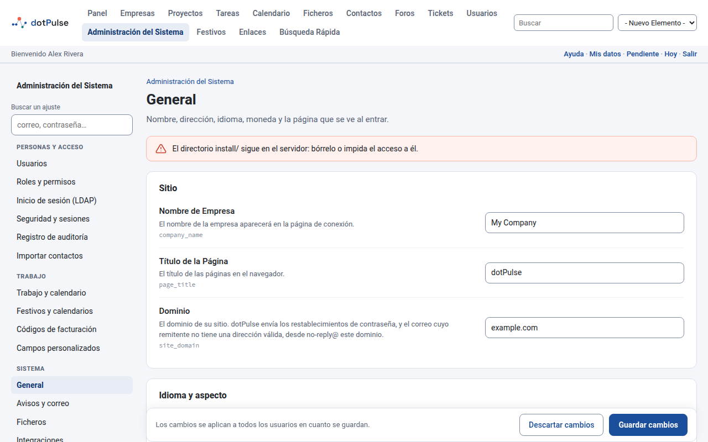
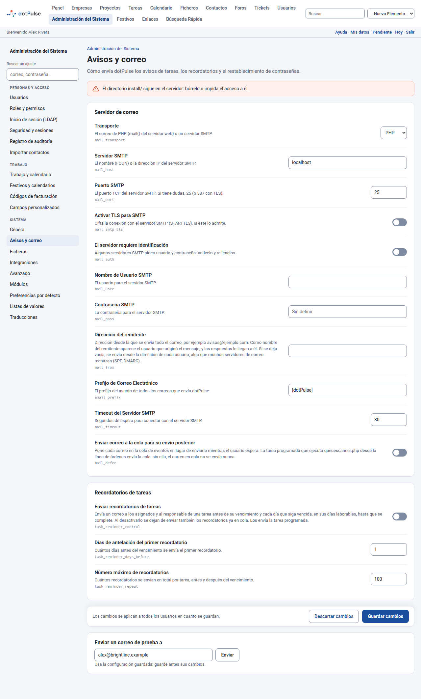

# Configuración { #settings }

La configuración de **Administración del Sistema** se divide en ocho secciones.
Cada sección tiene su propia tarjeta en la página de inicio de Administración
del Sistema y su propio enlace en el menú lateral. Esta página recoge todos los
ajustes de todas las secciones: su etiqueta tal como se ve en pantalla, lo que
hace de verdad y su valor en una instalación nueva.

Cómo buscar, cambiar y guardar los ajustes se explica en
[Administración del Sistema](index.md#change-settings). En resumen: cambie los
valores, haga clic en **Guardar cambios**, y los nuevos valores se aplican a
todos los usuarios en su siguiente página. El nombre interno de cada ajuste
(que aparece en letra pequeña bajo su texto de ayuda) se indica en las tablas
en estilo `code`.

!!! tip
    ¿No sabe dónde está un ajuste? Escriba una palabra en **Buscar un ajuste**,
    en la parte superior del menú lateral.

## General { #general }

**Administración del Sistema › General**: el nombre del sitio, su idioma y su
tema, la moneda y la página que la gente ve tras el acceso.

{ .shot }

### Sitio { #site }

| Ajuste | Qué hace | Valor predeterminado |
| --- | --- | --- |
| **Nombre de Empresa** (`company_name`) | Aparece en la página de acceso y en la de contraseña olvidada. Cuando hay una **Dirección del remitente**, también es el nombre del remitente del correo que no tiene una persona detrás. | `My Company` |
| **Título de la Página** (`page_title`) | El título de la pestaña del navegador, que también aparece en la página de acceso (*Título de la Página :: Login*). Las aplicaciones de autenticación lo muestran como nombre de la cuenta cuando se configura el inicio de sesión en dos pasos. | `dotPulse` |
| **Dominio** (`site_domain`) | Sirve para formar la dirección `no-reply@<dominio>`: el remitente de los correos de restablecimiento de contraseña y de cualquier correo cuyo remitente no tenga una dirección válida (mientras **Dirección del remitente** esté vacía), y la dirección de respuesta en los demás casos. Use su propio dominio. | `example.com` |

### Idioma y aspecto { #language-and-appearance }

| Ajuste | Qué hace | Valor predeterminado |
| --- | --- | --- |
| **Idioma del Servidor** (`host_locale`) | El idioma de la página de acceso. Una vez dentro, cada persona ve la **Configuración Regional** de sus preferencias, que, si no la tiene, toma la de [Preferencias por defecto](lists-and-fields.md#default-user-preferences), no este ajuste. | `en` |
| **Estilo Predeterminado** (`host_style`) | El tema de la página de acceso y de los usuarios que no han elegido uno en sus preferencias. La lista muestra primero los temas de dotPulse y después los antiguos (sin actualizar). | **dotPulse** |
| **Símbolo de Moneda** (`currency_symbol`) | Se pone delante de las cantidades de dinero: los presupuestos de proyectos y tareas, y la columna de presupuesto de la lista de empresas. | `$` |

Para cambiar el idioma o el tema de los usuarios que ya tienen uno, use
[Preferencias por defecto](lists-and-fields.md#default-user-preferences)
(usuarios nuevos) o las preferencias de cada usuario.

!!! note
    Escriba el propio símbolo de la moneda, por ejemplo `€` o `£`, no un código
    HTML como `&#8364;`: algunas páginas mostrarían el código como texto.

### Página de inicio { #start-page }

Estos tres ajustes eligen la página que dotPulse abre tras el acceso, y siempre
que alguien abre la dirección del sitio sin indicar una página.

| Ajuste | Qué hace | Valor predeterminado |
| --- | --- | --- |
| **Módulo predeterminado** (`default_view_m`) | El módulo que se abre. La lista muestra los módulos activos. | **Panel** (`dashboard`) |
| **Submódulo predeterminado** (`default_view_a`) | La página de ese módulo, tal como aparece tras `a=` en la dirección. Déjelo en `index` para la página principal del módulo. | `index` |
| **Subvista Predeterminada (solo pestañas)** (`default_view_tab`) | Qué pestaña se abre en esa página: `0` es la primera pestaña, `1` la segunda, y así sucesivamente. | `0` |

!!! warning "Compruebe la página de inicio después de cambiarla"
    Si elige un módulo que algunos roles no pueden abrir, o una página que no
    existe, esos usuarios no obtienen una página que funcione justo después de
    entrar. Use una página que todos los roles puedan abrir; el **Panel** es una
    opción segura.

## Trabajo y calendario { #work-and-calendar }

**Administración del Sistema › Trabajo y calendario**: el horario de trabajo con
el que se calculan las fechas y duraciones de las tareas, y algunas reglas de
las tareas.

### Horario { #working-hours }

| Ajuste | Qué hace | Valor predeterminado |
| --- | --- | --- |
| **Días Laborables en el Calendario** (`cal_working_days`) | Los días de la semana en que se trabaja. Marque una casilla por cada día. Los demás días se saltan cuando dotPulse calcula las fechas de fin y las duraciones de las tareas, y en ellos no se envían recordatorios de tareas. | De lunes a viernes |
| **Hora Inicial en el Calendario** (`cal_day_start`) | Cuándo empieza la jornada laboral. La usan las fechas y duraciones de las tareas y la vista diaria del calendario. | **08:00** |
| **Hora Final en el Calendario** (`cal_day_end`) | Cuándo termina la jornada laboral. | **17:00** |
| **Horas de Trabajo Diarias** (`daily_working_hours`) | Cuántas horas forman una jornada laboral. dotPulse lo usa para convertir una duración en días a horas y viceversa, y para calcular cuánto dura una tarea. | `8.0` |
| **Incremento de Minutos en el Calendario** (`cal_day_increment`) | Los saltos de las listas de minutos en los formularios de tareas y eventos, y la duración de cada fila en la vista diaria del calendario. | **15 minutos** |
| **Mostrar Mini Calendarios en Vista Diaria** (`cal_day_view_show_minical`) | Muestra pequeños calendarios mensuales junto a la vista diaria del calendario. | Activado |

Los festivos tampoco son días laborables. Debajo de este panel, una tarjeta
lleva a [Festivos y calendarios](holidays.md), donde cada centro de trabajo
puede tener los suyos.

!!! warning "Cambiar el horario de trabajo cambia las fechas de las tareas"
    Las fechas de las tareas no se recalculan al guardar. Pero la próxima vez
    que alguien edite una tarea, o la mueva con sus dependencias, se usarán los
    nuevos días y horas laborables. Decida el horario de trabajo antes de que
    empiecen los proyectos.

### Tareas { #tasks }

| Ajuste | Qué hace | Valor predeterminado |
| --- | --- | --- |
| **Comprobar fechas de tarea** (`check_task_dates`) | Si está activado, el formulario de tareas no guarda una tarea sin fecha de inicio y fecha de fin. Solo se comprueba en el navegador. | Activado |
| **Verificación de Sobreasignación** (`check_overallocation`) | No tiene efecto. La comprobación que activaba está desactivada en el código. | Desactivado |
| **Comprobar tareas dinámicas vacías** (`check_task_empty_dynamic`) | Si está activado, una tarea solo puede hacerse dinámica si ya tiene subtareas, y no se puede borrar la última subtarea de una tarea dinámica. | Desactivado |
| **Restringir Tiempo de Edición de la Tarea** (`restrict_task_time_editing`) | Si está activado, solo el responsable de la tarea, el responsable del proyecto y los usuarios que pueden editar **Usuarios** pueden cambiar las fechas, la duración y las dependencias de una tarea existente. Los demás siguen pudiendo editar el resto de la tarea. | Desactivado |
| **Mostrar Todos los Asignados a la Tarea** (`show_all_task_assignees`) | Si está activado, las listas de tareas muestran los nombres de acceso de todos los asignados con su parte, por ejemplo *priya (50%), marco (50%)*. Si está desactivado, muestran el primero y el número de los demás, por ejemplo *priya (50%) (+2)*; haga clic en **(+2)** para ver los demás. | Desactivado |
| **Editar Asignaciones de Tarea Múltiple** (`direct_edit_assignment`) | Si está activado, las listas de tareas (la de un proyecto y la lista **Pendiente**) tienen una casilla en cada tarea y, abajo, un cuadro para asignar personas (**Asignar con porcentaje**) y actualizar a la vez las tareas marcadas. | Desactivado |
| **Activar Diagramas de Gantt** (`enable_gantt_charts`) | Si está activado, la lista de tareas de cada proyecto termina con **Desplegar todas**, **Contraer todas** y un botón **Diagrama de Gantt**. Al desactivarlo solo desaparece esa línea: las pestañas **Gantt** de los proyectos y **Mi Gantt** siguen. | Activado |
| **Restringir Selección de Color del Proyecto** (`restrict_color_selection`) | Si está activado, el selector de color de los proyectos solo ofrece los colores de la lista de valores **ProjectColors** (consulte [Listas de valores](lists-and-fields.md#lookup-values)). Si está desactivado, se puede elegir cualquier color. | Desactivado |

## Avisos y correo { #notifications-and-email }

**Administración del Sistema › Avisos y correo**: cómo envía dotPulse el
correo. Envía avisos de tareas, correos de asignación, recordatorios de tareas
y restablecimientos de contraseña.

{ .shot }

### Servidor de correo { #mail-server }

| Ajuste | Qué hace | Valor predeterminado |
| --- | --- | --- |
| **Transporte** (`mail_transport`) | **PHP** entrega el correo a la función `mail()` de PHP, que necesita un programa de correo que funcione (sendmail o similar) en el servidor web. **SMTP** se conecta al servidor de correo que indique abajo. La mayoría de los sitios deberían usar SMTP. | **PHP** |
| **Servidor SMTP** (`mail_host`) | Nombre o dirección IP del servidor SMTP. Solo para SMTP. | `localhost` |
| **Puerto SMTP** (`mail_port`) | Puerto del servidor SMTP: normalmente `587` (envío, con TLS), `465` (SMTP sobre TLS) o `25`. | `25` |
| **Activar TLS para SMTP** (`mail_smtp_tls`) | Cifra la conexión. En el puerto `465`, dotPulse usa TLS desde el principio (SMTPS); en cualquier otro puerto empieza sin cifrar y pasa a TLS (STARTTLS). | Desactivado |
| **El servidor requiere identificación** (`mail_auth`) | Se identifica ante el servidor SMTP con el nombre de usuario y la contraseña de abajo. | Desactivado |
| **Nombre de Usuario SMTP** (`mail_user`) | Nombre de usuario para el servidor SMTP. | vacío |
| **Contraseña SMTP** (`mail_pass`) | Contraseña para el servidor SMTP. No se vuelve a mostrar nunca: el campo dice *Guardada: escriba otra para cambiarla*. Déjelo vacío para conservar la guardada. | vacío |
| **Dirección del remitente** (`mail_from`) | La dirección desde la que se envía todo el correo, por ejemplo `notifications@example.com`. Como nombre del remitente aparece el nombre de la persona que originó el correo, y las respuestas le llegan a ella. | vacío |
| **Prefijo de Correo Electrónico** (`email_prefix`) | Se pone al principio del asunto de cada correo, para que la gente pueda filtrarlos. | `[dotPulse]` |
| **Timeout del Servidor SMTP** (`mail_timeout`) | Cuántos segundos se espera al servidor SMTP antes de desistir. `0` usa el valor propio de la biblioteca de correo. | `30` |
| **Enviar correo a la cola para su envío posterior** (`mail_defer`) | Si está activado, el correo no se envía mientras el usuario espera: va a la cola de eventos, y la tarea de cron lo envía más tarde. Consulte [La cola de eventos y cron](#the-event-queue-and-cron). | Desactivado |

!!! warning "Indique una dirección de remitente"
    Mientras **Dirección del remitente** esté vacía, cada correo se envía desde
    la dirección del usuario que lo originó. La mayoría de los servidores
    receptores rechazan ese correo o lo clasifican como spam, porque su
    servidor no está autorizado a enviar en nombre de esos dominios (SPF,
    DMARC). Use una dirección de un dominio cuyos registros SPF y DKIM
    autoricen a su servidor de correo. La página de inicio muestra **Sin
    dirección de remitente** hasta que lo haga.

### Enviar un correo de prueba { #send-a-test-email }

Bajo los ajustes, el cuadro **Enviar un correo de prueba a** envía un mensaje
en el momento, para que pueda comprobar su configuración.

1. Guarde antes sus cambios: la prueba usa la configuración guardada, no lo que
   hay en el formulario.
2. Escriba una dirección (la suya aparece ya rellenada) y haga clic en
   **Enviar**.

El mensaje se envía directamente, aunque **Enviar correo a la cola para su envío
posterior** esté activado. Su texto indica el transporte, el servidor y el
puerto, el modo TLS y la dirección del remitente usados. Si falla, el mensaje de
la parte superior de la página dice por qué, por ejemplo *No se ha enviado el
correo de prueba: Could not instantiate mail function.* (correo de PHP sin
programa de correo en el servidor) o un error del servidor SMTP.

### Recordatorios de tareas { #task-reminders }

Cuando los recordatorios están activados, dotPulse envía un correo a los
asignados y al responsable de una tarea antes de su vencimiento y, después,
cada día que siga vencida.

| Ajuste | Qué hace | Valor predeterminado |
| --- | --- | --- |
| **Enviar recordatorios de tareas** (`task_reminder_control`) | Activa los recordatorios. | Desactivado |
| **Días de antelación del primer recordatorio** (`task_reminder_days_before`) | Cuántos días antes de la fecha de fin se envía el primer recordatorio. | `1` |
| **Número máximo de recordatorios** (`task_reminder_repeat`) | El máximo de recordatorios que se envían por tarea, contando los avisos previos a la fecha de fin y los de la tarea vencida. | `100` |

Qué esperar:

- Un recordatorio se programa cuando se guarda una tarea con fecha de fin: al
  crearla, o cuando cambia su fecha de fin. Activar los recordatorios no los
  programa para las tareas que ya existen.
- El correo va a los asignados y al responsable de la tarea. Cada persona solo
  lo recibe en sus propios días laborables (cuentan los festivos de su centro
  de trabajo).
- Los recordatorios se detienen cuando la tarea llega al 100 %, o tras el
  número máximo.
- Desactivar **Enviar recordatorios de tareas** detiene todos los
  recordatorios, también los que ya están en la cola. Si lo vuelve a activar,
  solo se programan recordatorios para las tareas que se guarden a partir de
  entonces.
- Los recordatorios, como los avisos de tareas, solo los envía la tarea de cron.

### La cola de eventos y cron { #the-event-queue-and-cron }

dotPulse no envía los avisos de tareas, los correos de asignación ni los
recordatorios mientras el usuario espera. Los pone en una **cola de eventos**,
y el script `queuescanner.php` envía lo que toca. Con **Enviar correo a la cola
para su envío posterior** activado, todo el resto del correo pasa también por
la cola.

`queuescanner.php` solo se ejecuta desde la línea de órdenes (por la web
responde *404 Not found*). Ejecútelo desde cron cada pocos minutos, como el
usuario del servidor web, con la dirección pública de su sitio:

```cron
# /etc/cron.d/dotpulse
*/5 * * * * www-data php /var/www/html/dotpulse/queuescanner.php --base-url=https://pm.example.com
```

[Instalación](../getting-started/install.md#set-up-the-cron-job) explica los
detalles.

Sin la tarea de cron, el correo en cola no se envía nunca. Un correo que no se
puede enviar se queda en la cola y se vuelve a intentar en la siguiente
ejecución; el motivo se escribe en el registro de errores de PHP
(`dotPulse mail: not sent (...)`).

Un correo en cola conserva la configuración de correo del momento en que entró
en la cola. Si corrige la configuración SMTP, el correo puesto en cola antes de
la corrección se sigue enviando con la antigua.

## Seguridad y sesiones { #security-and-sessions }

**Administración del Sistema › Seguridad y sesiones**: nombres de usuario y
contraseñas, cuánto tiempo sigue conectada la gente, la API REST y el registro
de auditoría.

### Cuentas { #accounts }

| Ajuste | Qué hace | Valor predeterminado |
| --- | --- | --- |
| **Nombre del Administrador** (`admin_username`) | El nombre de acceso que queda exento de **Longitud mínima del nombre de usuario** en el formulario de usuario. No da ningún derecho: quién es administrador depende solo de los roles. | `admin` |
| **Longitud mínima del nombre de usuario** (`username_min_len`) | El nombre de acceso más corto que acepta el formulario de usuario. Solo se comprueba en el navegador. | `4` |
| **Longitud Mínima de la Contraseña** (`password_min_len`) | La contraseña más corta que se acepta cuando alguien cambia su contraseña o un administrador pone una. Use al menos `12`. | `4` |
| **Desactivar contacto cuando el usuario se desactive** (`user_contact_inactivate`) | Cuando quita el último rol de un usuario (de modo que ya no puede entrar), su contacto pasa a ser privado. | Activado |
| **Activar contacto cuando el nombre de usuario se otorgue** (`user_contact_activate`) | Cuando da un rol a un usuario que no tenía ninguno, su contacto pasa a ser público. | Desactivado |

!!! warning "Aumente la longitud mínima de la contraseña"
    El valor predeterminado de 4 caracteres es demasiado corto para un sitio
    en internet. Se aplica cuando se pone o se cambia una contraseña, no a las
    contraseñas que ya existen. Consulte [Usuarios](users.md) para las
    contraseñas.

### Sesiones { #sessions }

Una sesión empieza cuando alguien entra y termina cuando sale o cuando caduca.

| Ajuste | Qué hace | Valor predeterminado |
| --- | --- | --- |
| **Gestor de Sesión** (`session_handling`) | **Sesiones Extendidas de dotPulse** guarda las sesiones en la base de datos y aplica los dos tiempos de abajo. **PHP** usa las sesiones propias de PHP: la sesión termina al cerrar el navegador o cuando vence el tiempo límite propio de PHP, y los dos tiempos de abajo no se tienen en cuenta. | **Sesiones Extendidas de dotPulse** |
| **Tiempo de Sesión Ocioso** (`session_idle_time`) | Cuánto tiempo puede pasar una sesión sin ninguna actividad antes de caducar y obligar a la persona a entrar de nuevo. | `2d` (2 días) |
| **Tiempo de Vida de Sesión Máximo** (`session_max_lifetime`) | Cuánto puede durar una sesión como máximo, por activa que sea. También es la duración de la cookie de sesión. | `1m` (30 días) |
| **Revisar la cola de eventos al limpiar las sesiones** (`session_gc_scan_queue`) | Si está activado, la cola de eventos también se procesa de vez en cuando mientras la gente usa el sitio, cuando PHP limpia las sesiones antiguas. No sustituye a cron: vea más abajo. | Desactivado |

**Cómo escribir un tiempo.** Un número solo son segundos. Añada una letra para
otra unidad:

| Letra | Unidad | Ejemplo |
| --- | --- | --- |
| ninguna | segundos | `3600` = 1 hora |
| `h` | horas | `8h` |
| `d` | días | `2d` |
| `m` | meses de 30 días (no minutos) | `1m` = 30 días |
| `y` | años de 365 días | `1y` |

Solo se admite una letra: escriba `28h`, no `1d4h`. Para los minutos, use
segundos: `1800` son 30 minutos.

!!! warning "m son meses"
    `30m` significa 30 meses, no 30 minutos. Un valor que dotPulse no puede
    leer (como `1w`), o inferior a 60 segundos, se rechaza al guardar, y se
    mantiene el valor guardado.

Las sesiones se comprueban en cada página: una sesión que ha superado
cualquiera de los dos tiempos se borra y la persona ve la página de acceso.
Los cambios de los tiempos se aplican a las sesiones que ya existen.

**Revisar la cola de eventos al limpiar las sesiones** depende de la limpieza de
sesiones de PHP, que se ejecuta en una fracción aleatoria de las visitas a
páginas (la fija `session.gc_probability` en PHP; algunas distribuciones de
Linux la ponen a 0, así que no se ejecuta nunca). Solo funciona con **Sesiones
Extendidas de dotPulse**, los correos enviados así no llevan una dirección del
sitio correcta en sus enlaces, y no se envía nada mientras nadie usa el sitio.
Use la tarea de cron en su lugar.

### API y auditoría { #api-and-audit }

| Ajuste | Qué hace | Valor predeterminado |
| --- | --- | --- |
| **Activar la API REST** (`api_enabled`) | Permite a los usuarios crear tokens de acceso personales (la pestaña **Tokens de API** de su cuenta) y usarlos con `api.php`. Cada token actúa con los permisos de su usuario. Si está desactivado, `api.php` rechaza todas las peticiones y la pestaña no aparece. | Desactivado |
| **Días que se conserva el registro de auditoría** (`audit_log_days`) | Se borran las entradas del [registro de auditoría](audit-and-maintenance.md#audit-log) con más de este número de días. `0` las conserva siempre. | `365` |

## Inicio de sesión (LDAP) { #login-ldap }

**Administración del Sistema › Inicio de sesión (LDAP)**: si la gente entra con
una contraseña guardada en dotPulse o con la contraseña de un directorio LDAP,
como OpenLDAP o Active Directory.

### Método { #method }

| Ajuste | Qué hace | Valor predeterminado |
| --- | --- | --- |
| **Método de Autentificación** (`auth_method`) | **Estándar dotPulse** comprueba la contraseña guardada en dotPulse. **LDAP** la comprueba contra el directorio indicado abajo. | **Estándar dotPulse** |

### Directorio LDAP { #ldap-directory }

| Ajuste | Qué hace | Valor predeterminado |
| --- | --- | --- |
| **Servidor LDAP** (`ldap_host`) | Nombre o dirección IP del servidor de directorio. Para una conexión cifrada, escriba una dirección como `ldaps://ldap.example.com` (añada `:puerto` si no es el 636: con una dirección así, **Puerto LDAP** no se usa). | `localhost` |
| **Puerto LDAP** (`ldap_port`) | Puerto del servidor de directorio, que se usa cuando **Servidor LDAP** es un nombre o una dirección sin más. | `389` |
| **Versión LDAP** (`ldap_version`) | Versión del protocolo LDAP. Déjela en `3`. | `3` |
| **Base DN para LDAP** (`ldap_base_dn`) | Dónde buscar los usuarios en el directorio, por ejemplo `ou=people,dc=example,dc=com`. | vacío (los sitios instalados antes de la 3.4 tienen el valor de ejemplo `dc=saki,dc=com,dc=au`: cámbielo) |
| **Filtro de Usuario LDAP** (`ldap_user_filter`) | La búsqueda que encuentra a un usuario. `%USERNAME%` se sustituye por el nombre de acceso escrito en la página de acceso. Para Active Directory, use `(sAMAccountName=%USERNAME%)`. | `(uid=%USERNAME%)` |
| **Usuario para Búsqueda LDAP** (`ldap_search_user`) | El DN completo de una cuenta que puede buscar en el directorio, por ejemplo `cn=dotpulse,ou=services,dc=example,dc=com`. Déjelo vacío para buscar de forma anónima. | vacío (antes de la 3.4: el valor de ejemplo `Manager`) |
| **Contraseña para Búsqueda LDAP** (`ldap_search_pass`) | Contraseña de la cuenta de búsqueda. No se vuelve a mostrar nunca; déjela vacía para conservar la guardada. | vacío (antes de la 3.4: el valor de ejemplo `secret`) |
| **LDAP también permite login estándar** (`ldap_allow_login`) | Si está activado, las personas que no están en el directorio (como `admin`) entran con su contraseña de dotPulse, y todo el mundo puede hacerlo cuando no se puede acceder al directorio. Si está desactivado, solo cuenta el directorio. | Activado |

### Cómo funciona el inicio de sesión LDAP { #how-ldap-login-works }

Cuando alguien entra con LDAP como método:

1. Una contraseña vacía se rechaza siempre.
2. dotPulse se conecta al directorio, se identifica como el usuario de búsqueda
   (o de forma anónima) y busca el nombre de acceso en **Base DN para LDAP** con
   **Filtro de Usuario LDAP**. Se usa la primera entrada encontrada.
3. Si la persona está en el directorio, solo cuenta la contraseña del
   directorio: dotPulse se identifica ante el directorio como esa entrada con
   la contraseña escrita. Si funciona, la persona entra, y dotPulse actualiza
   su copia de la contraseña.
4. Si aún no hay ningún usuario de dotPulse con ese nombre de acceso, dotPulse
   lo crea en el momento. El nuevo usuario recibe un contacto rellenado con la
   entrada del directorio (nombre, apellidos, correo, teléfono, móvil, ciudad,
   provincia, código postal y cargo) y el rol **Anónimo**. Se guarda una copia
   de la contraseña en dotPulse.
5. Si la persona no está en el directorio, o no se puede acceder a este, se
   comprueba en su lugar la contraseña de dotPulse, pero solo con **LDAP
   también permite login estándar** activado.

El inicio de sesión en dos pasos, si el usuario lo tiene, se pide después de
esto, igual que con el inicio de sesión estándar. El rol del usuario debe
permitir el acceso.

!!! warning "Antes de pasar a LDAP"
    - **Conserve una forma de entrar.** Con **LDAP también permite login
      estándar** desactivado, nadie puede entrar con una contraseña de dotPulse,
      tampoco los administradores. Si el directorio no funciona o un ajuste es
      incorrecto, todo el mundo se queda fuera, y tendrá que volver a poner
      `auth_method` en `sql` en la base de datos
      (`UPDATE dotp_config SET config_value = 'sql' WHERE config_name = 'auth_method'`,
      con su propio prefijo de tablas). Pruebe primero con el inicio de sesión
      estándar todavía permitido.
    - **Los usuarios nuevos apenas tienen derechos.** Los usuarios creados en
      su primer acceso por LDAP reciben el rol **Anónimo**, que solo les deja
      abrir los módulos que no son de administración. Deles un rol de verdad en
      [Usuarios](users.md) tras su primer acceso.
    - **Bloquee también a la gente en dotPulse.** Desactivar a alguien en el
      directorio impide que entre, pero mientras no se pueda acceder al
      directorio, o después de borrarlo de él, su última contraseña vuelve a
      funcionar (con **LDAP también permite login estándar** activado). Cuando
      alguien se vaya, quítele también sus roles en dotPulse.
    - dotPulse no usa STARTTLS. Use una dirección `ldaps://`, o un directorio en
      el mismo servidor, para que las contraseñas no crucen la red en claro.

dotPulse no muestra por qué ha fallado un inicio de sesión LDAP: la persona solo
ve el error de acceso normal. Revise el registro del servidor de directorio, o
pruebe antes el usuario de búsqueda y el filtro con una herramienta como
`ldapsearch`.

Para copiar contactos (no usuarios) desde un directorio, consulte
[Importar contactos desde LDAP](audit-and-maintenance.md#import-contacts-from-ldap).

## Ficheros { #files }

**Administración del Sistema › Ficheros**: las versiones de los archivos y el
indexado que permite buscar en el contenido de los archivos subidos.

### Ficheros { #files_1 }

| Ajuste | Qué hace | Valor predeterminado |
| --- | --- | --- |
| **Conservar Parámetros de Fichero en CI** (`files_ci_preserve_attr`) | Si está activado, quien sube una nueva versión de un archivo no puede cambiar su tipo, proyecto ni tarea: la nueva versión conserva los del archivo. | Activado |
| **Permitir Edición de Versiones Anteriores** (`files_show_versions_edit`) | Si está activado, la lista de versiones anteriores de un archivo muestra enlaces para editar y borrar (a los usuarios que pueden editar o borrar archivos). Si está desactivado, las versiones anteriores solo se pueden ver. | Desactivado |

### Indexado { #indexing }

Cuando se sube un archivo, dotPulse ejecuta un programa que extrae su texto y
guarda las palabras, para que la búsqueda encuentre los archivos por su
contenido.

| Ajuste | Qué hace | Valor predeterminado |
| --- | --- | --- |
| **Tamaño Máximo de Fichero para Indexar** (`index_max_file_size`) | Los archivos de más de este número de kilobytes no se indexan. Un valor negativo indexa todos los archivos; `0` solo indexa los archivos vacíos. | `-1` (sin límite) |
| **Parser Predeterminado** (`parser_default`) | El programa que se usa para los tipos de archivo que no tienen un parser propio. | `/usr/bin/strings` |
| **Parser MS Word** (`parser_application/msword`) | El programa para los archivos `.doc`. | `/usr/bin/strings` |
| **Parser HTML** (`parser_text/html`) | El programa para los archivos HTML. | `/usr/bin/strings` |
| **Parser PDF** (`parser_application/pdf`) | El programa para los archivos PDF (`pdftotext`, del paquete poppler-utils). | `/usr/bin/pdftotext` |

dotPulse ejecuta el parser añadiendo al final la ruta del archivo y lee lo que
imprime. Para un parser cuya ruta contiene `/pdf`, añade además `-` para que el
texto se imprima en lugar de escribirse en un fichero. Si el programa no existe,
el archivo se sube igualmente y el mensaje dice *0 words indexed*.

!!! warning "Los parsers son órdenes que se ejecutan en el servidor"
    Cada valor de parser lo ejecuta el servidor web como una orden de la shell
    en cada subida. Ponga ahí solo la ruta completa de un programa real de
    extracción de texto. Quien pueda cambiar estos ajustes puede ejecutar
    cualquier orden en el servidor, así que dé derechos de edición sobre
    **Administración del Sistema** solo a personas a las que confiaría el
    propio servidor.

## Integraciones { #integrations }

**Administración del Sistema › Integraciones**: enlaces con otros programas.

### Mantis { #mantis }

Estos ajustes solo existen mientras el módulo Mantis esté instalado (consulte
[Módulos](modules.md)). Al quitar el módulo se borran.

| Ajuste | Qué hace | Valor predeterminado |
| --- | --- | --- |
| **Dirección de Mantis** (`mantis_url`) | La dirección de su instalación de MantisBT (MantisBT 2.x, con su API REST), por ejemplo `https://bugs.example.org`. Debe empezar por `https://`; si no, las funciones de Mantis siguen desactivadas. Cada usuario guarda su propio token de la API de Mantis. | vacío |
| **Permitir HTTP para Mantis** (`mantis_allow_http`) | Acepta una dirección `http://`. Solo para una instalación de pruebas en su propio ordenador: los tokens de la API de los usuarios cruzan entonces la red sin cifrar. | Desactivado |

### Tickets { #tickets }

| Ajuste | Qué hace | Valor predeterminado |
| --- | --- | --- |
| **Permitir Reenlance de Ticket** (`link_tickets_kludge`) | Añade una columna **Enlace** a la lista del módulo **Tickets**, para unir un ticket a otro ticket como su padre. Útil para los tickets creados a partir de correos. | Desactivado |

## Avanzado { #advanced }

**Administración del Sistema › Avanzado**: caché de permisos, registros,
depuración y comprobación de traducciones. Déjelos en sus valores
predeterminados salvo que sepa por qué los cambia.

Los ajustes añadidos por un módulo que ninguna otra sección recoge también
aparecen aquí, en un panel llamado **Otros**.

### Caché de permisos { #permissions-cache }

| Ajuste | Qué hace | Valor predeterminado |
| --- | --- | --- |
| **Activar la caché de permisos** (`gacl_cache`) | Activa la caché de la biblioteca de permisos (phpGACL), guardada como ficheros en el directorio de abajo. | Desactivado |
| **Expirar la caché de permisos** (`gacl_expire`) | Si está activado, la caché entera se vacía cada vez que cambia un permiso o un rol, para que los cambios se apliquen al momento. Manténgalo activado si usa la caché. | Activado |
| **Directorio para la caché de permisos** (`gacl_cache_dir`) | Dónde van los ficheros de la caché. El servidor web debe poder escribir allí. | `/tmp` |
| **Caducidad de la caché de permisos** (`gacl_timeout`) | Cuántos segundos se conserva una respuesta en la caché. | `600` |

!!! note
    dotPulse comprueba los permisos en una tabla que construye cada vez que
    cambian los permisos, no con las consultas a la biblioteca que acelera esta
    caché. Activar la caché no supone ninguna diferencia apreciable; déjela
    desactivada.

### Registros y depuración { #logs-and-debugging }

| Ajuste | Qué hace | Valor predeterminado |
| --- | --- | --- |
| **Registrar cambios** (`log_changes`) | Si está activado, los cambios en proyectos, tareas, archivos y otros registros se anotan para el módulo **Historia**. Ese módulo debe estar instalado y activo; si no, cada cambio muestra un aviso de que no está cargado. | Desactivado |
| **Nivel de Depurado** (`debug`) | Cuánta información de depuración escribe dotPulse en el registro de errores de PHP. `0` no escribe nada; `1` solo los mensajes más importantes; los números más altos escriben más (desde `11`, la depuración propia de la biblioteca de permisos; desde `12`, cada consulta SQL). | `1` |
| **Mostrar Mensajes de Depurado** (`display_debug`) | Muestra además los mensajes de depuración en las páginas, a todos los usuarios. | Desactivado |
| **Límite de Memoria para Diagramas de Gantt** (`reset_memory_limit`) | Ya no lo usan los módulos estándar. Solo el módulo complementario Monitoring and Control pone el límite de memoria de PHP en este valor en algunas de sus páginas. | `32M` |

!!! warning "Depurar en un sitio en producción"
    Un **Nivel de Depurado** superior a 1 llena rápido el registro de errores de
    PHP, y desde 12 anota cada consulta SQL. **Mostrar Mensajes de Depurado**
    muestra rutas de ficheros, consultas y otros detalles internos a todos los
    usuarios, y puede estropear las páginas. Actívelos solo para una prueba
    breve, y desactívelos después.

### Traducciones { #translations }

| Ajuste | Qué hace | Valor predeterminado |
| --- | --- | --- |
| **Advertencia de Traducción** (`locale_warn`) | Marca cada texto de la interfaz que no tiene traducción en el idioma del usuario, añadiéndole la cadena de abajo. Útil mientras traduce (consulte [Traducciones](translations.md)). | Desactivado |
| **Alerta de Traducción** (`locale_alert`) | La marca que se añade a los textos sin traducir. | `^` |
