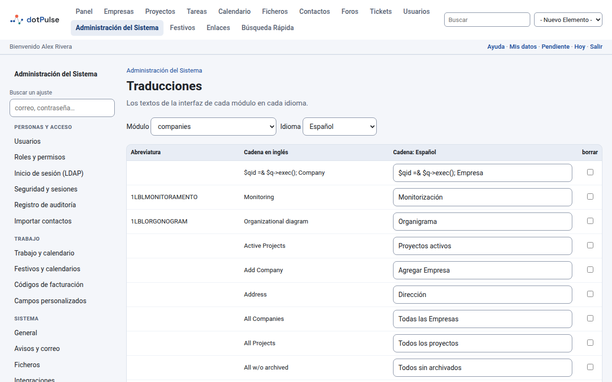

# Traducciones { #translations }

Todos los textos de la interfaz salen de un archivo de traducción: un archivo
por módulo e idioma. **Administración del Sistema › Traducciones** le permite
cambiar esos textos en el navegador, por ejemplo para corregir una traducción o
para usar sus propias palabras en una etiqueta.

El inglés y el español se mantienen con dotPulse: cada texto que usa el código
tiene una entrada en inglés y otra en español. Los demás idiomas vienen de
dotProject y se completaron con traducción automática. Sus entradas traducidas
automáticamente llevan la marca `// MT` hasta que alguien las revisa.

## Quién puede traducir { #who-can-translate }

La página necesita permiso de edición sobre **Administración del Sistema** y el
tipo de usuario **Administrador**. Los demás usuarios, aunque tengan el rol
adecuado, reciben **Acceso Denegado**.

## Editar una traducción { #edit-a-translation }

1. Abra **Administración del Sistema › Traducciones**.
2. Elija el **Módulo** y el **Idioma**. La página se vuelve a cargar en cuanto
   cambia cualquiera de las dos listas. La lista **Módulo** tiene todas las
   carpetas de módulos, instalados o no. **common** contiene los textos
   compartidos por todas las páginas (menús, botones, fechas); **styles**, los
   de los temas.
3. Cambie los textos que necesite.
4. Haga clic en **Enviar** al final de la página.

{ .shot }

La tabla tiene cuatro columnas:

| Columna | Qué muestra |
|--------|---------------|
| **Abreviatura** | La clave que usa el código, cuando no es el propio texto en inglés (por ejemplo `LBL_RISKS`). Vacía cuando la clave es el texto en inglés. |
| **Cadena en inglés** | El texto en inglés. |
| **Cadena:** *idioma* | La traducción, que puede editar. Los textos largos tienen un cuadro más grande. |
| **borrar** | Márquela para quitar la entrada al guardar. |

Una entrada con la traducción vacía muestra en pantalla el texto sin traducir:
el texto en inglés, o la abreviatura si la hay.

### Qué hace el guardado { #what-saving-does }

Al guardar se reescribe el archivo completo de ese módulo e idioma, a partir de
lo que muestra la página:

- Una entrada que **no ha tocado** se escribe tal como estaba, incluida su marca
  `// MT` si la tenía. Puede revisar un archivo largo en varias sesiones: las
  entradas a las que aún no ha llegado conservan su marca.
- Una entrada que **ha editado** se escribe con su texto y pierde la marca
  `// MT`. El HTML del texto se limpia: solo se conserva el marcado seguro.
- Una entrada con **borrar** marcado se deja fuera del archivo.

Los cambios se ven a partir de la siguiente página que abra.

!!! note "Módulos con dos archivos"
    Un módulo que trae su propia carpeta de traducciones
    (`modules/<module>/locales/`) tiene dos entradas en la lista **Módulo**. Por
    ejemplo, **projects** abre los pocos textos de `modules/projects/locales/`,
    y **projects (textos principales)** los textos principales del módulo
    Proyectos, en `locales/<language>/projects.inc` (consulte
    [Dónde están los archivos](#where-the-files-are)).

### Editar los textos en inglés { #edit-the-english-texts }

Con **Inglés** elegido, la página funciona de otra manera:

- Se pueden editar tanto la **Abreviatura** como la **Cadena en inglés**.
- La primera fila, **Nueva entrada**, añade una entrada. Escriba una
  **Abreviatura** si el código usa una clave, o déjela vacía y escriba solo la
  **Cadena en inglés**.

Cambie los textos en inglés con cuidado: las entradas en inglés son también la
lista de textos que la página ofrece para todos los demás idiomas. Si cambia la
clave de una entrada, las traducciones siguen usando la clave antigua.

## Dónde están los archivos { #where-the-files-are }

| Textos | Archivo |
|-------|------|
| La mayoría de los módulos, y **common** y **styles** | `locales/<language>/<module>.inc`, por ejemplo `locales/es/companies.inc` |
| Módulos con sus propias traducciones | `modules/<module>/locales/<language>.inc`, por ejemplo `modules/risks/locales/es.inc` |

`<language>` es el nombre de la carpeta dentro de `locales/`: `en`, `es`, `fr`,
`pt_br`, etc.

Los archivos son simples listas de líneas `"key"=>"text",`. Si un archivo
contiene otra cosa (código PHP, por ejemplo), dotPulse lo ignora y escribe una
línea en el registro de errores de PHP.

### Permita que el servidor web escriba los archivos { #let-the-web-server-write-the-files }

Para guardar, el usuario del servidor web (a menudo `www-data` o `apache`) debe
poder escribir el archivo, y la carpeta si el archivo aún no existe. Si no, la
página dice **Could not open locales file (...) to save.** y no cambia nada. Por
ejemplo, para permitir la traducción al español:

```sh
cd /var/www/html/dotpulse
chown -R www-data locales/es
```

Si prefiere que el código siga siendo de solo lectura para el servidor web,
edite los archivos a mano y cópielos al servidor.

!!! warning "Haga una copia de sus traducciones antes de actualizar"
    Una versión nueva de dotPulse sustituye `locales/` y `modules/*/locales/`.
    Antes de actualizar, copie los archivos que haya cambiado y después
    incorpore sus entradas a los archivos nuevos. Consulte
    [Actualización](../getting-started/upgrade.md#1-back-up).

## Elegir el idioma del sitio { #choose-the-language-of-the-site }

Dos cosas deciden el idioma que ve cada persona:

- La **Configuración Regional** de sus [preferencias](../user-guide/preferences.md#locale).
  Los usuarios que no han elegido una siguen la **Configuración Regional** de
  las [preferencias por defecto](lists-and-fields.md#default-user-preferences).
- **Idioma del Servidor** (`host_locale`), en
  [**Administración del Sistema › General**](settings.md#language-and-appearance):
  el idioma de la página de inicio de sesión.

Como las preferencias por defecto siempre tienen una **Configuración Regional**
(inglés en un sitio nuevo), en la práctica **Idioma del Servidor** solo cambia
la página de inicio de sesión. Para cambiar el idioma de todos los que no han
elegido uno, cambie las preferencias por defecto.

## Encontrar textos sin traducir { #find-untranslated-texts }

Dos ajustes de [**Administración del Sistema › Avanzado**](settings.md#translations)
le ayudan mientras traduce:

- **Advertencia de Traducción** (`locale_warn`) añade una marca a cada texto que
  aparece en pantalla y no tiene entrada en el idioma del usuario.
- **Alerta de Traducción** (`locale_alert`) es esa marca, `^` por defecto.

Active la advertencia, recorra las páginas en el idioma en que está trabajando y
busque los textos que terminan en `^`. Desactívela cuando termine: todo el mundo
ve las marcas.

## Añadir un idioma { #add-a-language }

Un idioma es una carpeta dentro de `locales/`. Para añadir uno, por ejemplo el
griego:

1. Cree `locales/el/`.
2. Copie en ella `lang.php` y `locales.php` desde `locales/en/`.
3. Edite `lang.php`. Lista las variantes del idioma que pueden elegir los
   usuarios, cada una con el nombre de la carpeta, su nombre en inglés, su
   nombre propio y un código de configuración regional de Windows. Por ejemplo:

    ```php
    $dir = basename(dirname(__FILE__));
    $LANGUAGES['el_GR'] = array($dir, 'Greek', 'Ελληνικά', 'ell');
    ```

4. Revise `locales.php`: el juego de caracteres (mantenga `utf-8`), el primer
   día de la semana (`0` para el domingo, `1` para el lunes) y el formato de
   hora por defecto.
5. Copie en la nueva carpeta los archivos `.inc` de `locales/en/`, o deje que
   la página **Traducciones** los cree: elija el nuevo idioma y un módulo, y
   haga clic en **Enviar**. Cada archivo se crea la primera vez que lo guarda,
   si el servidor web puede escribir en la carpeta.
6. Para los módulos con sus propias traducciones, añada
   `modules/<module>/locales/el.inc` de la misma forma.

Los usuarios ven el nuevo idioma en la lista **Configuración Regional** de sus
preferencias después de cerrar la sesión y volver a entrar: la lista de idiomas
se lee una vez por sesión.

## Contribuir con traducciones { #contribute-translations }

Si ha mejorado una traducción, piense en enviarla para que todo el mundo la
reciba con la próxima versión. dotPulse está en
[GitHub](https://github.com/davmont/dotPulse): abra una *pull request* con los
archivos `.inc` modificados, o una incidencia con los archivos adjuntos.

Desde un clon del repositorio, `php tools/locales/check.php status` muestra la
cobertura de cada idioma: cuántas entradas del catálogo en inglés tiene y
cuántas siguen marcadas con `// MT`. `php tools/locales/check.php missing es`
lista los textos que faltan en un idioma.
