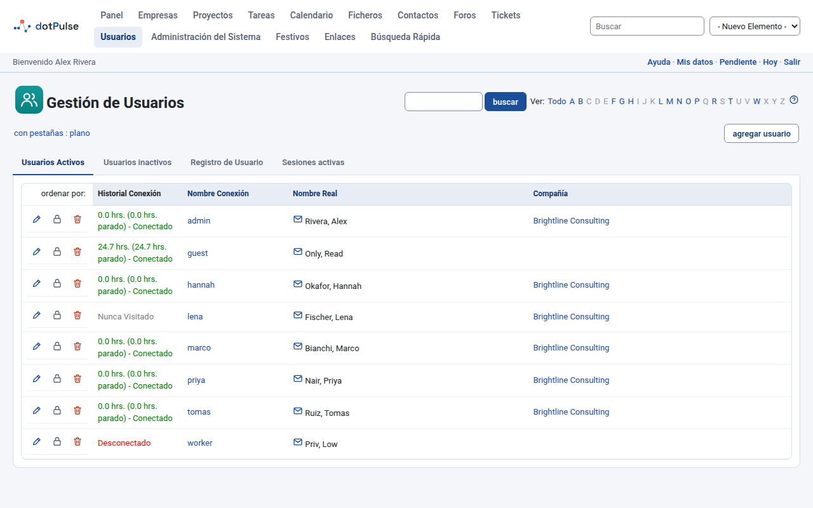
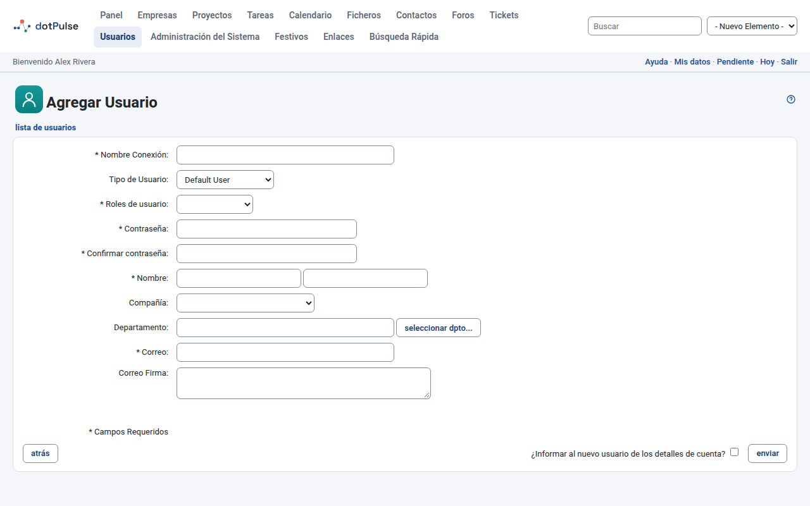

# Usuarios { #users }

Cada persona que entra en dotPulse tiene una cuenta de usuario. Esta página
trata la lista de usuarios, cómo dar de alta y editar cuentas, la página del
usuario y sus pestañas, y cómo desactivar o eliminar una cuenta.

Lo que un usuario puede ver y hacer depende de sus roles. Los roles se explican
en [Roles y permisos](roles-permissions.md).

## La lista de usuarios { #the-users-list }

Haga clic en **Usuarios** en el menú superior, o abra **Administración del
Sistema** y haga clic en **Usuarios**. La página se llama **Gestión de
Usuarios** (`?m=admin`).

{ .shot }

La lista tiene estas pestañas:

| Pestaña | Muestra |
|---|---|
| **Usuarios Activos** | Los usuarios que tienen al menos un rol, y por tanto pueden entrar. |
| **Usuarios inactivos** | Los usuarios que no tienen ningún rol. No pueden entrar. |
| **Registro de Usuario** | Cuándo entró y salió la gente, entre dos fechas. |
| **Sesiones activas** | Quién está conectado ahora. Aquí puede terminar sus sesiones. |

**Sesiones activas** solo aparece si puede tanto editar como borrar usuarios.

### Buscar un usuario { #find-a-user }

- Haga clic en una letra de la fila **Ver** para mostrar los usuarios cuyo
  nombre de acceso, nombre o apellido empieza por esa letra. Las letras en gris
  no tienen usuarios. **Todo** vuelve a mostrar a todos.
- Escriba parte de un nombre de acceso, un nombre o un apellido en el cuadro de
  la parte superior y haga clic en **buscar**.

La letra o la búsqueda se mantienen mientras siga conectado. Haga clic en
**Todo** para quitarlas. Haga clic en el título de una columna (**Nombre
Conexión**, **Nombre Real**, **Compañía**) para ordenar.

!!! note "Usuarios de otras empresas"
    La lista solo muestra los usuarios cuya empresa puede ver. Si sus roles le
    deniegan una empresa, sus usuarios no aparecen.

### Leer la lista { #read-the-list }

Los iconos a la izquierda de cada fila son:

- el lápiz: editar el usuario;
- el candado: abrir la página del usuario (en un sitio estándar, en la pestaña
  **Permisos**);
- la papelera: borrar el usuario.

En **Usuarios Activos**, la columna **Historial Conexión** muestra, para el
último acceso del usuario, hace cuántas horas entró y cuánto tiempo lleva
inactivo, seguido de **Conectado** en verde. Si no, dice **Desconectado** (en
rojo) o **Nunca Visitado** (en gris).

Haga clic en el nombre de acceso para abrir la página del usuario. El sobre que
hay junto al nombre empieza un correo dirigido a él.

## Añadir un usuario { #add-a-user }

1. Vaya a **Usuarios** y haga clic en **agregar usuario**.
2. Rellene el formulario (vea la tabla de abajo).
3. Para enviar un correo al nuevo usuario, marque **¿Informar al nuevo usuario
   de los detalles de cuenta?**.
4. Haga clic en **enviar**.

dotPulse abre la página del nuevo usuario. Revise las pestañas **Roles** y
**Permisos** antes de decirle al usuario que entre.

{ .shot }

| Campo | Qué hace |
|---|---|
| **Nombre Conexión** | El nombre con el que entra el usuario. Se guarda en minúsculas y debe ser único. No se puede cambiar después. Longitud mínima: el ajuste `username_min_len` (4 por defecto). |
| **Tipo de Usuario** | Una etiqueta para el puesto de la persona: Default User, Administrador, Director general, Director, Gerente de sucursal, Gerente, Supervisor o Empleado. No decide lo que el usuario puede ver: eso lo deciden los roles. |
| **Roles de usuario** | El primer rol del usuario. Obligatorio. Añada más roles después en la pestaña **Roles**. |
| **Contraseña**, **Confirmar contraseña** | La contraseña, dos veces. Longitud mínima: el ajuste `password_min_len` (4 por defecto). |
| **Nombre** | Nombre y apellido. Los dos son obligatorios. |
| **Compañía** | La empresa para la que trabaja la persona. Las listas suelen empezar en la empresa del propio usuario. |
| **Departamento** | Haga clic en **seleccionar dpto...** y elija un departamento de la empresa elegida. |
| **Correo** | Obligatorio. Aquí llegan los avisos y los restablecimientos de contraseña. |
| **Correo Firma** | Se añade a los correos que el usuario envía desde dotPulse. |

Los campos marcados con `*` son obligatorios. Si el nombre de acceso ya está en
uso, dotPulse lo indica y no guarda nada.

!!! tip "Tipo de Usuario frente a Roles de usuario"
    **Roles de usuario** decide lo que el usuario puede ver y hacer. **Tipo de
    Usuario** describe sobre todo el trabajo de la persona: un usuario con el
    tipo "Administrador" y el rol Invitado sigue siendo un invitado. Algunos
    módulos complementarios usan el tipo de usuario en su propia configuración.

### El contacto { #the-contact-record }

Cada usuario nuevo recibe un **contacto nuevo** en **Contactos**, con el
nombre, la empresa, el departamento y el correo del formulario. Usted pasa a
ser el propietario de ese contacto. Los teléfonos, la dirección y el
cumpleaños del usuario se guardan en el contacto: edite el usuario y haga clic
en **editar información de contacto**, o edite el contacto en **Contactos**.

No se puede convertir un contacto existente en usuario: al añadir un usuario
siempre se crea un contacto nuevo. Si la persona ya estaba en **Contactos**,
ahora tendrá dos contactos.

### El correo de bienvenida { #the-welcome-email }

Con **¿Informar al nuevo usuario de los detalles de cuenta?** marcado, dotPulse
envía al usuario un correo diciendo que se ha creado una cuenta, con la
dirección del sitio y su nombre de acceso. El correo **no** contiene la
contraseña: le indica al usuario que ponga una con el enlace de contraseña
olvidada de la página de acceso. Dele usted la contraseña, o deje que use ese
enlace.

El correo se envía desde su propia dirección, o desde la dirección del
remitente indicada en [Avisos y correo](settings.md#notifications-and-email).
Si el correo no se puede enviar, el usuario se crea igualmente y dotPulse
muestra el error del correo.

## La página del usuario { #the-user-page }

Haga clic en un nombre de acceso de la lista para abrir **Ver Usuario**. La
parte superior muestra el nombre de acceso, el tipo de usuario, el nombre, la
empresa, el departamento, los teléfonos, la dirección, el cumpleaños, el
correo y la firma.

Los enlaces bajo el título son:

- **lista de usuarios**: vuelve a la lista;
- **editar este usuario**: el mismo formulario que para un usuario nuevo;
- **editar preferencias**: las preferencias del usuario (consulte
  [Su cuenta y preferencias](../user-guide/preferences.md));
- **cambiar contraseña**, a la derecha: pone una contraseña nueva.

Las pestañas de abajo contienen el resto:

| Pestaña | Para qué sirve |
|---|---|
| **Proyectos**, **Gantt de proyecto** | Los proyectos de los que es propietario el usuario, como lista y como diagrama. |
| **Registro de Usuario** | Los accesos y salidas de este usuario entre dos fechas. |
| **Permisos** | Reglas de permisos solo para este usuario, además de sus roles. |
| **Roles** | Los roles del usuario. Aquí se añaden y se quitan roles. |
| **Inicio de sesión en dos pasos** | Si el inicio de sesión en dos pasos está activado; restablézcalo si el usuario ha perdido su teléfono. |
| **Tokens de API** | Solo cuando la API está activada: los tokens de API del usuario. |
| **Transferir** | Pasar los proyectos y tareas del usuario a otra persona. |

Los módulos complementarios pueden añadir más pestañas.

### Pestaña Roles { #roles-tab }

La parte izquierda muestra los roles del usuario. A la derecha, bajo **Agregar
Rol**, elija un rol y haga clic en **añadir**. Haga clic en la papelera junto a
un rol para quitárselo al usuario.

Un usuario puede tener varios roles. Consulte
[Cómo se combinan los permisos](roles-permissions.md#how-permissions-combine).

La papelera solo quita el rol a este usuario (**¿Quitar este rol al
usuario?**). El rol en sí sigue existiendo. Para borrar un rol, consulte
[Borrar un rol](roles-permissions.md#delete-a-role).

### Pestaña Permisos { #permissions-tab }

Esta pestaña contiene reglas de permisos para un solo usuario, sin tener que
crear un rol para ello. Solo muestra las reglas propias del usuario, no las que
le vienen de sus roles. Funciona como la página de permisos de un rol: consulte
[Dar un permiso a un solo usuario](roles-permissions.md#give-a-permission-to-one-user).

### Editar un usuario { #edit-a-user }

1. En la lista, haga clic en el lápiz, o abra el usuario y haga clic en
   **editar este usuario**.
2. Cambie lo que necesite. El nombre de acceso no se puede cambiar.
3. Deje **Contraseña** y **Confirmar contraseña** vacíos para conservar la
   contraseña.
4. Haga clic en **enviar**.

Los roles no están en este formulario: use la pestaña **Roles**.

### Cambiar la contraseña de otra persona { #change-someones-password }

La forma más segura, para cualquier administrador:

1. Abra el usuario y haga clic en **editar este usuario**.
2. Escriba la nueva contraseña en **Contraseña** y **Confirmar contraseña**.
3. Haga clic en **enviar**.

No necesita la contraseña antigua del usuario. (Cuando cambia su propia
contraseña, dotPulse le pide la actual.)

El enlace **cambiar contraseña** de la página del usuario abre una ventana
pequeña con **Nueva Contraseña** y **Repita la nueva contraseña** (y
**Contraseña Actual** cuando la página es la suya). Para poner la contraseña de
otra persona también sirve **editar este usuario**.

Cada cambio de contraseña se anota en el historial del usuario y en el
[registro de auditoría](audit-and-maintenance.md#audit-log). Los usuarios que
han olvidado su contraseña pueden restablecerla ellos mismos con el enlace de
contraseña olvidada de la página de acceso.

### Restablecer el inicio de sesión en dos pasos { #reset-two-step-login }

Un usuario que ha perdido su teléfono y sus códigos de recuperación no puede
entrar. Para dejarle entrar de nuevo:

1. Abra el usuario y haga clic en la pestaña **Inicio de sesión en dos pasos**.
2. Haga clic en **Restablecer el inicio de sesión en dos pasos** y confirme.

El inicio de sesión en dos pasos queda desactivado para ese usuario. Entra solo
con su contraseña, y puede volver a configurarlo desde **Mis datos** (consulte
[Configurar el inicio de sesión en dos pasos](../user-guide/preferences.md#set-up-two-step-login)).

Para otros usuarios solo puede restablecer el inicio de sesión en dos pasos. No
puede activarlo por ellos, y nunca ve su clave ni sus códigos. La pestaña dice
**El inicio de sesión en dos pasos está desactivado para este usuario.** cuando
no lo han configurado.

### Tokens de API { #api-tokens }

La pestaña **Tokens de API** solo está cuando la API REST está activada
(`api_enabled`, consulte [Seguridad y sesiones](settings.md#security-and-sessions)).
Los usuarios crean los tokens en su propia página. En la página de otra persona
ve sus tokens (**Nombre**, los primeros caracteres del **Token**, **Acceso**,
**Creado**, **Caduca**, **Último uso**) y puede revocarlos con **Revocar**. No puede crear
un token para otro usuario.

Un token actúa como su usuario, con los permisos de ese usuario. Deja de
funcionar cuando caduca, cuando se revoca o cuando a su usuario no le queda
ningún rol.

### Transferir proyectos y tareas { #transfer-projects-and-tasks }

Cuando alguien se va y otra persona se hace cargo de su trabajo, use la pestaña
**Transferir**:

1. Abra el usuario que se va y haga clic en **Transferir**.
2. En **Transferir proyectos**, seleccione los proyectos que va a traspasar.
   Mantenga pulsada ++ctrl++ para seleccionar varios, o haga clic en
   **Seleccionar todo**.
3. En **Al usuario**, haga clic en la persona que se hace cargo.
4. Haga clic en **Transferir**.

La lista de proyectos contiene todos los proyectos de los que el usuario es
propietario o contacto, o en los que tiene tareas (como responsable de la
tarea, asignado o contacto de la tarea). Para los proyectos seleccionados, la
transferencia:

- hace a la nueva persona propietaria de los proyectos de los que era
  propietario el usuario anterior;
- hace a la nueva persona responsable de las tareas de las que era responsable
  el usuario anterior;
- pasa a la nueva persona las asignaciones de tareas del usuario anterior.

Los registros de tareas, los archivos, los eventos y los mensajes de los foros
conservan su autor original.

El puesto del usuario anterior como **contacto** de esos proyectos y tareas
también pasa a la nueva persona. Cuando la nueva persona ya está asignada a una
tarea, o ya es contacto, conserva su propia entrada y se quita la del usuario
anterior.

## Desactivar un usuario { #deactivate-a-user }

Un usuario sin ningún rol no puede entrar. Así se desactiva una cuenta
conservando su historial y su contacto.

1. Abra el usuario y haga clic en la pestaña **Roles**.
2. Haga clic en la papelera junto a cada rol.

El usuario pasa de **Usuarios Activos** a **Usuarios inactivos**. Sus tokens de
API dejan de funcionar. Para volver a activar la cuenta, dele un rol.

Dos ajustes de [Seguridad y sesiones](settings.md#security-and-sessions) actúan
sobre el contacto del usuario:

| Ajuste | Qué hace | Valor predeterminado |
|---|---|---|
| **Desactivar contacto cuando el usuario se desactive** (`user_contact_inactivate`) | Cuando se quita el último rol, el contacto del usuario pasa a ser privado. | Activado |
| **Activar contacto cuando el nombre de usuario se otorgue** (`user_contact_activate`) | Cuando un usuario inactivo vuelve a recibir un rol, el contacto pasa a ser público. | Desactivado |

Cuando le quita su último rol, un usuario que esté conectado queda
desconectado: sus sesiones terminan.

## Eliminar un usuario { #delete-a-user }

1. En la lista de usuarios, haga clic en la papelera de la fila del usuario.
2. Confirme.

Al eliminarlo se borran la cuenta, las reglas de permisos propias del usuario y
sus preferencias. No se borra nada más:

- El **contacto** del usuario sigue en **Contactos**.
- Sus **proyectos y tareas** siguen, y también sus asignaciones de tareas.
  Siguen apuntando al usuario eliminado, que ya no tiene un nombre que mostrar.
- Los registros de tareas, los archivos, los mensajes de los foros y las
  entradas del historial siguen.
Sus sesiones abiertas terminan.

Por eso, antes de eliminar a alguien, [transfiera su trabajo](#transfer-projects-and-tasks).
A menudo es mejor
[desactivar](#deactivate-a-user) la cuenta: no se pierde nada y puede volver a
activarla.

## Ver quién ha entrado { #see-who-logged-in }

La pestaña **Registro de Usuario**, en la lista y en la página de cada usuario,
muestra los accesos entre una **Fecha de Inicio** y una **Fecha de
finalización**. Elija las fechas con los botones del calendario y haga clic en
**Enviar**. La tabla muestra los nombres, **Dirección Internet**, **Fecha Hora
IN** y **Fecha-Hora OUT**. Las sesiones que siguen abiertas muestran
`0000-00-00 00:00:00` como **Fecha-Hora OUT**.

El [registro de auditoría](audit-and-maintenance.md#audit-log) también anota
los accesos, los accesos fallidos y los cambios que hacen los administradores
en los usuarios.

## Terminar una sesión { #end-a-session }

La pestaña **Sesiones activas** muestra todas las sesiones abiertas, con
**Nombre Conexión**, **Nombre Real**, **Compañía**, **Fecha Hora IN** y
**Dirección Internet**. Cada fila tiene dos botones:

- **finalizar sesión de usuario**: termina esa sesión;
- **forzar el cierre de sesión**: termina todas las sesiones de ese usuario.

El usuario llega a la página de acceso en su siguiente clic. Terminar una sesión
no impide que el usuario vuelva a entrar: para eso,
[desactive](#deactivate-a-user) también la cuenta.
