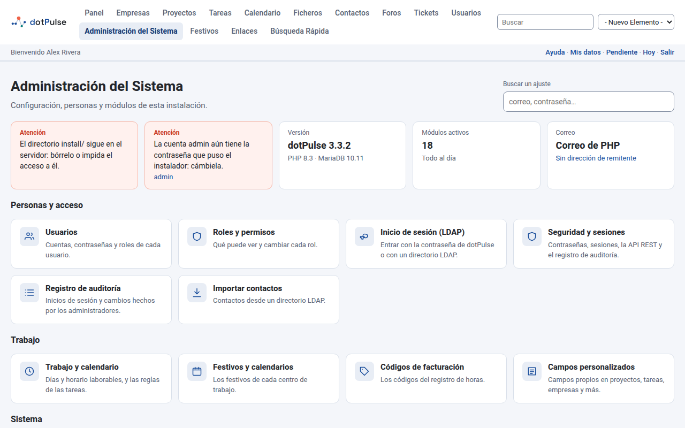
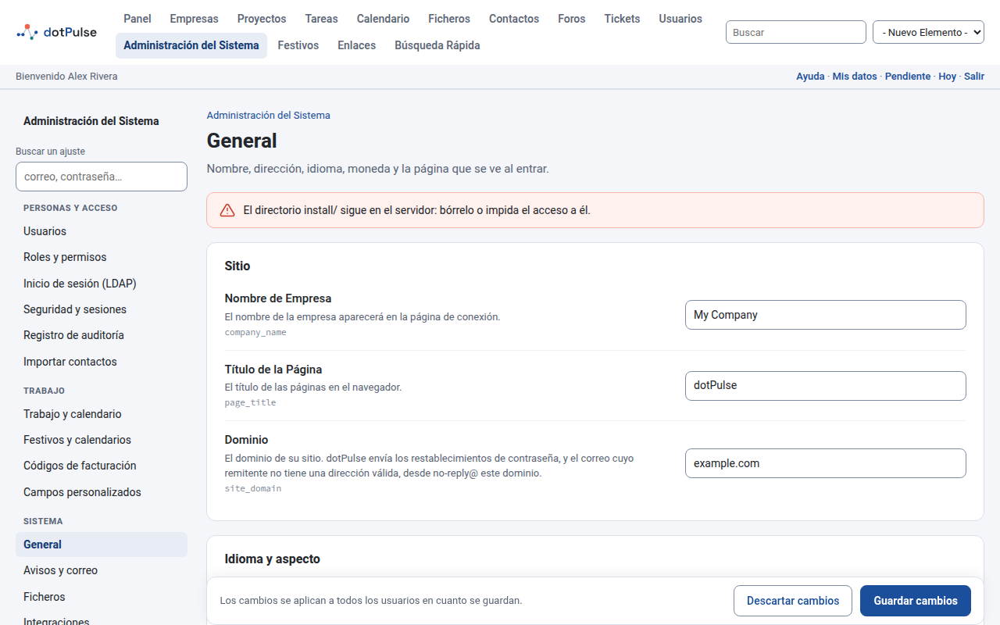
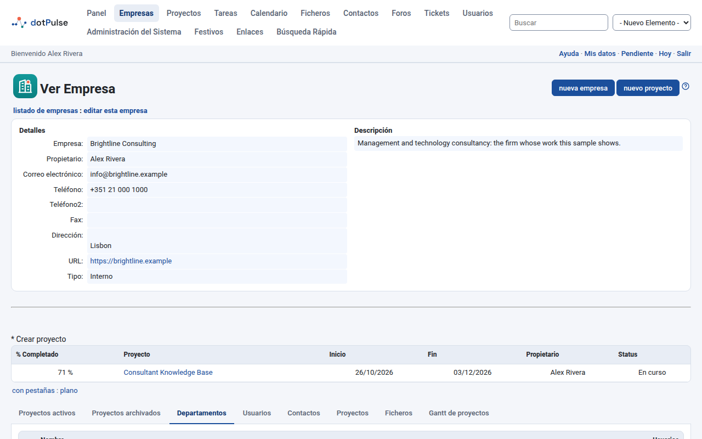
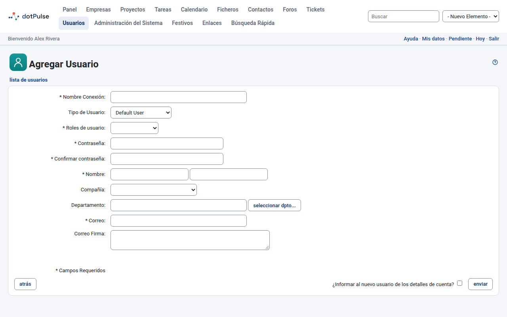
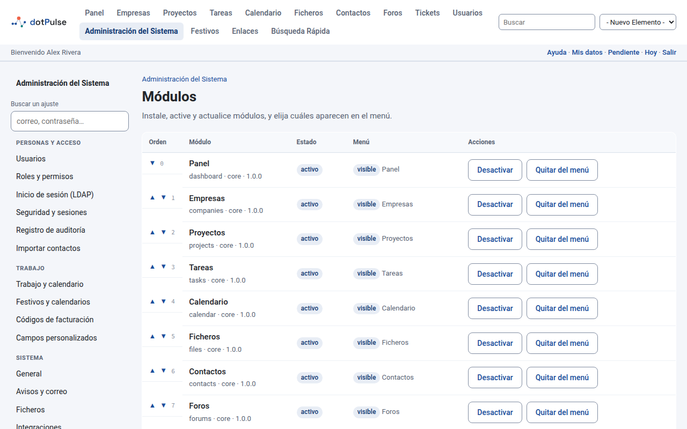
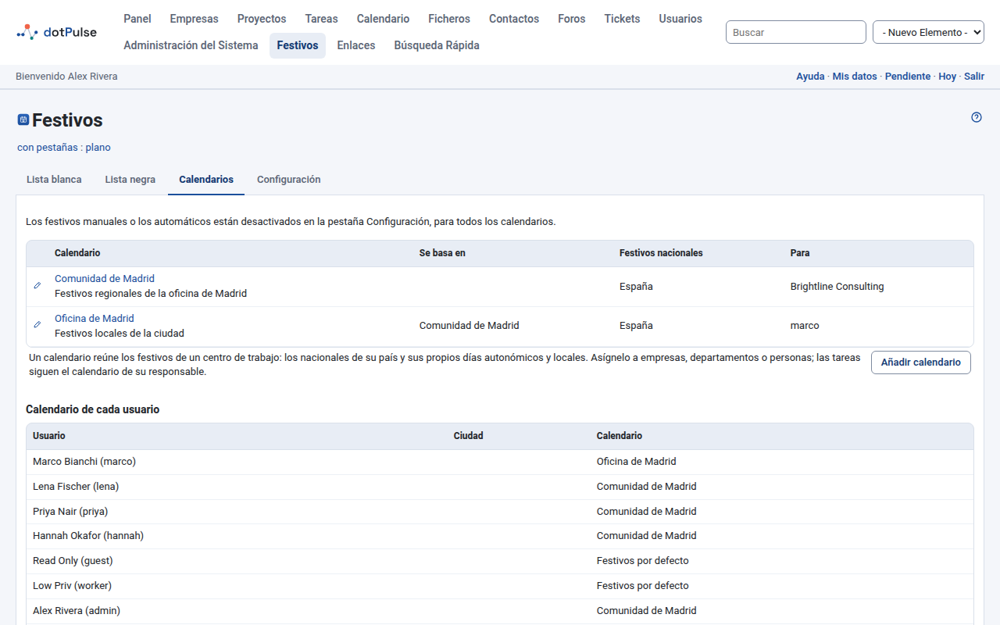
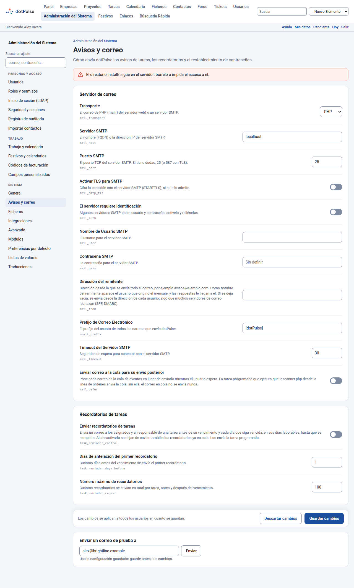

# Primeros pasos { #first-steps }

Su sitio está instalado y ha iniciado sesión como `admin`. Recorra esta lista antes de invitar a su equipo. Lleva una media hora. Cada paso es una versión breve; [Administración](../administration/index.md) tiene la referencia completa.

- [Cambiar la contraseña de admin](#before-anything-else)
- [Revisar la configuración del sistema](#1-review-the-system-settings)
- [Crear sus empresas y departamentos](#2-create-your-companies-and-departments)
- [Revisar los roles](#3-check-the-roles)
- [Añadir sus usuarios](#4-add-your-users)
- [Elegir sus módulos](#5-choose-your-modules)
- [Configurar los calendarios de festivos](#6-set-up-holiday-calendars)
- [Configurar el correo](#7-set-up-email)
- [Crear su primer proyecto](#8-create-your-first-project)

## Antes de nada { #before-anything-else }

Si aún no lo ha hecho, cambie la contraseña inicial: haga clic en **Mis datos** en la parte superior de la página y luego en **cambiar contraseña**. Vea [Instalación](install.md#6-log-in-for-the-first-time).

## La página Administración del Sistema { #the-system-admin-page }

La mayor parte de la configuración está en **Administración del Sistema**, en el menú principal. Su página de inicio muestra el estado de su instalación:

- **Atención**, si el directorio `install/` sigue en el servidor;
- **Versión**: las versiones de dotPulse, de PHP y de la base de datos;
- **Módulos activos**, y si algún módulo tiene una actualización por instalar;
- **Correo**: cómo se envía el correo, y la dirección del remitente.

Debajo, unas tarjetas llevan a cada página de administración, en tres grupos: **Personas y acceso**, **Trabajo** y **Sistema**.

{ .shot }

Cada página de configuración muestra la ayuda de cada ajuste a su lado. Haga clic en **Guardar cambios** al final cuando termine. Los cambios se aplican a todos los usuarios en cuanto los guarda.

!!! tip
    ¿Busca un ajuste concreto? Escriba una palabra en **Buscar un ajuste**, en la parte superior de Administración del Sistema, por ejemplo *correo* o *contraseña*.

## 1. Revisar la configuración del sistema { #1-review-the-system-settings }

Abra **Administración del Sistema › General**:

- **Nombre de Empresa**: el nombre de su organización. Es *My Company* hasta que lo cambie.
- **Título de la Página**: el título de la pestaña del navegador. Por defecto: *dotPulse*.
- **Dominio**: el dominio de su sitio. Por defecto: *example.com*.
- **Idioma del Servidor**: el idioma del sitio.
- **Estilo Predeterminado**: el tema. Las instalaciones nuevas usan *dotPulse*.
- **Símbolo de Moneda**: por defecto *$*.
- **Módulo predeterminado**: la página que ven los usuarios al iniciar sesión. Por defecto: el Panel.

{ .shot }

Luego abra **Administración del Sistema › Trabajo y calendario**. Las fechas y duraciones de las tareas se calculan con estos ajustes:

- **Días Laborables en el Calendario**: de lunes a viernes por defecto.
- **Hora Inicial en el Calendario** y **Hora Final en el Calendario**: 8 y 17 por defecto.
- **Horas de Trabajo Diarias**: 8 por defecto.

Por último, mire **Administración del Sistema › Seguridad y sesiones**. **Longitud Mínima de la Contraseña** es 4 por defecto; súbala.

### Preferencias por defecto de los usuarios { #default-user-preferences }

**Administración del Sistema › Preferencias por defecto** fija el idioma, los formatos de fecha y hora, el formato de moneda y el tema de los usuarios nuevos. Cada usuario puede cambiar los suyos más tarde; vea [Su cuenta y preferencias](../user-guide/preferences.md).

## 2. Crear sus empresas y departamentos { #2-create-your-companies-and-departments }

En dotPulse, cada proyecto pertenece a una empresa. Los usuarios y los contactos también pertenecen a empresas. Cree primero su propia organización, y después sus clientes y proveedores.

1. Haga clic en **Empresas** en el menú principal y luego en **nueva empresa**.
2. Rellene los datos de la empresa y guarde.
3. En la página de la empresa, abra la pestaña **Departamentos** y haga clic en **nuevo departamento** por cada departamento que necesite.

Más en [Empresas, departamentos y contactos](../user-guide/companies-contacts.md).

{ .shot }

## 3. Revisar los roles { #3-check-the-roles }

Un rol decide qué pueden ver y cambiar sus usuarios. Abra **Administración del Sistema › Roles y permisos**. Una instalación nueva tiene cuatro roles:

- **Administrador**: todos los permisos sobre todos los módulos, Administración del Sistema y Usuarios incluidos.
- **Trabajador**: todos los permisos sobre los demás módulos. Es el rol de la mayor parte de su equipo.
- **Invitado**: puede abrir y ver los demás módulos, pero no cambiar nada.
- **Anónimo**: solo puede abrir los demás módulos.

Ajuste los permisos de un rol, o añada sus propios roles, antes de añadir usuarios. Cada usuario debe tener un rol para iniciar sesión.

## 4. Añadir sus usuarios { #4-add-your-users }

1. Haga clic en **Usuarios** en el menú principal (o en **Administración del Sistema › Usuarios**) y luego en **agregar usuario**.
2. Rellene el formulario:
    - **Nombre Conexión**, **Contraseña** y **Confirmar contraseña**;
    - **Roles de usuario**: el rol que ha elegido para esa persona;
    - **Nombre** y **Correo**;
    - **Compañía** y **Departamento**.
3. Marque **¿Informar al nuevo usuario de los detalles de cuenta?** para enviarle un correo con la dirección del sitio y su nombre de usuario. El correo no contiene la contraseña: le pide que se ponga una con el enlace de contraseña olvidada de la página de inicio de sesión. Configure antes el correo ([paso 7](#7-set-up-email)) si quiere usar esta opción.
4. Haga clic en **enviar**.

{ .shot }

En la página de un usuario, la pestaña **Roles** muestra y cambia sus roles.

!!! tip "Inicio de sesión en dos pasos"
    Pida a sus administradores que activen el inicio de sesión en dos pasos: **Mis datos**, y luego la pestaña **Inicio de sesión en dos pasos**. Si alguien pierde su teléfono, un administrador puede restablecerlo desde la misma pestaña en la página de ese usuario.

## 5. Elegir sus módulos { #5-choose-your-modules }

dotPulse trae muchos módulos. Una instalación nueva tiene los básicos (empresas, proyectos, tareas, calendario, ficheros, contactos, foros y los demás). Los módulos adicionales, como los riesgos, las hojas de horas o los calendarios de festivos, están en el código pero aún no se han instalado.

Abra **Administración del Sistema › Módulos**:

- Los módulos en **Sin instalar** aparecen por el nombre de su carpeta, con un botón **instalar**. Instalar un módulo crea sus tablas.
- **Activar** y **Desactivar** hacen que un módulo instalado esté disponible o no.
- **Mostrar en el menú** y **Quitar del menú** deciden si tiene una entrada en el menú principal.
- Las flechas de la columna **Orden** suben o bajan un módulo en el menú.
- **eliminar** borra un módulo y **todos sus datos**.

{ .shot }

Un módulo nuevo se suma a los módulos de administración o a los demás, así que los roles anteriores reciben los mismos permisos sobre él.

## 6. Configurar los calendarios de festivos { #6-set-up-holiday-calendars }

Los festivos no son días laborables: las fechas de las tareas los saltan. Cada centro de trabajo puede tener su propio calendario.

1. En **Administración del Sistema › Módulos**, instale `holiday` en **Sin instalar**. Si después aparece *desactivado*, haga clic en **Activar**.
2. Abra **Administración del Sistema › Festivos y calendarios**.
3. En la pestaña **Configuración**, marque **Activar festivos automáticos** (está desmarcado en una instalación nueva, y sin él no cuenta ningún festivo nacional), elija el país cuyos festivos nacionales se aplican a todos los que no tienen calendario, y guarde.
4. Si hay personas que trabajan en sitios distintos, abra la pestaña **Calendarios** y haga clic en **Añadir calendario**. Dé al calendario un **Nombre**, sus **Festivos nacionales**, e indique **Para** quién es: empresas, departamentos o usuarios. Un calendario también puede basarse en otro, por ejemplo una ciudad en su región, e importar los días de un fichero iCalendar (`.ics`).

{ .shot }

Cada persona sigue su propio calendario; si no tiene, el de su departamento; si no, el de su empresa; y si no, los festivos por defecto. Las fechas de una tarea siguen el calendario del responsable de la tarea.

## 7. Configurar el correo { #7-set-up-email }

dotPulse envía correo para restablecer contraseñas, asignar tareas, avisos y recordatorios. Abra **Administración del Sistema › Avisos y correo**:

- **Transporte**: **PHP** usa la configuración de correo propia de PHP; **SMTP** envía a través de su servidor de correo.
- Con SMTP, rellene **Servidor SMTP** y **Puerto SMTP**, marque **Activar TLS para SMTP** (el puerto 587 usa STARTTLS, el 465 usa SMTPS), y marque **El servidor requiere identificación** con el **Nombre de Usuario SMTP** y la **Contraseña SMTP** si su servidor los pide.
- **Dirección del remitente**: la dirección desde la que se envía cada mensaje, por ejemplo `notifications@example.com`. Use un dominio cuyos registros SPF y DKIM autoricen a su servidor de correo. Si la deja vacía, el correo sale con la dirección de cada usuario y a menudo se rechaza como spam.
- **Prefijo de Correo Electrónico**: el comienzo de cada asunto. Por defecto: *[dotPulse]*.
- **Enviar recordatorios de tareas**, en **Recordatorios de tareas**, envía recordatorios de las tareas que vencen.

Haga clic en **Guardar cambios**. Después escriba su dirección en **Enviar un correo de prueba a**, al final de la página, y haga clic en **Enviar**. Si falla, la página muestra el error del servidor de correo.

{ .shot }

!!! warning "La tarea cron"
    Los avisos de tareas, los correos de asignación y los recordatorios solo se envían cuando la tarea cron ejecuta `queuescanner.php`. Vea [Instalación](install.md#set-up-the-cron-job).

## 8. Crear su primer proyecto { #8-create-your-first-project }

1. Haga clic en **Proyectos** en el menú principal y luego en **nuevo proyecto**.
2. Dele un nombre, elija su **Compañía**, fije sus fechas y su responsable, y guarde.
3. Añada sus tareas y asígnelas a sus usuarios.

Las páginas [Proyectos](../user-guide/projects.md) y [Tareas](../user-guide/tasks.md) de la Guía de uso explican cada campo.

Su sitio está listo. Indique a su equipo la [Guía de uso](../user-guide/index.md).
