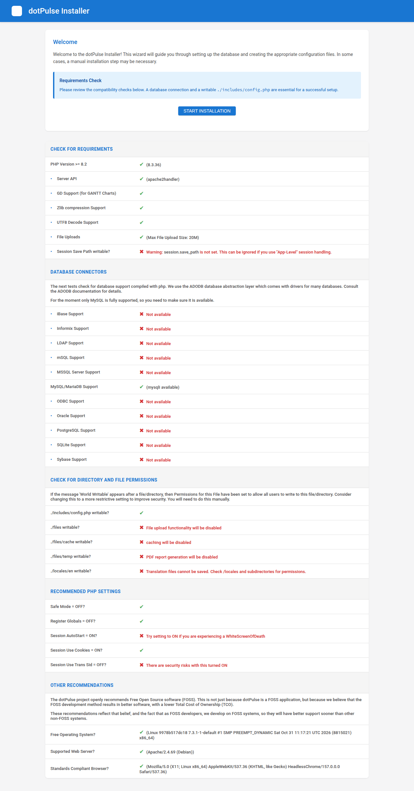
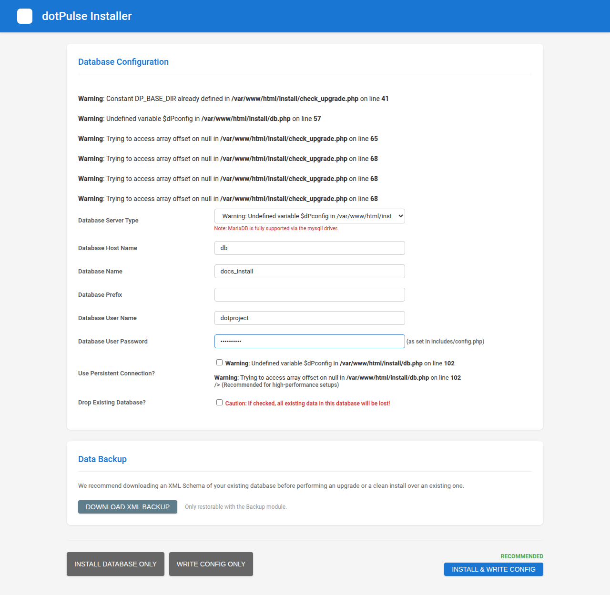
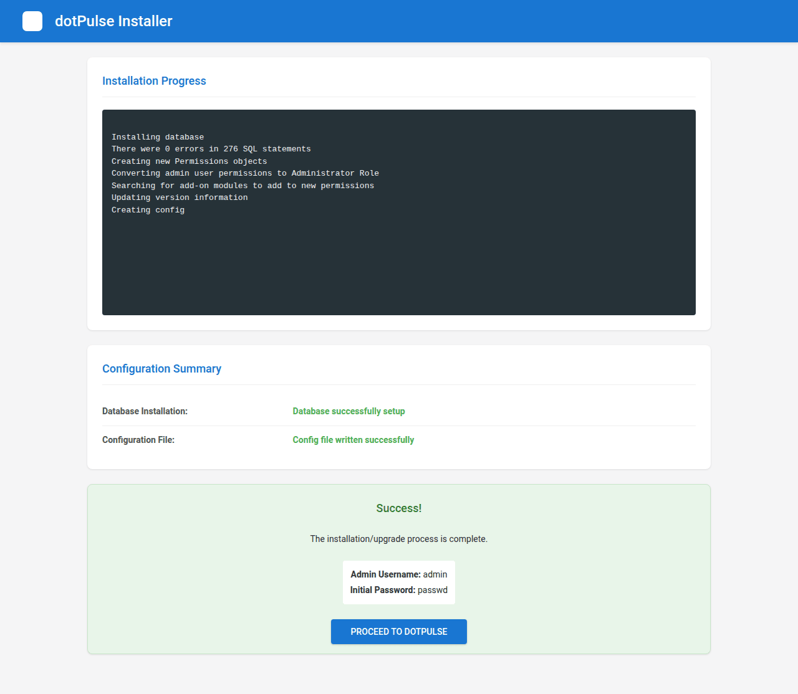
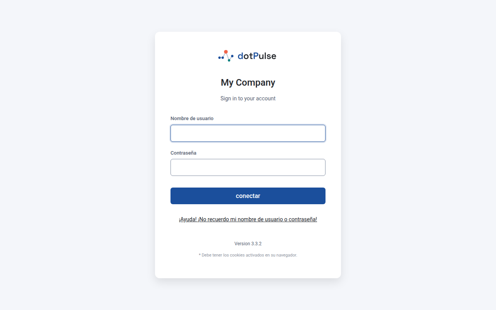

# Instalar dotPulse { #installing-dotpulse }

Un instalador web prepara la base de datos y escribe el fichero de configuración por usted. Ocupa tres páginas. Antes de empezar, revise los [requisitos](requirements.md).

## 1. Obtener el código { #1-get-the-code }

Descargue el código fuente de la última versión desde la [página de versiones de GitHub](https://github.com/davmont/dotPulse/releases) y descomprímalo. O clone el repositorio: la rama `master` contiene las versiones estables.

```sh
git clone --branch master https://github.com/davmont/dotPulse.git dotpulse
```

Ponga los ficheros en la raíz de documentos de su servidor web, o en un subdirectorio de ella, por ejemplo `/var/www/html/dotpulse`.

!!! note
    El archivo de una versión no incluye los ficheros de desarrollo (`tools/`, `tests/`, `docker/`, el `Makefile`). Un clon sí los tiene. El servidor no los necesita, y las reglas de `.htaccess` rechazan las peticiones a ellos.

## 2. Preparar la base de datos { #2-prepare-the-database }

Cree un usuario de MySQL o MariaDB para dotPulse. Tiene dos opciones:

- Dar al usuario permiso para crear bases de datos. El instalador crea entonces la base de datos él mismo.
- Crear usted una base de datos vacía y dar al usuario todos los permisos sobre ella.

Por ejemplo, en el cliente de MySQL o MariaDB:

```sql
CREATE DATABASE dotpulse CHARACTER SET utf8mb4 COLLATE utf8mb4_general_ci;
CREATE USER 'dotpulse'@'localhost' IDENTIFIED BY 'choose-a-strong-password';
GRANT ALL PRIVILEGES ON dotpulse.* TO 'dotpulse'@'localhost';
```

## 3. Dejar que el servidor web escriba donde debe { #3-let-the-web-server-write-where-it-must }

El usuario del servidor web (a menudo `www-data` o `apache`) debe poder escribir en `includes/`, `files/` y `files/temp/`. Por ejemplo:

```sh
cd /var/www/html/dotpulse
chown www-data includes files files/temp
```

Si el instalador no puede escribir `includes/config.php`, funciona igualmente: al final le muestra el contenido del fichero para que lo cree a mano.

## 4. Ejecutar el instalador { #4-run-the-installer }

Abra la carpeta `install/` de su sitio en un navegador, por ejemplo `https://pm.example.com/install/`.

### Página 1: bienvenida y requisitos { #page-1-welcome-and-requirements }

La primera página muestra una tabla **Check for Requirements**. Cada línea tiene una marca verde o una cruz roja:

- la versión de PHP, las extensiones y los conectores de base de datos (solo importa **MySQL/MariaDB Support**);
- **Check for Directory and File Permissions**: si `includes/config.php`, `files/`, `files/cache/`, `files/temp/` y `locales/en/` tienen permiso de escritura;
- **Recommended PHP Settings** y **Other Recommendations**.

{ .shot }

Una cruz roja es un aviso, no un bloqueo. Corrija lo que necesite y vuelva a cargar la página.

!!! tip "World Writable"
    Si una carpeta muestra *World Writable*, cualquier usuario del servidor puede escribir en ella. Restrinja sus permisos al usuario del servidor web cuando la instalación funcione.

Haga clic en **Start Installation**.

### Página 2: configuración de la base de datos { #page-2-database-configuration }

Rellene los datos de la base de datos:

| Campo | Qué escribir |
| --- | --- |
| **Database Server Type** | MySQL o MariaDB, la única base de datos que admite dotPulse. |
| **Database Host Name** | El servidor de base de datos, a menudo `localhost`. |
| **Database Name** | La base de datos que ha creado, o la que debe crear el instalador. |
| **Database Prefix** | Un prefijo para el nombre de cada tabla. El formulario propone `dotp_`. Manténgalo salvo que tenga un motivo para cambiarlo. |
| **Database User Name** | El usuario de base de datos de dotPulse. |
| **Database User Password** | La contraseña de ese usuario. |
| **Use Persistent Connection?** | Déjela sin marcar salvo que su sitio tenga mucho tráfico. |
| **Drop Existing Database?** | Márquela solo para vaciar una base de datos y empezar de cero. **Se pierden todos los datos de esa base de datos.** |

{ .shot }

El recuadro **Data Backup** ofrece **Download XML Backup**, que guarda la estructura y los datos de una base de datos existente. No lo necesita para una instalación nueva.

Abajo, elija qué hace el instalador:

- **install & Write Config** (recomendado): crea las tablas y escribe `includes/config.php`.
- **install Database Only**: crea las tablas pero no toca el fichero de configuración.
- **Write Config Only**: escribe `includes/config.php` y no toca la base de datos.

Haga clic en **install & Write Config**.

### Página 3: progreso de la instalación { #page-3-installation-progress }

El instalador crea la base de datos (si hace falta), carga las tablas y escribe la configuración. El **Configuration Summary** le dice cómo ha ido:

- **Database Installation**: *Database successfully setup*, o el error de la base de datos.
- **Configuration File**: *Config file written successfully*, o *Config file could not be written*.

Si no se pudo escribir el fichero, la página muestra su contenido en un cuadro de texto. Cree `includes/config.php` en el servidor y pegue ese contenido en él.

Cuando todo ha funcionado, un recuadro **Success!** muestra el acceso del administrador:

- **Admin Username:** `admin`
- **Initial Password:** `passwd`

{ .shot }

## 5. Quitar el instalador { #5-remove-the-installer }

Borre el directorio `install/` del servidor, o impida el acceso a él en la configuración de su servidor web:

```sh
rm -rf /var/www/html/dotpulse/install
```

Hasta que lo haga, las páginas de Administración del Sistema muestran un aviso: *El directorio install/ sigue en el servidor: bórrelo o impida el acceso a él.*

## 6. Iniciar sesión por primera vez { #6-log-in-for-the-first-time }

Haga clic en **Proceed to dotPulse**, o abra la dirección de su sitio. Inicie sesión con el usuario `admin` y la contraseña `passwd`.

{ .shot }

!!! warning "Cambie la contraseña ahora"
    Todo el que conoce dotPulse conoce la contraseña inicial. Cámbiela enseguida: haga clic en **Mis datos** en la parte superior de la página y luego en **cambiar contraseña**.

Ya en **Mis datos**, haga clic en **editar este usuario** y ponga su dirección de correo real en lugar de `admin@example.com`. La necesita para restablecer su contraseña.

## El fichero de configuración { #the-configuration-file }

El instalador escribe `includes/config.php`. Solo contiene los datos de la base de datos:

```php
$dPconfig['dbtype'] = 'mysqli';
$dPconfig['dbhost'] = 'localhost';
$dPconfig['dbname'] = 'dotpulse';
$dPconfig['dbprefix'] = 'dotp_';
$dPconfig['dbuser'] = 'dotpulse';
$dPconfig['dbpass'] = 'choose-a-strong-password';
$dPconfig['dbpersist'] = false;
$dPconfig['root_dir'] = DP_BASE_DIR;
$dPconfig['base_url'] = DP_BASE_URL;
```

Todo lo demás se configura en la aplicación, en **Administración del Sistema**.

Para configurar a mano en lugar de dejar que el instalador escriba el fichero, copie `includes/config-dist.php` en `includes/config.php` y edite los datos de la base de datos. Después ejecute el instalador, introduzca los mismos datos, contraseña incluida, y haga clic en **install Database Only** para crear las tablas. Una vez que `includes/config.php` tiene datos de base de datos, el instalador solo acepta peticiones que traigan exactamente esos datos.

Conserve `includes/config.php` al actualizar: no forma parte del código que descarga.

## Proteger la instalación { #secure-the-installation }

La [guía de seguridad del despliegue](https://github.com/davmont/dotPulse/blob/master/docs/deployment-security.md) tiene los detalles. En resumen:

- **Reglas del servidor web.** En Apache, asegúrese de que `AllowOverride` deja funcionar los ficheros `.htaccess`. En nginx, copie las reglas `deny` de la guía en su bloque `server`. Luego compruebe que se rechazan las peticiones a ficheros internos: la guía tiene un pequeño script que pide `includes/config.php`, `vendor/autoload.php`, `files/` y otros, y cada uno debe responder 403 o 404, nunca 200.
- **HTTPS.** Sirva el sitio solo por HTTPS.
- **Quite `install/`** si aún no lo ha hecho.
- **Inicio de sesión en dos pasos.** Actívelo al menos para los administradores: **Mis datos**, y luego la pestaña **Inicio de sesión en dos pasos**. El reloj del servidor debe estar en hora (use NTP), porque los códigos solo se aceptan dentro de 30 segundos respecto a la hora actual.
- **Remitente del correo.** Indique una dirección de remitente para que el correo de dotPulse no se rechace como spam. Vea [Primeros pasos](first-steps.md#7-set-up-email).
- **REST API.** Está desactivada por defecto. Déjela así salvo que algo la use.
- **Registro de auditoría.** **Administración del Sistema › Registro de auditoría** muestra los inicios de sesión, los intentos fallidos y los cambios de los administradores. Guarda 365 días por defecto.
- **Detrás de un proxy inverso**, configure `mod_remoteip` en Apache o `real_ip` en nginx, para que el registro de auditoría guarde las direcciones de sus usuarios y no la del proxy.

## Configurar la tarea cron { #set-up-the-cron-job }

dotPulse pone en cola los avisos de tareas, los correos de asignación y los recordatorios. Un script, `queuescanner.php`, los envía. Ejecútelo desde cron cada pocos minutos, como usuario del servidor web, con la dirección pública de su sitio:

```cron
# /etc/cron.d/dotpulse
*/5 * * * * www-data php /var/www/html/dotpulse/queuescanner.php --base-url=https://pm.example.com
```

- El script solo se ejecuta desde la línea de órdenes. Por HTTP responde 404.
- `--base-url` es obligatorio, para que funcionen los enlaces de los correos. Sin él, el script se detiene con el código de salida 2.
- Si dos ejecuciones se solapan, la segunda se omite.

Sin esta tarea, esos correos no se envían nunca.

## Siguiente paso { #next }

Su sitio está en marcha. Vaya a [Primeros pasos](first-steps.md) para prepararlo para su equipo.
