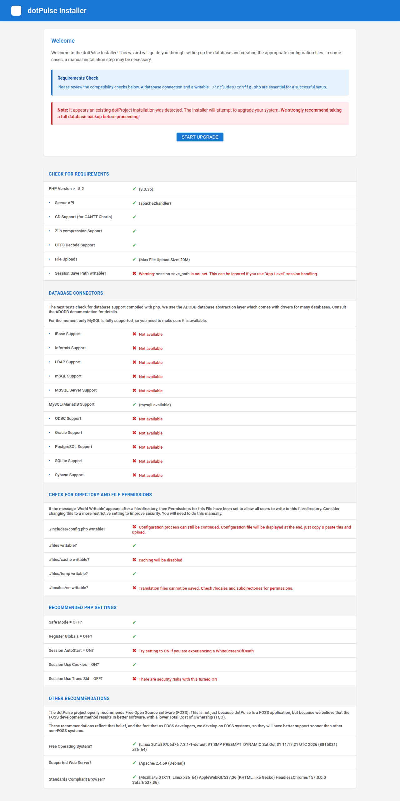
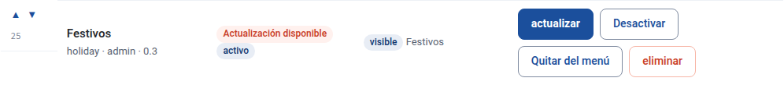

# Actualización { #upgrading }

dotPulse actualiza su base de datos en el sitio. Los mismos pasos sirven para una nueva versión de dotPulse y para un sitio dotProject 2.x: haga una copia de seguridad, sustituya el código, ejecute el instalador y luego actualice los módulos adicionales.

## Antes de empezar { #before-you-start }

- **Lea las notas de versión** de cada versión entre la suya y la nueva. Están en la [página de versiones de GitHub](https://github.com/davmont/dotPulse/releases). Cada una tiene una sección *Changes to know about* o *Breaking changes* y una lista de comprobación *Upgrading*.
- **Compruebe la versión de PHP.** dotPulse 3.2.0 y posteriores necesitan PHP 8.2 o posterior.
- **Prevea una breve parada.** Los usuarios no deben trabajar mientras se actualiza la base de datos.

## 1. Hacer una copia de seguridad { #1-back-up }

Haga una copia de seguridad de:

- la **base de datos**, con su herramienta habitual (por ejemplo `mysqldump`);
- el **directorio `files/`**, que contiene los ficheros subidos;
- **`includes/config.php`**;
- **`locales/` y `modules/*/locales/`**, si editó traducciones en **Administración del Sistema › Traducciones**. Las versiones nuevas sustituyen estos ficheros, así que tendrá que volver a incorporar sus entradas.

!!! tip "Ensaye con una copia"
    Si trabaja con un clon del repositorio y tiene Docker, `make rehearse DUMP=/path/to/dump.sql.gz ADMIN=<admin user>` actualiza una copia de su base de datos en un entorno aislado y después recorre todas las páginas. Vea `docker/README.md` en el repositorio.

## 2. Sustituir el código { #2-replace-the-code }

Ponga el código nuevo en lugar del antiguo. **Conserve `includes/config.php` y `files/`.** Sustituya también `vendor/`.

Borre el árbol antiguo en lugar de copiar los ficheros nuevos encima. Si no, los ficheros que una versión elimina se quedarían ahí.

## 3. Ejecutar el instalador { #3-run-the-installer }

Abra la carpeta `install/` de su sitio en un navegador, por ejemplo `https://pm.example.com/install/`.

1. El instalador encuentra su configuración y su base de datos, y muestra una nota de que se ha detectado una instalación existente. Haga clic en **Start Upgrade**.

    { .shot }

2. Los campos de la base de datos están vacíos. Introduzca los datos de su `includes/config.php`: servidor, nombre, prefijo, usuario y contraseña. El instalador no continúa salvo que coincidan exactamente con el fichero.
3. Haga clic en uno de los botones de abajo:
    - **upgrade Database Only** actualiza la base de datos y no toca `includes/config.php`;
    - **upgrade & Write Config** además reescribe `includes/config.php`. El fichero nuevo solo tiene los datos de la base de datos, así que se pierde cualquier línea que hubiera añadido a mano.
4. La página de progreso muestra *Applying database updates* y los pasos siguientes. **Success!** significa que la base de datos está al día.

Después, **quite de nuevo el directorio `install/`**, o impida el acceso a él.

!!! note
    Algunas versiones no tienen cambios en la base de datos. Ejecute el instalador de todos modos: registra la nueva versión.

## 4. Actualizar los módulos { #4-upgrade-the-modules }

Los módulos adicionales tienen sus propias versiones y sus propias tablas en la base de datos. El instalador no los actualiza.

1. Inicie sesión como administrador y abra **Administración del Sistema**. Si un módulo necesita una actualización, la página de inicio lo indica en **Módulos activos** (por ejemplo *2 actualizaciones por instalar*).
2. Abra **Administración del Sistema › Módulos**. Cada módulo con una versión más reciente muestra la etiqueta **Actualización disponible**.
3. Haga clic en **actualizar** junto a cada uno y confirme.

{ .shot }

Las notas de versión indican qué módulos cambian en cada versión, y lo que haya que hacer después. Por ejemplo, tras la actualización del módulo de festivos en 3.1.1 se elige un país en su pestaña *Configuración*, con **Activar festivos automáticos** marcado.

## 5. Comprobar el sitio { #5-check-the-site }

- Inicie sesión, abra algunos proyectos y tareas, y mire **Administración del Sistema**: la página de inicio muestra la versión que tiene ahora.
- Si usa el correo, envíe un mensaje de prueba desde **Administración del Sistema › Avisos y correo**.

## Actualizar desde dotProject 2.x { #upgrading-from-dotproject-2x }

dotPulse actualiza en el sitio una base de datos de dotProject 2.x, con los pasos anteriores. Conserve el `includes/config.php` de dotProject: el instalador lo lee para encontrar su base de datos.

La versión 3.0.0 es donde dotPulse se separó de dotProject. Lea [sus notas de versión](https://github.com/davmont/dotPulse/blob/master/docs/release-notes/v3.0.0.md) antes de empezar. Lo que cambia para usted:

- **El nombre.** Los títulos de las páginas y el prefijo del asunto de los correos pasan a dotPulse, salvo que los hubiera personalizado. Los nombres internos se mantienen: las tablas, `$dPconfig` y la API de módulos funcionan como antes.
- **Módulos de terceros.** dotPulse bloquea el JavaScript en línea con una Content-Security-Policy. Los módulos adicionales que no forman parte de dotPulse y usan scripts en línea dejan de funcionar hasta que se adapten. Pruébelos con la consola del navegador abierta; las infracciones también se registran en `files/temp/csp-reports.log`.
- **Enlaces que cambiaban datos.** Las acciones que cambiaban datos mediante un simple enlace ahora necesitan el envío de un formulario. Los marcadores o scripts que llamaban a esos enlaces dejan de funcionar.
- **La tarea cron.** `queuescanner.php` ahora solo se ejecuta desde la línea de órdenes, con `--base-url`. Cambie su tarea cron como se indica en [Instalación](install.md#set-up-the-cron-job).
- **El restablecimiento de contraseña** ahora envía por correo un enlace de un solo uso válido durante una hora, en lugar de una contraseña nueva.
- **El inicio de sesión con PostNuke** ha desaparecido (desde 3.2.0). Los usuarios que entraban a través de PostNuke se ponen una contraseña de dotPulse con el enlace de contraseña olvidada de la página de inicio de sesión.
- **Mantis.** El módulo Mantis ahora usa la REST API de MantisBT. Cada usuario introduce una vez su token de API de MantisBT.

Después de la actualización, además:

1. **Actualice los módulos** en **Administración del Sistema › Módulos**, como en el paso 4. Viniendo de dotProject, varios de los módulos incluidos tienen actualizaciones.
2. **Configure el correo:** indique la **Dirección del remitente** y envíe un correo de prueba desde **Administración del Sistema › Avisos y correo**.
3. **Aplique las reglas del servidor web** de la [guía de seguridad del despliegue](https://github.com/davmont/dotPulse/blob/master/docs/deployment-security.md). Es lo más importante en nginx, que ignora los ficheros `.htaccess`.

Las contraseñas guardadas por dotProject siguen funcionando. dotPulse convierte cada una a un hash más seguro la próxima vez que su usuario inicia sesión.
