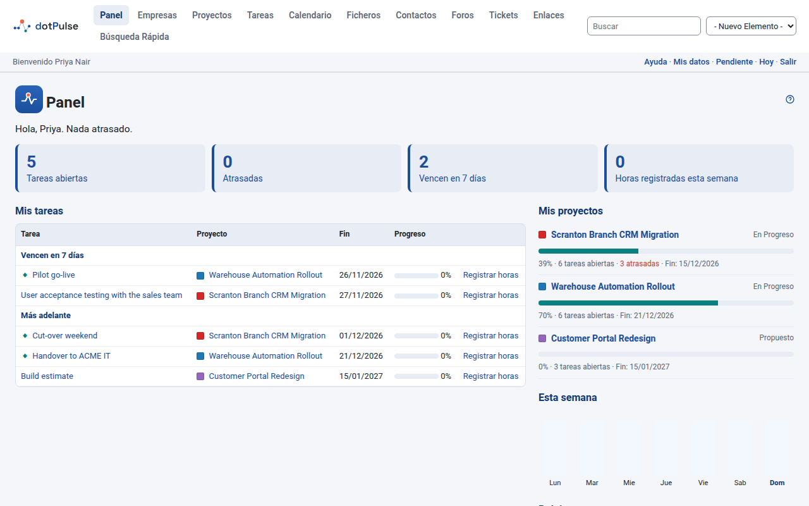

# dotPulse { #dotpulse }

dotPulse es un gestor de proyectos web de código abierto. Usted lo instala en su propio servidor, y su equipo lo usa desde el navegador para planificar proyectos, repartir tareas, registrar su trabajo y seguir el avance.

dotPulse continúa [dotProject](https://github.com/dotproject/dotProject). El desarrollo original se detuvo tras dotProject 2.2.0, en marzo de 2020; dotPulse lleva ese mismo código adelante sobre PHP 8. Las instalaciones de dotProject 2.x se actualizan en el sitio, con sus datos.

{ .shot }

## A quién va dirigido { #who-it-is-for }

- **Equipos y organizaciones pequeñas** que quieren una herramienta de proyectos en su propio servidor, con sus datos en casa.
- **Jefes de proyecto** que planifican con tareas, dependencias, diagramas de Gantt y presupuestos, y siguen las prácticas del PMBOK.
- **Administradores** de un sitio dotProject existente que necesitan que funcione con una versión actual de PHP.

## Qué ofrece { #what-you-get }

- **Proyectos y tareas**: empresas, departamentos y contactos; proyectos con sus tareas, asignados, fechas y dependencias.
- **Su panel**: la página que ve al iniciar sesión, con sus tareas abiertas por fecha de vencimiento, sus proyectos y las horas que ha registrado esta semana.
- **Diagrama de Gantt y tablero**: el plan sobre una línea de tiempo, y un tablero con las columnas *Por hacer*, *En progreso* y *Hecho*.
- **Tiempo y costes**: registros de tareas, hojas de horas, costes y avisos de valor ganado.
- **Calendario, ficheros y foros** para compartir eventos, documentos y debates en torno a un proyecto.
- **Calendarios de festivos** por centro de trabajo, para que las fechas de las tareas salten los festivos de cada persona.
- **Seguridad**: inicio de sesión en dos pasos, un registro de auditoría de los inicios de sesión y de los cambios de los administradores, y un código que ha pasado una auditoría de seguridad completa.
- **[API REST](developer/api.md)** (desactivada por defecto) para scripts y otras herramientas.
- **25 idiomas**, un tema claro y uno oscuro, y un diseño para móviles.

## Por dónde empezar { #where-to-start }

- **[Puesta en marcha](getting-started/index.md)**: qué necesita su servidor, cómo instalar o actualizar, y qué configurar primero.
- **[Guía de uso](user-guide/index.md)**: cómo trabajar a diario con proyectos, tareas, el calendario y lo demás.
- **[Administración](administration/index.md)**: la configuración, los usuarios, los permisos, los módulos y las traducciones de un sitio en marcha.
- **[Desarrollo](developer/index.md)**: el entorno de desarrollo, cómo escribir módulos y código seguro, y la API REST.

## Enlaces { #links }

- Código fuente e incidencias: [github.com/davmont/dotPulse](https://github.com/davmont/dotPulse)
- Notas de cada versión: [versiones en GitHub](https://github.com/davmont/dotPulse/releases)

dotPulse es software libre bajo la Licencia Pública General de GNU, como lo fue dotProject.
Esta documentación está bajo [CC BY-SA 4.0](https://creativecommons.org/licenses/by-sa/4.0/deed.es);
sus ejemplos de código están bajo la GPL, como el código.
