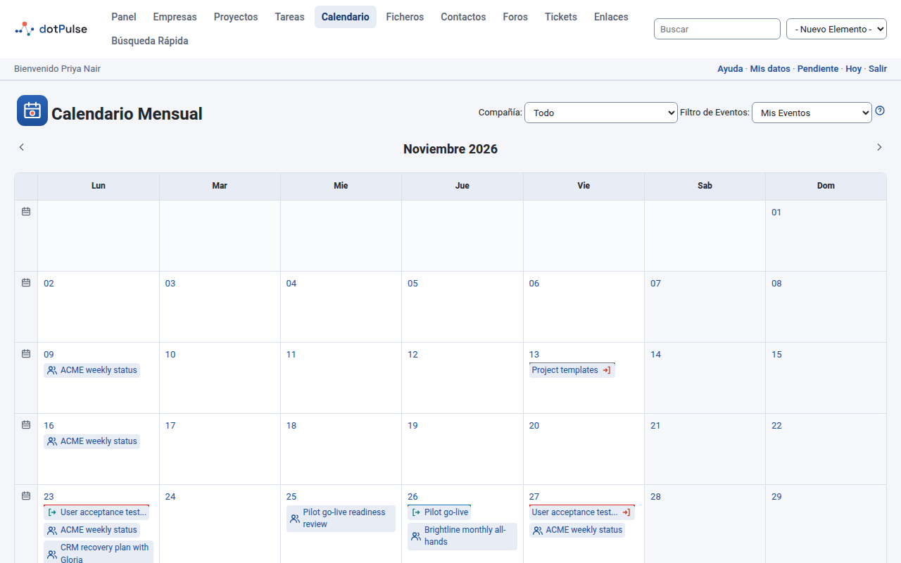
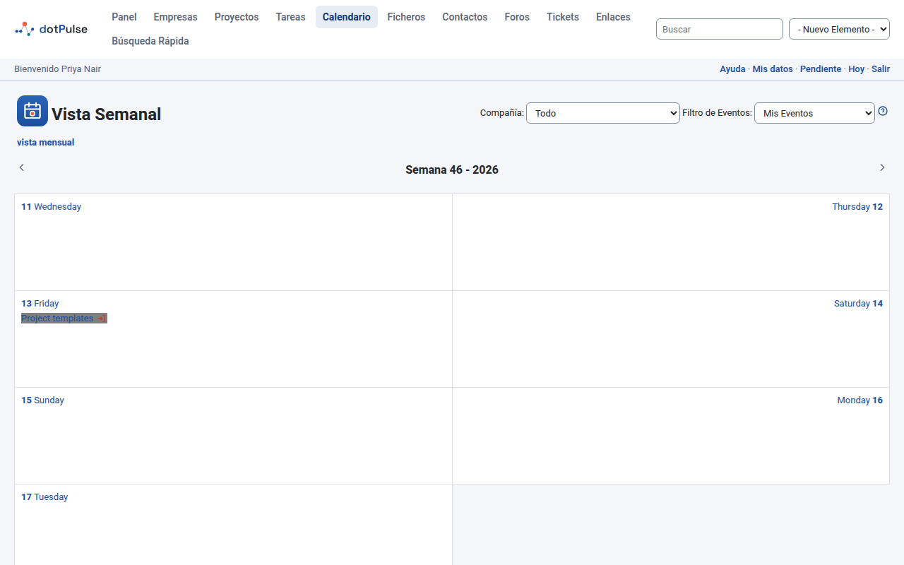
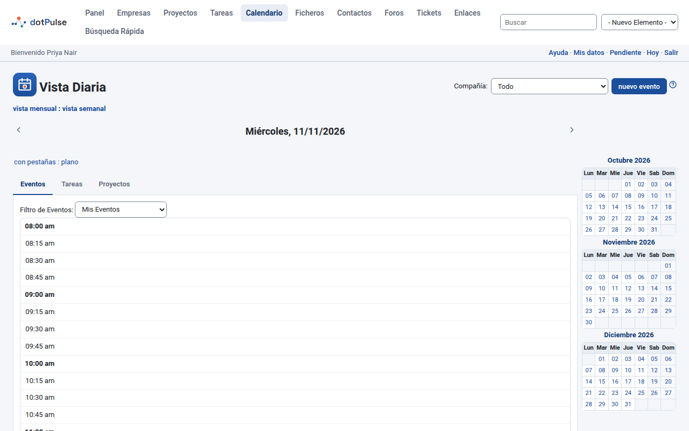
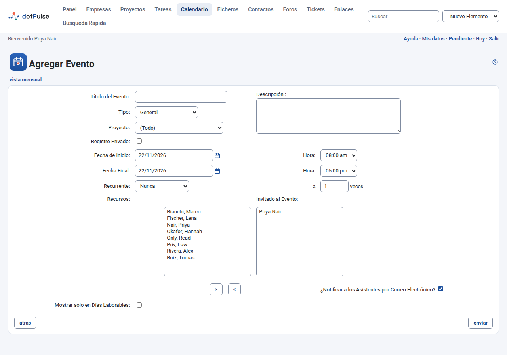

# Calendario { #calendar }

El calendario muestra sus eventos (reuniones, citas, recordatorios) junto con
las tareas en las que trabaja. Abra **Calendario** en el menú de módulos.

## Vista mensual { #month-view }

El calendario se abre en el mes actual, en la vista **Calendario Mensual**.

{ .shot }

- Use las flechas a cada lado del nombre del mes para ir al mes anterior o al
  siguiente.
- El día de hoy aparece resaltado, y los fines de semana sombreados.
- Haga clic en el número de un día para abrir ese día en la [vista diaria](#day-view).
- Haga clic en el icono de semana al principio de una fila para abrir esa semana en la
  [vista semanal](#week-view).
- Bajo el calendario, unos calendarios pequeños muestran los meses anterior y siguiente. Haga clic en
  un día de ellos para abrirlo, o en el nombre del mes para abrir ese mes.

Cada día muestra:

- **Sus tareas**, en el color de su proyecto. Una tarea aparece desde su fecha de
  inicio hasta su fecha de fin, con una marca de inicio el primer día y una marca de fin
  el último.
- **Eventos**, cada uno con un icono según su tipo.
- **Cumpleaños** de los contactos, con un icono de tarta y la edad que cumplen.

Sitúe el puntero sobre un elemento para ver más datos, y haga clic en él para abrirlo.

## Vista semanal { #week-view }

La **Vista Semanal** muestra los siete días de una semana en dos columnas, con
las mismas tareas, eventos y cumpleaños que la vista mensual. La fecha de hoy aparece en rojo.

{ .shot }

- Use las flechas para ir a la semana anterior o a la siguiente.
- Haga clic en el nombre de un día para abrirlo en la vista diaria.
- Haga clic en **hoy**, abajo, para volver a la semana actual.
- Haga clic en **vista mensual**, bajo el título, para volver al mes.

## Vista diaria { #day-view }

La **Vista Diaria** muestra un día en detalle. Ábrala haciendo clic en un día, o haga clic en
**Hoy** en la barra que hay bajo el menú de módulos.

{ .shot }

- Use las flechas para ir al día anterior o al siguiente.
- Haga clic en **vista mensual** o **vista semanal**, bajo el título, para ver un periodo mayor.
- Haga clic en **nuevo evento** para añadir un evento en este día.

El día tiene dos pestañas:

- **Eventos**: los eventos del día, colocados en un horario por horas. Los eventos que
  se solapan aparecen uno al lado del otro. Los cumpleaños aparecen encima del horario.
- **Tareas**: sus tareas pendientes.

Según la configuración de su administrador, junto a las pestañas aparecen calendarios pequeños de los
meses cercanos.

## Filtrar el calendario { #filter-the-calendar }

Las vistas mensual y semanal tienen dos filtros arriba. La vista diaria tiene
**Compañía** arriba y **Filtro de Eventos** en su pestaña **Eventos**.

- **Compañía**: muestra solo los eventos y las tareas de los proyectos de una empresa, o
  **Todo**.
- **Filtro de Eventos**: qué eventos se muestran:
    - **Mis Eventos**: los eventos a los que está invitado.
    - **Eventos que he Creado**: los eventos que ha creado.
    - **Todos los Eventos**: todos los eventos que puede ver.

El filtro que elija se mantiene hasta que cierre la sesión. El filtro con el que
empieza el calendario es su preferencia **Filtro de Eventos Predeterminado**. Vea
[Su cuenta y sus preferencias](preferences.md#default-event-filter).

Los eventos privados de otras personas no se muestran nunca, sea cual sea el filtro.

!!! note "Administradores"
    Los administradores tienen además **Mostrar Eventos para** en la vista diaria, para ver los
    eventos de otro usuario.

## Añadir un evento { #add-an-event }

1. Haga clic en **nuevo evento** en la vista diaria, o elija **Evento** en la
   lista **- Nuevo Elemento -** de la barra superior.
2. Rellene el formulario (vea más abajo).
3. Elija a quién invitar (vea [Invitar a personas](#invite-people)).
4. Haga clic en **enviar**.

{ .shot }

El formulario del evento tiene estos campos:

| Campo | Para qué sirve |
|---|---|
| **Título del Evento** | El nombre que se muestra en el calendario. Obligatorio. |
| **Descripción** | Los detalles del evento. |
| **Tipo** | **General**, **Cita**, **Reunión**, **Evento de todo el día**, **Aniversario** o **Recordatorio**. El tipo fija el icono del evento. |
| **Proyecto** | El proyecto al que pertenece el evento, o **(Todo)** para ninguno. Los eventos de un proyecto aparecen también en la pestaña **Eventos** del proyecto. |
| **Registro Privado** | Márquelo para que el evento sea solo suyo. Nadie más lo ve, aunque esté invitado. |
| **Fecha de Inicio**, **Fecha Final** y su **Hora** | Cuándo empieza y termina el evento. Haga clic en el icono de calendario para elegir una fecha: no se puede escribir. Si elige una fecha de inicio posterior a la fecha final, la fecha final se mueve con ella. |
| **Recurrente** y **x ... veces** | Si el evento se repite, y cuántas veces en total. Vea [Repetir un evento](#repeat-an-event). |
| **Mostrar solo en Días Laborables** | Márquelo para un evento que abarca varios días pero solo ocurre en días laborables. El calendario lo deja entonces fuera de los días que no son laborables según la configuración de dotPulse, normalmente los fines de semana. |

Su administrador puede añadir campos propios al final del formulario.

### Invitar a personas { #invite-people }

Bajo **Recursos** está la lista de personas a las que puede invitar. Bajo
**Invitado al Evento** están las personas invitadas. Cuando crea un evento, queda
invitado a él.

- Para invitar a alguien, selecciónelo en **Recursos** y haga clic en **>**.
- Para quitar a alguien, selecciónelo en **Invitado al Evento** y haga clic en **<**.

Deje marcada la casilla **¿Notificar a los Asistentes por Correo Electrónico?** para enviar la invitación por correo a las personas invitadas.

### Cuando alguien está ocupado { #when-someone-is-busy }

Si alguna de las personas invitadas ya tiene un evento a esa hora, dotPulse las muestra
bajo "Los usuarios siguientes tienen conflictos con el tiempo de evento propuesto" y ofrece
cuatro opciones:

- **Sugerir Alternativa**: dotPulse busca el primer hueco libre para
  todos. Indique la **Fecha más Temprana**, la **Fecha más Tardía**, la **Hora de Inicio más Temprana**,
  la **Hora de Finalización más Tardía** y la **Duración** en minutos, y haga clic en **enviar**.
  dotPulse abre el formulario del evento con el primer hueco que encuentra, que aún
  puede cambiar. Solo tiene en cuenta los días laborables.
- **Cancelar**: descarta el evento.
- **Petición de Correo**: no guarda el evento, pero envía un correo a las personas invitadas sobre la
  reunión propuesta para que acuerden una hora con usted.
- **Anotar Evento a pesar del Conflicto**: guarda el evento de todos modos.

### Repetir un evento { #repeat-an-event }

Elija con qué frecuencia se repite el evento en **Recurrente**: **Cada Hora**, **Diariamente**,
**Semanalmente**, **Cada 2 Semanas**, **Monthly**, **Trimestralmente**, **Semi-Annually** o
**Annually**. Después escriba en la casilla que hay tras la **x** cuántas veces ocurre en
total, por ejemplo 10 para diez reuniones semanales. **Nunca** significa que el evento ocurre
una sola vez.

## Ver, editar o eliminar un evento { #view-edit-or-delete-an-event }

Haga clic en un evento del calendario, o en **Próximamente** en su
[panel](dashboard.md), para abrirlo. La página **Ver Evento** muestra su título,
tipo, proyecto, inicio y fin, cómo se repite, quién está invitado (**Asistentes**) y
la descripción.

- Haga clic en **editar este evento** para cambiarlo, y después en **enviar**.
- Haga clic en **eliminar evento** y confirme para quitarlo.
- Haga clic en **vista mensual** o **vista diaria** para verlo en el calendario.

## Tareas en el calendario { #tasks-on-the-calendar }

El calendario muestra las tareas que tiene asignadas, en proyectos que no están archivados.
Salen de las fechas de inicio y fin de la tarea, así que para mover una tarea en el
calendario debe cambiar sus fechas en la propia tarea. Vea [Tareas](tasks.md).

## Festivos { #holidays }

Si su administrador usa el módulo de festivos, el calendario marca los festivos
de su lugar de trabajo (su calendario de festivos, vea
[Configurar los calendarios de festivos](../getting-started/first-steps.md#6-set-up-holiday-calendars)):

- en las vistas mensual y semanal, un festivo aparece sombreado y muestra su nombre;
- en los calendarios mensuales pequeños, aparece sombreado y muestra su nombre al situar el puntero encima;
- en la vista diaria, su nombre sigue a la fecha.

Los festivos cuentan también como días no laborables en el resto de dotPulse: por ejemplo,
**Sugerir Alternativa** se los salta cuando busca un hueco libre.
