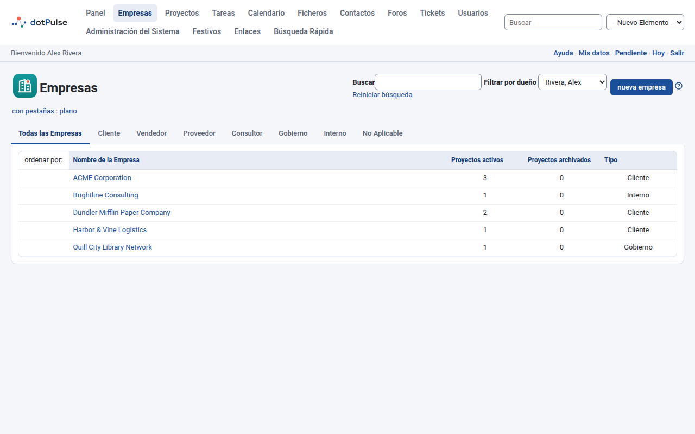
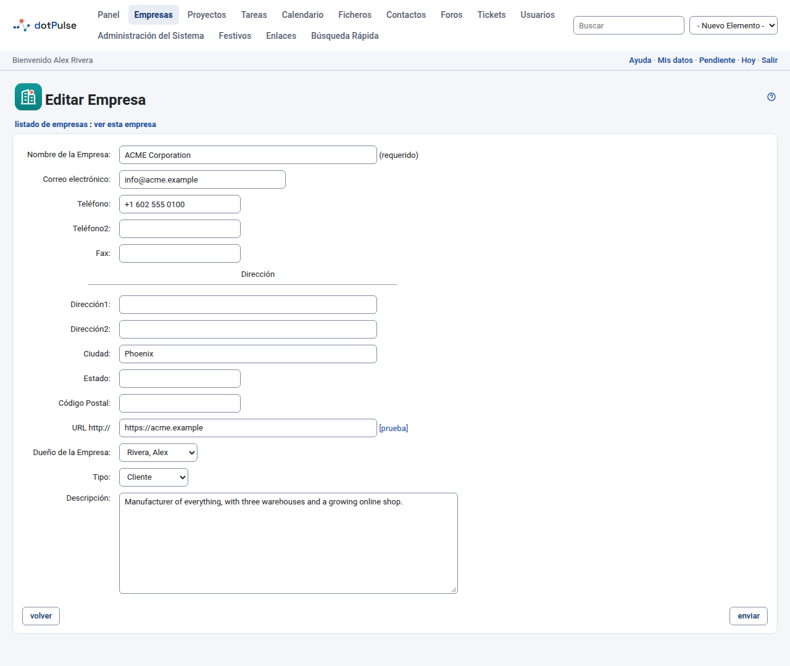
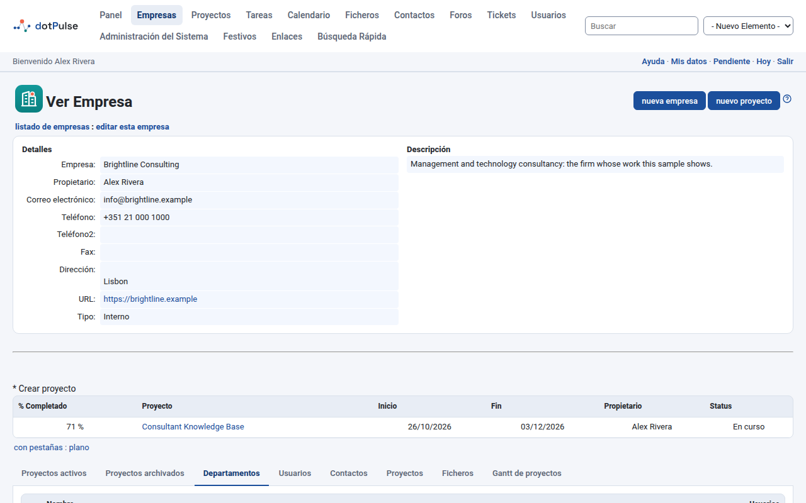
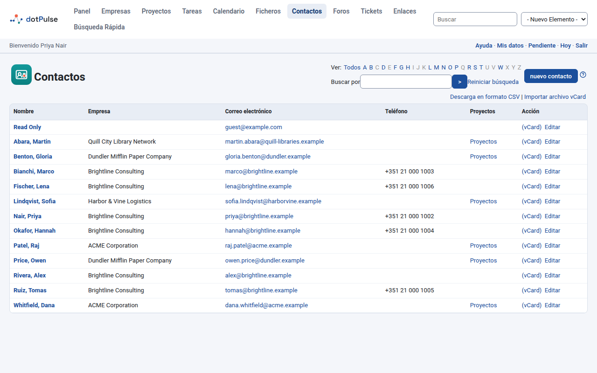
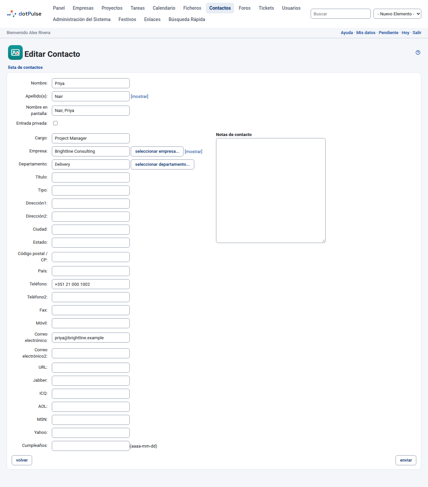

# Empresas, departamentos y contactos { #companies-departments-and-contacts }

Los proyectos se hacen para organizaciones y personas, y con ellas. dotPulse las
guarda en tres sitios:

- **Empresas**: su propia organización, sus clientes, proveedores, etc.
- **Departamentos**: las unidades dentro de una empresa.
- **Contactos**: las personas, dentro o fuera de su organización.

Cada proyecto pertenece a una empresa, así que normalmente las empresas van primero.

## Empresas { #companies }

Abra **Empresas** en el menú de módulos.

{ .shot }

### Buscar una empresa { #find-a-company }

La lista tiene una pestaña por tipo de empresa. **Todas las Empresas** muestra todas
las empresas; las demás pestañas muestran un tipo cada una: **Cliente**, **Vendedor**,
**Proveedor**, **Consultor**, **Gobierno**, **Interno** y **No Aplicable**. Su
administrador puede cambiar esta lista de tipos.

De cada empresa ve su **Nombre de la Empresa**, el número de **Proyectos activos**
y de **Proyectos archivados**, y su **Tipo**. Haga clic en el encabezado de una
columna para ordenar por ella.

Para acotar la lista:

- Escriba parte de un nombre en **Buscar** y pulse ++enter++. Haga clic en
  **Reiniciar búsqueda** para volver a mostrar todas las empresas.
- Use **Filtrar por dueño** para mostrar las empresas de una persona, o **Todo**.

!!! note "¿Faltan empresas?"
    **Filtrar por dueño** empieza con su propio nombre, así que al principio solo ve
    las empresas de las que es dueño. Elija **Todo** para ver todas las empresas a
    las que tiene acceso.

### Añadir una empresa { #add-a-company }

1. Haga clic en **Empresas › nueva empresa**, o elija **Empresa** en la lista
   **- Nuevo Elemento -** de la barra superior.
2. Rellene el formulario. Solo es obligatorio **Nombre de la Empresa**.
3. Haga clic en **enviar**.

{ .shot }

El formulario tiene estos campos:

| Campo | Para qué sirve |
|---|---|
| **Nombre de la Empresa** | El nombre que se muestra en todo dotPulse. Obligatorio. |
| **Correo electrónico**, **Teléfono**, **Teléfono2**, **Fax** | Cómo contactar con la empresa. |
| **Dirección1**, **Dirección2**, **Ciudad**, **Estado**, **Código Postal** | La dirección de la empresa. |
| **URL** | El sitio web de la empresa, sin `http://`. Haga clic en **[prueba]** para abrirlo en una ventana nueva y comprobarlo. |
| **Dueño de la Empresa** | La persona de su organización responsable de esta empresa. |
| **Tipo** | Cliente, proveedor, etc. Decide en qué pestaña de la lista aparece la empresa. |
| **Descripción** | Notas libres sobre la empresa. |

### Ver una empresa { #view-a-company }

Haga clic en el nombre de una empresa para abrir su página, **Ver Empresa**. La
parte superior muestra sus datos y su descripción. Debajo hay pestañas:

- **Proyectos activos** y **Proyectos archivados**: los proyectos de la empresa.
- **Departamentos**: los departamentos de la empresa.
- **Usuarios**: los usuarios de dotPulse que trabajan para la empresa.
- **Contactos**: los contactos de la empresa.

Otros módulos pueden añadir más pestañas, por ejemplo para ficheros o diagramas de Gantt.

Desde la página de la empresa también puede hacer clic en **nuevo proyecto** para
empezar un proyecto para esta empresa. Consulte [Proyectos](projects.md).

### Editar o eliminar una empresa { #edit-or-delete-a-company }

En la página de la empresa, haga clic en **editar esta empresa**, cambie el
formulario y haga clic en **enviar**.

Para eliminar una empresa, haga clic en **eliminar empresa** en la página de la
empresa y confirme. dotPulse solo le deja eliminar una empresa que no tenga
proyectos, departamentos ni usuarios. Si todavía tiene alguno, pase el ratón sobre
el enlace de eliminar para ver qué lo impide.

## Departamentos { #departments }

Los departamentos dividen una empresa en unidades, como Ventas o Ingeniería. Pueden
anidarse: un departamento puede tener un departamento padre.

### Añadir un departamento { #add-a-department }

1. Abra la página de la empresa y vaya a la pestaña **Departamentos**.
2. Haga clic en **nuevo departamento**.
3. Rellene el formulario y haga clic en **enviar**.

{ .shot }

El formulario tiene la **Empresa**, un **Nombre** (obligatorio), **Teléfono**,
**Fax**, campos de dirección, **URL**, **Padre**, **Propietario** y **Descripción**.

### Ver, editar o eliminar un departamento { #view-edit-or-delete-a-department }

En la pestaña **Departamentos** de la empresa, haga clic en el nombre de un
departamento para abrirlo. Su página muestra los datos del departamento y una
pestaña **Contactos** con las personas que lo forman. Use **editar este departamento**
y **eliminar departamento** en esa página para cambiarlo o quitarlo.

## Contactos { #contacts }

Abra **Contactos** en el menú de módulos.

{ .shot }

La lista muestra el **Nombre**, la **Empresa**, el **Correo electrónico** y el
**Teléfono** de cada contacto. Cuando un contacto está vinculado a proyectos, la
columna **Proyectos** tiene un enlace que abre una ventana pequeña con esos
proyectos; haga clic en uno para abrirlo. La columna **Acción** tiene **(vCard)**,
para descargar el contacto como vCard, y **Editar**.

### Buscar un contacto { #find-a-contact }

- Haga clic en una letra después de **Ver:** para mostrar los contactos cuyo nombre
  empieza por ella. Las letras en gris no tienen contactos. Haga clic en **Todos**
  para volver a mostrar a todo el mundo.
- Escriba una palabra en **Buscar por** y haga clic en **>**. dotPulse busca en el
  nombre y los apellidos, la empresa, la dirección de correo y las notas. Haga clic
  en **Reiniciar búsqueda** para borrarla.

### Añadir un contacto { #add-a-contact }

1. Haga clic en **Contactos › nuevo contacto**, o elija **Contacto** en la lista
   **- Nuevo Elemento -** de la barra superior.
2. Rellene el formulario.
3. Haga clic en **enviar**.

{ .shot }

Los campos principales son:

| Campo | Para qué sirve |
|---|---|
| **Nombre**, **Apellido(s)** | El nombre del contacto. Los apellidos son obligatorios. |
| **Nombre en pantalla** | Cómo se muestra y se ordena el contacto, por ejemplo "Smith, Anna". Haga clic en **[mostrar]** junto a los apellidos o a la empresa para rellenarlo a partir de ellos. Obligatorio. |
| **Entrada privada** | Márquela para guardar el contacto solo para usted. Consulte más abajo. |
| **Cargo**, **Título**, **Tipo** | El puesto del contacto, un tratamiento como Dr. o Sra., y una categoría libre propia. |
| **Empresa** | Haga clic en **seleccionar empresa...** para elegir la empresa del contacto. |
| **Departamento** | Haga clic en **seleccionar departamento...** para elegir uno de los departamentos de la empresa. Elija primero la empresa. |
| Campos de dirección | **Dirección1**, **Dirección2**, **Ciudad**, **Estado**, **Código postal / CP** y **País**. |
| Teléfonos y correo | **Teléfono**, **Teléfono2**, **Fax**, **Móvil**, **Correo electrónico**, **Correo electrónico2**. |
| **URL** | El sitio web del contacto. |
| Mensajería | Cuentas de Jabber, ICQ, AOL, MSN y Yahoo. |
| **Cumpleaños** | Se escribe como aaaa-mm-dd. Los cumpleaños aparecen en el [calendario](calendar.md). |
| **Notas de contacto** | Notas libres. |

### Mantener un contacto privado { #keep-a-contact-private }

Marque **Entrada privada** para que un contacto sea solo suyo. Los demás usuarios
no lo ven en la lista de contactos y no pueden abrirlo, editarlo ni descargarlo.

### Editar o eliminar un contacto { #edit-or-delete-a-contact }

Haga clic en **Editar** junto al contacto en la lista, o abra el contacto y haga
clic en **editar**. Cambie el formulario y haga clic en **enviar**.

Para eliminar un contacto, ábralo, haga clic en **eliminar contacto** y confirme.
No puede eliminar el contacto de un usuario de dotPulse (consulte más abajo).

### Empezar un proyecto desde un contacto { #start-a-project-from-a-contact }

En la página de un contacto, haga clic en **nuevo proyecto**. dotPulse abre el
formulario de proyecto con la empresa del contacto ya elegida. Consulte
[Proyectos](projects.md).

### Exportar contactos { #export-contacts }

- **Un contacto como vCard**: haga clic en **(vCard)** junto al contacto en la lista.
  Su navegador descarga un fichero `.vcf` que pueden importar las libretas de
  direcciones y los teléfonos.
- **Todos los contactos como hoja de cálculo**: haga clic en **Descarga en formato CSV**
  arriba a la derecha de la lista. El fichero usa los nombres de columna de la
  exportación de contactos de Outlook, así que la mayoría de las libretas de
  direcciones pueden importarlo.

### Importar contactos desde vCards { #import-contacts-from-vcards }

1. Haga clic en **Importar archivo vCard** arriba a la derecha de la lista de contactos.
2. Junto a **Obtener archivo(s) vCard**, elija un fichero `.vcf`. Un fichero puede
   contener muchos contactos.
3. Haga clic en **enviar**.

dotPulse crea un contacto por cada tarjeta. Si la organización de una tarjeta tiene
exactamente el mismo nombre que una empresa de dotPulse, el contacto se vincula a
esa empresa.

!!! tip
    Importar siempre crea contactos nuevos. Si importa dos veces el mismo fichero,
    tendrá cada contacto dos veces.

## Contactos y usuarios { #contacts-and-users }

Cada usuario de dotPulse tiene una ficha de contacto. En ella están el nombre, el
correo, los teléfonos y la dirección del usuario, y por eso los usuarios aparecen
en la lista de contactos y en la pestaña **Contactos** de su empresa.

- Para cambiar el teléfono o la dirección de un usuario, edite su contacto.
- No puede eliminar el contacto de un usuario: dotPulse dice
  "Este contacto pertenece a un usuario y no puede borrarse."
- Los contactos de los usuarios que ya no pueden iniciar sesión se dejan fuera de
  la lista de contactos.

## Usuarios, roles y permisos { #users-roles-and-permissions }

Los usuarios son las personas que pueden iniciar sesión. Cada usuario pertenece a
una empresa y recibe uno o más roles, y los roles deciden lo que puede ver y hacer.

Su administrador gestiona los usuarios, los roles y los permisos en **Usuarios**.
Puede ver sus propios roles y permisos en las pestañas **Roles** y **Permisos** de
la [página de su cuenta](preferences.md).
