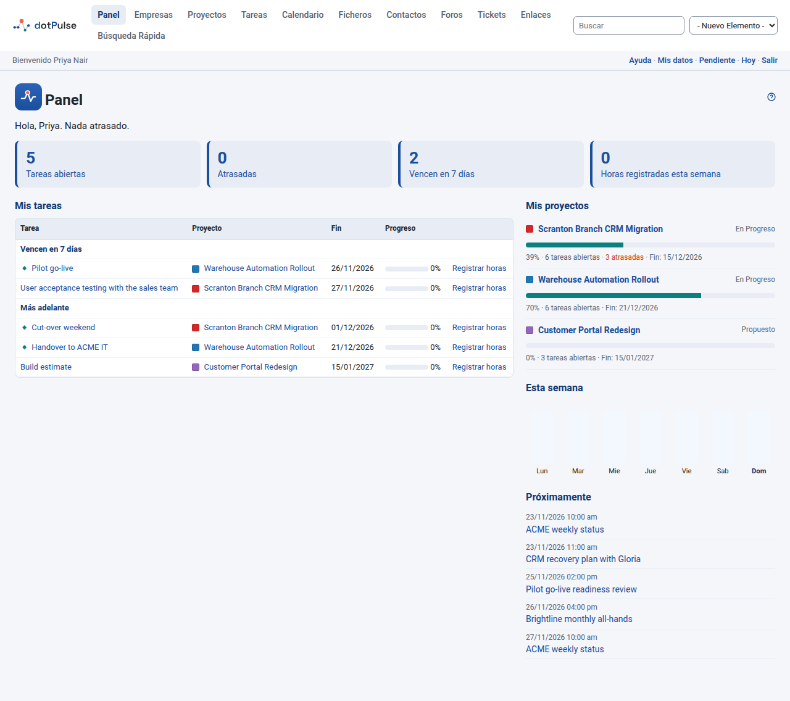
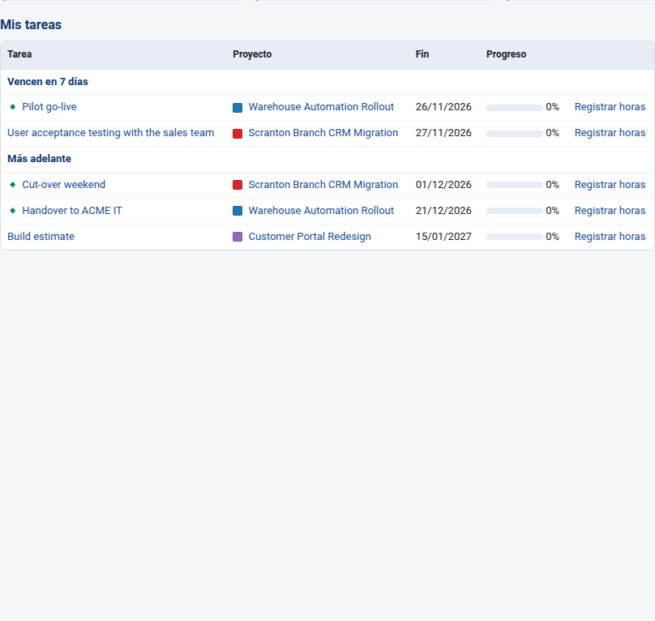
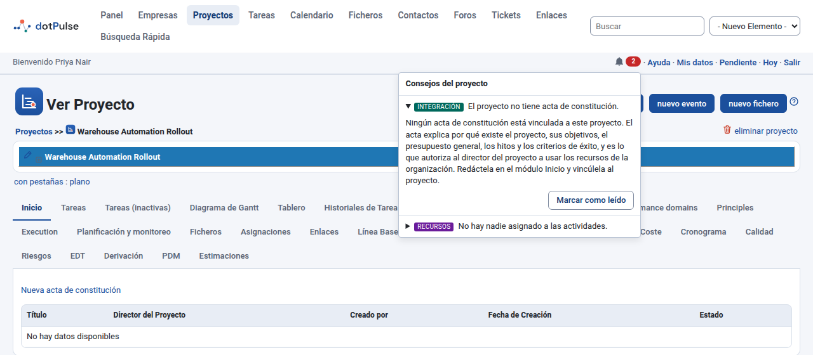

# Su panel { #your-dashboard }

El panel es su página de inicio personal. Muestra lo que tiene que hacer, cómo van
sus proyectos, cuántas horas ha registrado esta semana y lo que se acerca en su
calendario. dotPulse lo abre al iniciar sesión, y siempre puede volver a él con
**Panel** en el menú de módulos.

{ .shot }

Todo el panel respeta sus permisos: solo ve las tareas, los proyectos y los
eventos que tiene permiso para ver.

## El saludo { #the-greeting }

La línea de arriba le saluda por su nombre de pila y resume su día:

- cuántas de sus tareas están atrasadas, o
- **Nada atrasado.** cuando va al día, o
- **No tiene tareas abiertas asignadas.** cuando no tiene nada asignado.

## Los cuatro contadores { #the-four-counters }

Bajo el saludo, cuatro recuadros cuentan:

| Contador | Qué cuenta |
|---|---|
| **Tareas abiertas** | Las tareas asignadas a usted que no están terminadas. |
| **Atrasadas** | Sus tareas abiertas cuya fecha de fin ya ha pasado. El recuadro se resalta cuando hay alguna. |
| **Vencen en 7 días** | Sus tareas abiertas que terminan en los próximos siete días. |
| **Horas registradas esta semana** | Las horas que ha registrado de lunes a domingo de esta semana. |

Haga clic en un contador para saltar a la parte correspondiente de la página.

## Mis tareas { #my-tasks }

**Mis tareas** muestra sus tareas abiertas, primero las que terminan antes, en
cuatro grupos:

- **Atrasadas**
- **Vencen en 7 días**
- **Más adelante**
- **Sin fecha de fin**

Una tarea cuenta como abierta cuando está asignada a usted, está completada en
menos del 100 % y pertenece a un proyecto que no es una plantilla ni está
archivado. Los grupos de tareas (tareas que solo suman sus subtareas) se dejan
fuera, porque el trabajo se registra en sus subtareas.

Cada fila muestra:

- **Tarea**: el nombre de la tarea, con un enlace a ella. Un rombo marca un hito y
  un signo de exclamación una tarea de prioridad alta.
- **Proyecto**: el proyecto, con su color.
- **Fin**: la fecha de fin de la tarea.
- **Progreso**: cuánto está completada la tarea.
- **Registrar horas**: un atajo a la pestaña **Agregar Hist.** de la tarea, donde
  anota el tiempo dedicado. Solo aparece si puede registrar trabajo en esa tarea.
  Consulte [Registrar el trabajo](task-logs.md).

{ .shot }

## Mis proyectos { #my-projects }

**Mis proyectos** muestra los proyectos de los que es propietario o en los que
tiene tareas abiertas, primero los que terminan antes. Las plantillas y los
proyectos archivados se dejan fuera.

De cada proyecto ve su nombre y su estado, una barra de progreso, el número de
tareas abiertas, el número de tareas atrasadas (si las hay) y la fecha de fin. La
fecha de fin se resalta cuando ya ha pasado y el proyecto no está completo.

## Esta semana { #this-week }

**Esta semana** es un pequeño gráfico de barras con las horas que registró cada día
de lunes a domingo. La barra de hoy aparece resaltada. Pase el ratón sobre una
barra para ver la fecha y las horas exactas.

## Próximamente { #coming-up }

**Próximamente** muestra sus eventos desde ahora hasta el final del séptimo día:
los eventos a los que está invitado y los que ha creado. Haga clic en un evento
para abrirlo. Consulte [Calendario](calendar.md).

## Consejos del proyecto { #project-tips }

Cuando abre un proyecto, puede aparecer una campana en la barra bajo el menú de
módulos. Son los **Consejos del proyecto**: dotPulse compara el plan del proyecto
con las buenas prácticas de dirección de proyectos y enumera lo que se podría mejorar.

{ .shot }

La campana forma parte del módulo dotProject+. Solo la ve cuando ese módulo está
activo y puede ver el proyecto.

### Qué comprueban los consejos { #what-the-tips-check }

Los consejos se agrupan por área. Las comprobaciones de cada área solo se ejecutan
cuando están activos los módulos que necesitan, así que puede que solo vea algunas.

| Área | Ejemplos de lo que se comprueba |
|---|---|
| **Integración** | El proyecto no tiene acta de constitución, el acta no está autorizada o el proyecto termina después de la fecha de su acta. |
| **Alcance** | La EDT tiene muy pocos o demasiados elementos, o hay paquetes de trabajo sin tamaño o con un tamaño en horas o días. |
| **Cronograma** | Dos actividades dependen la una de la otra, un paquete de trabajo tiene una sola actividad, hay actividades que duran más de dos semanas o con esfuerzos muy pequeños o muy grandes, o el proyecto va retrasado. |
| **Costes** | Hay riesgos pero no reserva para contingencias, no hay reserva de gestión, hay personas sin coste por hora, o el trabajo cuesta más de lo previsto. |
| **Recursos** | No hay nadie asignado a las actividades, o alguien está asignado a actividades que se solapan. |
| **Riesgos** | La respuesta a un riesgo no encaja con su estrategia, o hay riesgos de prioridad baja con planes de respuesta. |

### Leer un consejo { #read-a-tip }

1. Haga clic en la campana. Un número en la campana indica cuántos consejos no ha
   leído todavía.
2. Haga clic en un consejo para abrir su explicación. La explicación dice por qué
   importa y qué hacer al respecto.

Si el proyecto está en buen estado, el panel dice **No hay consejos para este proyecto.**

### Marcar un consejo como leído { #mark-a-tip-as-read }

Abra el consejo y haga clic en **Marcar como leído**. El consejo pasa al final de
la lista y deja de contar en la campana. Para recuperarlo, ábralo y haga clic en
**Marcar como no leído**.

Lo que ha leído se guarda solo para usted y solo para ese proyecto. Sus compañeros
tienen sus propios consejos leídos y sin leer, y el mismo consejo en otro proyecto
vuelve a contar.

!!! note
    Un consejo desaparece por sí solo en cuanto el proyecto deja de tener el
    problema. Si solo tiene acceso de lectura al módulo dotProject+, puede leer
    los consejos pero no marcarlos.
