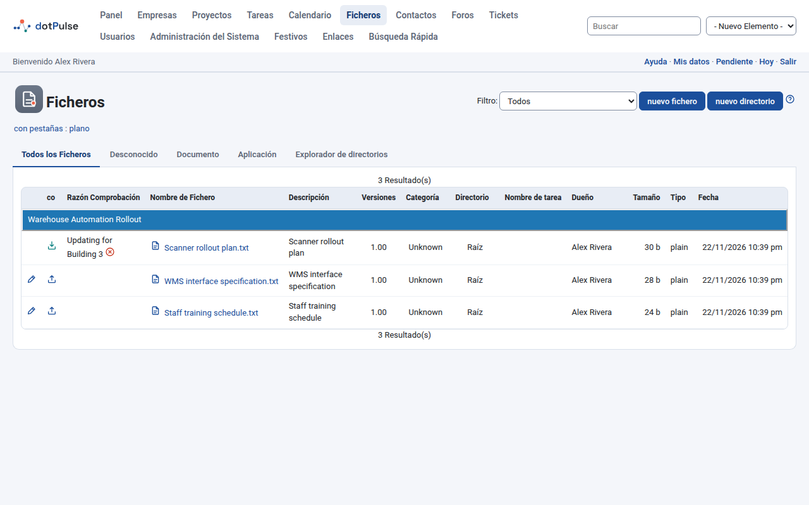
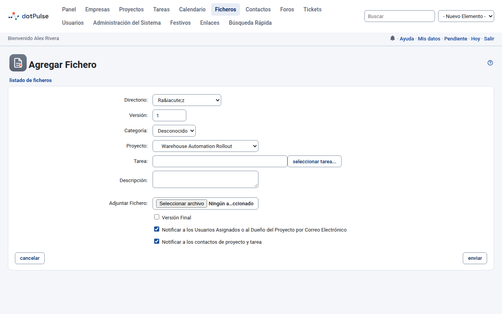
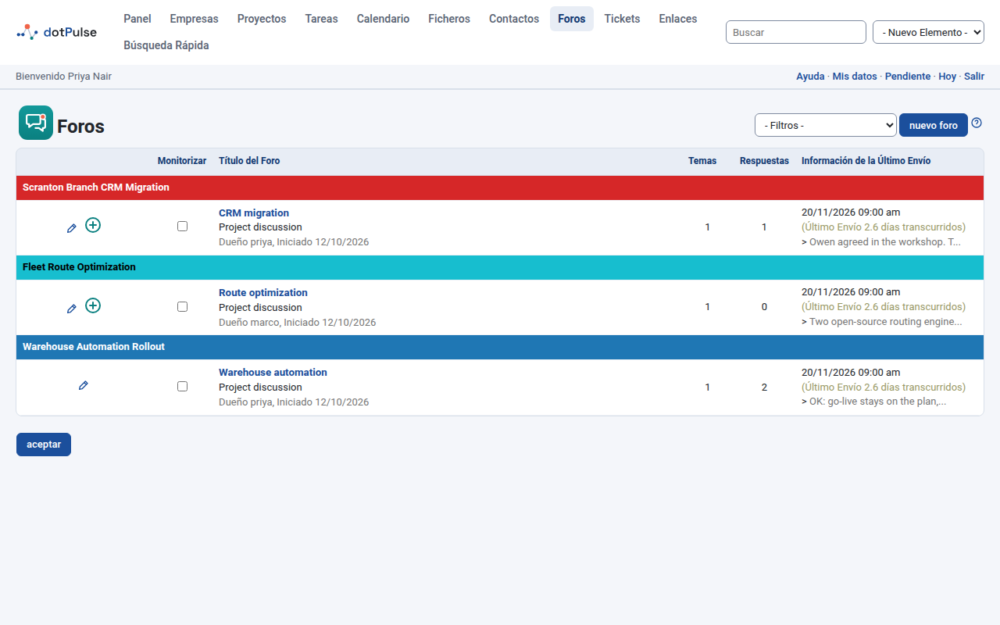
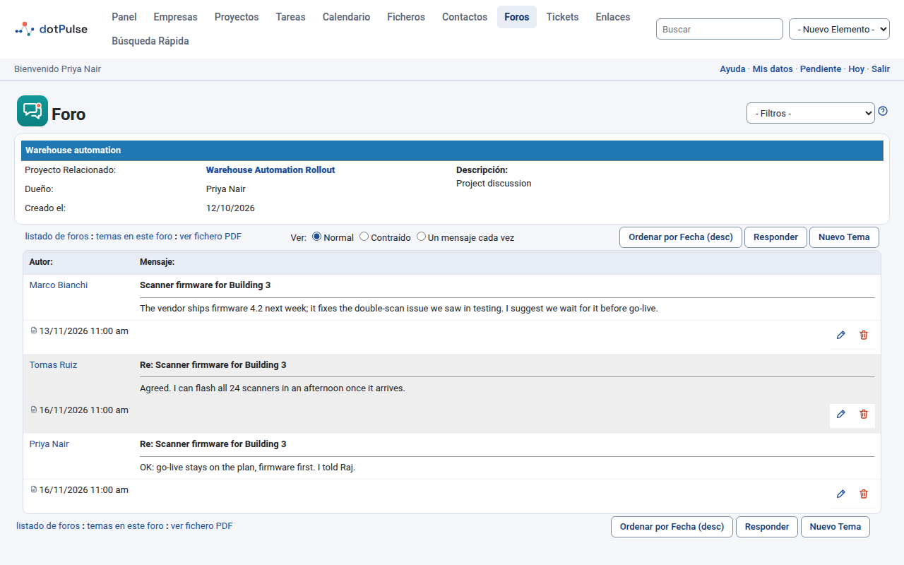
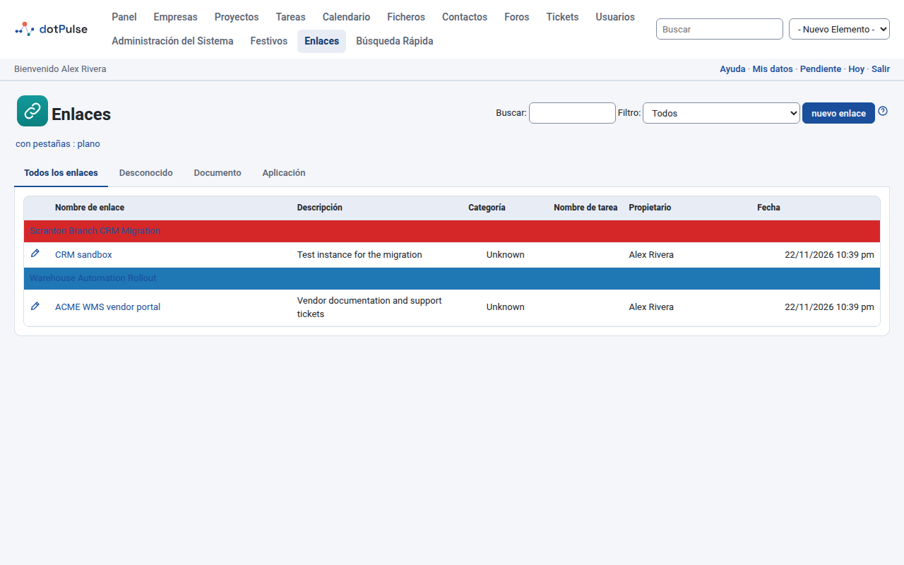

# Ficheros, foros y enlaces { #files-forums-and-links }

Los proyectos reúnen algo más que tareas. Esta página trata de tres formas de compartir material con su equipo: los ficheros (con versiones y reserva), los foros de debate y los enlaces web.

## Ficheros { #files }

Haga clic en **Ficheros** en el menú superior para ver los ficheros a los que tiene acceso.

{ .shot }

Las pestañas ordenan los ficheros por categoría: **Todos los Ficheros** y después una pestaña por categoría (**Desconocido**, **Documento** y **Aplicación** en un sitio estándar). La última pestaña, **Explorador de directorios**, muestra los ficheros por directorio. Use **Filtro** para mostrar solo los ficheros de un proyecto.

Cada fila muestra el nombre del fichero (haga clic en él para descargarlo), su descripción, versión, categoría, directorio, tarea, propietario, tamaño, tipo y fecha. Los ficheros con versiones anteriores muestran el número de versiones entre paréntesis junto a la versión; haga clic en él para verlas.

También encontrará ficheros en la pestaña **Ficheros** de un proyecto y en la pestaña **Ficheros** de una tarea.

### Subir un fichero { #upload-a-file }

1. Vaya a **Ficheros** y haga clic en **nuevo fichero**. Desde un proyecto o una tarea, también puede hacer clic en **nuevo fichero** en la zona del título, o en **Adjuntar archivo** en la pestaña **Ficheros** del proyecto.
2. Rellene el formulario.
3. Haga clic en **enviar**.

{ .shot }

| Campo | Significado |
|---|---|
| Directorio | Dónde va el fichero. **Raíz** es el nivel superior. |
| Versión | Un número de versión para el fichero. Empieza en 1. |
| Categoría | **Desconocido**, **Documento**, **Aplicación** u otra categoría creada en su sitio. |
| Proyecto | El proyecto al que pertenece el fichero. Déjelo en **Ninguno/a** para un fichero general. |
| Tarea | Haga clic en **seleccionar tarea...** para vincular el fichero a una tarea del proyecto elegido. Elija primero el proyecto. |
| Descripción | Qué es el fichero. |
| Adjuntar Fichero | Elija el fichero en su ordenador. |
| Versión Final | Bloquea el fichero como definitivo (vea más abajo). |
| Notificar a los Usuarios Asignados o al Dueño del Proyecto por Correo Electrónico | Envía un correo a las personas asignadas a la tarea, o al propietario del proyecto si no hay tarea. Marcado de entrada. |
| Notificar a los contactos de proyecto y tarea | Envía un correo a los contactos del proyecto y de la tarea. Marcado de entrada. |

Los ficheros vinculados a una tarea muestran un clip en las listas de tareas. Cuando [mueve una tarea](tasks.md#move-a-task-to-another-project) a otro proyecto, sus ficheros se mueven también.

### Editar o eliminar un fichero { #edit-or-delete-a-file }

Haga clic en el icono de editar a la izquierda de la fila de un fichero. Puede cambiar su directorio, categoría, proyecto, tarea y descripción. Si elige un fichero nuevo en **Adjuntar Fichero**, sustituye al actual sin conservar el antiguo como versión.

Para eliminar un fichero, ábralo para editarlo y haga clic en **eliminar fichero**, o use el icono de eliminar en **Explorador de directorios**.

### Guardar versiones con la reserva y la entrega { #keep-versions-with-check-out-and-check-in }

Reservar un fichero indica a su equipo que está trabajando en él, y le permite guardar sus cambios como una versión nueva.

1. Haga clic en el icono de reserva de la columna **co**.
2. Escriba una **Razón Comprobación**, elija a quién avisar y haga clic en **enviar**. El fichero se descarga, y la lista lo muestra como reservado por usted, con su motivo.
3. Edite el fichero en su ordenador.
4. Haga clic en el icono de entrega de la columna **co**. Se abre la página **Envío**.
5. Elija **Revisión Menor** o **Revisión Mayor**, elija el fichero modificado en **Adjuntar Fichero** y haga clic en **enviar**.

Una revisión menor suma 0,01 al número de versión (1 pasa a 1.01). Una revisión mayor pasa al siguiente número entero (1.01 pasa a 2). Las versiones anteriores se quedan en la lista.

Mientras un fichero está reservado, los demás ven su nombre en la columna **co** y no pueden editarlo. Puede cancelar su reserva con el icono de cancelar que hay junto al motivo. Los administradores y el propietario del proyecto también pueden cancelarla.

!!! note
    **Versión Final** marca el fichero como definitivo. La columna **co** muestra entonces **final** y ya nadie puede reservar ni editar el fichero.

### Trabajar con directorios { #work-with-folders }

Haga clic en **nuevo directorio** en la página **Ficheros**. Póngale un **Nombre de directorio**, una **Descripción** si quiere, y elija su directorio padre en **Subdirectorio de**.

La pestaña **Explorador de directorios** muestra el árbol de directorios. Los iconos junto a cada directorio le permiten añadirle un subdirectorio, añadirle un fichero o eliminarlo. Dentro de un directorio puede editarlo o volver al directorio padre o a la raíz.

Para mover varios ficheros a la vez, márquelos en **Explorador de directorios**, elija un destino en **Mover al directorio** o **Mover a proyecto** (o **No asociado a proyecto**) y haga clic en **Ir**.

## Foros { #forums }

Los foros son tablones de debate. Cada foro pertenece a un proyecto, así que la conversación queda junto al trabajo.

Haga clic en **Foros** en el menú superior para ver los foros de los proyectos activos.

{ .shot }

La lista muestra el proyecto, el nombre y el propietario de cada foro, el número de **Temas** y de **Respuestas**, y el último mensaje. Use el filtro de arriba para mostrar **Mis Foros**, **Mis Foros Monitorizados**, **Mis Proyectos**, **Mi Empresa** o **Proyectos Inactivos** (los foros de proyectos archivados).

La pestaña **Foros** de un proyecto muestra solo los foros de ese proyecto.

### Crear un foro { #create-a-forum }

1. Vaya a **Foros** y haga clic en **nuevo foro**. Desde la pestaña **Foros** de un proyecto, también sirve el botón **nuevo foro** de allí.
2. Rellene **Título del Foro**, **Proyecto Relacionado**, **Dueño** (usted, de entrada), **Moderador** y **Descripción**.
3. Haga clic en **Enviar**.

El moderador puede editar y eliminar cualquier mensaje del foro.

### Abrir un tema y responder { #start-a-topic-and-reply }

1. Haga clic en el nombre de un foro.
2. Haga clic en **nuevo tema**.
3. Escriba un **Asunto** y su **Mensaje**, y haga clic en **enviar**.

{ .shot }

Haga clic en un tema para leerlo. Después:

- **Responder** contesta al tema. La respuesta cita el mensaje al que contesta.
- **Nuevo Tema** abre otro tema en el mismo foro.
- **Ordenar por Fecha** cambia entre los más antiguos primero y los más recientes primero.
- **Ver** cambia la presentación: **Normal**, **Contraído** o **Un mensaje cada vez**.

Puede editar o eliminar sus propios mensajes con los iconos que hay junto a ellos.

En la lista de temas, un icono marca los temas con mensajes que aún no ha leído.

### Seguir un foro o un tema { #watch-a-forum-or-a-topic }

Seguir un foro o un tema le envía un correo cuando alguien escribe.

- Para seguir foros enteros, marque sus casillas en la columna **Monitorizar** de la lista de foros y haga clic en **aceptar**.
- Para seguir temas sueltos, abra el foro, marque los temas en la columna **Monitorizar** y haga clic en **aceptar**.

Desmarque una casilla y vuelva a hacer clic en **aceptar** para dejar de seguirlo.

## Enlaces { #links }

El complemento Enlaces guarda direcciones web útiles con sus proyectos. Si su sitio lo tiene, haga clic en **Enlaces** en el menú superior.

{ .shot }

Las pestañas ordenan los enlaces por categoría: **Todos los enlaces** y después una pestaña por categoría (**Desconocido**, **Documento** y **Aplicación** en un sitio estándar). Use **Buscar** para encontrar un enlace por su nombre o su descripción, y **Filtro** para mostrar los enlaces de un proyecto.

La pestaña **Enlaces** de un proyecto muestra los enlaces de ese proyecto.

### Añadir un enlace { #add-a-link }

1. Vaya a **Enlaces** y haga clic en **nuevo enlace**.
2. Rellene **Nombre de enlace**, **Categoría**, **Proyecto**, **Tarea** (haga clic en **seleccionar tarea...**), **Descripción** y **URL del enlace**.
3. Haga clic en **enviar**.

Cuando edita un enlace, el enlace **ir** junto a su nombre abre la dirección en una ventana nueva. Haga clic en el nombre de un enlace de la lista para abrirlo.
