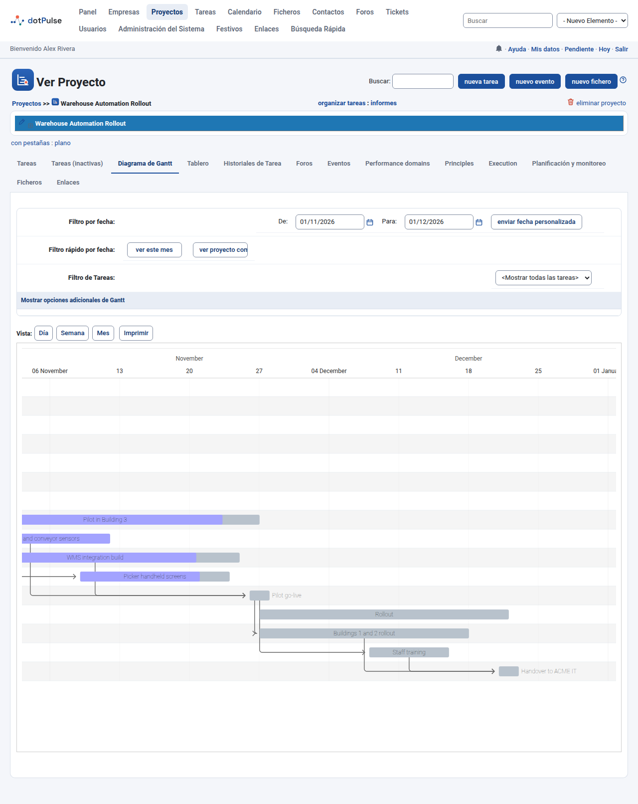
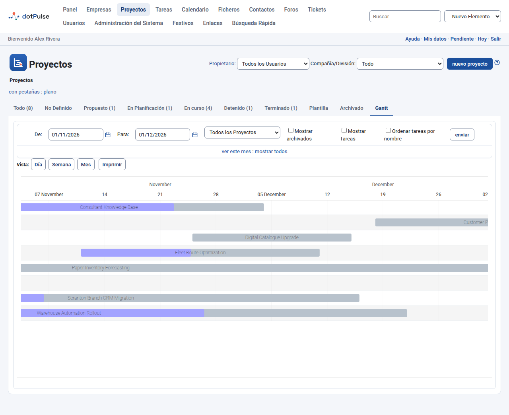
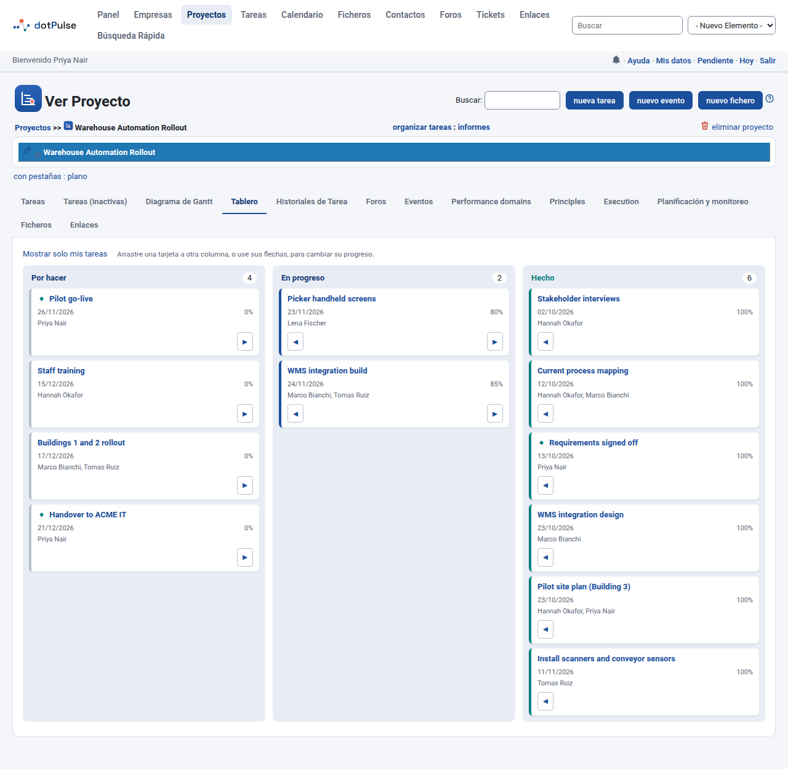

# Diagrama de Gantt y tablero { #gantt-chart-and-board }

dotPulse le ofrece dos formas visuales de seguir el trabajo: el diagrama de Gantt muestra los proyectos y las tareas sobre una línea de tiempo, y el tablero muestra las tareas de un proyecto como tarjetas según su progreso.

## El diagrama de Gantt { #the-gantt-chart }

Un diagrama de Gantt dibuja cada tarea o proyecto como una barra que va de su fecha de inicio a su fecha de fin. La parte más oscura de la barra muestra su progreso.

Encontrará diagramas de Gantt en varios sitios:

| Dónde | Qué muestra |
|---|---|
| La pestaña **Diagrama de Gantt** de un proyecto | Las tareas de ese proyecto. |
| El botón **Diagrama de Gantt** bajo cada proyecto en la lista de tareas | El mismo diagrama, en su propia página. |
| **Proyectos** › pestaña **Gantt** | Los proyectos y, si quiere, sus tareas. |
| **Tareas** › **a realizar por mi** › pestaña **Mi Gantt** | Sus tareas sin terminar. |

{ .shot }

### Leer el diagrama y moverse por él { #read-and-move-around-the-chart }

- Use los botones de **Vista:** **Día**, **Semana** y **Mes** para cambiar la escala. Los diagramas se abren en la vista **Semana**.
- Cuando el diagrama abarca el día de hoy, se desplaza para que hoy quede a la vista.
- Sitúe el puntero sobre una barra para ver su nombre, sus fechas y su porcentaje completado.
- En los diagramas de tareas, unas flechas unen cada tarea con las tareas de las que depende.
- **Imprimir** imprime la página.

### Cambiar fechas y progreso en el diagrama { #change-dates-and-progress-on-the-chart }

Si puede editar una tarea, puede cambiarla en un diagrama de tareas (la pestaña **Diagrama de Gantt** de un proyecto, el Gantt de las tareas o el diagrama de proyectos con **Mostrar Tareas**):

- **Arrastre una barra** para mover la tarea: conserva su longitud y sus horas de inicio y fin.
- **Arrastre cualquiera de los extremos de una barra** para cambiar el día de inicio o el de fin.
- **Arrastre el tirador de progreso** (el pequeño triángulo bajo la barra) para cambiar el porcentaje completado.

El cambio se guarda en el acto, y la línea bajo el diagrama dice **Guardado.** La barra de un grupo de tareas sigue a sus tareas, así que no se puede arrastrar; tampoco la barra de un proyecto. Las tareas que siguen sus dependencias se mueven con la tarea de la que dependen, y la página se recarga para mostrarlas. Si el cambio no se puede guardar, la barra vuelve a su sitio y la línea bajo el diagrama explica por qué.

Para cancelar un arrastre, pulse **Esc** antes de soltar el botón del ratón: la barra vuelve a su sitio y no se guarda nada. Después de guardar un cambio, la línea bajo el diagrama ofrece **Deshacer**, que guarda las fechas o el porcentaje completado que tenía antes la barra.

Una barra sin fecha de inicio empieza hoy (en el diagrama de proyectos, una tarea sin fecha de inicio empieza con su proyecto). Una barra sin fecha de fin, o con una fecha de fin anterior a la de inicio, se dibuja con un día de longitud.

### Filtrar un diagrama de tareas { #filter-a-task-chart }

El diagrama de tareas de un proyecto tiene estas opciones encima:

- **Filtro por fecha**: elija una fecha **De** y **Para** con los iconos de calendario y haga clic en **enviar fecha personalizada**. El diagrama muestra entonces solo las tareas que coinciden con ese periodo. Las flechas de los dos extremos mueven el periodo un mes atrás o adelante.
- **Filtro rápido por fecha**: **ver proyecto completo** quita los límites de fechas.
- **Filtro de Tareas**: elija un grupo de tareas para mostrar solo ese grupo y las tareas que contiene. **&lt;Mostrar todas las tareas&gt;** lo muestra todo.
- **Mostrar opciones adicionales de Gantt**: abre más opciones. **Ordenar por nombre** ordena las tareas por nombre en lugar de por fecha de inicio. **Ocultar hitos** deja fuera los hitos. Haga clic en **enviar** para aplicarlas.

No se muestran las tareas inactivas ni las tareas de proyectos archivados.

En **Mi Gantt**, las opciones adicionales incluyen también **Opciones de tareas a realizar**: **Solo Pinchadas**, **Proyectos archivados**, **Proyectos Congelados**, **Tareas Dinámicas** y **Tareas de Prioridad Baja**. Funcionan como las casillas de la [lista de pendientes](tasks.md#your-to-do-list) y se comparten con ella.

### El diagrama de proyectos { #the-projects-chart }

Vaya a **Proyectos** y abra la pestaña **Gantt**.

{ .shot }

Las opciones son:

- **De** y **Para**, con las flechas para avanzar o retroceder un mes, y **enviar** para aplicarlas.
- Un filtro de proyectos: **Todos los Proyectos**, **Todo Excepto En Progreso**, **Mis proyectos** o un único estado.
- **Mostrar archivados**: incluye los proyectos archivados.
- **Mostrar Tareas**: dibuja las tareas de cada proyecto debajo de él.
- **Ordenar tareas por nombre**: ordena esas tareas por nombre en lugar de por fecha de fin.
- **mostrar todos** quita los límites de fechas.

El diagrama también sigue el filtro **Compañía/División** de la lista de proyectos. La barra de cada proyecto muestra su progreso, calculado a partir de sus tareas.

## El tablero { #the-board }

La pestaña **Tablero** de un proyecto muestra sus tareas como tarjetas en tres columnas:

| Columna | Tareas con un progreso de |
|---|---|
| Por hacer | 0 % |
| En progreso | entre el 1 % y el 99 % |
| Hecho | 100 % |

{ .shot }

Cada tarjeta muestra el nombre de la tarea, su fecha de fin y su progreso. Una fecha de fin ya pasada, en una tarea que no está hecha, se marca como retrasada. Debajo aparecen las personas asignadas a la tarea. Un rombo (◆) marca un hito y un signo de exclamación (!) una tarea de prioridad alta. Haga clic en el nombre de la tarea para abrirla.

El tablero muestra las tareas activas del proyecto. Las tareas inactivas y los grupos de tareas quedan fuera, porque el progreso de un grupo viene de sus hijas. Las tarjetas se ordenan por fecha de fin; las tareas sin fecha de fin van al final.

Haga clic en **Mostrar solo mis tareas** para dejar solo las tareas que tiene asignadas. **Mostrar todas las tareas** vuelve a mostrar las demás.

### Mover una tarjeta { #move-a-card }

Puede mover las tarjetas de las tareas que tiene permiso para editar. Hay dos formas:

- Arrastre la tarjeta a otra columna.
- Use los botones de flecha de la tarjeta (◀ y ▶) para moverla una columna a la izquierda o a la derecha. Las flechas también funcionan con el teclado.

Mover una tarjeta cambia el progreso de la tarea:

- A **Por hacer**: el progreso pasa a ser del 0 %.
- A **Hecho**: el progreso pasa a ser del 100 %. Si la tarea no tenía fecha de fin, hoy pasa a ser su fecha de fin.
- A **En progreso**: una tarea que viene de *Por hacer* pasa al 10 %; una tarea que viene de *Hecho* pasa al 90 %.

La tarjeta se mueve en el acto y el cambio se guarda en segundo plano. Si dotPulse no puede guardarlo, la tarjeta vuelve a su columna y un mensaje explica por qué.

!!! tip
    El tablero solo fija valores aproximados. Para anotar el progreso real y las horas que ha dedicado, [registre su trabajo](task-logs.md) en la tarea.
