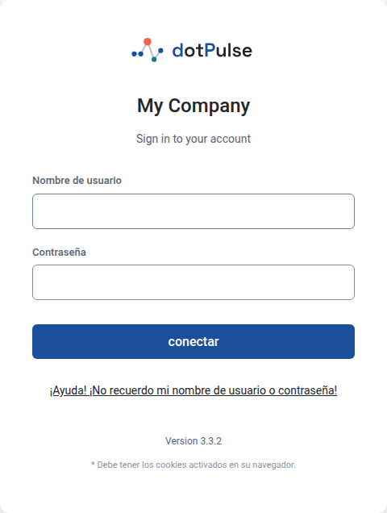
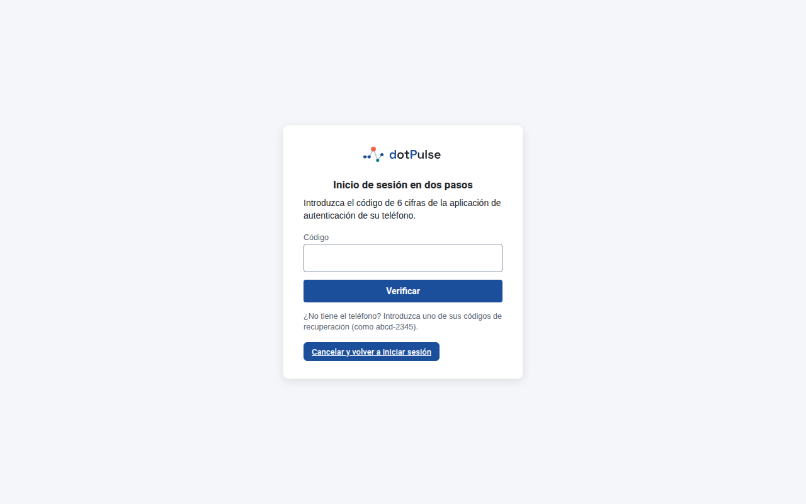
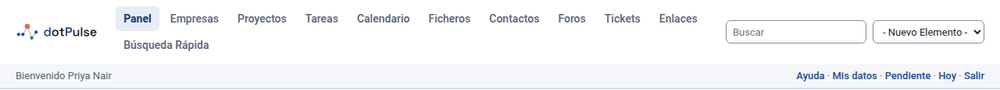
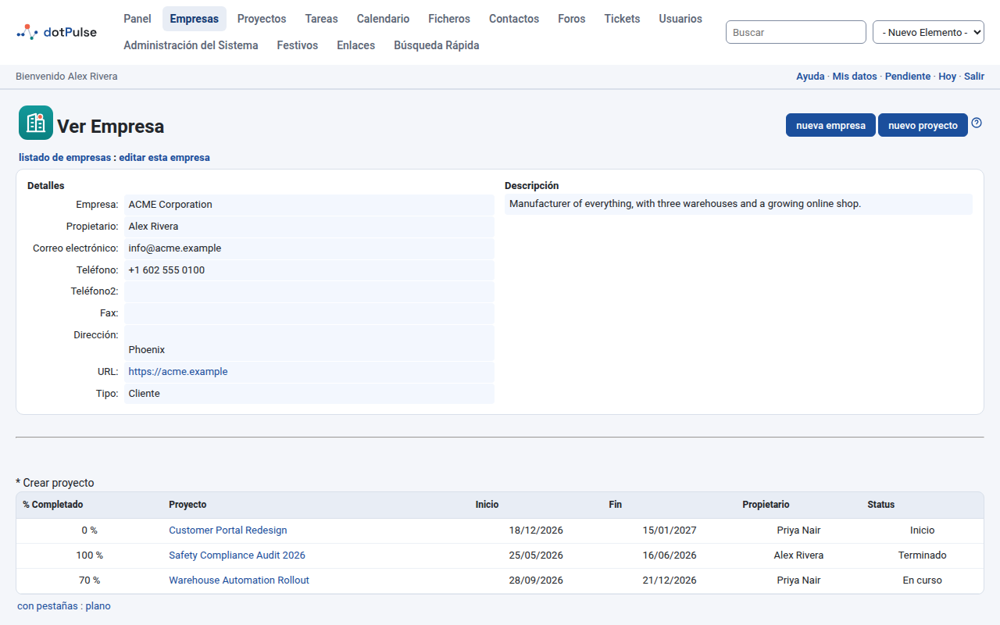
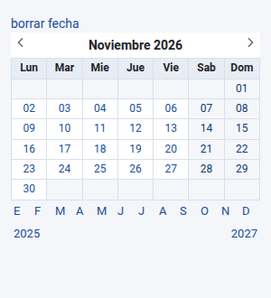
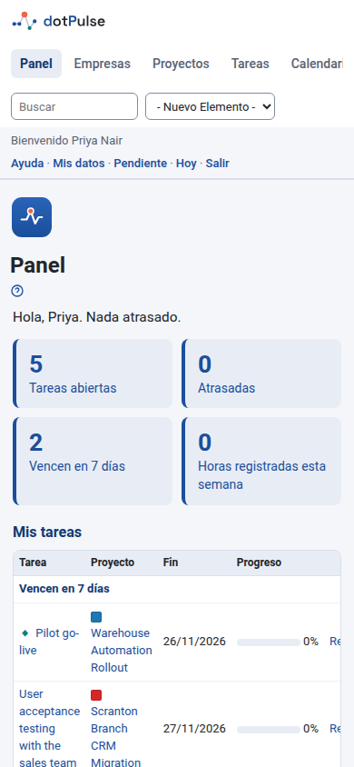

# La interfaz { #the-interface }

Todas las páginas de dotPulse comparten el mismo marco: una barra superior con los
módulos, un título de página con enlaces y filtros, y debajo el contenido de la página.
Esta página explica esas partes comunes una sola vez, para que el resto de la guía
se centre en el trabajo.

## Iniciar sesión { #log-in }

1. Abra en su navegador la dirección de su sitio dotPulse.
2. Escriba su **Nombre de usuario** y su **Contraseña**.
3. Haga clic en **conectar**.

{ .shot }

dotPulse necesita cookies para mantener la sesión abierta. Si la página de inicio
de sesión vuelve a aparecer una y otra vez, compruebe que su navegador acepta las
cookies del sitio.

Si escribe mal la contraseña varias veces seguidas, dotPulse le hace esperar un
rato antes de volver a intentarlo ("Demasiados intentos de inicio de sesión").

Después de iniciar sesión, dotPulse abre su [panel](dashboard.md), salvo que su
administrador haya elegido otra página de inicio.

### Iniciar sesión en dos pasos { #log-in-with-two-step-login }

Si ha activado el [inicio de sesión en dos pasos](preferences.md#set-up-two-step-login),
dotPulse le pide un segundo código después de la contraseña:

1. Abra la aplicación de autenticación de su teléfono.
2. Escriba en **Código** el código de 6 dígitos que muestra para dotPulse.
3. Haga clic en **Verificar**.

{ .shot }

Si no tiene el teléfono a mano, escriba uno de sus códigos de recuperación (tienen
este aspecto: `abcd-2345`) en lugar del código de 6 dígitos. Cada código de
recuperación sirve una sola vez.

Tiene unos minutos para escribir el código. Pasado ese tiempo, o tras varios
códigos erróneos, dotPulse le devuelve a la página de inicio de sesión y debe
empezar de nuevo con su contraseña. Para abandonar y empezar de nuevo usted mismo,
haga clic en **Cancelar y volver a iniciar sesión**.

!!! tip "¿No se acepta el código?"
    Los códigos cambian cada 30 segundos y dependen del reloj de su teléfono.
    Compruebe que la hora del teléfono se ajusta automáticamente y use el código
    más reciente.

### Ha olvidado su contraseña { #forgot-your-password }

1. En la página de inicio de sesión, haga clic en **¡Ayuda! ¡No recuerdo mi nombre de usuario o contraseña!**
2. Escriba su **Nombre de usuario** y la dirección de correo de su cuenta.
3. Haga clic en **enviar contraseña**.

Si el nombre de usuario y el correo coinciden con una cuenta, dotPulse le envía un
enlace por correo. Ábralo antes de una hora, escriba dos veces la nueva contraseña
(**Nueva contraseña** y **Repetir nueva contraseña**) y haga clic en **enviar**.
Después podrá iniciar sesión con la nueva contraseña.

Por seguridad, dotPulse muestra el mismo mensaje tanto si la cuenta existe como si
no. Si no le llega ningún correo, revise la carpeta de correo no deseado y luego
consulte a su administrador.

## La barra superior { #the-top-bar }

La barra superior está en todas las páginas.

{ .shot }

De izquierda a derecha contiene:

- **El logotipo**: haga clic en él para volver a su página de inicio.
- **El menú de módulos**: un enlace por cada módulo que puede abrir, como
  **Panel**, **Empresas**, **Proyectos**, **Tareas**, **Calendario**, **Ficheros**
  y **Contactos**. El módulo en el que está aparece resaltado. Los módulos que
  aparecen dependen de lo que su administrador haya instalado y de aquello a lo
  que usted tenga acceso.
- **Buscar**: escriba una palabra y pulse ++enter++ para buscar en todo dotPulse.
  Consulte [Búsqueda](search.md). Solo aparece si puede usar SmartSearch.
- **- Nuevo Elemento -**: una forma rápida de crear algo. Elija **Empresa**,
  **Contacto**, **Evento**, **Fichero** o **Proyecto** y dotPulse abre su
  formulario. Solo ve los elementos que tiene permiso para añadir.

Debajo, una barra más fina le saluda por su nombre y tiene estos enlaces:

- **Consejos del proyecto**: una campana que aparece en las páginas de un proyecto.
  Consulte [Su panel](dashboard.md#project-tips).
- **Ayuda**: abre esta documentación en una pestaña nueva, en la página sobre la
  parte de dotPulse en la que está (la lista de proyectos abre [Proyectos](projects.md),
  por ejemplo). dotPulse muestra la copia de la documentación que viene con él, así
  que coincide con su versión y no necesita acceso a Internet; la lista de la
  izquierda lleva a todas las páginas.
- **Mis datos**: la página de su cuenta. Consulte [Su cuenta y sus preferencias](preferences.md).
- **Pendiente**: su lista de tareas por hacer (**Mis Tareas a Realizar**).
- **Hoy**: el día de hoy en la vista diaria del calendario.
- **Salir**: cierra su sesión.

**Pendiente** y **Hoy** solo aparecen si puede usar el calendario.

## El título de la página { #the-page-title }

Cada página empieza con un bloque de título.

{ .shot }

- **El título** indica dónde está, por ejemplo **Ver Empresa**.
- **Los botones y filtros** están a la derecha del título, por ejemplo
  **nueva empresa** o **nuevo proyecto**.
- **Los enlaces** están en la línea bajo el título, separados por dos puntos. Le
  llevan a páginas relacionadas, por ejemplo **listado de empresas : editar esta empresa**.
  Un enlace como **lista de proyectos** o **lista de contactos** siempre le devuelve
  a la lista de la que venía.
- **Un enlace para eliminar**, como **eliminar empresa**, está a la derecha de esa
  línea cuando tiene permiso para eliminar el elemento. dotPulse le pide primero
  que lo confirme.
- **El icono de ayuda**, en el extremo derecho del título, abre la documentación
  de la página.

## Mensajes { #messages }

Después de guardar, eliminar o hacer algo que falla, dotPulse muestra un mensaje
breve cerca de la parte superior de la página, por ejemplo para confirmar que se
ha actualizado un registro o para explicar qué ha fallado.

## Pestañas { #tabs }

Muchas páginas reparten su contenido en pestañas, por ejemplo las pestañas
**Proyectos activos**, **Departamentos**, **Usuarios** y **Contactos** de una
empresa. Haga clic en una pestaña para mostrarla. dotPulse recuerda la última
pestaña que abrió en cada página.

Algunos módulos añaden sus propias pestañas a las páginas de otros módulos, así
que las pestañas que ve dependen de los módulos instalados.

Salvo que haya cambiado la preferencia **Vista con Pestañas**, también ve los
enlaces **con pestañas : plano** encima de las pestañas. **plano** muestra el
contenido de todas las pestañas una tras otra en una sola página; **con pestañas**
vuelve a las pestañas. Consulte
[Su cuenta y sus preferencias](preferences.md#tabbed-box-view).

## Filtros y ordenación { #filters-and-sorting }

Las listas suelen tener filtros en el bloque de título, por ejemplo **Filtrar por dueño**
en la lista de empresas, o **Compañía** y **Filtro de Eventos** en el calendario.
Elija un valor y la página se recarga con la lista filtrada. La mayoría de los
filtros conservan su valor mientras se mueve por dotPulse, hasta que cierra la sesión.

En muchas listas puede hacer clic en el encabezado de una columna, como
**Nombre de la Empresa**, para ordenar por esa columna. Haga clic otra vez para
invertir el orden.

## Elegir una fecha { #pick-a-date }

La mayoría de los campos de fecha tienen al lado un pequeño icono de calendario.
Haga clic en él y se abre una ventana pequeña con el calendario de un mes:

- Haga clic en un día para ponerlo en el campo.
- Use las flechas para retroceder o avanzar un mes. Las letras bajo el calendario
  saltan a un mes del mismo año, y los años retroceden o avanzan un año.
- Haga clic en **borrar fecha** para vaciar el campo.

{ .shot }

!!! tip "Permita las ventanas emergentes"
    El selector de fecha, el cambio de contraseña y algunos selectores se abren en
    ventanas pequeñas. Si no ocurre nada al hacer clic en ellos, permita las
    ventanas emergentes de su sitio dotPulse en el navegador.

## Expandir y contraer { #expand-and-collapse }

Algunas páginas ocultan detalles hasta que los pide. Haga clic en el icono de
expandir (un signo más dentro de un cuadrito) para mostrarlos; se convierte en un
signo menos, que vuelve a ocultarlos. Por ejemplo:

- En la página de un proyecto, el icono junto al nombre del proyecto muestra u
  oculta los detalles del proyecto.
- En las listas de tareas, una tarea con subtareas tiene un icono que abre o
  cierra sus subtareas.

## Usar dotPulse en un teléfono { #use-dotpulse-on-a-phone }

dotPulse funciona en el navegador de un teléfono. En una pantalla estrecha:

- El menú de módulos se queda en una sola línea. Deslícelo de lado para llegar a
  los demás módulos.
- Los formularios colocan cada etiqueta encima de su campo.
- Las listas y los calendarios conservan sus columnas y se desplazan de lado dentro
  de sí mismos. Deslice la lista, no la página.

{ .shot }

## Tema claro y oscuro { #light-and-dark-theme }

dotPulse incluye un tema claro, **dotPulse**, y uno oscuro, **dotPulse oscuro**.
Elija el suyo en la preferencia **Estilo de la Interfaz de Usuario**. Consulte
[Su cuenta y sus preferencias](preferences.md#user-interface-style).

## Cerrar sesión { #log-out }

Haga clic en **Salir** en la barra bajo el menú de módulos. Cierre siempre la
sesión en un ordenador compartido.
