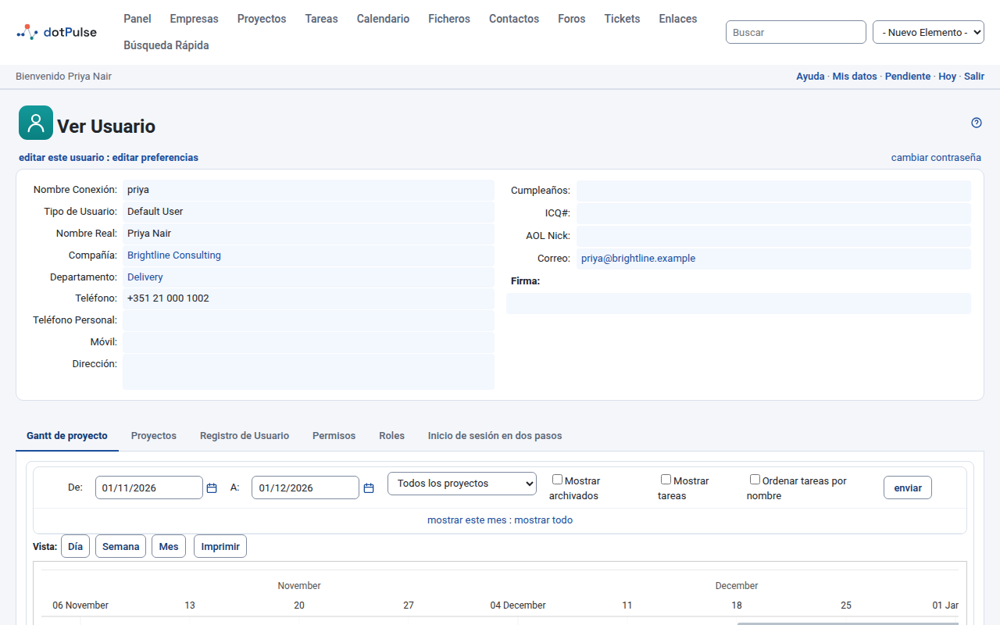
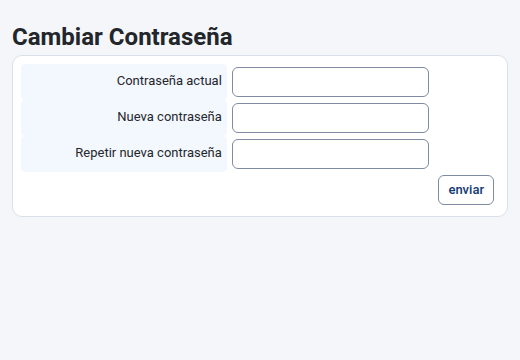
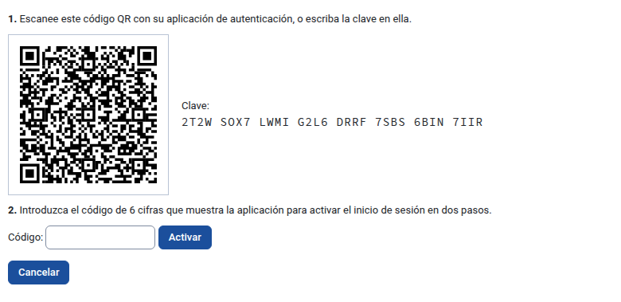
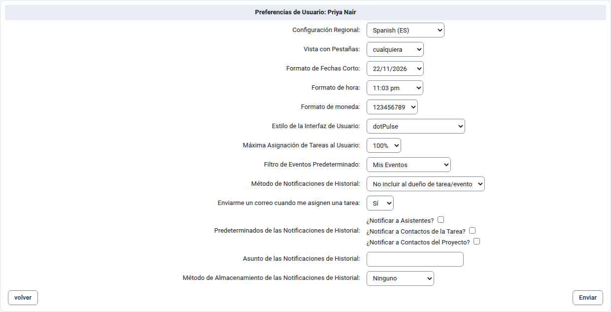
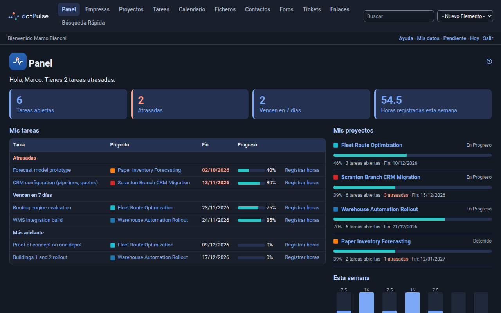

# Su cuenta y sus preferencias { #your-account-and-preferences }

Haga clic en **Mis datos** en la barra bajo el menú de módulos para abrir la página
de su cuenta, **Ver Usuario**. Desde ella puede revisar sus datos, cambiar su
contraseña, configurar el inicio de sesión en dos pasos y elegir sus preferencias.

{ .shot }

## Sus datos { #your-details }

La parte superior de la página muestra su **Nombre Conexión**, **Tipo de Usuario**,
**Nombre Real**, **Compañía**, **Departamento**, sus teléfonos, **Dirección**,
**Cumpleaños**, **Correo** y **Firma**.

La mayoría de estos datos proceden de su ficha de contacto: cada usuario de dotPulse
tiene una (consulte [Empresas, departamentos y contactos](companies-contacts.md#contacts-and-users)).

### Cambiar sus datos { #change-your-details }

1. En la página de su cuenta, haga clic en **editar este usuario**.
2. Cambie su **Nombre**, su **Correo** o su firma de correo (**Firma**). Para
   cambiar su dirección de correo (o aquí su contraseña), escriba también su
   **Contraseña anterior**: se envía un restablecimiento de contraseña a esa dirección.
3. Haga clic en **enviar**.

Su nombre de conexión, su tipo de usuario, su empresa y su departamento los
gestiona su administrador. Si puede editar contactos, también puede cambiar sus
teléfonos y su dirección: abra **Contactos**, búsquese y haga clic en **Editar**.

## Cambiar su contraseña { #change-your-password }

1. Haga clic en **Mis datos**.
2. Haga clic en **cambiar contraseña**, a la derecha de la línea bajo el título.
3. En la ventana pequeña que se abre, escriba su **Contraseña actual** y después dos
   veces su nueva contraseña (**Nueva contraseña** y **Repetir nueva contraseña**).
4. Haga clic en **enviar**.

{ .shot }

La nueva contraseña debe tener al menos la longitud mínima que haya fijado su
administrador. dotPulse le avisa si es demasiado corta o si las dos entradas no
coinciden.

## Configurar el inicio de sesión en dos pasos { #set-up-two-step-login }

El inicio de sesión en dos pasos pide, después de la contraseña, un código de una
aplicación de su teléfono. Quien robe su contraseña seguirá sin poder entrar como usted.

Necesita una aplicación de autenticación en el teléfono. Sirve cualquiera, por
ejemplo Google Authenticator, Microsoft Authenticator, Aegis, FreeOTP o 1Password.

1. Haga clic en **Mis datos** y abra la pestaña **Inicio de sesión en dos pasos**.
2. Haga clic en **Configurar el inicio de sesión en dos pasos**.
3. Escanee el código QR con su aplicación de autenticación. Si no puede escanearlo,
   escriba en la aplicación la **Clave** que aparece a su lado.
4. Escriba en **Código** el código de 6 dígitos que muestra la aplicación y haga
   clic en **Activar**.

{ .shot }

Para dejarlo a medias, haga clic en **Cancelar**.

### Guardar sus códigos de recuperación { #save-your-recovery-codes }

En cuanto se activa el inicio de sesión en dos pasos, dotPulse muestra diez códigos
de recuperación.

!!! warning "Los códigos de recuperación solo se ven una vez"
    Guárdelos ahora, en un lugar seguro y lejos de su teléfono: un gestor de
    contraseñas o una copia impresa. Cada código le permite iniciar sesión una vez
    si pierde el teléfono.

Después la pestaña indica **El inicio de sesión en dos pasos está activado.**, con
la fecha en que lo activó y cuántos códigos de recuperación le quedan. A partir de
ahora, para iniciar sesión hacen falta su contraseña y un código. Consulte
[Iniciar sesión en dos pasos](interface.md#log-in-with-two-step-login).

### Obtener nuevos códigos de recuperación { #get-new-recovery-codes }

Si ha usado la mayoría de sus códigos de recuperación, o cree que alguien los ha visto:

1. Abra la pestaña **Inicio de sesión en dos pasos**.
2. Escriba en **Código** un código actual de su aplicación (o un código de recuperación).
3. Haga clic en **Nuevos códigos de recuperación**.

dotPulse muestra diez códigos nuevos, una sola vez. Los antiguos dejan de funcionar.

### Desactivar el inicio de sesión en dos pasos { #turn-two-step-login-off }

1. Abra la pestaña **Inicio de sesión en dos pasos**.
2. Escriba en **Código** un código actual de su aplicación (o un código de recuperación).
3. Haga clic en **Desactivar** y confirme.

Vuelve a bastar su contraseña para iniciar sesión.

### Ha perdido el teléfono y los códigos de recuperación { #lost-your-phone-and-your-recovery-codes }

Consulte a su administrador. Puede restablecer el inicio de sesión en dos pasos de
su cuenta. Después inicia sesión con su contraseña y puede volver a configurarlo.

## Tokens de API { #api-tokens }

La pestaña **Tokens de API** solo aparece cuando su administrador ha activado la
REST API. Viene desactivada de forma predeterminada.

Un token permite que un programa use dotPulse en su nombre, con sus permisos. Para
crear uno, escriba un **Nombre**, elija el **Acceso** (**Solo lectura** o
**Lectura y escritura**) y cuándo **Caduca** (a los 30, 90 o 365 días, o **Nunca**)
y haga clic en **Crear token**. Copie el token en ese momento: dotPulse solo lo
muestra una vez. Haga clic en **Revocar** junto a un token para que deje de funcionar.

## Otras pestañas { #other-tabs }

La página de su cuenta puede mostrar más pestañas, según los módulos instalados y
sus permisos. Las habituales son:

- **Proyectos** y **Gantt de proyecto**: sus proyectos, como lista y como diagrama
  de Gantt.
- **Registro de Usuario**: cuándo inició y cerró sesión, entre dos fechas que elija.
- **Permisos** y **Roles**: lo que tiene permitido hacer. Solo los administradores
  pueden cambiarlos.

## Editar sus preferencias { #edit-your-preferences }

Las preferencias cambian el aspecto y el comportamiento de dotPulse solo para usted.

1. Haga clic en **Mis datos**.
2. Haga clic en **editar preferencias**, en la línea bajo el título.
3. Cambie lo que necesite.
4. Haga clic en **enviar**.

{ .shot }

Sus preferencias siguen los valores predeterminados que su administrador fijó para
todos. Al guardar esta página, una preferencia que haya puesto en un valor distinto
del predeterminado pasa a ser suya; una que deje en el valor predeterminado lo sigue
siguiendo, así que cambia cuando su administrador cambia el valor predeterminado.

### Configuración Regional { #locale }

El idioma de la interfaz, por ejemplo **Inglés (US)** o **Inglés (GB)**. Cada idioma
aparece con su nombre en inglés.

### Vista con Pestañas { #tabbed-box-view }

Cómo se muestran las páginas con pestañas:

- **cualquiera**: pestañas, con los enlaces **con pestañas : plano** encima para
  poder cambiar en cualquier página. Es el valor predeterminado.
- **con pestañas**: siempre pestañas, sin el cambio.
- **plano**: siempre plano: el contenido de todas las pestañas, uno tras otro.

Algunas páginas, como la de su cuenta, siempre usan pestañas.

### Formato de Fechas Corto { #short-date-format }

Cómo se escriben las fechas. Cada opción muestra la fecha de hoy en ese formato,
por ejemplo día/mes/año o mes/día/año.

### Formato de hora { #time-format }

Cómo se escriben las horas: en formato de 12 horas con AM/PM, o de 24 horas con o
sin segundos. Cada opción muestra como ejemplo la hora actual.

### Formato de moneda { #currency-format }

Cómo se escriben las cantidades de dinero: los separadores de miles y de decimales.
Cada opción muestra la misma cantidad con el formato de una configuración regional.

### Estilo de la Interfaz de Usuario { #user-interface-style }

El aspecto de dotPulse. La lista tiene dos grupos. En **Temas de dotPulse**, elija:

- **dotPulse**, el tema predeterminado.
- **Facet**, con superficies en capas sobre un gris neutro, un acento verde
  azulado y esquinas más redondeadas, al estilo de los sistemas de escritorio
  actuales.
- **Linen**, con una barra de herramientas clara, paneles blancos de esquinas
  suaves, el módulo actual como una píldora naranja y las pestañas como un
  control segmentado.
- **Material**, al estilo de Material Design: superficies tonales, un acento
  morado, botones en forma de píldora y pestañas subrayadas con el acento.

dotPulse, Facet y Linen pueden verse claros u oscuros: consulte [Apariencia](#appearance).

En **Temas antiguos (sin actualizar)** están los estilos más antiguos heredados
de dotProject. Siguen funcionando, pero las funciones nuevas se diseñan y prueban
con los temas de dotPulse, y los antiguos pueden verse fuera de lugar en las
páginas nuevas. Use un tema de dotPulse.

El cambio se aplica a partir de la siguiente página que abra.

### Apariencia { #appearance }

Si el tema se ve claro u oscuro:

- **Clara**.
- **Oscura**.
- **Automática (sigue al ordenador)**: oscura cuando su ordenador o su teléfono
  usa el modo oscuro, clara en otro caso. Cuando cambia el ajuste del
  ordenador, dotPulse lo sigue a partir de la siguiente página que abra.

Solo los temas con una paleta oscura pueden verse oscuros: **dotPulse**,
**Facet**, **Linen** y **Material**. Los temas antiguos se ven siempre claros.

{ .shot }

!!! note "dotPulse oscuro"
    Las versiones anteriores tenían un tema aparte, **dotPulse oscuro**. Ahora
    es dotPulse con la apariencia **Oscura**: al actualizar dotPulse, quienes lo
    usaban pasan a dotPulse con **Oscura** y no notan ningún cambio.

### Máxima Asignación de Tareas al Usuario { #user-task-assignment-maximum }

Cuánto trabajo puede asumir, como porcentaje de su tiempo, del 5 % al 200 %. El
valor predeterminado es 100 %. Cuando su administrador ha activado el ajuste
relacionado, dotPulse usa esta cifra para mostrar qué parte de su capacidad ya
está ocupada cuando alguien le asigna tareas.

### Filtro de Eventos Predeterminado { #default-event-filter }

Qué eventos muestra el calendario al abrirlo:

- **Mis Eventos**: los eventos a los que está invitado.
- **Eventos que he Creado**: los eventos que ha creado.
- **Todos los Eventos**: todos los eventos que puede ver.

Puede seguir cambiando el filtro en el propio calendario. Consulte
[Calendario](calendar.md#filter-the-calendar).

### Método de Notificaciones de Historial { #task-notification-method }

Si los correos sobre una tarea o un evento se envían también a su dueño:

- **No incluir al dueño de tarea/evento**
- **Incluir al dueño de tarea/evento**

Con **Incluir al dueño de tarea/evento**, la casilla **Notificar al propietario**
también aparece marcada de forma predeterminada cuando registra trabajo en la
tarea de otra persona.

### Enviarme un correo cuando me asignen una tarea { #email-me-when-i-am-assigned-to-a-task }

**Sí** (el valor predeterminado) le envía un correo cuando otra persona le asigna
una tarea. Elija **No** para dejar de recibir estos correos.

### Predeterminados de las Notificaciones de Historial { #task-log-email-defaults }

Qué casillas aparecen marcadas de forma predeterminada en **Enviar historial a**
cuando registra trabajo en una tarea:

- **¿Notificar a Asistentes?**: las personas asignadas a la tarea.
- **¿Notificar a Contactos de la Tarea?**: los contactos de la tarea.
- **¿Notificar a Contactos del Proyecto?**: los contactos del proyecto.

Puede seguir cambiando las casillas cada vez que registra trabajo.

### Asunto de las Notificaciones de Historial { #task-log-email-subject }

Texto que se añade al principio del asunto de los correos que se envían al registrar
trabajo, por ejemplo `[Work log]`. A continuación va el resumen del registro de la tarea.

### Método de Almacenamiento de las Notificaciones de Historial { #task-log-email-recording-method }

Lo que hace dotPulse después de enviar por correo un registro de tarea:

- **Ninguno**: nada.
- **Añadir al registro**: añade una nota a la descripción del registro de la tarea
  que indica cuándo se envió por correo y a quién.
