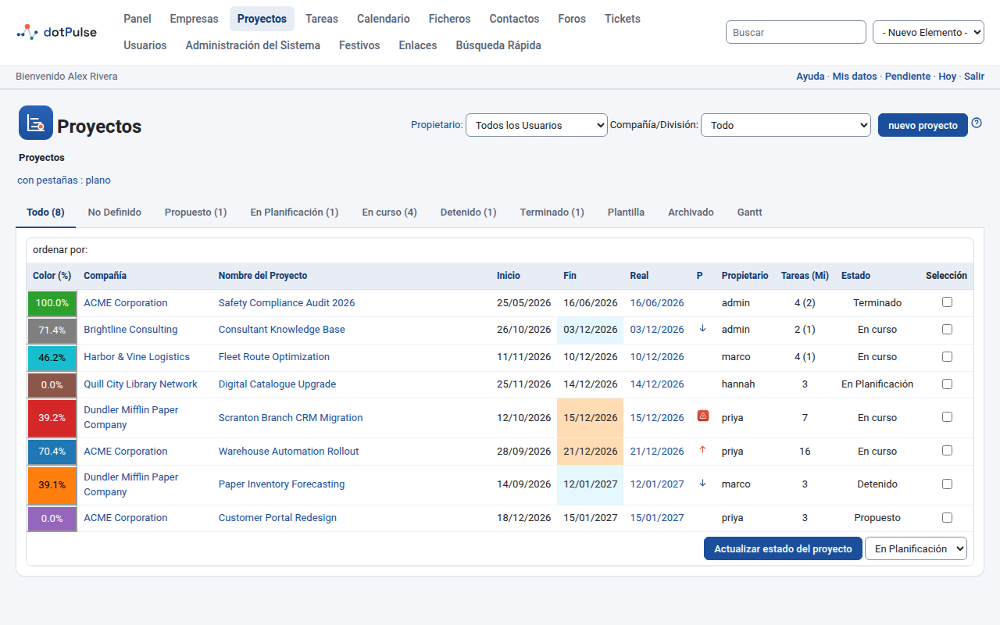
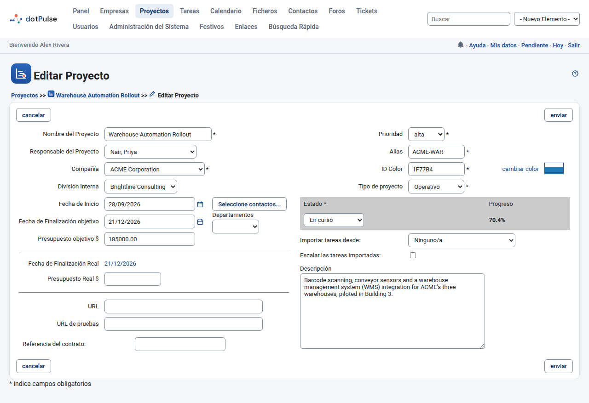
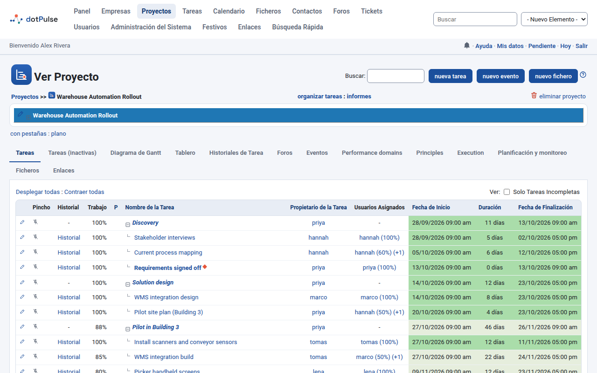

# Proyectos { #projects }

Un proyecto agrupa las tareas, los ficheros, los foros y los registros de trabajo de un mismo trabajo. Cada proyecto pertenece a una empresa. Esta página explica cómo buscar, crear, editar, archivar y eliminar proyectos.

## Buscar un proyecto { #find-a-project }

Haga clic en **Proyectos** en el menú superior. La lista se abre con una pestaña por cada estado de proyecto. Cada pestaña indica cuántos proyectos contiene, por ejemplo **En curso (4)**.

{ .shot }

Las pestañas son:

- **Todo**: todos los proyectos que puede ver, sea cual sea su estado.
- Una pestaña por estado: **No Definido**, **Propuesto** (se llama **Inicio** cuando está instalado el complemento dotProject+), **En Planificación**, **En curso**, **Detenido**, **Terminado**, **Plantilla** y **Archivado**.
- **Gantt**: un diagrama de los proyectos. Consulte [Diagrama de Gantt y tablero](gantt-board.md).

Encima de las pestañas hay dos filtros:

- **Propietario**: muestra solo los proyectos de una persona. Empieza con sus propios proyectos. Elija **Todos los Usuarios** para ver los proyectos de todos. Haga clic en la etiqueta **Propietario:** para volver a los suyos.
- **Compañía/División**: muestra solo los proyectos de una empresa o un departamento. La lista de una empresa incluye también los proyectos que lleva para sus clientes (aquellos en los que es la empresa interna).

Haga clic en el encabezado de una columna para ordenar por ella. Haga clic otra vez para invertir el orden. La primera columna muestra el progreso del proyecto sobre su color. La columna **P** muestra un icono de aviso en los proyectos con un problema notificado en un registro de tarea, o si no, flechas de prioridad. **Tareas (Mi)** cuenta todas las tareas y las tareas asignadas a usted.

Haga clic en el nombre de un proyecto para abrirlo.

## Estados de proyecto { #project-statuses }

El estado indica en qué punto de su vida está un proyecto. Los valores estándar son:

| Estado | Úselo para |
|---|---|
| No Definido | Un proyecto cuyo estado no ha fijado nadie todavía. |
| Propuesto (Inicio) | Una idea u oferta que aún no está aprobada. |
| En Planificación | Trabajo aprobado que todavía está planificando. |
| En curso | Trabajo que está en marcha. |
| Detenido | Trabajo en pausa. |
| Terminado | Trabajo acabado. |
| Plantilla | Un proyecto modelo del que copia tareas (consulte [Importar tareas de otro proyecto](#import-tasks-from-another-project)). |
| Archivado | Trabajo antiguo que quiere quitar de en medio. |

!!! note
    Un administrador puede renombrar o añadir estados en **Administración del Sistema**. Los nombres de su sitio pueden ser distintos.

Los proyectos archivados desaparecen de muchas listas. La lista de tareas, la lista de pendientes, los diagramas de Gantt y la lista de proyectos a los que puede mover una tarea los dejan fuera salvo que los pida.

## Crear un proyecto { #create-a-project }

Primero necesita al menos una empresa. Si no hay ninguna, dotPulse le pide que cree una.

1. Vaya a **Proyectos** y haga clic en **nuevo proyecto**.
2. Rellene el formulario. Los campos marcados con `*` son obligatorios.
3. Haga clic en **enviar**.

{ .shot }

También puede empezar un proyecto desde la página de una empresa o de un contacto. La empresa o el contacto se rellenan entonces por usted.

### Campos del proyecto { #project-fields }

| Campo | Qué significa |
|---|---|
| Nombre del Proyecto `*` | El nombre completo. |
| Responsable del Proyecto | La persona responsable. De forma predeterminada es usted. |
| Compañía `*` | La empresa para la que es el proyecto. |
| División interna | La empresa suya que lleva el proyecto. Aquí solo aparecen las empresas de tipo *Interno*. |
| Fecha de Inicio | El día en que empieza el trabajo. Haga clic en el icono de calendario para elegirlo. |
| Fecha de Finalización objetivo | El día en que debería terminar el proyecto. Si elige una fecha de inicio posterior, la fecha de fin se mueve para coincidir. |
| Presupuesto objetivo | El presupuesto previsto, en la moneda de su sitio. |
| Fecha de Finalización Real | No editable. Muestra la fecha de fin de la tarea que termina la última, con un enlace a esa tarea. Se pone en rojo cuando es posterior al objetivo. En un proyecto nuevo dice **Calculado dinámicamente**. |
| Presupuesto Real | El dinero gastado hasta ahora. Algunos complementos lo calculan a partir de los costes de las tareas; el campo aparece entonces en gris. |
| URL | Una dirección web para el proyecto, como el sitio en producción. |
| URL de pruebas | Una segunda dirección, como un sitio de pruebas. |
| Prioridad `*` | **baja**, **normal** o **alta**. |
| Alias `*` | Hasta 10 caracteres, para los sitios con poco espacio. Si lo deja vacío, se rellena con los primeros caracteres del nombre del proyecto al salir del campo del nombre. |
| ID Color `*` | Un color hexadecimal (como `FF9900`) para el proyecto en listas y diagramas. Haga clic en **cambiar color** para elegir uno. |
| Tipo de proyecto `*` | **Desconocido**, **Administrativo** u **Operativo**. |
| Estado `*` | Consulte [Estados de proyecto](#project-statuses). |
| Progreso | No editable. El porcentaje hecho, calculado a partir de las tareas. |
| Importar tareas desde | Copia las tareas de otro proyecto en este. Consulte más abajo. |
| Escalar las tareas importadas | Estira o encoge las tareas importadas para ajustarlas a las fechas de este proyecto. |
| Descripción | Texto libre sobre el proyecto. |

A la derecha de las fechas encontrará:

- **Seleccione contactos...**: abre una lista de contactos. Los que marque pasan a ser los contactos del proyecto. Aparecen en la página del proyecto y pueden recibir los correos de los registros de tarea.
- **Departamentos**: aparece cuando la empresa elegida tiene departamentos. Elija el departamento al que pertenece el proyecto.

Puede que su administrador haya añadido campos personalizados. Aparecen debajo de **URL de pruebas**.

## Editar un proyecto { #edit-a-project }

1. Abra el proyecto.
2. Haga clic en el icono del lápiz (**editar este proyecto**) a la izquierda de la barra de título de color.
3. Cambie lo que necesite y haga clic en **enviar**.

## Cambiar el estado de varios proyectos { #change-the-status-of-several-projects }

En la lista de proyectos puede cambiar muchos proyectos a la vez, si puede editarlos:

1. Marque las casillas de la columna **Selección**.
2. Elija el nuevo estado en la lista que hay al pie de la tabla.
3. Haga clic en **Actualizar estado del proyecto**.

## Archivar un proyecto { #archive-a-project }

Ponga su estado en **Archivado**, ya sea en el formulario de edición o con **Actualizar estado del proyecto**. El proyecto se queda en la base de datos con todas sus tareas, ficheros y registros. Lo encontrará de nuevo en la pestaña **Archivado**.

!!! tip
    Archive el trabajo terminado en lugar de eliminarlo. Eliminar no se puede deshacer.

## Importar tareas de otro proyecto { #import-tasks-from-another-project }

Puede copiar todas las tareas de un proyecto existente en el proyecto que está editando. Resulta práctico si mantiene un proyecto modelo con el estado **Plantilla**.

1. Edite el proyecto de destino (o créelo).
2. En **Importar tareas desde**, elija el proyecto de origen. Los proyectos aparecen agrupados por empresa.
3. Para ajustar las tareas a las nuevas fechas, marque **Escalar las tareas importadas**.
4. Haga clic en **enviar**.

Las copias conservan sus tareas padre y las dependencias entre ellas. Sus fechas se desplazan tanto como la diferencia entre las fechas de inicio de los dos proyectos. Con **Escalar las tareas importadas**, las fechas y las duraciones también crecen o se reducen en proporción a la duración de los dos proyectos. El escalado solo funciona cuando los dos proyectos tienen fecha de inicio y fecha de finalización objetivo.

## La página del proyecto { #the-project-page }

Abra un proyecto para ver su página.

{ .shot }

La barra de color de arriba muestra el nombre del proyecto. Haga clic en la flecha que hay a su lado para mostrar u ocultar los detalles:

- **Detalles**: empresa, empresa interna, alias, fechas, presupuesto objetivo, propietario, URL, campos personalizados y descripción.
- **Resumen**: estado, prioridad, tipo, progreso y tres totales de horas. **Horas Trabajadas** suma todos los registros de tarea. **Horas Programadas** suma las duraciones de las tareas. **Horas de proyecto** pondera cada duración según la parte asignada a personas. Después vienen los departamentos y los contactos.

Los botones de la zona del título le permiten añadir una **nueva tarea**, un **nuevo evento** o un **nuevo fichero** a este proyecto. El cuadro **Buscar** filtra la lista de tareas por nombre y descripción.

Bajo los botones encontrará estos enlaces:

- **organizar tareas**: cambiar muchas tareas a la vez. Consulte [Tareas](tasks.md#organize-many-tasks-at-once).
- **informes**: los informes del proyecto, como la lista de tareas y los informes de registros de tarea.
- **eliminar proyecto**: consulte [Eliminar un proyecto](#delete-a-project).

### Pestañas del proyecto { #project-tabs }

Las pestañas bajo los detalles muestran el contenido del proyecto. Las pestañas que ve dependen de sus permisos y de los módulos que usa su sitio.

Las pestañas básicas son:

| Pestaña | Qué muestra |
|---|---|
| Tareas | Las tareas activas, en forma de árbol. Consulte [Tareas](tasks.md). |
| Tareas (inactivas) | Las tareas cuyo estado es *Inactiva*. |
| Diagrama de Gantt | Las tareas sobre una línea de tiempo. Consulte [Diagrama de Gantt y tablero](gantt-board.md). |
| Tablero | Las tareas como tarjetas en *Por hacer*, *En progreso* y *Hecho*. Consulte [Diagrama de Gantt y tablero](gantt-board.md#the-board). |
| Historiales de Tarea | Todo el trabajo registrado en las tareas del proyecto. Consulte [Registrar el trabajo](task-logs.md). |
| Foros | Los foros de debate vinculados al proyecto. Consulte [Ficheros, foros y enlaces](files-forums-links.md#forums). |
| Ficheros | Los ficheros adjuntos al proyecto. |
| Eventos | Los eventos de calendario del proyecto. |

Los módulos complementarios añaden más pestañas cuando están instalados. Los más habituales son:

| Pestaña | Complemento | Para qué sirve |
|---|---|---|
| Enlaces | Enlaces | Enlaces web adjuntos al proyecto. |
| Historia | Historia | Un registro de los cambios en el proyecto y sus tareas. |
| Planificación y monitoreo, Execution | dotProject+ | Planificar paquetes de trabajo y actividades, y seguir su ejecución. |
| Principles | dotProject+ | Valorar cómo sigue el proyecto cada principio del PMBOK (de 1 a 5), con notas. |
| Performance domains | dotProject+ | Anotar el estado de cada dominio de desempeño del PMBOK, con notas. |
| Riesgos | Riesgos | El registro de riesgos del proyecto. |
| Costs, Presupuesto | Costs | Estimaciones de costes y el presupuesto. |
| Diario | Diario | Notas fechadas sobre el proyecto. |
| Inicio | Inicio | El acta de constitución del proyecto. |

## Eliminar un proyecto { #delete-a-project }

!!! warning
    Eliminar un proyecto elimina también todas sus tareas, sus asignaciones y sus dependencias. No se puede deshacer. Considere [archivarlo](#archive-a-project) en su lugar.

1. Abra el proyecto.
2. Haga clic en **eliminar proyecto**.
3. dotPulse le pide que escriba el nombre del proyecto. Escríbalo exactamente (puede copiarlo y pegarlo) y confirme.

Si el nombre no coincide, no se elimina nada. Solo ve **eliminar proyecto** si tiene permiso para eliminarlo.
