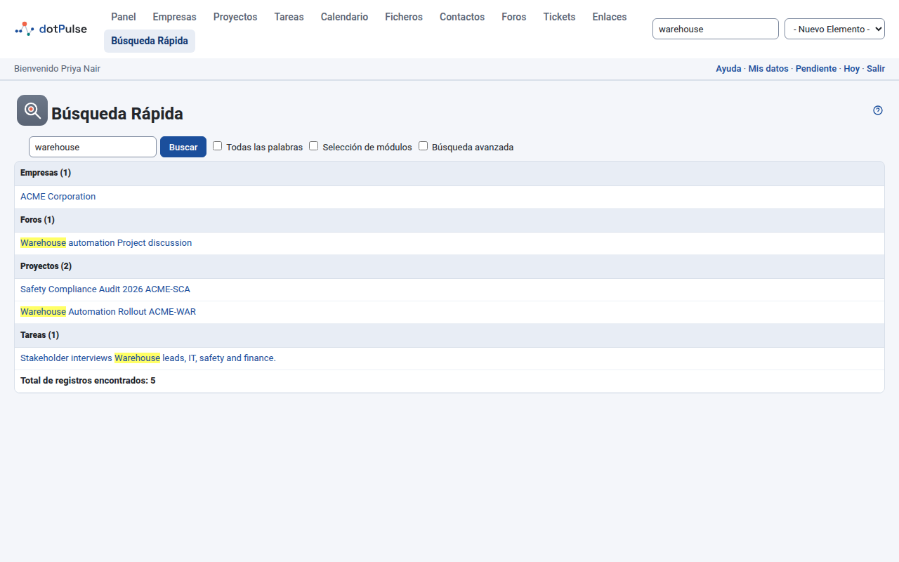
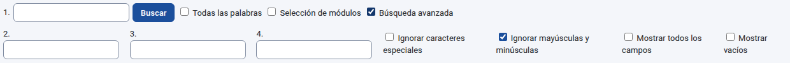

# Búsqueda { #search }

La búsqueda rápida busca palabras en todo dotPulse: proyectos, tareas, contactos, ficheros
y más, todo a la vez.

## Buscar desde cualquier página { #search-from-any-page }

1. Haga clic en la casilla **Buscar** de la barra superior.
2. Escriba una palabra.
3. Pulse ++enter++.

dotPulse abre la página **Búsqueda Rápida** con los resultados.

También puede abrir **Búsqueda Rápida** desde el menú de módulos, si su administrador
la ha puesto allí, y buscar desde la casilla que hay en la parte superior de esa página.

## Leer los resultados { #read-the-results }

Los resultados se agrupan por tipo de elemento, como **Proyectos**, **Tareas** o
**Contactos**, con el número de coincidencias entre paréntesis. Cada resultado muestra los
primeros campos del elemento, con las palabras buscadas resaltadas. Haga clic en un
resultado para abrirlo. La última línea da el **Total de registros encontrados**.

{ .shot }

Los resultados respetan sus permisos: solo obtiene elementos de los módulos y
registros que puede ver. Los eventos privados de otras personas quedan fuera.

## Dónde se busca { #what-is-searched }

| Grupo | Dónde busca dotPulse |
|---|---|
| **Empresas** | Nombre, dirección, sitio web, correo electrónico y descripción. |
| **Contactos** | Nombre, cargo, empresa, tipo, direcciones de correo, dirección y notas. |
| **Departamentos** | Nombre, dirección, sitio web y descripción. |
| **Eventos** | Título, descripción y fechas de inicio y fin. |
| **Ficheros** | Nombre del fichero, descripción y tipo. |
| **Contenido de los Ficheros** | Las palabras de los ficheros subidos que dotPulse ha indexado. Un resultado abre el fichero. |
| **Foros** | Nombre y descripción del foro. |
| **Mensajes del Foro** | Título y texto del mensaje. |
| **Proyectos** | Nombre, nombre corto, descripción, direcciones web, y los nombres y datos de los contactos del proyecto. |
| **Historial de Tarea** | Resumen y descripción del trabajo registrado. |
| **Tareas** | Nombre, descripción, dirección web y campos personalizados. |
| **Tickets** | Autor, destinatario, asunto, cuerpo y otros datos del ticket. |
| **Usuarios** | Nombre de usuario y firma. |

Solo ve los grupos de los módulos que puede abrir, así que su lista puede ser más corta.

## Buscar varias palabras { #search-for-several-words }

Escriba varias palabras separadas por espacios, comas o puntos y coma.

- De entrada, un resultado coincide si contiene **cualquiera** de las palabras.
- Marque **Todas las palabras** para obtener solo los resultados que contienen **todas** las palabras.

Las palabras coinciden en cualquier parte de un campo, también dentro de palabras más largas: buscar
`plan` encuentra también "planning" y "airplane".

!!! tip
    Busque letras y números sin más. Caracteres como `.` `*` `(` y `?`
    tienen un significado especial en la búsqueda y pueden dar resultados inesperados.

## Buscar solo en algunos módulos { #search-only-some-modules }

1. Marque **Selección de módulos**. Aparece una lista de los grupos.
2. Marque los grupos que quiera, o use **Seleccionar todo** y **Deseleccionar todo**.
3. Haga clic en **Buscar**.

## Búsqueda avanzada { #advanced-search }

Marque **Búsqueda avanzada** para obtener más opciones:

- **Cuatro casillas de búsqueda** (de la 1 a la 4). Las palabras de cada casilla se resaltan en un color
  distinto en los resultados, así que puede saber qué palabra ha coincidido.
- **Ignorar mayúsculas y minúsculas**: marcada de entrada, así que `Report` encuentra también "report". Desmárquela
  para que las mayúsculas tengan que coincidir exactamente.
- **Mostrar todos los campos**: muestra todos los campos de cada resultado en lugar de los dos
  primeros.

{ .shot }
