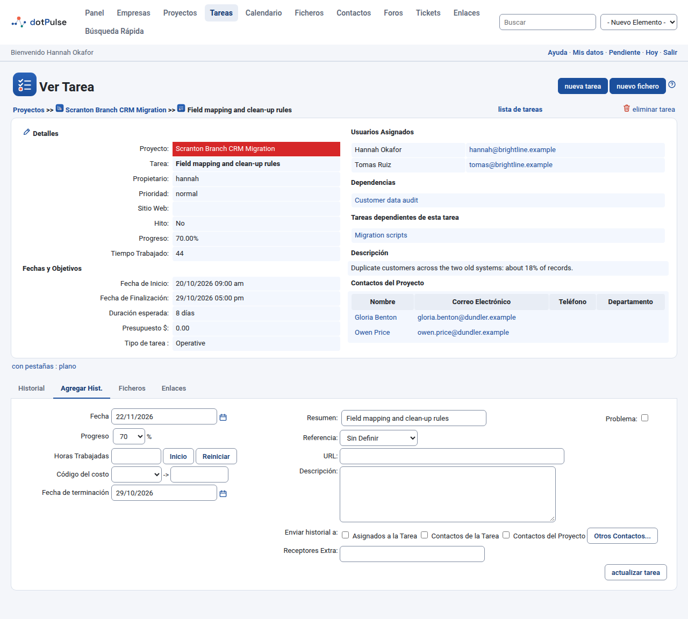
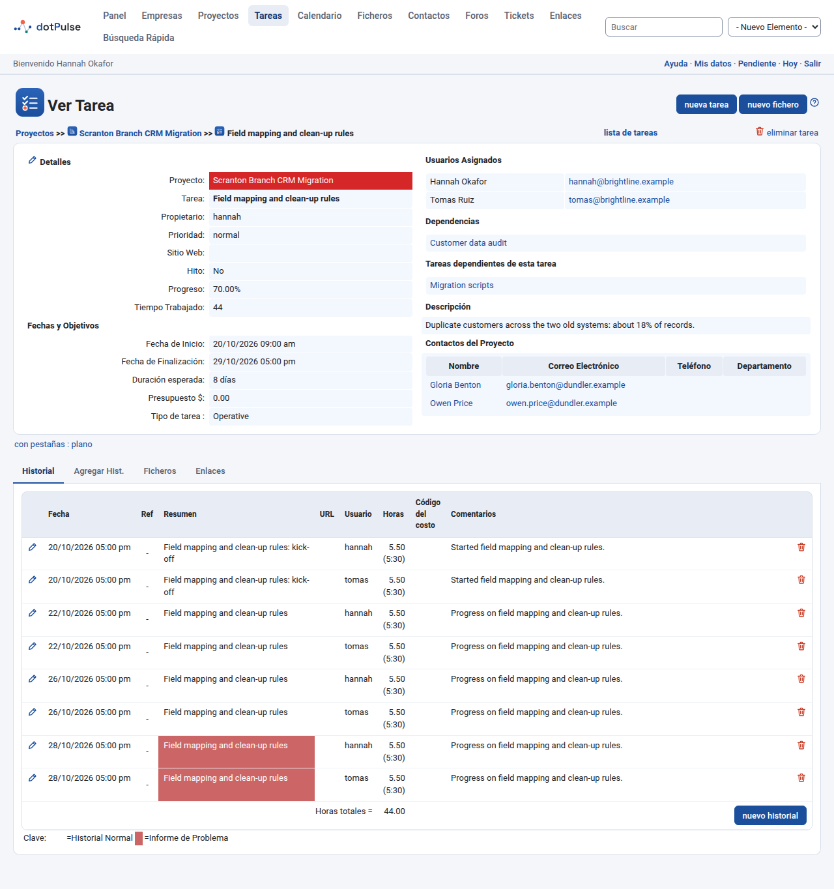
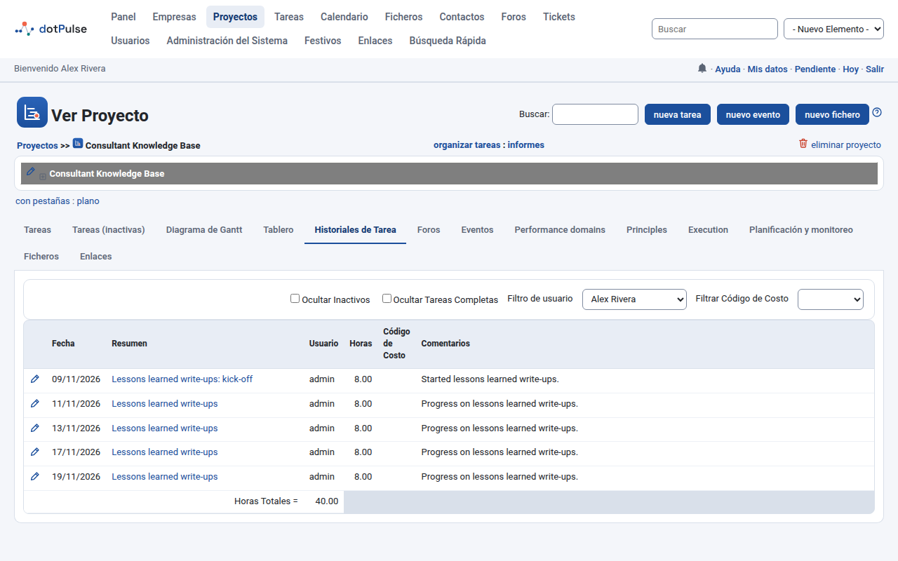

# Registrar el trabajo { #logging-work }

Un registro de tarea anota el trabajo que ha hecho en una tarea: cuándo, cuántas horas y qué ha pasado. Registrar el trabajo es también la forma de actualizar el progreso de una tarea. Sus registros alimentan los totales de horas de su panel, de la página del proyecto y de los informes.

## Registrar tiempo en una tarea { #log-time-on-a-task }

Puede registrar trabajo en una tarea que tenga permiso para editar.

1. Abra la tarea. También puede hacer clic en **Historial** en la columna **Agregar Hist.** de cualquier lista de tareas.
2. Abra la pestaña **Agregar Hist.**.
3. Rellene el formulario (vea los campos más abajo).
4. Haga clic en **actualizar tarea**.

{ .shot }

dotPulse guarda el registro, actualiza la tarea y muestra la pestaña **Historial** con su nueva entrada.

!!! note
    Los grupos de tareas (tareas dinámicas) no tienen pestaña **Agregar Hist.**. Registre su trabajo en sus tareas hijas; el grupo lo suma.

### Campos del registro { #log-fields }

| Campo | Qué escribir |
|---|---|
| Fecha | El día en que hizo el trabajo. De entrada es hoy. Haga clic en el icono de calendario para cambiarlo. |
| Progreso | El nuevo porcentaje completado de la tarea, en pasos del 5 %. Esto cambia la propia tarea. |
| Notificar al propietario | Envía un correo al propietario de la tarea sobre este registro. Solo se muestra cuando usted no es el propietario. |
| Horas Trabajadas | El tiempo dedicado, como número decimal (`1.5`) o como horas y minutos (`1:30`). |
| Inicio / Reiniciar | Un cronómetro. Haga clic en **Inicio** al empezar; el campo de horas va contando mientras funciona. Haga clic en **Parar** para detenerlo y en **Reiniciar** para ponerlo a cero. |
| Código del costo | El código de facturación al que se carga el tiempo. Elija uno de la lista, o escriba un código en la casilla de al lado. |
| Fecha de terminación | Cambia la fecha de fin de la tarea. Solo se muestra al propietario de la tarea, al propietario del proyecto y a los administradores. |
| Resumen | Un título de una línea para el registro. Empieza con el nombre de la tarea. |
| Problema | Márquelo para señalar un problema. Vea [Informar de un problema](#report-a-problem). |
| Referencia | De dónde vino el trabajo: **Sin Definir**, **Correo Electrónico**, **Helpdesk**, **Phone Call** o **Fax**. |
| URL | Una dirección web relacionada. Incluya el `http://` o `https://`. |
| Descripción | Lo que hizo, con todo el detalle que quiera. |

Los códigos de coste de la lista son los códigos de facturación que su administrador ha creado para la empresa del proyecto, más los que comparten todas las empresas.

## Actualizar el progreso de una tarea { #update-the-progress-of-a-task }

Cada registro lleva el progreso de la tarea. Al registrar, ponga en **Progreso** el nuevo valor. Si no ha cambiado nada, déjelo como está.

Cuando pone **Progreso** al 100 % y la tarea no tiene fecha de fin, la fecha de su registro pasa a ser su fecha de fin.

El progreso de un proyecto se calcula a partir de sus tareas, ponderadas por su duración. Los grupos de tareas toman su progreso de sus hijas. También puede cambiar el progreso de forma aproximada en el [tablero](gantt-board.md#the-board), o directamente en el formulario de edición de la tarea.

## Enviar la actualización por correo { #email-the-update }

En **Enviar historial a**, marque quién debe recibir una copia del registro:

- **Asignados a la Tarea**: todas las personas asignadas a la tarea.
- **Contactos de la Tarea**: los contactos vinculados a la tarea.
- **Contactos del Proyecto**: los contactos vinculados al proyecto.
- **Otros Contactos...**: abre una lista para elegir más contactos.
- **Receptores Extra**: escriba direcciones de correo adicionales.

El correo incluye el proyecto, la tarea, las horas y su resumen y descripción. Qué casillas empiezan marcadas depende de **Predeterminados de las Notificaciones de Historial** en sus [preferencias](preferences.md).

## Informar de un problema { #report-a-problem }

Marque **Problema** cuando algo bloquee la tarea. El registro se muestra entonces con fondo rojo en la pestaña **Historial**. En las listas de tareas, la tarea lleva un icono de aviso en la columna **P**; haga clic en él para ver solo los registros de problemas de esa tarea. En la lista de proyectos, la columna **P** puede ordenar primero los proyectos con problemas.

## Ver, editar y eliminar registros { #see-edit-and-delete-logs }

La pestaña **Historial** de una tarea muestra todos sus registros, de más antiguo a más reciente, con una línea de **Horas totales** al final.

{ .shot }

Las columnas son **Fecha**, **Ref** (la referencia, como icono), **Resumen**, **URL**, **Usuario**, **Horas** (como número decimal y como horas:minutos), **Código del costo** y **Comentarios** (la descripción). La clave del final distingue un **Historial Normal** de un **Informe de Problema**.

- Para editar un registro, haga clic en el icono de editar a la izquierda de su fila. El formulario se abre en la pestaña **Editar Historial**. Cámbielo y haga clic en **actualizar tarea**.
- Para eliminar un registro, haga clic en el icono de eliminar a la derecha de su fila y confirme.

Necesita el permiso correspondiente para ver estos iconos.

!!! warning
    Al eliminar una tarea se eliminan también todos los registros de esa tarea y de sus tareas hijas.

## Dónde aparecen las horas registradas { #where-logged-hours-appear }

| Dónde | Qué ve |
|---|---|
| [Su panel](dashboard.md) | **Horas registradas esta semana**: las horas que ha registrado de lunes a domingo de esta semana. |
| La página de una tarea | **Tiempo Trabajado**, y las **Horas totales** de la pestaña **Historial**. |
| La página de un proyecto | **Horas Trabajadas** en el resumen, y la pestaña **Historiales de Tarea** del proyecto. |
| Informes del proyecto | Por ejemplo **Task Log** (los registros de un usuario) y **User performance** (horas trabajadas frente a horas asignadas). Ábralos con el enlace **informes** de la página de un proyecto o de la lista de tareas. |
| Complemento Timesheet | Si está instalado, muestra los registros que escribió el día elegido. |

### La pestaña Historiales de Tarea del proyecto { #the-project-task-logs-tab }

La pestaña **Historiales de Tarea** de un proyecto reúne los registros de todas sus tareas.

{ .shot }

Use los filtros de arriba para acotarla:

- **Ocultar Inactivos**: deja fuera los registros de las tareas inactivas.
- **Ocultar Tareas Completas**: deja fuera los registros de las tareas terminadas.
- **Filtro de usuario**: muestra los registros de una persona, o **Todos los Usuarios**. Empieza mostrando sus propios registros.
- **Filtrar Código de Costo**: muestra solo los registros con un código de coste.
