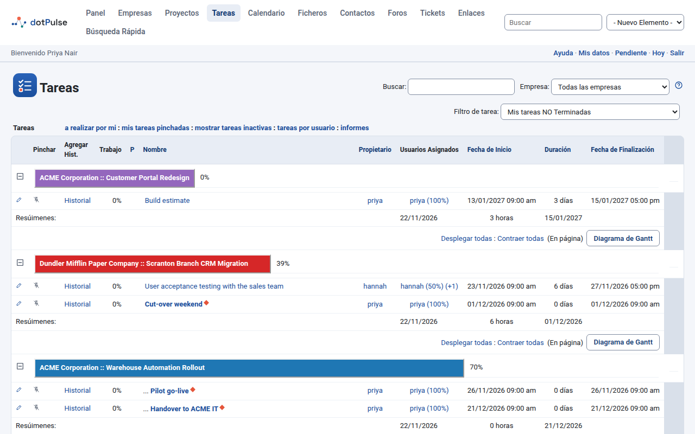
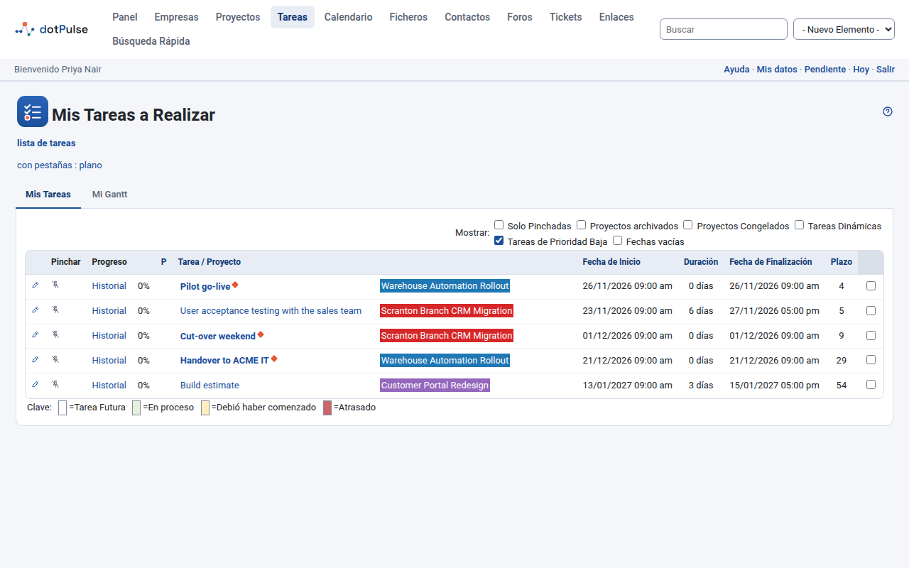
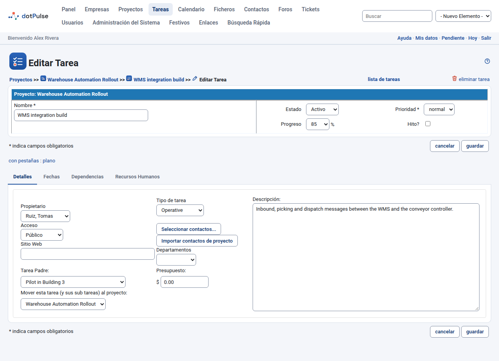
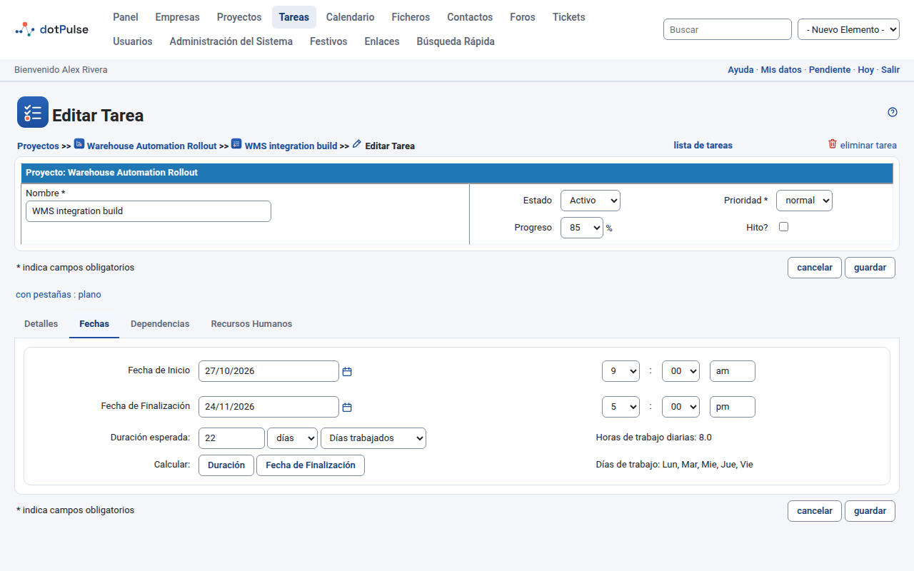
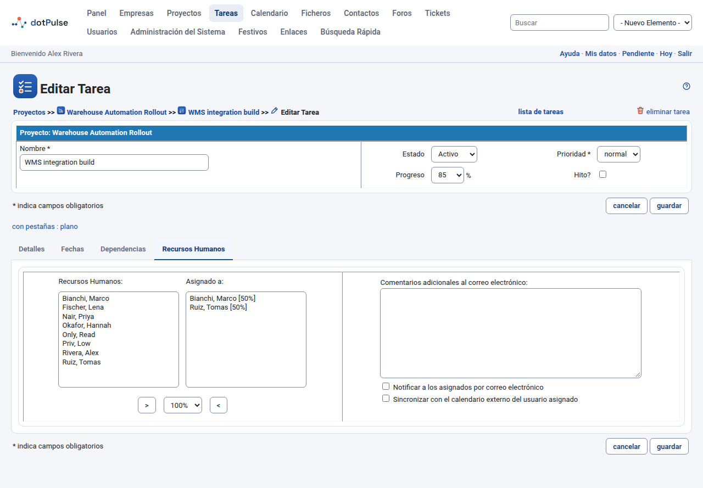
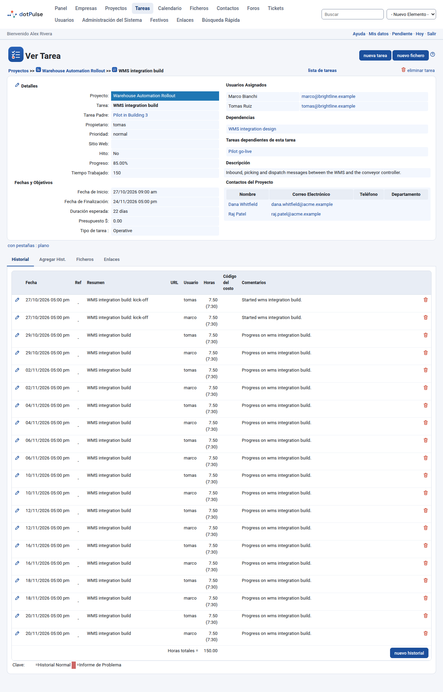

# Tareas { #tasks }

Las tareas son las unidades de trabajo de un proyecto. Cada tarea tiene fechas, una duración, personas asignadas y un porcentaje de progreso. Esta página trata de las listas de tareas, de cómo crear y editar tareas y de la página de la tarea.

## Encontrar sus tareas { #find-your-tasks }

Haga clic en **Tareas** en el menú superior. La lista agrupa las tareas por proyecto. De entrada muestra **Mis tareas NO Terminadas**.

{ .shot }

Use los controles que hay encima de la lista para acotarla:

- **Buscar**: escriba una palabra y pulse Intro. Busca en los nombres y las descripciones de las tareas.
- **Empresa**: muestra solo las tareas de los proyectos de una empresa.
- **Usuario**: los administradores pueden ver las tareas de otra persona.
- **Filtro de tarea**: elige qué tareas se muestran:

| Filtro | Muestra |
|---|---|
| Mis Tareas | Las tareas que tiene asignadas. |
| Mis tareas NO Terminadas | Sus tareas que no están al 100 %, en proyectos que no están detenidos, terminados ni archivados. |
| Todas las Tareas SIN Finalizar | Las tareas sin terminar de todos, con las mismas reglas de proyecto. |
| Mis Proyectos | Todas las tareas de los proyectos de los que es propietario. |
| Todas las Tareas de mi Empresa | Todas las tareas de los proyectos de su empresa. |
| Todas las tareas (sin asignar) | Las tareas que no tienen a nadie asignado. |
| Todas las Tareas que he Creado | Las tareas de las que es propietario. |
| Todas las Tareas | Todas las tareas que puede ver. |
| Todas las Tareas Finalizadas en los Últimos 7 Días | Las tareas que llegaron al 100 % con una fecha de fin en la última semana. |
| Mis Tareas Finalizadas en los Últimos 7 Días | Lo mismo, solo para sus tareas. |

Los enlaces que hay bajo los filtros abren otras vistas:

- **a realizar por mi**: su lista de pendientes (vea más abajo).
- **mis tareas pinchadas**: solo las tareas que ha pinchado. **todas las tareas** le lleva de vuelta.
- **mostrar tareas inactivas** / **mostrar tareas activas**: cambia entre las tareas activas y las inactivas.
- **tareas por usuario**: una lista de tareas agrupadas por persona asignada.
- **informes**: los informes del proyecto.

Haga clic en la flecha a la izquierda de la barra de un proyecto para mostrar solo ese proyecto. Vuelva a hacer clic para mostrar todos los proyectos.

### Leer la lista de tareas { #read-the-task-list }

| Columna | Significado |
|---|---|
| (lápiz) | Editar la tarea. |
| Pinchar | Pinchar la tarea o quitar el pincho. Vea [Pinchar una tarea](#pin-a-task). |
| Agregar Hist. | El enlace **Historial** abre el formulario para registrar trabajo en la tarea. |
| Trabajo | El progreso, en porcentaje. |
| P | Flechas de prioridad, o un icono de aviso si un registro de trabajo informó de un problema. Un clip indica que la tarea tiene ficheros. |
| Nombre | Las tareas hijas aparecen sangradas bajo su tarea padre. |
| Propietario, Usuarios Asignados | Quién es el propietario de la tarea y quién trabaja en ella. |
| Fecha de Inicio, Duración, Fecha de Finalización | La planificación prevista. |
| Última Actualización | Se muestra cuando el módulo de historial está activo. |

El color de la fila indica cómo va la tarea. La clave bajo la lista lo explica: **Tarea Futura**, **En proceso**, **Debió haber comenzado**, **Atrasado** y **Hecho**.

Use **Desplegar todas** y **Contraer todas** para abrir o cerrar todas las tareas padre. Dentro de un proyecto, marque **Solo Tareas Incompletas** para ocultar las tareas terminadas.

## Su lista de pendientes { #your-to-do-list }

Vaya a **Tareas** y haga clic en **a realizar por mi**. La página **Mis Tareas a Realizar** muestra las tareas activas y sin terminar que tiene asignadas.

{ .shot }

Tiene dos pestañas: **Mis Tareas** (una lista) y **Mi Gantt** (un diagrama). Si el complemento Helpdesk está activo, una tercera pestaña muestra **Mis solicitudes abiertas**.

Marque las casillas de **Mostrar** para añadir más tareas a la lista:

- **Solo Pinchadas**: solo las tareas que ha pinchado.
- **Proyectos archivados**: incluye las tareas de los proyectos archivados.
- **Proyectos Congelados**: incluye las tareas de los proyectos detenidos.
- **Tareas Dinámicas**: incluye los grupos de tareas (vea [Grupos de tareas](#task-groups-and-child-tasks)).
- **Tareas de Prioridad Baja**: incluye las tareas de prioridad baja. Esta casilla empieza marcada.
- **Fechas vacías**: incluye las tareas sin fecha de inicio.

La columna **Plazo** cuenta los días que faltan hasta la fecha de fin de cada tarea. Los administradores pueden elegir a otra persona en **Mostrar Tareas a Realizar de:**.

## Pinchar una tarea { #pin-a-task }

Pinchar una tarea la mantiene a mano. Haga clic en el icono de chincheta de la columna **Pinchar** de cualquier lista de tareas. Vuelva a hacer clic para quitarla. Sus tareas pinchadas son personales; los demás no las ven.

Para ver solo las tareas pinchadas, haga clic en **mis tareas pinchadas** en la lista de tareas, o marque **Solo Pinchadas** en la lista de pendientes.

## Crear una tarea { #create-a-task }

1. Abra el proyecto.
2. Haga clic en **nueva tarea**.
3. Escriba el **Nombre** y rellene las pestañas de abajo.
4. Haga clic en **guardar**.

Para crear una tarea hija, abra la tarea padre y haga clic allí en **nueva tarea**. La nueva tarea empieza con esa tarea padre.

{ .shot }

La parte superior del formulario muestra el proyecto y estos campos:

| Campo | Significado |
|---|---|
| Nombre `*` | Un nombre corto y claro. |
| Estado | **Activo** o **Inactiva**. Las tareas inactivas salen de las listas normales y aparecen en la pestaña **Tareas (inactivas)** del proyecto. |
| Prioridad `*` | **baja**, **normal** o **alta**. |
| Progreso | Cuánto está hecho, en pasos del 5 %. |
| Hito? | Marca una fecha clave. Un hito no tiene duración. |

El resto del formulario se reparte en pestañas. Puede cambiar de pestaña antes de guardar; dotPulse conserva lo que haya escrito.

### Pestaña Detalles { #details-tab }

| Campo | Significado |
|---|---|
| Propietario | La persona responsable de la tarea. También decide qué calendario de festivos siguen las fechas (vea [Días laborables y festivos](#working-days-and-holidays)). |
| Acceso | Quién puede ver la tarea. Vea [Acceso a la tarea](#task-access). |
| Sitio Web | Un enlace relacionado con la tarea. |
| Tipo de tarea | **Unknown**, **Administrative** u **Operative**. |
| Seleccionar contactos... | Elija contactos para esta tarea. |
| Importar contactos de proyecto | Añade a la tarea los contactos del proyecto. |
| Departamentos | Se muestra cuando la empresa del proyecto tiene departamentos. |
| Tarea Padre | Convierte esta tarea en hija de otra. **Ninguno** la deja en el nivel superior. |
| Presupuesto | El presupuesto previsto para la tarea. |
| Descripción | Texto libre. |
| Mover esta tarea (y sus sub tareas) al proyecto | Solo al editar. Vea [Mover una tarea a otro proyecto](#move-a-task-to-another-project). |

### Pestaña Fechas { #dates-tab }

{ .shot }

| Campo | Significado |
|---|---|
| Fecha de Inicio | Día y hora en que empieza el trabajo. |
| Fecha de Finalización | Día y hora en que termina el trabajo. |
| Duración esperada | Un número más **horas** o **días**, y **Días trabajados** o **Días del calendario**. |

Bajo los campos, dotPulse muestra las **Horas de trabajo diarias** y los **Días de trabajo** del sitio.

Los botones de **Calcular** rellenan un valor a partir de los demás:

- **Duración**: calcula la duración a partir de las fechas de inicio y fin.
- **Fecha de Finalización**: calcula la fecha de fin a partir de la fecha de inicio y la duración.

Un día de duración cuenta como las horas de trabajo diarias del sitio, no como 24 horas.

!!! note
    Solo el propietario de la tarea, el propietario del proyecto o un administrador del sistema pueden cambiar fechas, duraciones y dependencias. Los demás ven un mensaje en lugar de estos campos.

### Días laborables y festivos { #working-days-and-holidays }

Cuando hace clic en **Fecha de Finalización**, dotPulse cuenta la duración en horas de trabajo, día laborable a día laborable. Con **Días trabajados** se salta los días no laborables y los festivos. Con **Días del calendario** cuenta todos los días, fines de semana y festivos incluidos.

Si su sitio usa calendarios de festivos (el módulo Holiday), las fechas siguen el calendario del **propietario de la tarea**. Es el calendario de la propia cuenta del propietario o, si no, el de su departamento o su empresa. Si cambia el propietario, **Fecha de Finalización** usa los festivos del nuevo propietario. Lo mismo vale cuando dotPulse mueve tareas por sus dependencias, y para los correos de recordatorio, que no se envían en los festivos de la persona.

### Pestaña Dependencias { #dependencies-tab }

Una dependencia indica que esta tarea solo puede empezar cuando termine otra.

1. En **Todas las Tareas**, seleccione una o varias tareas.
2. Si quiere, escriba un retraso en días en la casilla que hay entre las flechas, como `+2` o `-1`.
3. Haga clic en **>** para añadirlas a **Dependencias**. Haga clic en **<** para quitar las seleccionadas.
4. Marque **Configurar la fecha de inicio de acuerdo a sus dependencias** si la fecha de inicio debe seguir a la fecha de fin más tardía de entre ellas.

**Seguimiento de Dependencias** controla lo que pasa cuando se mueven las tareas de las que depende:

- **On**: las fechas de esta tarea se mueven con ellas.
- **Off**: esta tarea conserva sus fechas.
- **No seguir esta tarea**: las tareas que dependen de esta no se mueven cuando cambia.

dotPulse rechaza las dependencias que forman un bucle o que atan una tarea a su propia tarea padre.

### Pestaña Recursos Humanos { #human-resources-tab }

Asigne personas a la tarea e indique cuánto de su tiempo ocupa.

{ .shot }

1. Seleccione una o varias personas en **Recursos Humanos**.
2. Elija un porcentaje (del 5 % al 100 %) en la lista que hay entre las flechas.
3. Haga clic en **>**. Aparecen en **Asignado a** con su porcentaje.
4. Para quitar a alguien, selecciónelo en **Asignado a** y haga clic en **<**.

A la derecha:

- **Comentarios adicionales al correo electrónico**: texto que se añade al correo de aviso.
- **Notificar a los asignados por correo electrónico**: envía los datos de la tarea a las personas asignadas al guardar.
- **Sincronizar con el calendario externo del usuario asignado**: envía la tarea como invitación de calendario a las personas asignadas.

Si su administrador ha activado el control de sobreasignación, dotPulse no asignará a nadie por encima de su capacidad libre. Se lo indicará.

### Pestañas de complementos { #add-on-tabs }

Los módulos complementarios pueden añadir pestañas al formulario de la tarea. Las habituales son **Otros Recursos** (equipos y otros recursos no humanos, con un porcentaje como las personas), **Allocations**, **Presupuesto detallado**, **Unit costs** y **Estimations**.

## Hitos { #milestones }

Marque **Hito?** para un momento clave, como una entrega o una aprobación. dotPulse pone su duración a cero. Los hitos llevan un rombo en el [tablero](gantt-board.md#the-board). Puede ocultarlos en el diagrama de Gantt de las tareas.

## Grupos de tareas y tareas hijas { #task-groups-and-child-tasks }

Cualquier tarea puede tener tareas hijas: indique la **Tarea Padre** en la hija. La tarea padre se muestra como un árbol en las listas de tareas. La página de una tarea padre tiene una pestaña **Sub-tareas**.

Una **tarea dinámica** (un grupo de tareas) toma sus fechas, su duración, sus horas trabajadas y su progreso de sus hijas. Para crear una, marque **Tarea Dinámica** en la pestaña **Dependencias**. Tenga en cuenta que:

- Una tarea dinámica está pensada para tener hijas. Según la configuración de su sitio, dotPulse rechaza una tarea dinámica sin ninguna.
- Una tarea dinámica no puede depender de otra tarea.
- El trabajo no se registra en una tarea dinámica, sino en sus hijas.
- Los grupos de tareas no aparecen en el tablero, y quedan fuera de su lista de pendientes salvo que marque **Tareas Dinámicas**.

## Acceso a la tarea { #task-access }

El campo **Acceso** limita quién puede ver una tarea:

| Acceso | Quién puede verla |
|---|---|
| Público | Todos los que pueden ver el proyecto. |
| Protegido | El propietario y las personas asignadas de la misma empresa que el propietario. |
| Participante | El propietario y las personas asignadas. |
| Privilegiado | El propietario, las personas asignadas y las personas de la empresa del proyecto. |
| Privado | Solo el propietario. |

## Recordatorios { #reminders }

Si su administrador ha activado los recordatorios de tareas, dotPulse envía un correo a las personas asignadas y al propietario antes de la fecha de fin de la tarea. El recordatorio se repite una vez al día hasta que la tarea llega al 100 % o se agota el número de repeticiones fijado. Nadie recibe un recordatorio en un día que no es laborable para esa persona. El administrador fija cuántos días antes de la fecha de fin empiezan los recordatorios y cuántas repeticiones hay.

## Mover una tarea a otro proyecto { #move-a-task-to-another-project }

1. Edite la tarea.
2. En la pestaña **Detalles**, elija el nuevo proyecto en **Mover esta tarea (y sus sub tareas) al proyecto**.

El formulario se guarda en el acto. Las tareas hijas y los ficheros de la tarea se mueven con ella. La lista solo ofrece proyectos de la misma empresa que no estén archivados.

## Organizar muchas tareas a la vez { #organize-many-tasks-at-once }

En la página de un proyecto, haga clic en **organizar tareas**. Marque las tareas en la columna **Seleccionar** y elija una **Acción**: **Copiar**, **Mover**, **Borrar**, **Marcar como finalizada** o una de las opciones **cambiar prioridad a**. Si no puede editar tareas, solo se ofrece **Copiar**. Para copiar y mover, elija el **Proyecto** de destino y la **Tarea** (la nueva tarea padre). Marque **Incluir subtareas** para aplicar la acción también a las tareas hijas; no se aplica al borrar ni al mover dentro del mismo proyecto. Después haga clic en **actualizar tareas seleccionadas**.

## La página de la tarea { #the-task-page }

Haga clic en el nombre de una tarea para abrir su página.

{ .shot }

La parte izquierda muestra **Detalles** (proyecto, tarea padre, propietario, prioridad, sitio web, hito, progreso y **Tiempo Trabajado**) y **Fechas y Objetivos** (inicio, fin, duración esperada, presupuesto, tipo de tarea). La parte derecha muestra **Usuarios Asignados**, **Dependencias**, **Tareas dependientes de esta tarea**, la descripción, los departamentos, **Contactos de la Tarea** y **Contactos del Proyecto**.

Use el icono del lápiz (**editar esta tarea**) para editarla. Los botones **nueva tarea** y **nuevo fichero** añaden una tarea hija o un fichero a esta tarea.

Las pestañas de abajo son:

- **Historial**: el trabajo registrado en la tarea. Vea [Registrar el trabajo](task-logs.md).
- **Agregar Hist.** (o **Editar Historial**): el formulario para registrar trabajo.
- **Sub-tareas**: cuando la tarea tiene hijas.
- Pestañas de complementos, como **Ficheros**, cuando esos módulos están activos.

## Eliminar una tarea { #delete-a-task }

1. Abra la tarea, o su formulario de edición.
2. Haga clic en **eliminar tarea** y confirme.

!!! warning
    Al eliminar una tarea se eliminan también todas sus tareas hijas y el trabajo registrado en ellas. No se puede deshacer. Para conservar el historial, ponga el estado de la tarea en **Inactiva**.
