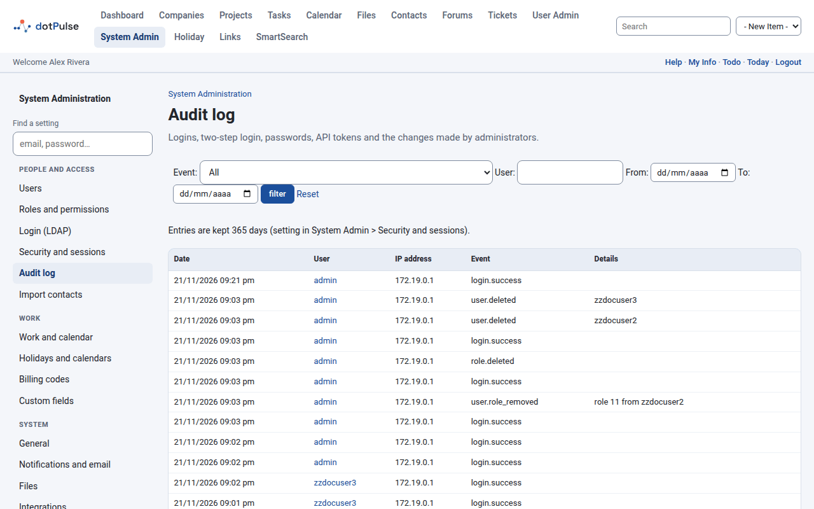

# Audit and maintenance

This page covers the security audit log, importing contacts from LDAP, and the
routine work that keeps a dotPulse site healthy: the cron job, backups, upgrades
and a security check.

## Audit log

The audit log records logins and the changes administrators make. It is always
on, and nobody can edit or delete its entries from dotPulse.

Open **System Admin › Audit log**. It needs view permission on **System Admin**,
which only administrators have on a new site. The newest entries come first, 100
per page; **Older** and **Newer** at the bottom move between pages.

{ .shot }

Each entry has the **Date**, the **User**, the **IP address**, the **Event** and
**Details**. For a failed login, **User** is the name that was tried. Failed and
blocked attempts are shown in red. Point at an event to see what it means.

Passwords, tokens and the values of settings are never written to the log. A
settings change lists only the names of the settings that changed.

### What is recorded

| Events | When |
|--------|------|
| `login.success`, `logout` | Someone logged in or out. |
| `login.failure` | Wrong user name or password. |
| `login.blocked` | An address made too many failed logins and is refused for a while. |
| `twofactor.failure`, `twofactor.blocked` | Wrong two-step login codes. |
| `twofactor.recovery_used` | Someone logged in with a recovery code. |
| `twofactor.enabled`, `twofactor.disabled`, `twofactor.recovery_renewed` | A user changed their two-step login. |
| `twofactor.reset` | An administrator reset someone's two-step login. |
| `password.changed` | A password was changed, by its user or by an administrator. |
| `password.reset_requested`, `password.reset` | Someone asked for a password reset link, and used it. |
| `api.token_created`, `api.token_revoked` | REST API tokens. |
| `api.blocked` | An address made too many failed API calls. |
| `user.created`, `user.updated`, `user.deleted` | User accounts. |
| `user.role_added`, `user.role_removed` | A user's roles. |
| `user.transferred` | A user's projects and tasks were given to another user. |
| `permission.added`, `permission.removed` | Permissions of a user or a role. |
| `role.saved`, `role.deleted` | Roles. |
| `config.changed` | Someone saved the **System Admin** settings. |
| `module.changed` | A module was installed, removed, upgraded, or turned on or off. |

Changes to projects, tasks and other records are not in the audit log. Neither
are changes to lookup values, custom fields, billing codes, default preferences
or translations.

### Filter the log

At the top of the page:

- **Event**: one event, or a whole group, such as `login.*` for every login
  event.
- **User**: a login name, exactly as written.
- **From** and **To**: a range of dates, both included.

Click **filter**. **Reset** clears the filters.

### How long entries are kept

Entries older than **Days to keep the audit log** (`audit_log_days`) are
deleted. The default is 365 days; `0` keeps them forever. The setting is in
[**System Admin › Security and sessions**](settings.md#api-and-audit), and the
page reminds you of the current value above the table.

Old entries are not removed at a fixed time but now and then, when new entries
are written. If you must keep the log longer than dotPulse does, copy the
`audit_log` table of the database regularly.

!!! tip "Behind a reverse proxy"
    If dotPulse runs behind a reverse proxy or load balancer, configure the web
    server so that it passes on your users' addresses (Apache `mod_remoteip`,
    nginx `real_ip`). Otherwise every entry shows the proxy's address.

### Logins and open sessions

The audit log is the security record. For a quick look at who uses the site,
**System Admin › Users** also has a **User Log** tab (logins and logouts between
two dates) and an **Active Sessions** tab, where you can end a session. See
[See who logged in](users.md#see-who-logged-in) and
[End a session](users.md#end-a-session).

## Import contacts from LDAP

**System Admin › Import contacts** copies people from an LDAP directory, such as
Active Directory or OpenLDAP, into the **Contacts** module. It creates contacts
only, not users. To let people log in with their directory password, see
[Login (LDAP)](settings.md#login-ldap).

The page needs the PHP `ldap` extension. Without it, the test and the import
fail with a server error.

### Test the connection

1. Fill in the form:

    | Field | What to enter |
    |-------|---------------|
    | **Server** | The directory server, for example `ldap.example.com` or `ldaps://ldap.example.com`. |
    | **Port** | `389` by default; `636` for LDAPS. |
    | **Protocol** | **Version 3** for any current directory. |
    | **Bind Name** | An account that may read the directory, for example `cn=reader,dc=example,dc=com`. Leave empty for an anonymous bind. |
    | **Bind Password** | Its password. |
    | **Base DN** | Where to search, for example `ou=People,dc=example,dc=com`. |
    | **Filter** | Which entries to take. The default, `(objectclass=Person)`, takes every person. |

2. Click **Test Connection and Query**. The page shows whether the connection,
   the bind and the search worked, how many entries were found, and a table of
   the values that would be imported. Nothing is saved.

dotPulse remembers what you typed, except the password, until you log out.

### Import

Click **Import Users** (despite the name, it imports contacts). For each entry
found, dotPulse:

- **updates** the contact that has the same first and last name, if there is
  one, replacing the fields below with the directory's values;
- otherwise **adds** a new contact.

The directory attributes are copied into these contact fields:

| LDAP attribute | Contact field |
|----------------|---------------|
| `givenname` | First name |
| `sn` | Last name |
| `title` | Job title |
| `mail` | Email |
| `telephonenumber` | Phone |
| `physicaldeliveryofficename` | Phone 2 |
| `postaladdress` | Address |
| `l`, `st`, `postalcode`, `c` | City, state, postal code, country |
| `companyname`, `department` | Company and department, as text |
| `employeeid` | Type |

!!! warning "Before you import"
    - Run the test first and check the table.
    - Back up the database. There is no undo, and the import overwrites
  contacts with the same name, including the contacts of your users.
    - The imported company and department are text from the directory, not
  links to your companies and departments. Set them on each contact
  afterwards.
    - Apostrophes are removed from the values (`O'Neil` becomes `ONeil`).
    - The mapping can only be changed in the code
  (`modules/system/contacts_ldap.php`).

## The cron job

dotPulse doesn't send task notifications, assignment emails and task reminders
while the user waits. It queues them, and the script `queuescanner.php` sends
them. When **Queue Email for later sending** is on, all other emails go through
the queue as well.

Run `queuescanner.php` from cron every few minutes. Without it, these emails are
never sent. [Installing](../getting-started/install.md#set-up-the-cron-job)
gives the cron line, and
[Settings](settings.md#the-event-queue-and-cron) explains the queue.

To check that the job runs, assign a task to a test user and see whether the
email arrives within a few minutes.

## Back up the site

Back up regularly, and always before an upgrade:

| What | Why |
|------|-----|
| The **database** | Everything except uploaded files. Use your usual tool, for example `mysqldump --single-transaction`. |
| The **`files/`** directory | The files people upload. |
| **`includes/config.php`** | The database connection and the site's secret settings. |
| **`locales/`** and **`modules/*/locales/`** | Only if you changed translations in **System Admin › Translations** (see [Translations](translations.md#let-the-web-server-write-the-files)). |

Back up the database and `files/` at the same time: a file's record and its
content must match.

Test a restore now and then, on another server or a copy of the site.

!!! note "The Backup module"
    dotPulse includes an optional **Backup** module, inherited from dotProject.
    When it is installed, administrators can download the database from it, as
    an SQL file (plain or zipped) or an XML file, and restore an XML file. It
    doesn't save the `files/` directory or `includes/config.php`, and nobody
    should rely on someone remembering to click a button. Use it for a quick
    copy before a risky change; keep your scheduled database backups for the
    rest.

## Keep the site up to date

New versions fix security problems as well as bugs. Watch the
[releases on GitHub](https://github.com/davmont/dotPulse/releases) and read the
release notes of each version. [Upgrading](../getting-started/upgrade.md)
describes the steps.

Keep PHP, the database server and the operating system up to date too.

## Security checklist

Go through this list after installing, and again from time to time.
[Installing](../getting-started/install.md#secure-the-installation) and the
[deployment security guide](https://github.com/davmont/dotPulse/blob/master/docs/deployment-security.md)
explain each point.

- The `install/` folder is removed.
- The `admin` password is no longer the one chosen at installation by
  someone else, and every administrator uses a strong password.
- Administrators use [two-step login](../user-guide/preferences.md#set-up-two-step-login).
- The site is served over HTTPS only.
- Requests for internal files (`includes/config.php`, `files/`, `vendor/`)
  are refused by the web server.
- The web server can write only where it must: `files/`, `files/temp/`,
  and the translation files if you translate in the browser. Once the
  installation is done, it no longer needs to write to `includes/`.
- The REST API is off unless something uses it.
- People who left have been [deactivated](users.md#deactivate-a-user).
- The audit log shows no unexpected `login.failure` or `login.blocked`
  entries, and no settings or permission changes you don't know about.
- Backups run, and you have tested a restore.
- dotPulse, PHP and the server are up to date.
