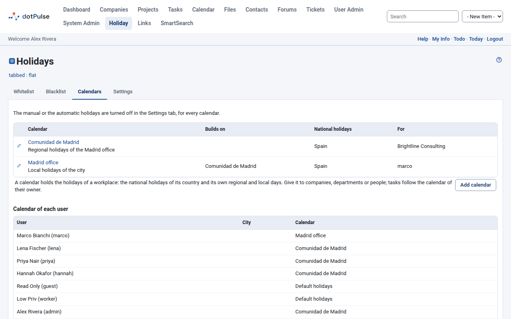

# Holidays and calendars

The holiday module tells dotPulse which days nobody works besides the weekend:
national holidays, regional and local holidays, and closures. Task dates skip
them, reminders aren't sent on them, and the calendar marks them.

Each workplace can have its own **calendar**: an office in Madrid and one in
Lisbon don't share their holidays. Each person follows the calendar of their
workplace.

[Getting started](../getting-started/first-steps.md#6-set-up-holiday-calendars)
has the short version. This page is the full reference.

## Install and open the module

The holiday module is an add-on: a new site doesn't have it.

1. Open **System Admin › Modules**.
2. Under **Not installed**, click **install** next to `holiday`.
3. Click **Turn on** on its row. Click **Show in menu** if you want a
   **Holiday** entry in the main menu.

See [Modules](modules.md) for the details. Before you turn it on, read
[Who can change the holidays](#who-can-change-the-holidays).

Once the module is on, open it from **System Admin › Holidays and calendars**
(in the **Work** group), from the card at the bottom of the **Working hours**
section of **System Admin › Work and calendar**, or from **Holiday** in the
main menu. The page is called **Holidays** and has four tabs: **Whitelist**,
**Blacklist**, **Calendars** and **Settings**.

{ .shot }

!!! note
    Holidays only count while the module is turned on. Turn it off and every
    task date, reminder and calendar view ignores them again; the calendars
    and days you entered are kept.

## How dotPulse decides that a day is off

A day is not a working day when:

1. it is not one of the site's working days of the week (**Working Days** in
   [System Admin › Work and calendar](settings.md#work-and-calendar)), or
2. it is a holiday in the person's calendar.

A day is a holiday in a calendar when, in this order:

- a **blacklist** day (a working day) covers it: then it is **not** a holiday,
  whatever else says so;
- otherwise, a **whitelist** day (a holiday added by hand or imported) covers
  it;
- otherwise, it is a national holiday of the calendar's country.

The days that count for a calendar are its own, those of the calendars it
builds on, and those entered for **All calendars**.

## Settings tab

| Setting | What it does | Default |
|---|---|---|
| **Enable manual holidays** | Uses the days entered by hand or imported: the whitelist, the blacklist and the days of every calendar. Untick it and all of them are ignored. | On |
| **Enable automatic holidays** | Uses the national holidays that dotPulse calculates for a country. Untick it and no calendar has national holidays. | Off |
| **Default country** | The country of the national holidays for people without a calendar, and for calendars that set no country. | None |

Click **save** to apply. Changes affect every user at once.

!!! warning "Tick Enable automatic holidays"
    A new installation has the automatic holidays **off**. Choosing a
    **Default country**, or a country in a calendar, does nothing until you
    tick **Enable automatic holidays** and save. The **Calendars** tab reminds
    you when either kind of holiday is off.

When a default country is set, the tab lists its national holidays for this
year and next, so you can check them.

### Supported countries

dotPulse calculates the national public holidays of these countries for any
year:

- Austria, Belgium, France, Germany, Italy, the Netherlands, Norway,
  Portugal, Spain, Sweden;
- Ireland, with the substitute days when a holiday falls on a weekend;
- **United Kingdom (England and Wales)**: the bank holidays, with the
  one-off ones (jubilees, coronation) and the substitute days;
- **United States (federal)**: the federal holidays, moved to the nearest
  weekday when they fall on a weekend (shown as *observed*).

Only **national** holidays are included. Regional and local holidays change
from year to year by decree, so you enter them in a calendar, by hand or from
an iCalendar file. For a country that isn't listed, leave the country empty
and enter all the holidays yourself.

## Calendars tab

The **Calendars** tab lists the calendars, with:

| Column | What it shows |
|---|---|
| **Calendar** | The name (click it to edit) and the description. |
| **Builds on** | The calendar whose holidays it includes. |
| **National holidays** | The country of its national holidays: its own, or the one it gets from the calendar it builds on or from **Default country**. |
| **For** | The companies, departments and users it is given to. |

Below, **Calendar of each user** lists every user with their city and the
calendar they end up with. **Default holidays** means no calendar applies to
them. Use this list to check your setup.

### Add a calendar

1. On the **Calendars** tab, click **Add calendar**.
2. Fill in the form and click **save**.

| Field | What it is |
|---|---|
| **Name** | Required, for example *Madrid office*. |
| **Builds on** | Another calendar whose holidays this one has as well. A city can build on its region, and the region on the country: *Madrid* builds on *Comunidad de Madrid*, which has Spain's national holidays. You can't pick the calendar itself or one that builds on it. |
| **National holidays** | A country, or **As the calendar it builds on, or the default**. |
| **Description** | Optional. |
| **For** | The **Companies**, **Departments** and **Users** that follow this calendar. Hold ++ctrl++ (++cmd++ on a Mac) to select several in each list. |

A company, department or user has only one calendar. Choosing one in a
calendar's **For** takes it away from the calendar it had before.

After saving, the page stays on the calendar and shows more:

- **Days of this calendar**: its own holidays and working days, with **Add
  holiday** and **Add workday** buttons;
- the iCalendar import (see below);
- **Holidays** of this year and next: every day this calendar takes off, from
  every source. This is exactly what task dates will skip.

### Edit or delete a calendar

Click the calendar's name or the pencil on the **Calendars** tab. Change the
fields and click **save**.

**delete** asks *Delete this calendar and its days?* and then removes the
calendar, its own days and whom it was given to. Those people go back to the
next calendar that applies to them, or to the default holidays. Calendars that
built on it become stand-alone.

### Import holidays from an iCalendar file

Many regional and local governments publish their holidays as an iCalendar
(`.ics`) file, and calendar apps such as Google Calendar or Outlook export
them.

1. Open the calendar (it must be saved first).
2. Under the days, choose the file in **Import the holidays of an iCalendar
   (.ics) file** and click **Import**.

The page says how many days it added and how many were already there.

- Each event becomes a holiday of this calendar, named after the event.
- An all-day event covers its days; an event with times covers the days it
  touches.
- A yearly repeating event becomes an **Annual** holiday. Events that repeat
  in other ways (weekly, monthly) and cancelled events are left out.
- Importing the same file again adds nothing: a day with the same dates and
  name is skipped.
- The file can be 1 MB at most.

Check the **Holidays** list afterwards, and delete any event you don't want
(some published calendars include observances that are not days off).

## Whitelist and blacklist

These two tabs list every day entered by hand or imported, across all
calendars, most recent first. When calendars exist, a **Calendar** column
says which calendar each day belongs to, or **All calendars**.

- **Whitelist**: extra days off, such as a company closure or a holiday not in
  the national list. Click **Add holiday**.
- **Blacklist**: days that are working days even though they would be a
  holiday, for example a national holiday your office works. Click **Add
  workday**.

A day added from a calendar's page (**Add holiday** or **Add workday** there)
goes to that calendar; you see it in these tabs too.

### Add a holiday or a workday

| Field | What it is |
|---|---|
| **Start date** and **End date** | The first and last day. Use the same date for a single day. Pick them with the calendar icon. |
| **Annual** | The same days every year, for fixed-date holidays. |
| **Calendar** | **All calendars**, or one calendar. Shown once you have calendars. |
| **Description** | The holiday's name, shown in the calendar views. |

Click **save**. To change or delete a day, click the pencil next to it, then
**save** or **Delete holiday** (**Delete workday**).

!!! warning "Annual days can't span the new year"
    An **Annual** day from, say, 24 December to 2 January is never counted.
    Enter two annual days instead: 24–31 December and 1–2 January.

!!! tip
    Holidays that move every year, like Easter or a regional day set by
    decree, can't be **Annual**: enter them each year, or import the year's
    iCalendar file.

## Which calendar applies to a person

dotPulse looks for a person's calendar in this order:

1. the calendar given to the **user**;
2. else the calendar of their **department**, or of the nearest parent
   department that has one;
3. else the calendar of their **company**;
4. else the **default holidays**: the days entered for **All calendars**, and
   the national holidays of the **Default country**.

The department and company are those of the person's contact record (see
[Users](users.md)). Check the result in **Calendar of each user** on the
**Calendars** tab.

## What holidays change

- **Task dates.** On the task form, **Calculate › Finish Date** counts the
  duration in working days and skips the holidays of the **task owner**
  (unless the duration is in **Calendar days**). **Calculate › Duration**
  leaves them out too. Change the owner and the calculation uses the new
  owner's calendar. See [Working days and holidays](../user-guide/tasks.md#working-days-and-holidays).
- **Dependencies and copies.** When dotPulse moves a task after the tasks it
  depends on, or shifts dates when a project is copied, the new dates skip the
  owner's holidays.
- **Reminders.** Task reminder emails reach each person on their own working
  days only.
- **Reports.** The allocated hours report counts each person's own working
  days.
- **Calendar views.** The month, week and day views mark the holidays of the
  calendar of the person looking at them. See
  [the calendar's holidays](../user-guide/calendar.md#holidays).

Holidays don't change existing tasks. Dates and durations already saved stay
as they are until someone recalculates and saves the task. After adding
holidays, check the tasks that run over them.

## Who can change the holidays

Anyone whose role lets them edit the **Holiday** module can add and delete
calendars, holidays and workdays, and change the settings. The module joins
the non-admin modules when it is installed, so with the default roles every
**Project worker** can do it.

To keep holidays for administrators, take the **Holiday** module away from the
**Project worker** role (and any other role that shouldn't manage them) in
**System Admin › Roles and permissions**, or give those roles view rights
only. See [Roles and permissions](roles-permissions.md).
People don't need any right on the module for their holidays to apply to
them.

## Upgrade from an older version

The module's current version is 0.3. **System Admin › Modules** shows
**Upgrade available** on an older one; click **upgrade**. See
[Upgrade a module](modules.md#upgrade-a-module).

- **From 0.1** (dotPulse before 3.1.1): the national holidays came from a
  library that no longer works. The upgrade adds the country setting: open the
  **Settings** tab, choose the **Default country** again and save. Until you
  upgrade, the **Settings** tab says *Upgrade the Holiday module in System
  Admin, Modules, to choose a country.*
- **From 0.2**: the upgrade adds calendars. Every existing whitelist and
  blacklist day is kept and applies to **All calendars**. Until you upgrade,
  the **Calendars** tab asks you to upgrade.
