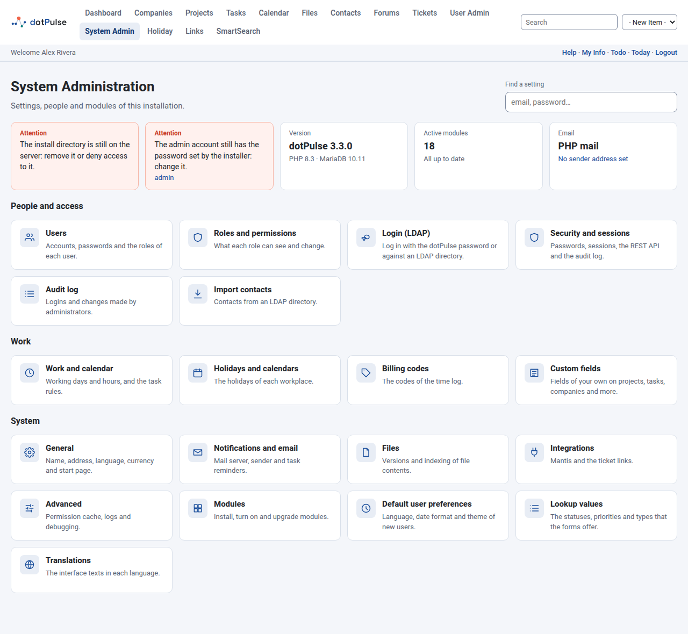

# Administration

This section is for the people who run a dotPulse site: they add users, decide
what each role may do, turn modules on and off and choose the settings that
apply to everyone.

To do this you need administrator rights. In a new installation that means a
user with the **Administrator** role, such as the `admin` account the installer
creates. Strictly, what counts is the permission on the **System Admin**
module: a role that may view it opens the start page, and a role that may also
edit it can change the settings. See [Roles and permissions](roles-permissions.md).

If you have just installed dotPulse, start with the short checklist in
[First steps](../getting-started/first-steps.md). The pages of this section are
the full reference.

## Open System Admin

Click **System Admin** in the modules menu. The start page,
**System Administration**, shows the state of the site at the top and a card for
each administration page below.

{ .shot }

## The status tiles

The tiles at the top tell you at a glance if something needs your attention.

| Tile | What it shows |
| --- | --- |
| **Attention** | Shown only when there is a problem. *The install directory is still on the server* appears while the `install/` folder exists: anyone who reaches it can see the installer, so delete it or deny access to it in the web server once the site works. *The admin account still has the password set by the installer* appears while the user `admin` still logs in with the password `passwd`: click **admin** in the tile to open that user and change the password. |
| **Version** | The dotPulse version, with the PHP and database (MySQL or MariaDB) versions below it. Give these when you report a problem. |
| **Active modules** | How many modules are turned on. Below it, **All up to date**, or a link such as **2 upgrades to install** when the code of some modules is newer than the version installed in the database (after you upgrade dotPulse, for example). The link opens [Modules](modules.md), where you run the upgrades. |
| **Email** | How dotPulse sends mail: **PHP mail** or **SMTP**. Below it is the sender address, or a **No sender address set** link to the mail settings. See [Notifications and email](settings.md#notifications-and-email). |

!!! note
    The default password check only looks at the account whose login name is
    `admin`. If you renamed it, the tile can't warn you.

## The cards

The cards lead to every administration page, in three groups.

**People and access**

| Card | What you do there |
| --- | --- |
| **Users** | Add users, change their passwords and roles, and reset two-step login. See [Users](users.md). |
| **Roles and permissions** | Decide what each role can see and change. See [Roles and permissions](roles-permissions.md). |
| **Login (LDAP)** | Let people log in with their directory password. See [Login (LDAP)](settings.md#login-ldap). |
| **Security and sessions** | Password and user name lengths, how long people stay logged in, the REST API and how long the audit log is kept. See [Security and sessions](settings.md#security-and-sessions). |
| **Audit log** | Logins, password changes and changes made by administrators. See [Audit log](audit-and-maintenance.md#audit-log). |
| **Import contacts** | Copy contacts from an LDAP directory. See [Import contacts from LDAP](audit-and-maintenance.md#import-contacts-from-ldap). |

**Work**

| Card | What you do there |
| --- | --- |
| **Work and calendar** | Working days and hours, and the rules for tasks. See [Work and calendar](settings.md#work-and-calendar). |
| **Holidays and calendars** | The holidays of each workplace. Shown only while the Holiday module is turned on. See [Holidays and calendars](holidays.md). |
| **Billing codes** | The codes people choose when they log time. See [Billing codes](lists-and-fields.md#billing-codes). |
| **Custom fields** | Extra fields on projects, tasks, companies and other records. See [Custom fields](lists-and-fields.md#custom-fields). |

**System**

| Card | What you do there |
| --- | --- |
| **General** | Site name, language, theme, currency and the page shown after login. See [General](settings.md#general). |
| **Notifications and email** | The mail server, the sender address and task reminders. See [Notifications and email](settings.md#notifications-and-email). |
| **Files** | File versions and the indexing of file contents. See [Files](settings.md#files). |
| **Integrations** | Mantis and ticket links. See [Integrations](settings.md#integrations). |
| **Advanced** | Permission cache, logs and debugging. See [Advanced](settings.md#advanced). |
| **Modules** | Install, turn on, turn off and upgrade modules. See [Modules](modules.md). |
| **Default user preferences** | The language, date format, theme and other preferences of new users. See [Default user preferences](lists-and-fields.md#default-user-preferences). |
| **Lookup values** | The statuses, priorities and types the forms offer. See [Lookup values](lists-and-fields.md#lookup-values). |
| **Translations** | The interface texts in each language. See [Translations](translations.md). |

On every other administration page the same links appear as a side menu on the
left, in the same three groups, with the current page highlighted. Click
**System Administration** at the top of the menu, or in the line above the page
title, to go back to the start page.

## Find a setting

You don't need to know which section a setting is in. Type a word into
**Find a setting** (on the start page and at the top of the side menu) and press
++enter++. dotPulse lists every setting whose label, help text or internal name
contains that word, for example `email`, `password` or `ldap`. Each result shows
the section it belongs to. You can change and save the settings right there.

## Change settings

Each settings page shows its settings in panels. Every setting has its label,
a help text and, in small type, its internal name (the name used in the
database and in this documentation, for example `mail_from`).

1. Change the values you want.
2. Click **Save changes** at the bottom of the page.

To throw away what you changed and reload the saved values, click
**Discard changes**.

!!! warning "Changes apply to every user"
    Settings are for the whole site. As soon as you save, they apply to every
    user, on their next page.

Saving only touches the settings shown on the page: the section, or the search
results. Password fields (the SMTP and LDAP passwords) are never shown again;
leave them empty to keep the saved password, or type a new one to replace it.

Every save that changes something is written to the
[audit log](audit-and-maintenance.md#audit-log) with the names of the settings
that changed (not their values, which can be passwords).

## Pages in this section

- [System Admin overview](index.md): this page.
- [Settings](settings.md): every setting of the eight settings sections, what it really does and its default.
- [Users](users.md): add users, passwords, roles, two-step login and API tokens.
- [Roles and permissions](roles-permissions.md): what each role may see and change.
- [Modules](modules.md): install, turn on, order and upgrade modules.
- [Holidays and calendars](holidays.md): holidays and the working calendar of each workplace.
- [Lists, fields and defaults](lists-and-fields.md): lookup values, custom fields, billing codes and default user preferences.
- [Translations](translations.md): change the interface texts and add a language.
- [Audit and maintenance](audit-and-maintenance.md): the audit log, importing contacts from LDAP and keeping the site healthy.
