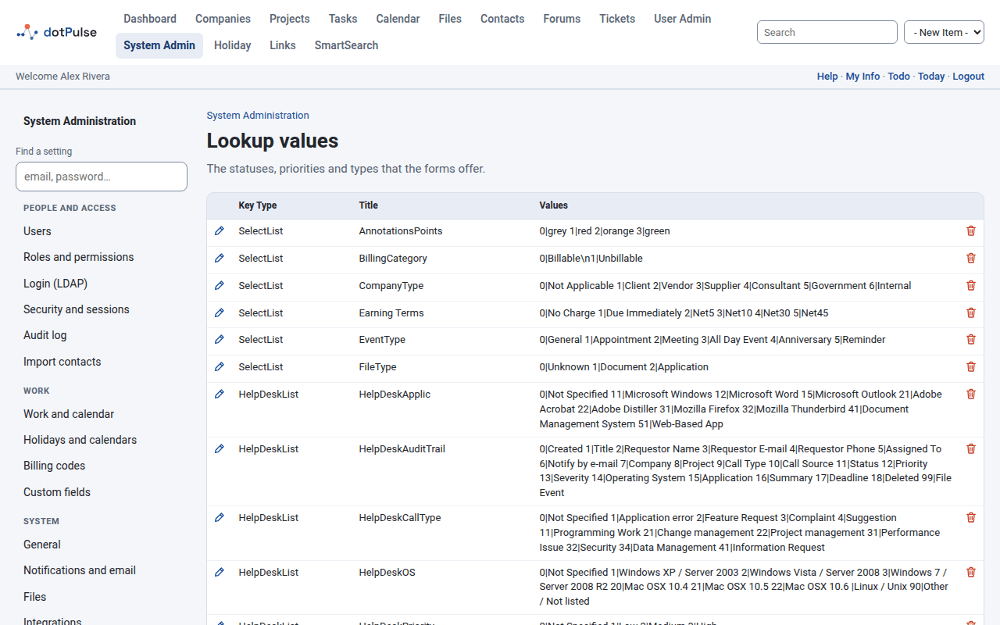
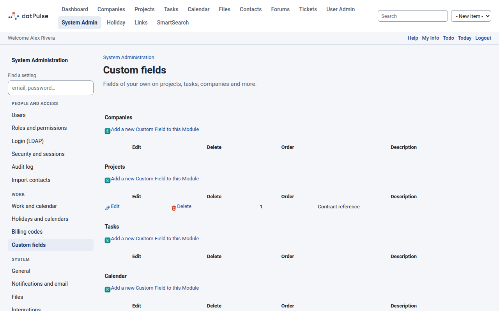
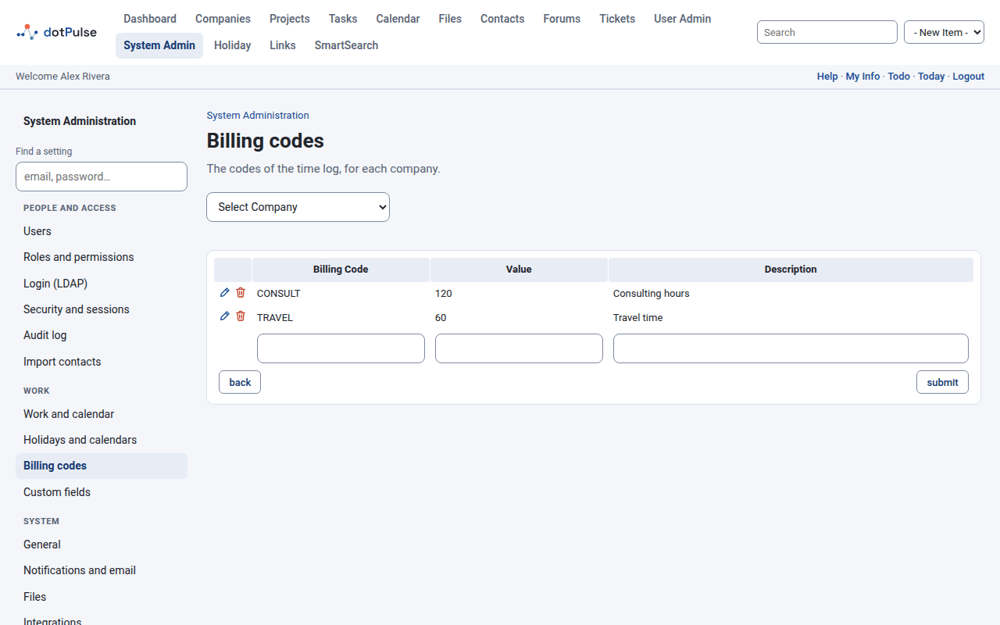

# Lists, fields and defaults

Four pages of **System Admin** shape the forms everyone uses:

- **Lookup values**: the choices offered by the drop-down lists, such as project
  statuses, task priorities and company types.
- **Custom fields**: fields of your own on companies, projects, tasks and events.
- **Billing codes**: the cost codes people charge their time to.
- **Default user preferences**: the language, date format, theme and other
  preferences of users who haven't chosen their own.

## Lookup values

Open **System Admin › Lookup values**. Each row is one list. The columns are:

- **Key Type**: how the list is read. Almost every list is a **SelectList**
  (one choice per line). **ColorSelection** holds colours, **CustomField** is
  an old format kept for compatibility.
- **Title**: the list's name. The code looks lists up by this name, so never
  rename it.
- **Values**: the entries, one per line, each as `key|label`.

{ .shot }

### The lists of a new site

A new installation has these lists. Add-on modules add their own when you
install them (for example `HelpDesk...`, `Risk...` or `Opportunities...`).

| List | Where it is used |
|------|------------------|
| `ProjectStatus` | **Status** of a project, and the status tabs of the projects list. See [Project statuses](../user-guide/projects.md#project-statuses). |
| `ProjectType` | **Type** of a project. |
| `ProjectPriority` | **Priority** of a project. |
| `ProjectPriorityColor` | The background colour of a project's priority, on the project page. Keys match `ProjectPriority`. |
| `ProjectColors` | The colours offered by the colour picker of the project form, as `name|RRGGBB`. |
| `ProjectRequiredFields` | The checks the project form makes before saving. See the warning below. |
| `TaskPriority` | **Priority** of a task. |
| `TaskStatus` | **Status** of a task: **Active** or **Inactive**. |
| `TaskType` | **Type** of a task. |
| `TaskDurationType` | The units of a task's duration: hours and days. |
| `TaskLogReference` | **Reference** of a task log (email, phone call...). |
| `TaskLogReferenceImage` | Icons for the references. |
| `CompanyType` | **Type** of a company, and the tabs of the companies list (one per type). |
| `EventType` | **Type** of a calendar event. |
| `FileType` | **Category** of a file. |
| `UserType` | **User Type** of a user. |
| `TicketNotify`, `TicketPriority`, `TicketStatus` | The old Ticketsmith add-on. |

### Edit a list

1. Click the pencil icon at the start of the row. The row becomes a form.
2. Change the **Values** box. Write one entry per line, as `key|label`, for
   example:

    ```text
    0|Not Defined
    1|Proposed
    2|In Planning
    ```

3. Click **edit**.

To add a new list, fill in the empty row at the bottom of the page: choose the
**Key Type**, enter the **Title** and the **Values**, then click **add**. A new
list is only useful if some code or add-on module reads it under that title.

Click the bin icon at the end of a row to delete a whole list. Don't do this for
the lists of the table above: the forms that use them lose their choices.

### What is safe to change

Records store the **key**, not the label. A project with status `3` shows
whatever label key `3` has today.

- **Renaming a label** (the text after `|`) is safe. Every record with that key
  shows the new label at once.
- **Adding an entry** with a new key is safe.
- **Removing an entry** leaves the records that use it with a key nobody can
  read: they show an empty value, and the next time someone edits one of them
  the form picks another value. Move those records to another value first.
- **Changing a key** has the same effect as removing the entry and adding a new
  one. Don't.

Some keys and labels mean something to the code. Leave them as they are:

- `ProjectStatus`: the projects list picks its layout from three labels:
  **In Progress**, **Complete** and **Archived**. Renaming one of them gives
  its tab the layout of the other statuses. Key `7` (Archived) is left out of
  the Gantt charts, and key `4` (On Hold) can be hidden there.
- `TaskDurationType`: the keys are the number of hours in one unit (`1` for
  hours, `24` for days).
- `TaskStatus`: `0` is active, `-1` is inactive.
- `UserType`: key `1` is **Administrator**. Some pages, such as
  **Translations**, check for it.

!!! warning "`ProjectRequiredFields` is JavaScript"
    Each line of `ProjectRequiredFields` is a piece of JavaScript that the
    project form runs, for example
    `f.project_name.value.length|<3`. A mistake breaks the project form for
    everyone. Change it only if you know JavaScript, and keep a copy of the
    original value.

## Custom fields

Custom fields add fields of your own to the forms of four modules:
**Companies**, **Projects**, **Tasks** and **Calendar** (events). Each field
appears on the record's edit form and on its page.

Open **System Admin › Custom fields**. The page has a section per module, with
its fields in order.

{ .shot }

### Add a custom field

1. Under the module, click **Add a new Custom Field to this Module**.
2. Fill in the form (see the table below).
3. For a **Select List**, type each option under **List of Options** and click
   **Add** after each one.
4. Click **Save**.

| Field | What it does |
|-------|--------------|
| **Field Name/Identifier** | The internal name. Letters and digits only, no spaces. It must be unique in the module. |
| **Field Description** | The label shown next to the field on the forms. |
| **Field Order** | The position among the module's custom fields. Lower numbers come first; fields with the same number are sorted by name. |
| **Field Data Type** | **Text** or **Numeric**. A **Numeric** field refuses a value that isn't a number. |
| **Field Display Type** | The kind of field (see below). |
| **HTML Tag Options** | Extra HTML attributes for the field, for example `size="40"` or `maxlength="10"`. Usually empty. |

The display types are:

| Display type | On the edit form | On the record's page |
|--------------|------------------|----------------------|
| **Text Input** | A one-line box. | The text. |
| **Text Area** | A larger box. | The text. |
| **Checkbox** | A tick box. | Yes or no. |
| **Select List** | A list of the options you entered. | The chosen option. |
| **Weblink** | A box for an address. | A link. |
| **File** | A file upload. The file is stored in the **Files** module. | A link to the file. |
| **Label** | The description alone, no input. | The description. |
| **Separator** | A horizontal line. | A line. |

The options of a **Select List** are always shown in alphabetical order.

### Where custom fields appear

| Module | Edit form | Page |
|--------|-----------|------|
| Companies | **Add Company** / **Edit Company** | the company page |
| Projects | the project form, below **Staging URL** | the project page, **Details** |
| Tasks | the task form, **Details** tab | the task page |
| Calendar | the event form | the event page |

The global search also looks in the custom fields of tasks.

### Edit a custom field

Click **Edit** next to the field, change it, then click **Save**. Changing the
name, description, order or HTML options doesn't touch the values already
entered.

!!! warning "Changing options and deleting fields"
    - A **Select List** stores the option each record chose, not its text.
      If you delete an option, the records that chose it show nothing. To
      rename an option you have to delete it and add a new one, so the same
      thing happens.
    - Changing the **Field Display Type** of a field that already has values
      can make them unreadable: a text value doesn't fit a select list.
    - Avoid apostrophes in the options of a **Select List**: they are saved
      with a backslash in front (`O\'Neil`).

### Delete a custom field

The **Delete** link next to a field doesn't work in this version: it shows
**Module ID is invalid** and keeps the field. Until this is fixed, the field
can only be removed from the database (its row in the `custom_fields_struct`
table).

When a field is deleted, the values entered in it stay in the database but
nothing shows them any more.

## Billing codes

Billing codes are the cost codes people pick in the **Cost Code** field when
they log time on a task (see [Logging work](../user-guide/task-logs.md#log-fields)).
Use them to tell billable work from internal work, or to charge time to
different budgets.

Each code belongs to one company, or to all of them. When someone logs time,
the list offers the codes of the project's company plus the codes shared by
all companies.

Open **System Admin › Billing codes**.

{ .shot }

### Add a billing code

1. In the list at the top, choose the company. Leave **Select Company** to
   create a code shared by all companies.
2. In the empty row at the bottom, enter:
    - **Billing Code**: the name people see, up to 25 characters. It must be
      unique for the company.
    - **Value**: a number, for example an hourly rate. The core of dotPulse
      only stores it; some add-on reports multiply it by the hours.
    - **Description**: a note for you.
3. Click **submit**.

### Edit or delete a billing code

Choose the company, click the pencil icon next to the code, change the row and
click **submit**.

Click the bin icon to delete a code. dotPulse doesn't ask for confirmation, but
a deleted code is not removed: it stays in the list marked **(deleted)**, the
logs that use it keep it, and it can still be chosen in the **Cost Code
Filter** of a project's task logs. It is no longer offered when people log
time.

To bring a deleted code back, click its pencil icon and click **submit**:
saving a code makes it active again.

## Default user preferences

Open **System Admin › Default user preferences**. The page has the same
preferences each user sets for themselves with **My Info › edit preferences**.
The [user guide](../user-guide/preferences.md#edit-your-preferences) describes
each one.

| Preference | Default of a new site |
|------------|-----------------------|
| [**Locale**](../user-guide/preferences.md#locale) | **English (US)** |
| [**Tabbed Box View**](../user-guide/preferences.md#tabbed-box-view) | **either** |
| [**Short Date Format**](../user-guide/preferences.md#short-date-format) | day/month/year |
| [**Time Format**](../user-guide/preferences.md#time-format) | 12-hour with AM/PM |
| [**Currency Format**](../user-guide/preferences.md#currency-format) | the first in the list |
| [**User Interface Style**](../user-guide/preferences.md#user-interface-style) | **dotPulse** |
| [**User Task Assignment Maximum**](../user-guide/preferences.md#user-task-assignment-maximum) | 100% |
| [**Default Event Filter**](../user-guide/preferences.md#default-event-filter) | **My Events** |
| [**Task Notification Method**](../user-guide/preferences.md#task-notification-method) | **Do not include task/event owner** |
| [**Email me when I am assigned to a task**](../user-guide/preferences.md#email-me-when-i-am-assigned-to-a-task) | **Yes** |
| [**Task Log Email Defaults**](../user-guide/preferences.md#task-log-email-defaults) | no box ticked |
| [**Task Log Email Subject**](../user-guide/preferences.md#task-log-email-subject) | empty |
| [**Task Log Email Recording Method**](../user-guide/preferences.md#task-log-email-recording-method) | **None** |

Change what you need and click **submit**.

!!! note "Currency Format examples"
    Each option of **Currency Format** shows an amount formatted with the
    conventions of one language. The examples come from the locales installed
    on the server's operating system. If the server has none, every option
    shows the same unformatted number.

### Who the defaults apply to

A user's own preference wins over the default. But dotPulse only stores a
user's preference when it differs from the default at the moment they save.

- New users follow the defaults.
- Users who never saved their preferences follow the defaults.
- Users who saved their preferences keep the values they chose **that differ
  from the defaults of that time**. For every other preference they follow the
  defaults, including your later changes.

For example, if a user saved their preferences with the default date format,
and you later change the default date format, that user gets the new format.
A user who chose another format keeps it.

To change one user's preferences, open the user in **System Admin › Users**
and click **edit preferences**. See [Users](users.md).
