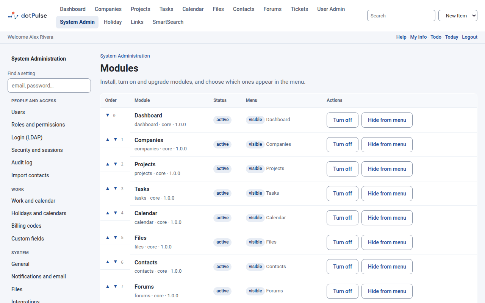

# Modules

Everything in dotPulse is a module: companies, projects, tasks, the calendar,
and the optional add-ons such as risks, timesheets or the holiday calendars.
**System Admin › Modules** is where you install modules, turn them on and off,
choose which ones appear in the main menu and in which order, upgrade them and
remove them.

{ .shot }

## The modules list

The table lists every installed module, in menu order:

| Column | What it shows |
|---|---|
| **Order** | The module's place in the main menu, with arrows to move it up (▲) or down (▼). |
| **Module** | The module's name, and below it its folder, its type (`core`, `user`, `admin`, `utility`) and its installed version. |
| **Status** | **active** or **disabled**. **Upgrade available** appears next to it when the module's code is newer than its tables. |
| **Menu** | **visible** or **hidden**, with the name used in the main menu. |
| **Actions** | The buttons described below. |

Below the table, **Not installed** lists the module folders found on the
server that are not installed yet, by folder name, each with an **install**
button. The section is not shown when every module is installed.

The **Public** and **install** modules are never listed: they are part of
dotPulse itself.

!!! note
    Only users who may edit the **System Administration** module see the
    buttons. Others with read access see the list only.

## Install a module

1. Open **System Admin › Modules**.
2. Under **Not installed**, click **install** next to the module's folder name.

Installing creates the module's tables and registers it. The page says
*Module installed* and the module moves up into the table, at the end of the
menu order. Most modules start **disabled** and **hidden** (Registers and
Document Management start **visible**):

3. Click **Turn on** to make it available.
4. Click **Show in menu** if it should have an entry in the main menu.

If the module can't create its tables, the page says *Module not installed*
with the reason, and the module stays under **Not installed**.

!!! warning "Set the permissions before you turn it on"
    A new module is open to every role that has rights on the non-admin
    modules (see below). If only some people should use it, change the roles
    first.

### Permissions of a new module

dotPulse's roles give rights on two groups of modules: the **admin modules**
(User Administration, System Administration, roles and users) and the
**non-admin modules** (everything else). A newly installed module joins the
**non-admin modules** (the holiday module, an administration tool, joins the
admin modules), so every role that has rights on the non-admin modules
gets the same rights on it at once. With the roles of a new installation:

- **Administrator** can do everything in it;
- **Project worker** can view, add, edit and delete in it;
- **Guest** can view it.

If a module should be limited to some people, change its permissions in each
role after installing it. See [Roles and permissions](roles-permissions.md).

## Turn a module on or off

Click **Turn off** to disable a module, and **Turn on** to enable it again.
Turning a module off keeps its tables and data. The module leaves the main
menu, its tabs disappear from other modules' pages, and the features other
modules take from it stop: for example, when the holiday module is off, task
dates ignore the holidays.

The pages of a turned-off module are closed: opening one says **Access
Denied**, whatever the person's roles. **User Administration** and **System
Administration** can't be turned off, so System Admin always stays open to
administrators.

## Show or hide a module in the menu

**Show in menu** and **Hide from menu** decide whether the module has an entry
in the main menu. A hidden module that is turned on still works: other pages
link to it. Departments and Help are hidden on a new installation for that
reason: departments are reached from their company, and help from the
**Help** link at the top of every page.

Modules of the `utility` type (iGantt) never get a menu entry, even when
**visible**: they only add views to other modules.

## Change the menu order

Use the arrows in the **Order** column: ▲ moves a module one place up, ▼ one
place down. The number is the module's position. The first module (number 0,
the dashboard on a new installation) has no ▲ arrow.

## Upgrade a module

When you update dotPulse, a module's code can be newer than the tables it
created when it was installed. The module then shows **Upgrade available** in
the **Status** column, and a note at the top of the page counts the modules
with an upgrade to install. The System Admin start page shows the same count.

1. Back up the database first (see [Upgrading](../getting-started/upgrade.md)).
2. Click **upgrade** on the module's row and confirm.

The upgrade changes the module's tables to the new version and keeps their
data. When it works, the page says *Module upgraded* and the new version
appears in the list. If it fails, the page says so and gives the two versions;
the module keeps its old version number and you can try again after fixing the
cause.

!!! note
    **Upgrade available** appears only when the code is newer than the
    installed version. After going back to an earlier release, a module whose
    tables are newer than its code shows nothing: restore the database backup
    of that release.

## Configure a module

A few add-ons have a **configure** button, which opens their own settings page:
**Help Desk**, **Mileage Log**, **ProjectDesigner**, **Unit Testing**,
**Time Card** and **Gallery2**.

The other modules have no configuration here; some, like the holiday module,
have their settings inside the module itself.

## Remove a module

!!! warning "Removing deletes the data"
    **remove** drops the module's tables: every record kept in that module is
    deleted and can't be recovered without a backup. To stop using a module
    for a while, **Turn off** instead.

1. Back up the database.
2. Click **remove** on the module's row.
3. Confirm the warning *This will delete all data associated with the module!*

The module also loses its permissions in every role. It goes back to the **Not
installed** section, where you can install it again, empty.

Core modules have no **remove** button.

## Core modules and add-ons

**Core modules** are installed with dotPulse and can't be removed (you can
still turn them off or hide them):

| Module | Folder |
|---|---|
| Dashboard | `dashboard` |
| Companies | `companies` |
| Projects | `projects` |
| Tasks | `tasks` |
| Calendar | `calendar` |
| Files | `files` |
| Contacts | `contacts` |
| Forums | `forums` |
| Tickets | `ticketsmith` |
| User Administration | `admin` |
| System Administration | `system` |
| Departments | `departments` |
| Help | `help` |

**Add-ons** come with dotPulse in the `modules/` folder but are not installed
on a new site. They differ a lot in age and quality. Many were written by
third parties for dotProject years ago; dotPulse made them load on PHP 8 and
fixed the security problems found in them, but has not rebuilt or tested them
in depth.

### Maintained add-ons

These are kept up to date with the core modules and are fine to use:

| Module | Folder | What it is |
|---|---|---|
| Holiday | `holiday` | Holiday calendars: non-working days that task dates skip. See [Holidays and calendars](holidays.md). |
| Mantis | `mantis` | Links projects to a MantisBT bug tracker through its REST API, with a personal Mantis token per user. |
| Unitcost | `unitcost` | Unit costs on task logs, and a project tab with cost progress. |
| History | `history` | Keeps a record of changes to items. |
| SmartSearch | `smartsearch` | Searches keywords across modules. |
| Resources | `resources` | Resources such as rooms or equipment, to assign to tasks. |
| Backup | `backup` | Downloads a backup of the database (SQL, XML or zip). Only system administrators can use it. |
| Links | `links` | Web links attached to projects and tasks. See [Files, forums and links](../user-guide/files-forums-links.md#links). |

### Other add-ons

These work on PHP 8 and passed dotPulse's security checks, but have had little
use and are not actively developed. Most come from the dotProject+ project,
which adds planning and reporting along the lines of the PMBOK process groups.
Try them on a test site before relying on them:

| Module | Folder | What it is |
|---|---|---|
| dotProject+ | `dotproject_plus` | Planning and execution views built on the add-ons below. |
| Initiating | `initiating` | Project charters (initiating process group). |
| Closure | `closure` | Project closure and lessons learned. |
| Costs | `costs` | Cost planning and budget. |
| Finances | `finances` | Budget improvements on projects. |
| Risks | `risks` | Risk planning. |
| Human Resources | `human_resources` | Project roles and staff. |
| Monitoring and Control | `monitoringandcontrol` | Baselines, meeting minutes, change and quality tracking. |
| Time Planning | `timeplanning` | Work breakdown and schedule planning. |
| MacroProjects | `macroprojects` | Groups of projects. |
| Resource Management | `resource_m` | Shows and edits how busy each resource is. |
| iGantt | `igantt` | A Gantt chart where you drag bars to change task dates. |
| ICal | `ical` | Sends tasks to users' calendars when tasks are added or edited. |
| Invoices | `invoices` | Invoices. |
| Messages | `messages` | Internal messages between users. |
| Journal | `journal` | Simple notes about a project. |
| Document Management | `mngdocument` | Document management. |
| Timesheet | `timesheet` | Timesheets. |
| ProjectDesigner | `projectdesigner` | A page to design a project and its tasks, with a Gantt chart you can drag. |

### Dormant add-ons: not recommended

These old add-ons are kept in the code to be revived later. They load on
PHP 8 and their known security problems are fixed, but they are not
maintained, have hardly been tested, and may be broken in places. Don't use
them on a production site:

| Module | Folder | What it is |
|---|---|---|
| Annotations | `annotations` | Notes attached to items. |
| Communication | `communication` | Communication planning. |
| Data Import | `dataimport` | Imports project data from flat files. |
| Earnings | `earnings` | Staff timecards and contractor invoices, approved by management. |
| Gallery2 | `gallery2` | Integration with the Gallery2 photo gallery. |
| Help Desk | `helpdesk` | Bug reports, feature requests and support calls. |
| Hosting | `hosting` | Hosting status and domain names of companies. |
| Informer | `informer` | Weekly and monthly timecards from task logs. |
| Inventory | `inventory` | Tracks hardware and software. |
| Mileage Log | `mileagelog` | Mileage for reimbursement. |
| Opportunities | `opportunities` | A list of ideas or issues. |
| Payments | `payments` | Payments. |
| Registers | `registers` | Registers. |
| Reports | `reports` | Payroll and billing reports. |
| Tasks template | `tasks_template` | Task templates, managed by administrators. |
| Unit Testing | `testing` | Unit tests of tasks and projects. |
| Time Card | `timecard` | Weekly timecards from task logs. |
| TimeTrack | `timetrack` | Time tracking. |

!!! tip
    For time recording, use the task log of the core Tasks module (see
    [Task logs](../user-guide/task-logs.md)) rather than the old timecard and
    timesheet add-ons.
