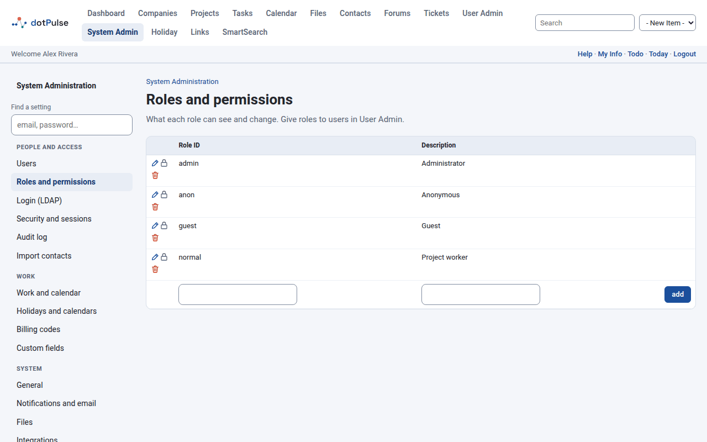
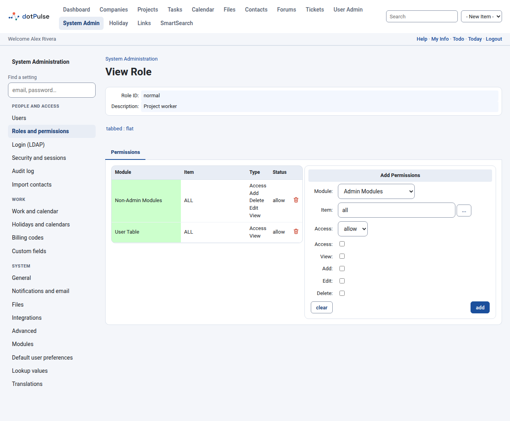

# Roles and permissions

A role is a named set of permissions, such as "Project worker". You give roles
to users, and the users get the role's permissions. This page explains the
roles of a new site, how to change them, and how dotPulse decides what a user
may do.

Open **System Admin › Roles and permissions** (`?m=system&u=roles`). To give a
role to a user, see [Roles tab](users.md#roles-tab).

## What a role is

- A user can have **several roles**. A user with **no role** can't log in
  (see [Deactivate a user](users.md#deactivate-a-user)).
- A role holds a list of **permission rules**. Each rule says: on this module,
  group of modules or single record, **allow** or **deny** these actions.
- The actions are **Access**, **View**, **Add**, **Edit** and **Delete**.

| Action | Means |
|---|---|
| Access | The module appears in the menu and its pages open. |
| View | The user can see the records. |
| Add | The user can create records. |
| Edit | The user can change records. |
| Delete | The user can delete records. |

A user needs **Access** to a module before anything else in it works, even for
records they are allowed to see.

## The roles of a new site

A new installation has four roles:

| Role ID | Description | What it can do |
|---|---|---|
| `admin` | Administrator | Everything, in every module, including **System Admin** and **User Admin**. |
| `normal` | Project worker | Access, view, add, edit and delete in all non-admin modules. Can also see the list of users. |
| `guest` | Guest | Access and view in all non-admin modules, and see the list of users. Can't add, change or delete anything. |
| `anon` | Anonymous | Access to the non-admin modules, without view. It opens the modules but sees no records. |

Four modules are **admin modules**: **System Administration**, **User
Administration**, **User Table** (the user records) and **Roles
Administration**. Only the Administrator role reaches them. Every other module
is a non-admin module, including add-on modules you install later.

Every role may log in. That rule is built in and doesn't show on the role
pages.

!!! tip
    Give your staff the **Project worker** role, and only the people who run
    the site the **Administrator** role.

## The roles list

The page lists each role with its **Role ID** (a short code) and its
**Description** (the name shown in role lists). The icons at the left are:

- the pencil: change the role's ID or description;
- the padlock: open the role's permissions;
- the bin: delete the role.

The last row is an empty form to add a role.

{ .shot }

### Add a role

1. In the empty row at the bottom, type a **Role ID**, for example `client`.
   Spaces become underscores.
2. Type a **Description**, for example `Client`.
3. Click **add**.
4. Click the padlock of the new role and add its rules (see below).

A new role has no rules: its users can log in but can't open any module.

### Rename a role

Click the pencil, change the **Role ID** or the **Description**, and click
**edit**. Users keep the role.

### Copy a role

dotPulse has no copy button. To make a role like an existing one, add a new
role and give it the same rules one by one. Open the old role's permissions in
a second browser tab to compare.

### Delete a role

In the roles list, click the bin of the role and confirm.

!!! warning "Users lose the role"
    Every user who had the role loses it. A user for whom it was the only role
    can no longer log in: check **Inactive Users** afterwards, and give those
    users another role.

## Role permissions

Click the padlock of a role to open **View Role**. Its **Permissions** tab lists
the role's rules on the left; on the right, **Add Permissions** adds a rule.

{ .shot }

Each rule shows the **Module**, the **Item** (**ALL** for the whole module), the
**Type** (the actions) and the **Status** (**allow** or **deny**). Allow rules
have a green background, deny rules a red one.

### Add a permission rule

1. Under **Module**, pick what the rule is about:
    - **All Modules**: every module, admin ones included;
    - **Admin Modules**: the four admin modules;
    - **Non-Admin Modules**: every other module;
    - or one module, such as **Projects**.
2. To make the rule about one record, click **...** next to **Item** and pick
   it, for example one project or one company. Leave **Item** on `all` for the
   whole module. Only modules with records (projects, companies, departments,
   tasks, files, file folders, forums, ...) have items; for the others dotPulse
   says **No list associated with this Module.**
3. Under **Access**, pick **allow** or **deny**.
4. Tick the actions: **Access**, **View**, **Add**, **Edit**, **Delete**.
5. Click **add**.

The rule applies from the users' next click.

The **Module** list starts on **- choose a module -**: dotPulse refuses a rule
until you pick one.

### Delete a permission rule

Click the bin of the rule and confirm. Rules can't be edited: to change one,
delete it and add a new one.

### Give a permission to one user

Sometimes one person needs a little more or less than their role. Open the
user in **User Admin** and click the **Permissions** tab (or click the padlock
on their row in the list). It works exactly like the role permissions page, but
the rules apply to that user only, and they win over the role rules (see
below).

Prefer roles: rules on single users are easy to forget.

## How permissions combine

For each action, dotPulse looks at every rule that applies to the user, from
all their roles and from their own **Permissions** tab, and uses the **most
specific** one:

1. a rule on the **user**, for that **module or record**;
2. a rule on the **user**, for a **group** (All, Admin or Non-Admin Modules);
3. a rule on one of the user's **roles**, for that **module or record**;
4. a rule on a **role**, for a **group**.

The first level that has a rule decides. When two rules are on the same level
(for example in two roles, one allowing and one denying), the **newest** rule
wins.

So:

- **Deny doesn't automatically win.** A deny on **Non-Admin Modules** is
  overridden by an allow on **Projects** in any of the user's roles.
- A rule on the user beats every role rule.
- With no rule at all, the answer is no.

A rule on one record (one project) applies to that record only. For the other
records of the module, the module rules apply.

!!! warning "A deny on one record hides it"
    A deny rule on a single record removes that record from the lists, even if
    it denies only **Delete**. To stop someone deleting one project but keep it
    visible, deny **Delete** on the whole module instead, or don't give them
    delete rights in the first place.

!!! note "Owners and assignees"
    When there is no rule for one particular project or task, dotPulse also
    lets people work on the projects they own and the tasks they own or are
    assigned to, even if the module rules say no. An explicit rule on that
    project or task overrides this. A task also needs view rights on its
    project, and a project on its company.

### The permissions cache

dotPulse keeps a ready-made table of every user's permissions. It is rebuilt
whenever you add or delete a rule, a role, a user's role, a user or a module.
You don't need to do anything.

The **Permissions cache** settings in [Advanced](settings.md#advanced) belong
to the phpGACL library underneath. Leave them as they are.

## Recipes

### A read-only guest

Give the user the **Guest** role. They see all non-admin modules and can't
add, change or delete anything.

To hide a module from guests, add a rule to the Guest role: that module,
**deny**, **Access** and **View**.

### A client who sees only their own project

1. Add a role with the Role ID `client` and the description **Client**.
2. Give it these rules (all **allow**):

    | Module | Item | Actions |
    |---|---|---|
    | Projects | all | Access |
    | Projects | the client's project | Access, View |
    | Companies | all | Access |
    | Companies | the client's company | Access, View |
    | Tasks | all | Access, View |

3. Add a user for the client with only the **Client** role.

The client sees **Companies**, **Projects** and **Tasks** in the menu, with
only their project, its tasks and their company. Tasks of other projects stay
hidden, because a task needs view rights on its project.

!!! tip
    The project and company lists first show only records the user owns. Tell
    the client to pick **All Users** (projects) or **All** (companies) in the
    **Owner** filter.

### A project worker

Give the user the **Project worker** role. To keep workers from changing a
module, for example **Companies**, add a rule to the role: **Companies**,
**deny**, **Add**, **Edit** and **Delete**. They can still see companies. Deny
all five actions to hide the module.

### Someone who manages users but not the system

Give the user the **Project worker** role. Then, on their **Permissions** tab,
add two rules: **User Administration**, **allow**, all five actions; and
**User Table**, **allow**, all five actions. The users list needs both
modules.
