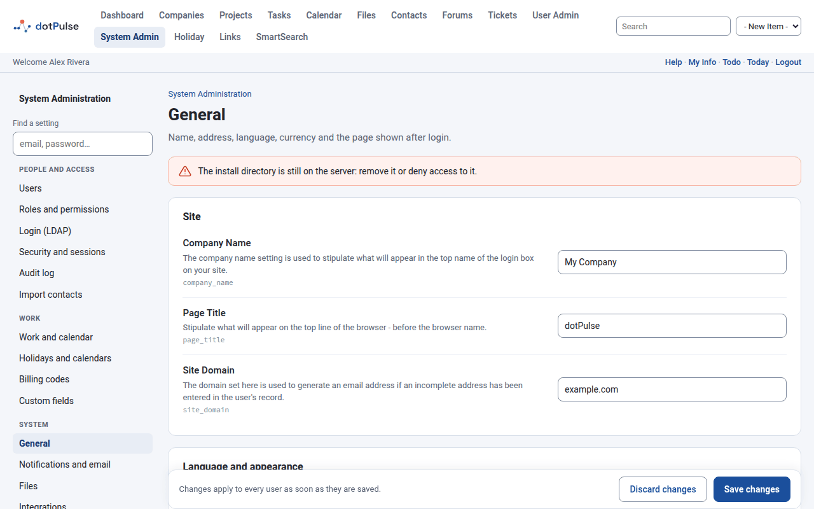
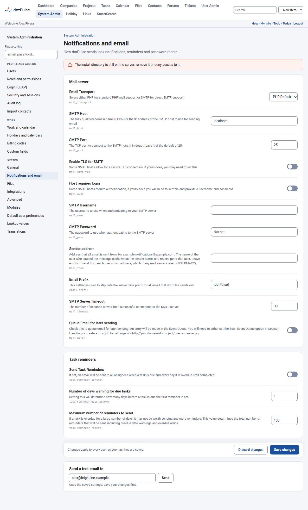

# Settings

The settings of **System Admin** are split into eight sections. Each section
has its own card on the System Admin start page and its own link in the side
menu. This page lists every setting of every section: its label as you see it
on screen, what it really does, and its value in a new installation.

How to find, change and save settings is explained in
[System Admin overview](index.md#change-settings). In short: change the values,
click **Save changes**, and the new values apply to every user on their next
page. The internal name of each setting (shown in small type under its help
text) is given in the tables in `code` style.

!!! tip
    Don't know where a setting is? Type a word into **Find a setting** at the
    top of the side menu.

## General

**System Admin › General**: the name of the site, its language and theme, the
currency and the page people see after they log in.

{ .shot }

### Site

| Setting | What it does | Default |
| --- | --- | --- |
| **Company Name** (`company_name`) | Shown on the login page and on the forgotten password page. When a **Sender address** is set, it is also the sender name of mail that has no person behind it. | `My Company` |
| **Page Title** (`page_title`) | The title of the browser tab, also shown on the login page (*Page Title :: Login*). Authenticator apps show it as the name of the account when people set up two-step login. | `dotPulse` |
| **Site Domain** (`site_domain`) | Used to build the address `no-reply@<domain>`: the sender of password reset mails and of any mail whose sender has no valid address (while **Sender address** is empty), and the reply address otherwise. Use your own domain. | `example.com` |

### Language and appearance

| Setting | What it does | Default |
| --- | --- | --- |
| **Host Locale** (`host_locale`) | The language of the login page. Once logged in, people see the **Locale** of their preferences, which falls back to the one in [Default user preferences](lists-and-fields.md#default-user-preferences), not to this setting. | `en` |
| **Default User Interface Style** (`host_style`) | The theme for the login page and for users who haven't chosen one in their preferences. Choose from the list of installed themes. | **dotPulse** |
| **Currency Symbol** (`currency_symbol`) | Put before money amounts: project and task budgets, and the budget column of the companies list. | `$` |

To change the language or theme of users who already have one, use
[Default user preferences](lists-and-fields.md#default-user-preferences) (new
users) or each user's own preferences.

!!! note
    Type the currency symbol itself, for example `€` or `£`, not an HTML code
    such as `&#8364;`: some pages would show the code as plain text.

### Start page

These three settings choose the page dotPulse opens after login, and whenever
someone opens the site's address without naming a page.

| Setting | What it does | Default |
| --- | --- | --- |
| **Default Module** (`default_view_m`) | The module to open. The list shows the active modules. | **Dashboard** (`dashboard`) |
| **Default Submodule** (`default_view_a`) | The page of that module, as it appears after `a=` in the address. Leave it at `index` for the module's main page. | `index` |
| **Default Tabbed Subview** (`default_view_tab`) | Which tab to open on that page: `0` is the first tab, `1` the second and so on. | `0` |

!!! warning "Check the start page after you change it"
    If you choose a module that some roles may not open, or a page that does
    not exist, those users don't get a working page right after they log in.
    Use a page every role may open; the **Dashboard** is a safe choice.

## Work and calendar

**System Admin › Work and calendar**: the working time that task dates and
durations are calculated with, and some rules for tasks.

### Working hours

| Setting | What it does | Default |
| --- | --- | --- |
| **Calendar Working Days** (`cal_working_days`) | The days of the week people work. Tick a box for each day. The other days are skipped when dotPulse calculates task end dates and durations, and no task reminders are sent on them. | Monday to Friday |
| **Calendar Start Hour** (`cal_day_start`) | When the working day starts. Task dates, durations and the calendar's day view use it. | **08:00** |
| **Calendar End Hour** (`cal_day_end`) | When the working day ends. | **17:00** |
| **Daily Working Hours** (`daily_working_hours`) | How many hours make one working day. dotPulse uses it to turn a duration in days into hours and back, and to calculate how long a task takes. | `8.0` |
| **Calendar Minute Increment** (`cal_day_increment`) | The steps of the minutes lists in task and event forms, and the length of each row in the calendar's day view. | **15 minutes** |
| **Show MiniCals in Day View** (`cal_day_view_show_minical`) | Shows small month calendars next to the calendar's day view. | On |

Holidays are not working days either. Below this panel a card leads to
[Holidays and calendars](holidays.md), where each workplace can have its own.

!!! warning "Changing working time changes task dates"
    Task dates aren't recalculated when you save. But the next time someone
    edits a task, or moves it with its dependencies, the new working days and
    hours are used. Decide on working time before projects start.

### Tasks

| Setting | What it does | Default |
| --- | --- | --- |
| **Check Task Dates** (`check_task_dates`) | When on, the task form refuses to save a task without a start date and a finish date. It is checked in the browser only. | On |
| **Overallocation Checking** (`check_overallocation`) | Has no effect. The check it used to turn on is disabled in the code. | Off |
| **Check Empty Dynamic Tasks** (`check_task_empty_dynamic`) | When on, a task can be made dynamic only if it already has subtasks, and you can't delete the last subtask of a dynamic task. | Off |
| **Restrict Task Time Editing** (`restrict_task_time_editing`) | When on, only the task owner, the project owner and users who may edit **User Admin** can change the dates, duration and dependencies of an existing task. Others still edit the rest of the task. | Off |
| **Show All Task Assignees** (`show_all_task_assignees`) | When on, task lists show the login names of all assignees with their share, for example *priya (50%), marco (50%)*. When off, they show the first one and the number of others, for example *priya (50%) (+2)*; click **(+2)** to see the others. | Off |
| **Edit Multiple Task Assignments** (`direct_edit_assignment`) | When on, the task lists (of a project, and the **To Do** list) get a checkbox on each task and a box at the bottom to assign people (**Assign with Percentage**) and update the ticked tasks together. | Off |
| **Enable Gantt Charts** (`enable_gantt_charts`) | When on, the task list of each project ends with **Expand All**, **Collapse All** and a **Gantt Chart** button. Turning it off removes only that line: the **Gantt** tabs of projects and **My Gantt** stay. | On |
| **Restrict Project Colour Selection** (`restrict_color_selection`) | When on, the colour picker of projects offers only the colours of the **ProjectColors** lookup list (see [Lookup values](lists-and-fields.md#lookup-values)). When off, people can pick any colour. | Off |

## Notifications and email

**System Admin › Notifications and email**: how dotPulse sends mail. It sends
task notifications, assignment mails, task reminders and password resets.

{ .shot }

### Mail server

| Setting | What it does | Default |
| --- | --- | --- |
| **Email Transport** (`mail_transport`) | **PHP Default** hands mail to PHP's `mail()` function, which needs a working mail program (sendmail or similar) on the web server. **SMTP** connects to the mail server you set below. Most sites should use SMTP. | **PHP Default** |
| **SMTP Host** (`mail_host`) | Name or IP address of the SMTP server. SMTP only. | `localhost` |
| **SMTP Port** (`mail_port`) | Port of the SMTP server: usually `587` (submission, with TLS), `465` (SMTP over TLS) or `25`. | `25` |
| **Enable TLS for SMTP** (`mail_smtp_tls`) | Encrypts the connection. On port `465` dotPulse uses TLS from the start (SMTPS); on any other port it starts plain and switches to TLS (STARTTLS). | Off |
| **Host requires login** (`mail_auth`) | Logs in to the SMTP server with the user name and password below. | Off |
| **SMTP Username** (`mail_user`) | User name for the SMTP server. | empty |
| **SMTP Password** (`mail_pass`) | Password for the SMTP server. It is never shown again: the field says *Saved: type another to change it*. Leave it empty to keep the saved one. | empty |
| **Sender address** (`mail_from`) | The address every mail is sent from, for example `notifications@example.com`. The name of the person who caused the mail is shown as the sender name, and replies go to that person. | empty |
| **Email Prefix** (`email_prefix`) | Put at the start of the subject of every mail, so people can filter them. | `[dotPulse]` |
| **SMTP Server Timeout** (`mail_timeout`) | How many seconds to wait for the SMTP server before giving up. `0` uses the mail library's own default. | `30` |
| **Queue Email for later sending** (`mail_defer`) | When on, mail isn't sent while the user waits: it goes to the event queue, and the cron job sends it later. See [The event queue and cron](#the-event-queue-and-cron). | Off |

!!! warning "Set a sender address"
    While **Sender address** is empty, each mail is sent from the address of the
    user who caused it. Most receiving servers reject such mail or file it as
    spam, because your server is not allowed to send for those domains (SPF,
    DMARC). Use an address on a domain whose SPF and DKIM records allow your
    mail server. The start page shows **No sender address set** until you do.

### Send a test email

Under the settings, the **Send a test email to** box sends one message right
away, so you can check your settings.

1. Save your changes first: the test uses the saved settings, not what is in
   the form.
2. Enter an address (yours is filled in) and click **Send**.

The message is sent directly, even when **Queue Email for later sending** is
on. Its text lists the transport, the server and port, the TLS mode and the
sender address used. If it fails, the message at the top of the page says why,
for example *Test email not sent: Could not instantiate mail function.*
(PHP mail with no mail program on the server) or an error from the SMTP server.

### Task reminders

When reminders are on, dotPulse mails the assignees and the owner of a task
before it is due and then every day it is overdue.

| Setting | What it does | Default |
| --- | --- | --- |
| **Send Task Reminders** (`task_reminder_control`) | Turns reminders on. | Off |
| **Number of days warning for due tasks** (`task_reminder_days_before`) | How many days before the finish date the first reminder is sent. | `1` |
| **Maximum number of reminders to send** (`task_reminder_repeat`) | The most reminders sent for one task, counting the warnings before the finish date and the overdue ones. | `100` |

What to expect:

- A reminder is scheduled when a task is saved with a finish date: when it is
  created, or when its finish date changes. Turning reminders on does not
  schedule them for tasks that already exist.
- The mail goes to the assignees and the task owner. Each person only gets it
  on their own working days (their workplace's holidays count).
- Reminders stop when the task reaches 100 %, or after the maximum number.
- Turning **Send Task Reminders** off stops all reminders, also those already
  in the queue. Turning it on again schedules reminders only for tasks saved
  from then on.
- Reminders, like task notifications, are sent only by the cron job.

### The event queue and cron

dotPulse doesn't send task notifications, assignment mails and reminders
while the user waits. It puts them in an **event queue**, and the script
`queuescanner.php` sends what is due. With **Queue Email for later sending**
on, all other mail goes through the queue too.

`queuescanner.php` runs from the command line only (over the web it answers
*404 Not found*). Run it from cron every few minutes, as the web server user,
with your site's public address:

```cron
# /etc/cron.d/dotpulse
*/5 * * * * www-data php /var/www/html/dotpulse/queuescanner.php --base-url=https://pm.example.com
```

[Installing](../getting-started/install.md#set-up-the-cron-job) explains the
details.

Without the cron job, queued mail is never sent. A mail that can't be sent
stays in the queue and is tried again on the next run; the reason is written to
the PHP error log (`dotPulse mail: not sent (...)`).

A queued mail keeps the mail settings of the moment it was queued. If you fix
the SMTP settings, mail queued before the fix is still sent with the old ones.

## Security and sessions

**System Admin › Security and sessions**: user names and passwords, how long
people stay logged in, the REST API and the audit log.

### Accounts

| Setting | What it does | Default |
| --- | --- | --- |
| **Admin Username** (`admin_username`) | The login name that is exempt from **Minimum Username Length** in the user form. It gives no rights: who is an administrator depends only on roles. | `admin` |
| **Minimum Username Length** (`username_min_len`) | The shortest login name the user form accepts. Checked in the browser only. | `4` |
| **Minimum Password Length** (`password_min_len`) | The shortest password accepted when someone changes their password or an administrator sets one. Use at least `12`. | `4` |
| **Inactivate contact when user is disabled** (`user_contact_inactivate`) | When you remove a user's last role (so they can no longer log in), their contact record is made private. | On |
| **Activate contact when user login is granted** (`user_contact_activate`) | When you give a role to a user who had none, their contact record is made public. | Off |

!!! warning "Raise the minimum password length"
    The default of 4 characters is far too short for a site on the internet.
    It applies when a password is set or changed, not to passwords that
    already exist. See [Users](users.md) for passwords.

### Sessions

A session starts when someone logs in and ends when they log out or it
expires.

| Setting | What it does | Default |
| --- | --- | --- |
| **Session Handler** (`session_handling`) | **dotPulse Extended Sessions** keeps sessions in the database and applies the two times below. **PHP Default** uses PHP's own sessions: the session ends when the browser is closed or when PHP's own timeout expires, and the two times below are ignored. | **dotPulse Extended Sessions** |
| **Session Idle Time** (`session_idle_time`) | How long a session may go without any activity before it expires and the person has to log in again. | `2d` (2 days) |
| **Session Maximum Lifetime** (`session_max_lifetime`) | How long a session may last at most, however active it is. Also the lifetime of the session cookie. | `1m` (30 days) |
| **Scan Event Queue on Session Garbage Collection** (`session_gc_scan_queue`) | When on, the event queue is also processed now and then while people use the site, when PHP cleans up old sessions. Not a replacement for cron: see below. | Off |

**How to write a time.** A number alone is seconds. Add one letter for
another unit:

| Letter | Unit | Example |
| --- | --- | --- |
| none | seconds | `3600` = 1 hour |
| `h` | hours | `8h` |
| `d` | days | `2d` |
| `m` | months of 30 days (not minutes) | `1m` = 30 days |
| `y` | years of 365 days | `1y` |

Only one letter is allowed: write `28h`, not `1d4h`. For minutes, use seconds:
`1800` is 30 minutes.

!!! warning "m is months"
    `30m` means 30 months, not 30 minutes. A value dotPulse can't read (such
    as `1w`), or less than 60 seconds, is refused when you save, and the saved
    value stays.

Sessions are checked on each page: a session past either time is deleted and
the person sees the login page. Changing the times applies to sessions that
already exist.

**Scan Event Queue on Session Garbage Collection** depends on PHP's session
clean-up, which runs on a random fraction of page views (set by
`session.gc_probability` in PHP; some Linux distributions set it to 0, so it
never runs). It only works with **dotPulse Extended Sessions**, mails sent this
way have no proper site address in their links, and nothing is sent while
nobody uses the site. Use the cron job instead.

### API and audit

| Setting | What it does | Default |
| --- | --- | --- |
| **Enable the REST API** (`api_enabled`) | Lets users create personal access tokens (the **API tokens** tab of their account) and use them with `api.php`. Each token acts with the permissions of its user. When off, `api.php` refuses every request and the tab is hidden. | Off |
| **Days to keep the audit log** (`audit_log_days`) | Entries of the [audit log](audit-and-maintenance.md#audit-log) older than this many days are deleted. `0` keeps them forever. | `365` |

## Login (LDAP)

**System Admin › Login (LDAP)**: whether people log in with a password stored
in dotPulse, or with the password of an LDAP directory such as OpenLDAP or
Active Directory.

### Method

| Setting | What it does | Default |
| --- | --- | --- |
| **User Authentication Method** (`auth_method`) | **Standard dotPulse** checks the password stored in dotPulse. **LDAP** checks it against the directory set below. | **Standard dotPulse** |

### LDAP directory

| Setting | What it does | Default |
| --- | --- | --- |
| **LDAP Host** (`ldap_host`) | Name or IP address of the directory server. For an encrypted connection, write an address such as `ldaps://ldap.example.com` (add `:port` if it isn't 636: with an address like this, **LDAP Port** is not used). | `localhost` |
| **LDAP Port** (`ldap_port`) | Port of the directory server, used when **LDAP Host** is a plain name or address. | `389` |
| **LDAP Version** (`ldap_version`) | LDAP protocol version. Leave it at `3`. | `3` |
| **LDAP Base DN** (`ldap_base_dn`) | Where in the directory to look for users, for example `ou=people,dc=example,dc=com`. | empty (sites installed before 3.4 have the placeholder `dc=saki,dc=com,dc=au`: change it) |
| **LDAP User Filter** (`ldap_user_filter`) | The search that finds a user. `%USERNAME%` is replaced by the login name typed on the login page. For Active Directory use `(sAMAccountName=%USERNAME%)`. | `(uid=%USERNAME%)` |
| **LDAP Search User** (`ldap_search_user`) | The full DN of an account allowed to search the directory, for example `cn=dotpulse,ou=services,dc=example,dc=com`. Leave empty to search anonymously. | empty (before 3.4: the placeholder `Manager`) |
| **LDAP Search User Password** (`ldap_search_pass`) | Password of the search account. Never shown again; leave empty to keep the saved one. | empty (before 3.4: the placeholder `secret`) |
| **LDAP also allows standard login** (`ldap_allow_login`) | When on, the password stored in dotPulse is tried first, and the directory only if it fails. When off, only the directory counts. | On |

### How LDAP login works

When someone logs in with LDAP as the method:

1. An empty password is always refused.
2. If **LDAP also allows standard login** is on, dotPulse first checks the
   password stored in dotPulse. If it matches, the person is in.
3. Otherwise dotPulse connects to the directory, logs in as the search user (or
   anonymously), and searches **LDAP Base DN** with **LDAP User Filter**. The
   first entry found is used.
4. It then tries to log in to the directory as that entry with the password the
   person typed. If that works, the person is in.
5. If no dotPulse user has that login name yet, dotPulse creates one on the
   spot. The new user gets a contact filled from the directory entry (given
   name, surname, mail, phone, mobile, city, state, postal code and title) and
   the **Anonymous** role. A copy of the password is stored in dotPulse.

Two-step login, when the user has it, is asked for after this, as with
standard login. The user's role must allow login.

!!! warning "Before you switch to LDAP"
    - **Keep a way in.** With **LDAP also allows standard login** off, nobody
      can log in with a dotPulse password, administrators included. If the
      directory is down or a setting is wrong, everyone is locked out, and you
      have to set `auth_method` back to `sql` in the database
      (`UPDATE dotp_config SET config_value = 'sql' WHERE config_name = 'auth_method'`,
      with your own table prefix). Test with standard login still allowed first.
    - **New users get almost no rights.** Users created at their first LDAP
      login get the **Anonymous** role, which only lets them open the
      non-admin modules. Give them a real role in [Users](users.md) after their
      first login.
    - **Lock people out in dotPulse too.** When someone leaves, remove their
      roles in dotPulse as well as disabling them in the directory.
    - dotPulse doesn't use STARTTLS. Use an `ldaps://` address, or a directory on
      the same server, so passwords don't cross the network in clear text.

dotPulse doesn't show why an LDAP login failed: the person just sees the
normal login error. Check the directory server's log, or test the search user
and filter with a tool such as `ldapsearch` first.

To copy contacts (not users) from a directory, see
[Import contacts from LDAP](audit-and-maintenance.md#import-contacts-from-ldap).

## Files

**System Admin › Files**: file versions and the indexing that lets people
search the contents of uploaded files.

### Files

| Setting | What it does | Default |
| --- | --- | --- |
| **Preserve File Settings on CI** (`files_ci_preserve_attr`) | When on, someone checking in a new version of a file can't change its type, project or task: the new version keeps those of the file. | On |
| **Allow Editing of Previous Versions** (`files_show_versions_edit`) | When on, the list of older versions of a file shows edit and delete links (to users who may edit or delete files). When off, older versions can only be viewed. | Off |

### Indexing

When a file is uploaded, dotPulse runs a program that extracts its text and
stores the words, so that the search finds files by their contents.

| Setting | What it does | Default |
| --- | --- | --- |
| **Maximum File Size for Indexing** (`index_max_file_size`) | Files larger than this many kilobytes are not indexed. A negative value indexes all files; `0` indexes only empty files. | `-1` (no limit) |
| **Default File Indexing Parser** (`parser_default`) | The program used for file types that have no parser of their own. | `/usr/bin/strings` |
| **MS Word Indexing Parser** (`parser_application/msword`) | The program for `.doc` files. | `/usr/bin/strings` |
| **Html File Indexing Parser** (`parser_text/html`) | The program for HTML files. | `/usr/bin/strings` |
| **PDF Indexing Parser** (`parser_application/pdf`) | The program for PDF files (`pdftotext`, from the poppler-utils package). | `/usr/bin/pdftotext` |

dotPulse runs the parser with the path of the file added at the end and reads
what it prints. For a parser whose path contains `/pdf`, it also adds `-` so
that the text is printed instead of written to a file. If the program is
missing, the file is uploaded anyway and the message says *0 words indexed*.

!!! warning "Parsers are commands run on the server"
    Each parser value is run as a shell command by the web server on every
    upload. Put only the full path of a real text extraction program there.
    Anyone who may change these settings can run any command on the server, so
    give edit rights on **System Admin** only to people you trust with the
    server itself.

## Integrations

**System Admin › Integrations**: links to other programs.

### Mantis

These settings exist only while the Mantis module is installed (see
[Modules](modules.md)). Removing the module deletes them.

| Setting | What it does | Default |
| --- | --- | --- |
| **Mantis Address** (`mantis_url`) | The address of your MantisBT installation (MantisBT 2.x, with its REST API), for example `https://bugs.example.org`. It must start with `https://`; otherwise the Mantis features stay off. Each user stores their own Mantis API token. | empty |
| **Allow HTTP for Mantis** (`mantis_allow_http`) | Accepts an `http://` address. Only for a test installation on your own computer: the users' API tokens then cross the network unencrypted. | Off |

### Tickets

| Setting | What it does | Default |
| --- | --- | --- |
| **Allow Ticket Relinking** (`link_tickets_kludge`) | Adds a **Link** column to the list of the **Tickets** module, to attach a ticket to another ticket as its parent. Useful for tickets created from mail. | Off |

## Advanced

**System Admin › Advanced**: permission cache, logs, debugging and translation
checks. Leave these at their defaults unless you know why you change them.

Settings added by a module that no other section lists also appear here, in a
panel called **Other**.

### Permissions cache

| Setting | What it does | Default |
| --- | --- | --- |
| **Enable Permissions Cache** (`gacl_cache`) | Turns on the cache of the permissions library (phpGACL), stored as files in the directory below. | Off |
| **Expire Permissions Cache** (`gacl_expire`) | When on, the whole cache is cleared each time a permission or role changes, so changes apply at once. Keep it on if you use the cache. | On |
| **Permissions Cache Directory** (`gacl_cache_dir`) | Where the cache files go. The web server must be able to write there. | `/tmp` |
| **Permissions Cache Timeout** (`gacl_timeout`) | How many seconds a cached answer is kept. | `600` |

!!! note
    dotPulse checks permissions in a table it builds whenever permissions
    change, not with the library queries this cache speeds up. Turning the
    cache on makes no difference you'd notice; leave it off.

### Logs and debugging

| Setting | What it does | Default |
| --- | --- | --- |
| **Log Changes** (`log_changes`) | When on, changes to projects, tasks, files and other records are recorded for the **History** module. That module must be installed and active; otherwise each change shows a warning that it is not loaded. | Off |
| **Debug Level** (`debug`) | How much debug information dotPulse writes to the PHP error log. `0` writes none; `1` writes only the most important messages; higher numbers write more (from `11`, the permission library's own debugging; from `12`, every SQL query). | `1` |
| **Show Debug Messages** (`display_debug`) | Also prints the debug messages on the pages, for every user. | Off |
| **Memory Limit for Gantt** (`reset_memory_limit`) | Not used by the standard modules any more. Only the add-on module Monitoring and Control sets PHP's memory limit to this value on some of its pages. | `32M` |

!!! warning "Debugging on a live site"
    A **Debug Level** above 1 fills the PHP error log fast, and from 12 it logs
    every SQL query. **Show Debug Messages** shows file paths, queries and
    other internal details to every user, and can break pages. Turn them on
    only for a short test, and off again.

### Translations

| Setting | What it does | Default |
| --- | --- | --- |
| **Translation Warning** (`locale_warn`) | Marks every interface text that has no translation in the user's language, by adding the string below to it. Useful while you translate (see [Translations](translations.md)). | Off |
| **Translation Alert String** (`locale_alert`) | The mark added to untranslated texts. | `^` |
