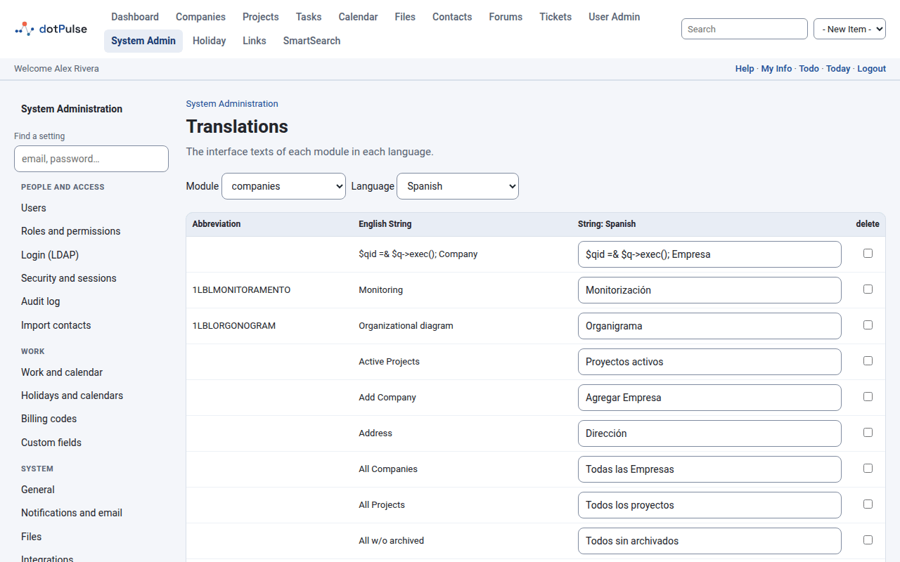

# Translations

Every text of the interface comes from a translation file: one file per module
and language. **System Admin › Translations** lets you change those texts in the
browser, for example to fix a translation or to use your own words for a label.

English and Spanish are maintained with dotPulse: every text the code uses has
an English and a Spanish entry. The other languages come from dotProject and
were completed by machine translation. Their machine-translated entries are
marked `// MT` until someone reviews them.

## Who can translate

The page needs edit permission on **System Admin** and the user type
**Administrator**. Other users, even with the right role, get **Access
Denied**.

## Edit a translation

1. Open **System Admin › Translations**.
2. Choose the **Module** and the **Language**. The page reloads as soon as you
   change either list. The **Module** list has every module folder, installed
   or not. **common** holds the texts shared by every page (menus,
   buttons, dates); **styles** holds those of the themes.
3. Change the texts you need.
4. Click **submit** at the bottom of the page.

{ .shot }

The table has four columns:

| Column | What it shows |
|--------|---------------|
| **Abbreviation** | The key the code uses, when it isn't the English text itself (for example `LBL_RISKS`). Empty when the key is the English text. |
| **English String** | The English text. |
| **String:** *language* | The translation, which you can edit. Long texts get a larger box. |
| **delete** | Tick it to remove the entry when you save. |

An entry with an empty translation shows the untranslated text on screen: the
English text, or the abbreviation when there is one.

### What saving does

Saving rewrites the whole file of that module and language, from what the page
shows:

- An entry you **didn't touch** is written back exactly as it was, including
  its `// MT` mark if it had one. You can review a long file in several
  sittings: the entries you haven't reached keep their mark.
- An entry you **edited** is written with your text and loses its `// MT`
  mark. HTML in the text is cleaned: only safe markup is kept.
- An entry with **delete** ticked is left out of the file.

Changes show from the next page you open.

!!! note "Modules with two files"
    A module that ships its own translations folder
    (`modules/<module>/locales/`) has two entries in the **Module** list. For
    example, **projects** opens the few texts of `modules/projects/locales/`,
    and **projects (main texts)** the main texts of the Projects module, in
    `locales/<language>/projects.inc` (see
    [Where the files are](#where-the-files-are)).

### Edit the English texts

With **English** chosen, the page works differently:

- Both the **Abbreviation** and the **English String** can be edited.
- The first row, **New Entry**, adds an entry. Enter an **Abbreviation** if the
  code uses a key, or leave it empty and type only the **English String**.

Change the English texts with care: the English entries are also the list of
texts the page offers for every other language. If you rename an entry's key,
the translations still use the old key.

## Where the files are

| Texts | File |
|-------|------|
| Most modules, and **common** and **styles** | `locales/<language>/<module>.inc`, for example `locales/es/companies.inc` |
| Modules with their own translations | `modules/<module>/locales/<language>.inc`, for example `modules/risks/locales/es.inc` |

`<language>` is the name of the folder under `locales/`: `en`, `es`, `fr`,
`pt_br` and so on.

The files are plain lists of `"key"=>"text",` lines. If a file contains anything
else (PHP code, for example), dotPulse ignores it and writes a line to the PHP
error log.

### Let the web server write the files

To save, the web server user (often `www-data` or `apache`) must be able to
write the file, and the folder if the file doesn't exist yet. Otherwise the page
says **Could not open locales file (...) to save.** and nothing changes. For
example, to allow translating into Spanish:

```sh
cd /var/www/html/dotpulse
chown -R www-data locales/es
```

If you prefer the code to stay read-only for the web server, edit the files by
hand and copy them to the server.

!!! warning "Back up your translations before an upgrade"
    A new version of dotPulse replaces `locales/` and `modules/*/locales/`.
    Before you upgrade, copy the files you changed, then merge your entries
    into the new files. See [Upgrading](../getting-started/upgrade.md#1-back-up).

## Choose the language of the site

Two things decide the language someone sees:

- The **Locale** of their [preferences](../user-guide/preferences.md#locale).
  Users who haven't chosen one follow the **Locale** of the
  [default user preferences](lists-and-fields.md#default-user-preferences).
- **Host Locale** (`host_locale`), in
  [**System Admin › General**](settings.md#language-and-appearance): the
  language of the login page.

Since the default user preferences always have a **Locale** (English on a new
site), **Host Locale** in practice only changes the login page. To change the
language of everyone who hasn't chosen one, change the default user preferences.

## Find untranslated texts

Two settings of [**System Admin › Advanced**](settings.md#translations) help while
you translate:

- **Translation Warning** (`locale_warn`) adds a mark to every text shown on
  screen that has no entry in the user's language.
- **Translation Alert String** (`locale_alert`) is that mark, `^` by default.

Turn the warning on, browse the pages in the language you are working on, and
look for texts that end in `^`. Turn it off again when you're done: everyone
sees the marks.

## Add a language

A language is a folder under `locales/`. To add one, for example Greek:

1. Create `locales/el/`.
2. Copy `lang.php` and `locales.php` from `locales/en/` into it.
3. Edit `lang.php`. It lists the variants of the language that users can
   choose, each with the folder name, its English name, its own name and a
   Windows locale code. For example:

    ```php
    $dir = basename(dirname(__FILE__));
    $LANGUAGES['el_GR'] = array($dir, 'Greek', 'Ελληνικά', 'ell');
    ```

4. Check `locales.php`: the character set (keep `utf-8`), the first day of the
   week (`0` for Sunday, `1` for Monday) and the default time format.
5. Copy the `.inc` files of `locales/en/` into the new folder, or let the
   **Translations** page create them: choose the new language and a module,
   and click **submit**. Each file is created when you first save it, if the
   web server can write the folder.
6. For modules with their own translations, add
   `modules/<module>/locales/el.inc` the same way.

Users see the new language in the **Locale** list of their preferences after
they log out and in again: the list of languages is read once per session.

## Contribute translations

If you improved a translation, consider sending it back so that everyone gets
it with the next version. dotPulse is on
[GitHub](https://github.com/davmont/dotPulse): open a pull request with the
changed `.inc` files, or an issue with the files attached.

From a clone of the repository, `php tools/locales/check.php status` shows the
coverage of each language: how many entries of the English catalogue it has and
how many are still marked `// MT`. `php tools/locales/check.php missing es` lists
the texts missing in one language.
