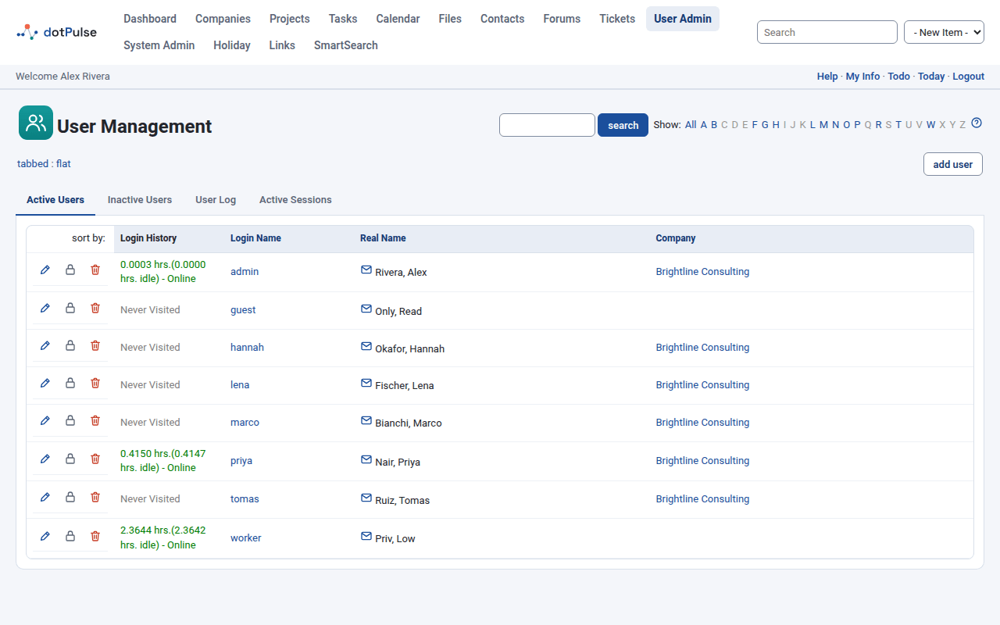
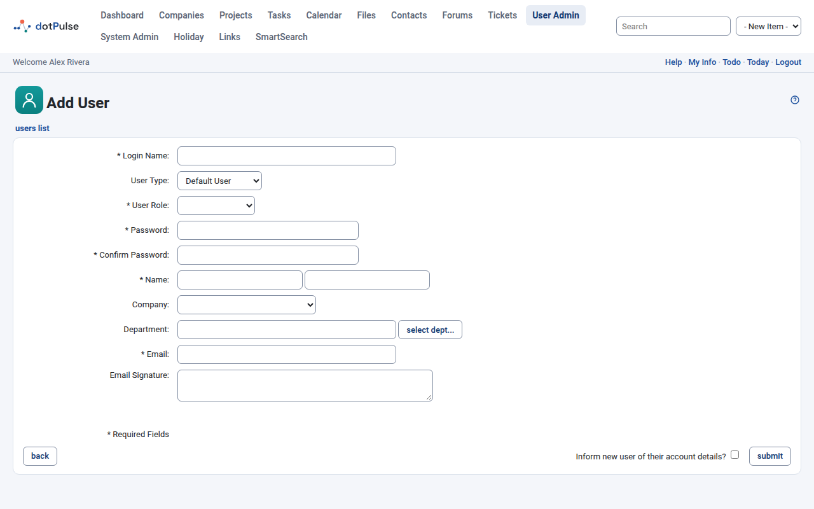

# Users

Every person who logs in to dotPulse has a user account. This page covers the
list of users, adding and editing accounts, the user page and its tabs, and how
to switch off or remove an account.

What a user may see and do comes from their roles. Roles are explained in
[Roles and permissions](roles-permissions.md).

## The users list

Click **User Admin** in the top menu, or open **System Admin** and click
**Users**. The page is called **User Management** (`?m=admin`).

{ .shot }

The list has these tabs:

| Tab | Shows |
|---|---|
| **Active Users** | Users who have at least one role, so they can log in. |
| **Inactive Users** | Users who have no role. They can't log in. |
| **User Log** | When people logged in and out, between two dates. |
| **Active Sessions** | Who is logged in now. You can end their sessions here. |

**Active Sessions** only appears if you may both edit and delete users.

### Find a user

- Click a letter in the **Show** row to list users whose login name, first name
  or last name starts with that letter. Grey letters have no users. **All**
  shows everyone again.
- Type part of a login name, first name or last name in the box at the top and
  click **search**.

The letter or search stays in force while you are logged in. Click **All** to
clear it. Click a column title (**Login Name**, **Real Name**, **Company**) to
sort.

!!! note "Users of other companies"
    The list only shows users whose company you may see. If your roles deny you
    a company, its users are not listed.

### Read the list

The icons at the left of each row are:

- the pencil: edit the user;
- the padlock: open the user's page (on a standard site, at the
  **Permissions** tab);
- the bin: delete the user.

On **Active Users**, the **Login History** column shows, for the user's last
login, how many hours ago they logged in and how long they have been idle,
followed by **Online** in green. Otherwise it says **Offline** (red) or
**Never Visited** (grey).

Click the login name to open the user's page. The envelope next to the name
starts an email to them.

## Add a user

1. Go to **User Admin** and click **add user**.
2. Fill in the form (see the table below).
3. To email the new user, tick **Inform new user of their account details?**.
4. Click **submit**.

dotPulse opens the new user's page. Check the **Roles** and **Permissions**
tabs before you tell the user to log in.

{ .shot }

| Field | What it does |
|---|---|
| **Login Name** | The name the user logs in with. It is saved in lower case and must be unique. You can't change it later. Minimum length: the `username_min_len` setting (4 by default). |
| **User Type** | A label for the person's position: Default User, Administrator, CEO, Director, Branch Manager, Manager, Supervisor or Employee. It doesn't decide what the user may see: roles do that. |
| **User Role** | The user's first role. Required. Add more roles later on the **Roles** tab. |
| **Password**, **Confirm Password** | The password, twice. Minimum length: the `password_min_len` setting (4 by default). |
| **Name** | First name and last name. Both are required. |
| **Company** | The company the person works for. Lists often start on the user's own company. |
| **Department** | Click **select dept...** and pick a department of the chosen company. |
| **Email** | Required. Notifications and password resets go here. |
| **Email Signature** | Added to the emails the user sends from dotPulse. |

Fields marked `*` are required. If the login name is already taken, dotPulse
says so and saves nothing.

!!! tip "User Type versus User Role"
    **User Role** decides what the user may see and do. **User Type** mostly
    describes the person's job: a user with the type "Administrator" and the
    Guest role is still a guest. A few add-on modules use the user type in their
    own settings.

### The contact record

Each new user gets a **new contact** in **Contacts**, with the name, company,
department and email from the form. You become the owner of that contact. The
user's phone numbers, address and birthday are kept on the contact: edit the
user and click **edit contact info**, or edit the contact in **Contacts**.

You can't turn an existing contact into a user: adding a user always creates a
new contact. If the person was already in **Contacts**, you now have two
contacts for them.

### The welcome email

With **Inform new user of their account details?** ticked, dotPulse emails the
user that an account was created, with the site address and their login name.
The email does **not** contain the password: it tells the user to set one with
the forgotten-password link on the login page. Give them the password yourself,
or let them use that link.

The email is sent from your own address, or from the sender address set in
[Notifications and email](settings.md#notifications-and-email). If the email
can't be sent, the user is still created and dotPulse shows the mail error.

## The user page

Click a login name in the list to open **View User**. The top shows the login
name, user type, name, company, department, phone numbers, address, birthday,
email and signature.

The links under the title are:

- **users list**: back to the list;
- **edit this user**: the same form as for a new user;
- **edit preferences**: the user's preferences (see
  [Your account and preferences](../user-guide/preferences.md));
- **change password**, on the right: set a new password.

The tabs below hold the rest:

| Tab | What it is for |
|---|---|
| **Projects**, **Projects gantt** | The projects the user owns, as a list and as a chart. |
| **User Log** | This user's logins and logouts between two dates. |
| **Permissions** | Permission rules for this user alone, on top of their roles. |
| **Roles** | The user's roles. Add and remove roles here. |
| **Two-step login** | Whether two-step login is on; reset it if the user lost their phone. |
| **API tokens** | Only when the API is turned on: the user's API tokens. |
| **Transfer** | Move the user's projects and tasks to someone else. |

Add-on modules can add more tabs.

### Roles tab

The left side lists the user's roles. On the right, under **Add Role**, pick a
role and click **add**. Click the bin next to a role to take it away from the
user.

A user can have several roles. See
[How permissions combine](roles-permissions.md#how-permissions-combine).

The bin only takes the role away from this user (**Remove this role from the
user?**). The role itself stays. To delete a role, see
[Delete a role](roles-permissions.md#delete-a-role).

### Permissions tab

This tab holds permission rules for one user, without making a role for it. It
shows only the user's own rules, not the ones that come from their roles. It
works like the role permissions page: see
[Give a permission to one user](roles-permissions.md#give-a-permission-to-one-user).

### Edit a user

1. In the list, click the pencil, or open the user and click **edit this user**.
2. Change what you need. The login name can't be changed.
3. Leave **Password** and **Confirm Password** empty to keep the password.
4. Click **submit**.

Roles are not on this form: use the **Roles** tab.

### Change someone's password

The surest way, for any administrator:

1. Open the user and click **edit this user**.
2. Enter the new password in **Password** and **Confirm Password**.
3. Click **submit**.

You don't need the user's old password. (When you change your own password,
dotPulse asks for your current one.)

The **change password** link on the user page opens a small window with
**New Password** and **Repeat New Password** (and **Current Password** when the
page is your own). To set someone else's password, **edit this user** works
as well.

Each password change is written to the user's history and to the
[audit log](audit-and-maintenance.md#audit-log). Users who forgot their password
can reset it themselves with the forgotten-password link on the login page.

### Reset two-step login

A user who lost their phone and their recovery codes can't log in. To let them
in again:

1. Open the user and click the **Two-step login** tab.
2. Click **Reset two-step login** and confirm.

Two-step login is now off for that user. They log in with their password only,
and can set it up again from **My Info** (see
[Set up two-step login](../user-guide/preferences.md#set-up-two-step-login)).

For other users you can only reset two-step login. You can't turn it on for
them, and you never see their key or codes. The tab says **Two-step login is
off for this user.** when they haven't set it up.

### API tokens

The **API tokens** tab is only there when the REST API is turned on
(`api_enabled`, see [Security and sessions](settings.md#security-and-sessions)).
Users create tokens on their own page. On someone else's page you see their
tokens (**Name**, the first characters of the **Token**, **Access**,
**Created**, **Expires**, **Last used**) and can **Revoke** them. You can't
create a token for another user.

A token acts as its user, with that user's permissions. It stops working when
it expires, when it is revoked, or when its user has no role left.

### Transfer projects and tasks

When someone leaves and another person takes over their work, use the
**Transfer** tab:

1. Open the user who is leaving and click **Transfer**.
2. Under **Transfer Projects**, select the projects to hand over. Hold
   ++ctrl++ to select several, or click **Select All**.
3. Under **To User**, click the person who takes over.
4. Click **Transfer**.

The project list holds every project the user owns, is a contact of, or has
tasks in (as task owner, assignee or task contact). For the selected projects,
the transfer:

- makes the new person owner of the projects the old user owned;
- makes the new person owner of the tasks the old user owned;
- moves the old user's task assignments to the new person.

Task logs, files, events and forum posts keep their original author.

The old user's place as a **contact** of those projects and tasks also goes to
the new person. Where the new person is already assigned to a task, or already
a contact, they keep their own entry and the old user's is removed.

## Deactivate a user

A user without any role can't log in. That is how you switch off an account
and keep its history and contact.

1. Open the user and click the **Roles** tab.
2. Click the bin next to every role.

The user moves from **Active Users** to **Inactive Users**. Their API tokens
stop working. To switch the account on again, give it a role.

Two settings in [Security and sessions](settings.md#security-and-sessions) act
on the user's contact:

| Setting | What it does | Default |
|---|---|---|
| **Inactivate contact when user is disabled** (`user_contact_inactivate`) | When the last role is removed, the user's contact is made private. | On |
| **Activate contact when user login is granted** (`user_contact_activate`) | When an inactive user gets a role again, the contact is made public. | Off |

When you remove their last role, a user who is logged in is logged out: their
sessions end.

## Delete a user

1. In the users list, click the bin on the user's row.
2. Confirm.

Deleting removes the account, the user's own permission rules and their
preferences. Nothing else is removed:

- The user's **contact** stays in **Contacts**.
- Their **projects and tasks** stay, and so do their task assignments. They
  still point at the deleted user, who no longer has a name to show.
- Task logs, files, forum posts and history entries stay.
Their open sessions end.

So before you delete someone, [transfer their work](#transfer-projects-and-tasks).
Often it is better to
[deactivate](#deactivate-a-user) the account: nothing is lost and you can switch
it on again.

## See who logged in

The **User Log** tab, in the list and on each user's page, shows the logins
between a **Start Date** and an **End Date**. Pick the dates with the calendar
buttons and click **Submit**. The table shows the names, **Internet Address**,
**Date Time IN** and **Date Time OUT**. Sessions that are still open show
`0000-00-00 00:00:00` as **Date Time OUT**.

The [audit log](audit-and-maintenance.md#audit-log) also records logins, failed
logins and the changes administrators make to users.

## End a session

The **Active Sessions** tab lists every open session, with **Login Name**,
**Real Name**, **Company**, **Date Time IN** and **Internet Address**. Each row
has two buttons:

- **end user session**: ends that one session;
- **force user logout**: ends every session of that user.

The user lands on the login page at their next click. Ending a session doesn't
stop the user logging in again: to stop that, also
[deactivate](#deactivate-a-user) the account.
