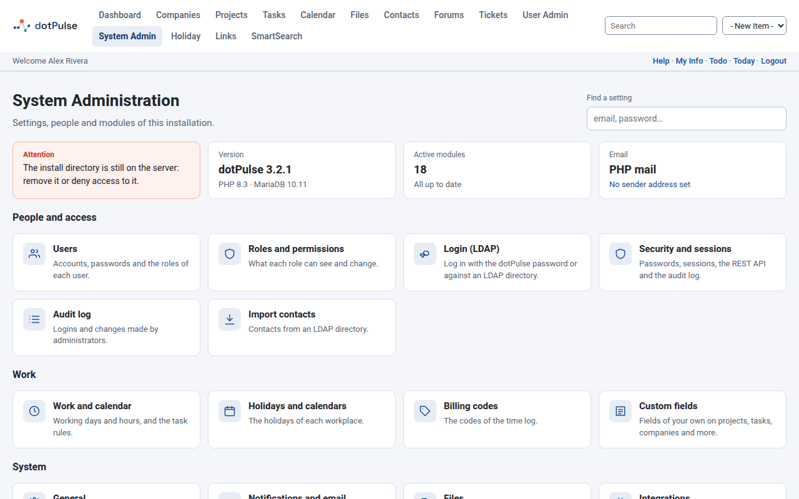
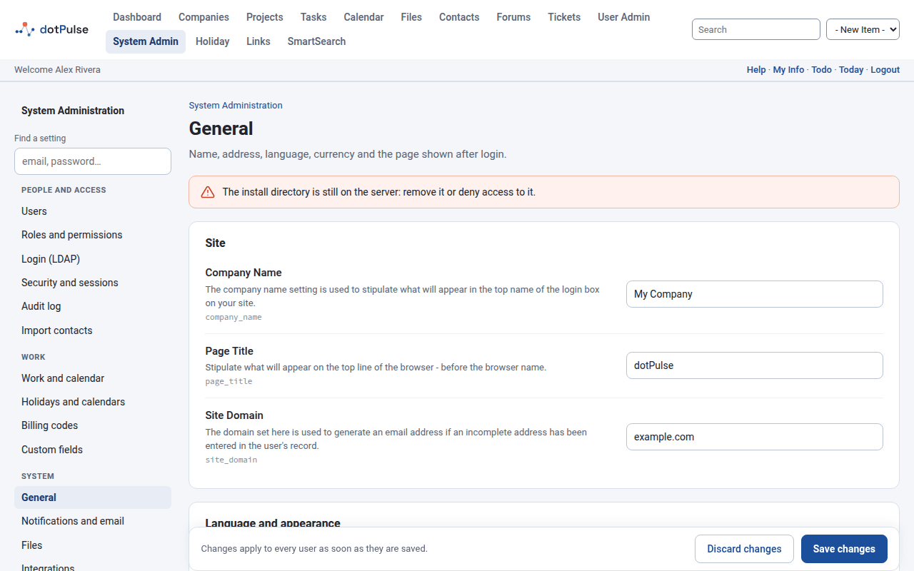
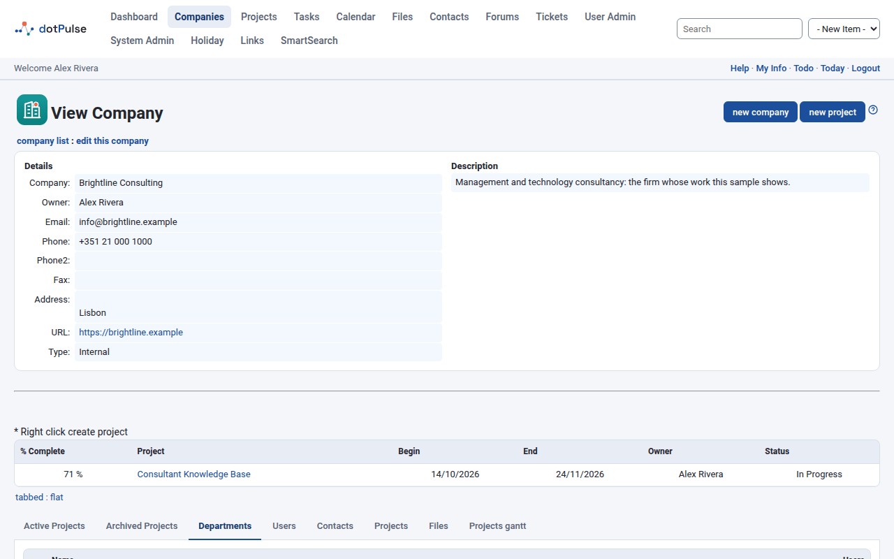
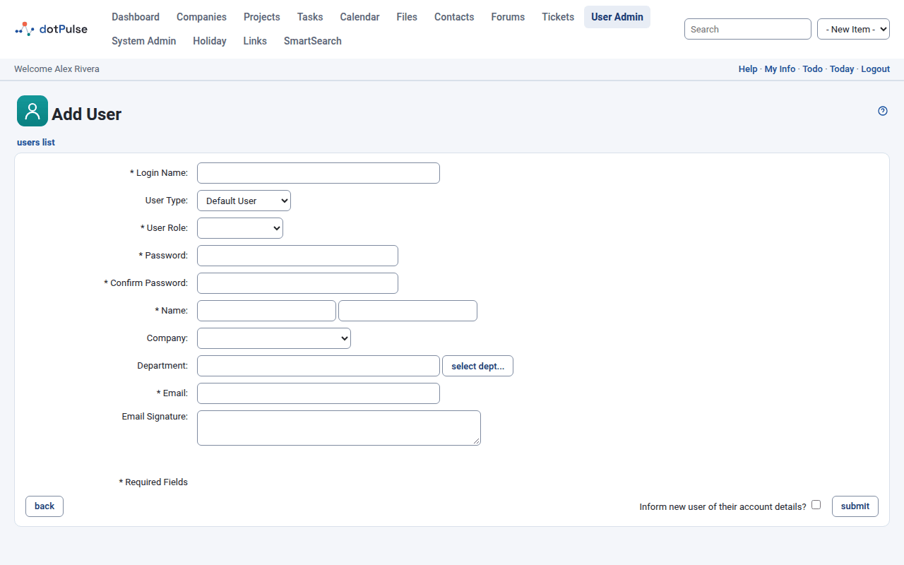
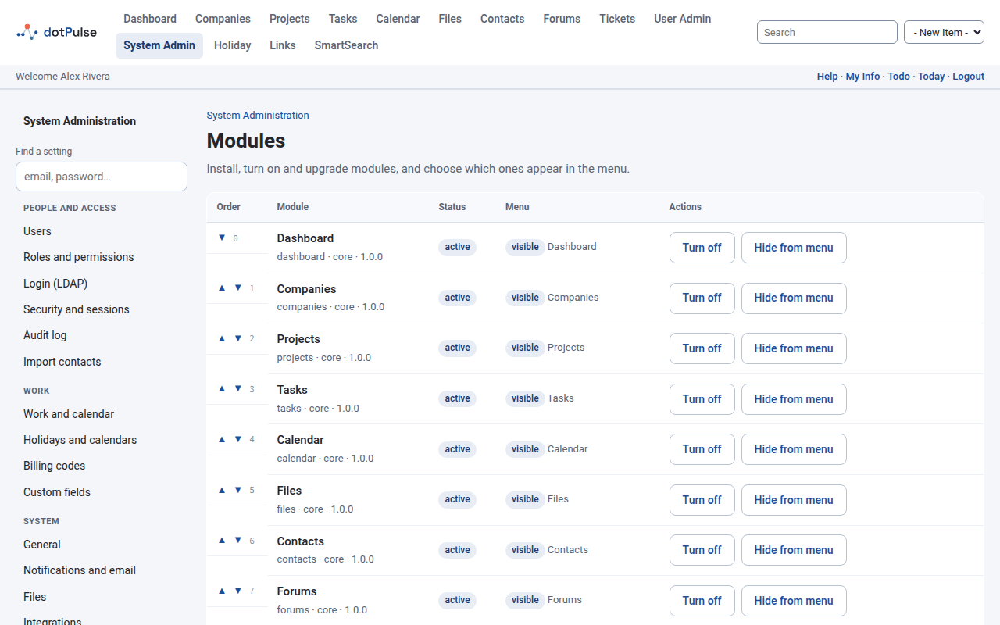
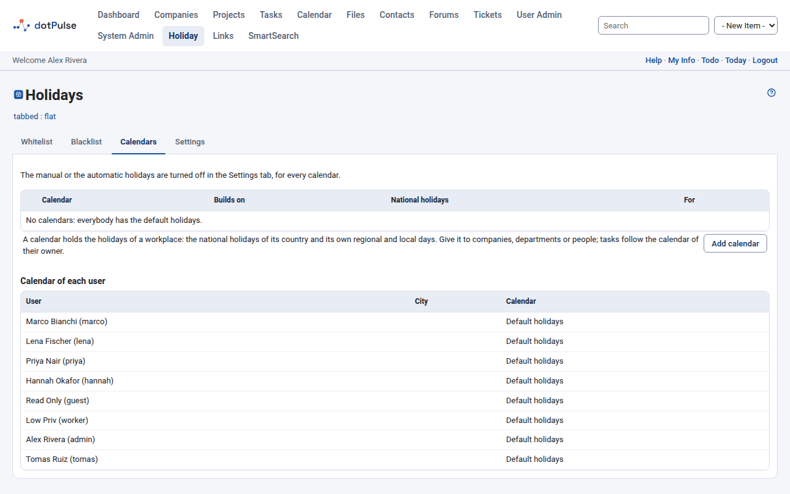
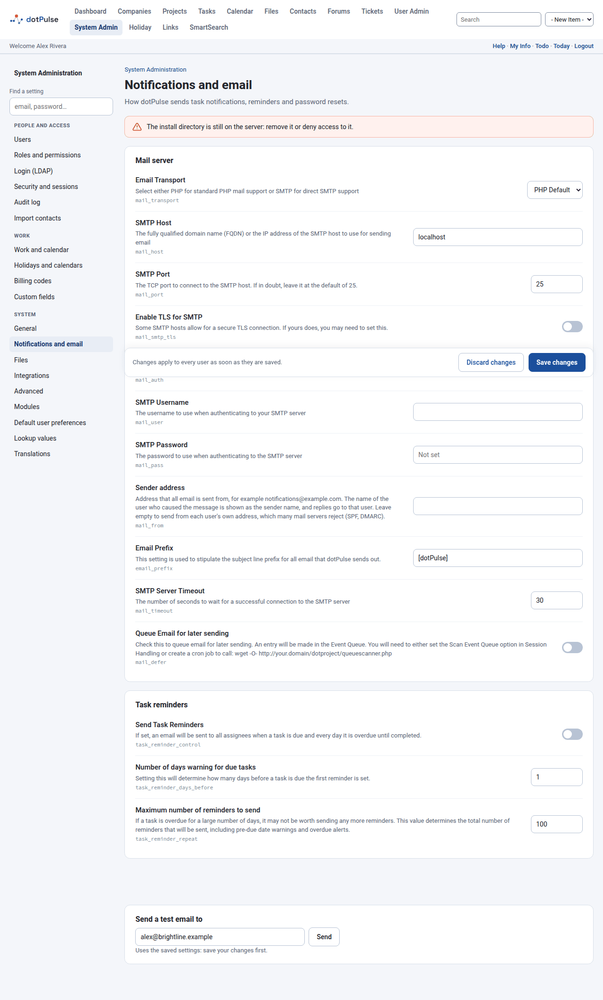

# First steps

Your site is installed and you have logged in as `admin`. Work through this checklist before you invite your team. It takes about half an hour.

- [Change the admin password](#before-anything-else)
- [Review the system settings](#1-review-the-system-settings)
- [Create your companies and departments](#2-create-your-companies-and-departments)
- [Check the roles](#3-check-the-roles)
- [Add your users](#4-add-your-users)
- [Choose your modules](#5-choose-your-modules)
- [Set up holiday calendars](#6-set-up-holiday-calendars)
- [Set up email](#7-set-up-email)
- [Create your first project](#8-create-your-first-project)

## Before anything else

If you haven't yet, change the initial password: click **My Info** at the top of the page, then **change password**. See [Installing](install.md#6-log-in-for-the-first-time).

## The System Admin page

Most of the settings live under **System Admin**, in the main menu. Its start page shows the state of your installation:

- **Attention**, if the `install/` directory is still on the server;
- **Version**: the dotPulse, PHP and database versions;
- **Active modules**, and whether any module has an upgrade to install;
- **Email**: how mail is sent, and the sender address.

Below that, cards lead to every admin page, in three groups: **People and access**, **Work** and **System**.

{ .shot }

Each settings page shows the help for each setting next to it. Click **Save changes** at the bottom when you are done. Changes apply to every user as soon as you save them.

!!! tip
    Looking for one setting? Type a word in **Find a setting** at the top of System Admin, for example *email* or *password*.

## 1. Review the system settings

Open **System Admin › General**:

- **Company Name**: your organisation's name. It is *My Company* until you change it.
- **Page Title**: the title in the browser tab. Default: *dotPulse*.
- **Site Domain**: your site's domain. Default: *example.com*.
- **Host Locale**: the language of the site.
- **Default User Interface Style**: the theme. New installations use *dotPulse*.
- **Currency Symbol**: default *$*.
- **Default Module**: the page users see after login. Default: the dashboard.

{ .shot }

Then open **System Admin › Work and calendar**. Task dates and durations are calculated with these settings:

- **Calendar Working Days**: Monday to Friday by default.
- **Calendar Start Hour** and **Calendar End Hour**: 8 and 17 by default.
- **Daily Working Hours**: 8 by default.

Finally, look at **System Admin › Security and sessions**. **Minimum Password Length** is 4 by default; raise it.

### Default user preferences

**System Admin › Default user preferences** sets the language, date and time formats, currency format and theme of new users. Each user can change their own later; see [Your account and preferences](../user-guide/preferences.md).

## 2. Create your companies and departments

In dotPulse, every project belongs to a company. Users and contacts belong to companies too. Create your own organisation first, then your clients and suppliers.

1. Click **Companies** in the main menu, then **new company**.
2. Fill in the company's details and save.
3. On the company's page, open the **Departments** tab and click **new department** for each department you need.

More in [Companies, departments and contacts](../user-guide/companies-contacts.md).

{ .shot }

## 3. Check the roles

A role decides what its users can see and change. Open **System Admin › Roles and permissions**. A new installation has four roles:

- **Administrator**: every permission on every module, System Admin and User Admin included.
- **Project worker**: every permission on the other modules. This is the role for most of your team.
- **Guest**: can open and view the other modules, but not change anything.
- **Anonymous**: can open the other modules only.

Adjust the permissions of a role, or add roles of your own, before you add users. Every user must have a role to log in.

## 4. Add your users

1. Click **User Admin** in the main menu (or **System Admin › Users**), then **add user**.
2. Fill in the form:
    - **Login Name**, **Password** and **Confirm Password**;
    - **User Role**: the role you chose for them;
    - **Name** and **Email**;
    - **Company** and **Department**.
3. Tick **Inform new user of their account details?** to send them an email with the site's address and their username. The email doesn't contain the password: it asks them to set one with the forgotten-password link on the login page. Set up email first ([step 7](#7-set-up-email)) if you want to use this.
4. Click **submit**.

{ .shot }

On a user's page, the **Roles** tab shows and changes their roles.

!!! tip "Two-step login"
    Ask your administrators to turn on two-step login: **My Info**, then the **Two-step login** tab. If someone loses their phone, an administrator can reset it from the same tab on their user page.

## 5. Choose your modules

dotPulse comes with many modules. A new installation has the core ones (companies, projects, tasks, calendar, files, contacts, forums and the rest). Add-on modules, such as risks, timesheets or the holiday calendars, are in the code but not installed yet.

Open **System Admin › Modules**:

- Modules under **Not installed** are listed by folder name, with an **install** button. Installing a module creates its tables.
- **Turn on** and **Turn off** make an installed module available or not.
- **Show in menu** and **Hide from menu** decide whether it has an entry in the main menu.
- The arrows in the **Order** column move a module up or down in the menu.
- **remove** deletes a module and **all its data**.

{ .shot }

A new module joins the admin or the non-admin modules, so the roles above get the same rights on it.

## 6. Set up holiday calendars

Holidays are not working days: task dates skip them. Each workplace can have its own calendar.

1. In **System Admin › Modules**, install `holiday` under **Not installed**. If it then shows *disabled*, click **Turn on**.
2. Open **System Admin › Holidays and calendars**.
3. In the **Settings** tab, choose the country whose national holidays apply to everyone without a calendar.
4. If people work in different places, open the **Calendars** tab and click **Add calendar**. Give the calendar a **Name**, its **National holidays**, and say who it is **For**: companies, departments or users. A calendar can also build on another one, a city on its region for example, and import the days of an iCalendar (`.ics`) file.

{ .shot }

Each person follows their own calendar, else their department's, else their company's, else the default holidays. Task dates follow the calendar of the task owner.

## 7. Set up email

dotPulse sends mail for password resets, task assignments, notifications and reminders. Open **System Admin › Notifications and email**:

- **Email Transport**: **PHP Default** uses PHP's own mail setup; **SMTP** sends through your mail server.
- With SMTP, fill in **SMTP Host** and **SMTP Port**, tick **Enable TLS for SMTP** (port 587 uses STARTTLS, port 465 uses SMTPS), and tick **Host requires login** with the **SMTP Username** and **SMTP Password** if your server needs them.
- **Sender address**: the address every message is sent from, for example `notifications@example.com`. Use a domain whose SPF and DKIM records allow your mail server. If you leave it empty, mail goes out from each user's own address and is often rejected as spam.
- **Email Prefix**: the start of every subject line. Default: *[dotPulse]*.
- **Send Task Reminders**, in **Task reminders**, mails reminders about tasks that are due.

Click **Save changes**. Then enter your address in **Send a test email to** at the bottom of the page and click **Send**. If it fails, the page shows the mail server's error.

{ .shot }

!!! warning "The cron job"
    Task notifications, assignment mails and reminders are only sent when the cron job runs `queuescanner.php`. See [Installing](install.md#set-up-the-cron-job).

## 8. Create your first project

1. Click **Projects** in the main menu, then **new project**.
2. Give it a name, choose its **Company**, set its dates and owner, and save.
3. Add its tasks and assign them to your users.

The [Projects](../user-guide/projects.md) and [Tasks](../user-guide/tasks.md) pages of the User guide explain every field.

Your site is ready. Point your team to the [User guide](../user-guide/index.md).
