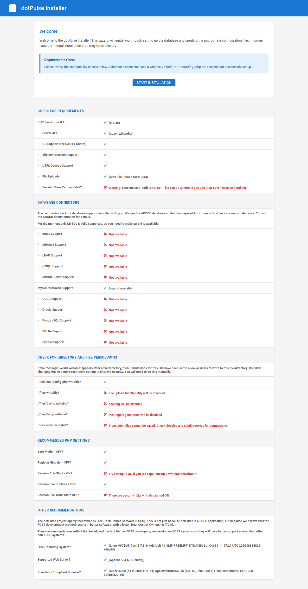
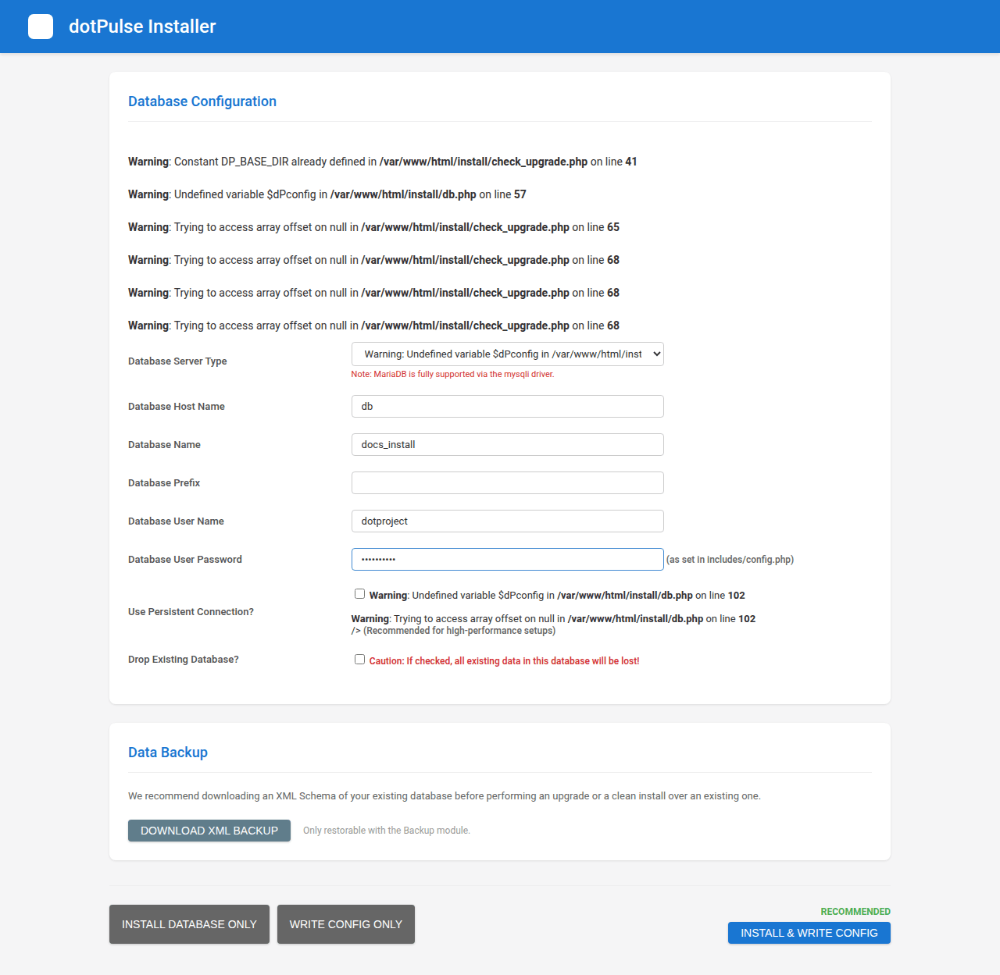
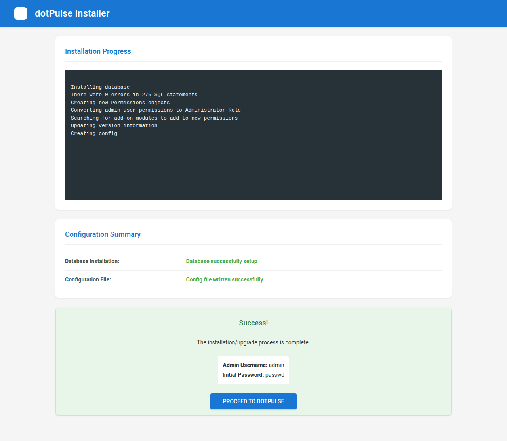
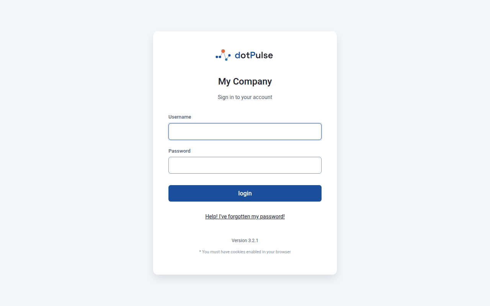

# Installing dotPulse

A web installer sets up the database and writes the configuration file for you. It takes three pages. Before you start, check the [requirements](requirements.md).

## 1. Get the code

Download the source code of the latest release from the [GitHub releases page](https://github.com/davmont/dotPulse/releases) and unpack it. Or clone the repository: the `master` branch holds the stable releases.

```sh
git clone --branch master https://github.com/davmont/dotPulse.git dotpulse
```

Put the files in your web server's document root, or in a subdirectory of it, for example `/var/www/html/dotpulse`.

!!! note
    A release archive leaves out the development files (`tools/`, `tests/`, `docker/`, the `Makefile`). A clone has them. The server doesn't need them, and the `.htaccess` rules refuse requests for them.

## 2. Prepare the database

Create a MySQL or MariaDB user for dotPulse. You have two options:

- Give the user the right to create databases. The installer then creates the database itself.
- Create an empty database yourself and give the user full rights on it.

For example, in the MySQL or MariaDB client:

```sql
CREATE DATABASE dotpulse CHARACTER SET utf8mb4 COLLATE utf8mb4_general_ci;
CREATE USER 'dotpulse'@'localhost' IDENTIFIED BY 'choose-a-strong-password';
GRANT ALL PRIVILEGES ON dotpulse.* TO 'dotpulse'@'localhost';
```

## 3. Let the web server write where it must

The web server user (often `www-data` or `apache`) must be able to write to `includes/`, `files/` and `files/temp/`. For example:

```sh
cd /var/www/html/dotpulse
chown www-data includes files files/temp
```

If the installer can't write `includes/config.php`, it still works: at the end it shows you the content of the file to create by hand.

## 4. Run the installer

Open the `install/` folder of your site in a browser, for example `https://pm.example.com/install/`.

### Page 1: Welcome and requirements

The first page shows a **Check for Requirements** table. Each line has a green tick or a red cross:

- the PHP version, the extensions and the database connectors (only **MySQL/MariaDB Support** matters);
- **Check for Directory and File Permissions**: whether `includes/config.php`, `files/`, `files/cache/`, `files/temp/` and `locales/en/` are writable;
- **Recommended PHP Settings** and **Other Recommendations**.

{ .shot }

A red cross is a warning, not a stop. Fix what you need and reload the page.

!!! tip "World Writable"
    If a folder shows *World Writable*, every user on the server can write to it. Restrict its permissions to the web server user once the installation works.

Click **Start Installation**.

### Page 2: Database Configuration

Fill in the database settings:

| Field | What to enter |
| --- | --- |
| **Database Server Type** | MySQL or MariaDB, the only database dotPulse supports. |
| **Database Host Name** | The database server, often `localhost`. |
| **Database Name** | The database you created, or the one the installer should create. |
| **Database Prefix** | A prefix for every table name. The form suggests `dotp_`. Keep it unless you have a reason to change it. |
| **Database User Name** | The dotPulse database user. |
| **Database User Password** | That user's password. |
| **Use Persistent Connection?** | Leave it unticked unless you run a high-traffic site. |
| **Drop Existing Database?** | Tick it only to wipe a database and start over. **All data in that database is lost.** |

{ .shot }

The **Data Backup** box offers **Download XML Backup**, which saves the structure and data of an existing database. You don't need it for a new installation.

At the bottom, choose what the installer does:

- **install & Write Config** (recommended): creates the tables and writes `includes/config.php`.
- **install Database Only**: creates the tables but leaves the configuration file alone.
- **Write Config Only**: writes `includes/config.php` and leaves the database alone.

Click **install & Write Config**.

### Page 3: Installation Progress

The installer creates the database (if needed), loads the tables and writes the configuration. The **Configuration Summary** tells you how it went:

- **Database Installation**: *Database successfully setup*, or the database error.
- **Configuration File**: *Config file written successfully*, or *Config file could not be written*.

If the file could not be written, the page shows its content in a text box. Create `includes/config.php` on the server and paste that content into it.

When everything worked, a **Success!** box shows the administrator's login:

- **Admin Username:** `admin`
- **Initial Password:** `passwd`

{ .shot }

## 5. Remove the installer

Delete the `install/` directory from the server, or deny access to it in your web server configuration:

```sh
rm -rf /var/www/html/dotpulse/install
```

Until you do, the System Admin pages show a warning: *The install directory is still on the server: remove it or deny access to it.*

## 6. Log in for the first time

Click **Proceed to dotPulse**, or open your site's address. Log in with the username `admin` and the password `passwd`.

{ .shot }

!!! warning "Change the password now"
    Everyone who knows dotPulse knows the initial password. Change it straight away: click **My Info** at the top of the page, then **change password**.

While you are on **My Info**, click **edit this user** and put your real email address in place of `admin@example.com`. You need it to reset your password.

## The configuration file

The installer writes `includes/config.php`. It holds only the database settings:

```php
$dPconfig['dbtype'] = 'mysqli';
$dPconfig['dbhost'] = 'localhost';
$dPconfig['dbname'] = 'dotpulse';
$dPconfig['dbprefix'] = 'dotp_';
$dPconfig['dbuser'] = 'dotpulse';
$dPconfig['dbpass'] = 'choose-a-strong-password';
$dPconfig['dbpersist'] = false;
$dPconfig['root_dir'] = DP_BASE_DIR;
$dPconfig['base_url'] = DP_BASE_URL;
```

Everything else is set in the application, under **System Admin**.

To configure by hand instead of letting the installer write the file, copy `includes/config-dist.php` to `includes/config.php` and edit the database settings. Then run the installer, enter the same settings, password included, and click **install Database Only** to create the tables. Once `includes/config.php` has database settings, the installer only accepts requests that carry exactly those settings.

Keep `includes/config.php` when you upgrade: it is not part of the code you download.

## Secure the installation

The [deployment security guide](https://github.com/davmont/dotPulse/blob/master/docs/deployment-security.md) has the details. In short:

- **Web server rules.** On Apache, make sure `AllowOverride` lets the `.htaccess` files work. On nginx, copy the `deny` rules from the guide into your `server` block. Then check that requests for internal files are refused: the guide has a small script that requests `includes/config.php`, `vendor/autoload.php`, `files/` and others, and each must answer 403 or 404, never 200.
- **HTTPS.** Serve the site over HTTPS only.
- **Remove `install/`** if you haven't yet.
- **Two-step login.** Turn it on at least for administrators: **My Info**, then the **Two-step login** tab. The server's clock must be right (use NTP), because codes are only accepted within 30 seconds of the current time.
- **Mail sender.** Set a sender address so that mail from dotPulse isn't rejected as spam. See [First steps](first-steps.md#7-set-up-email).
- **REST API.** It is off by default. Leave it off unless something uses it.
- **Audit log.** **System Admin › Audit log** lists logins, failed logins and administrators' changes. It keeps 365 days by default.
- **Behind a reverse proxy**, configure Apache's `mod_remoteip` or nginx's `real_ip`, so the audit log records your users' addresses and not the proxy's.

## Set up the cron job

dotPulse queues task notifications, assignment mails and reminders. A script, `queuescanner.php`, sends them. Run it from cron every few minutes, as the web server user, with your site's public address:

```cron
# /etc/cron.d/dotpulse
*/5 * * * * www-data php /var/www/html/dotpulse/queuescanner.php --base-url=https://pm.example.com
```

- The script runs from the command line only. Over HTTP it answers 404.
- `--base-url` is required, so that the links in the mails work. Without it the script stops with exit status 2.
- If two runs overlap, the second one is skipped.

Without this job, those mails are never sent.

## Next

Your site is running. Go to [First steps](first-steps.md) to set it up for your team.
