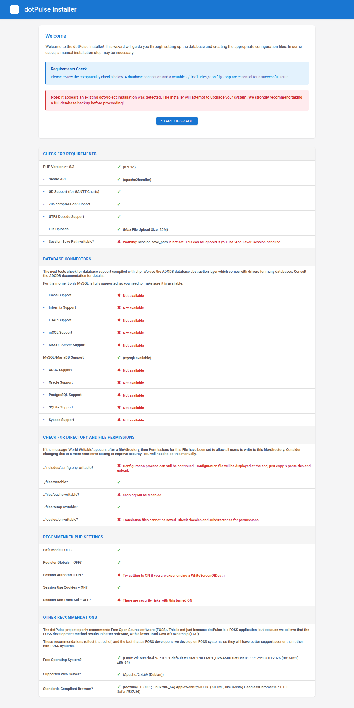
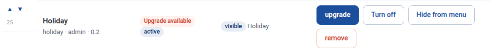

# Upgrading

dotPulse upgrades its database in place. The same steps work for a new dotPulse version and for a dotProject 2.x site: back up, replace the code, run the installer, then upgrade the add-on modules.

## Before you start

- **Read the release notes** of every version between yours and the new one. They are on the [GitHub releases page](https://github.com/davmont/dotPulse/releases). Each has a *Changes to know about* or *Breaking changes* section and an *Upgrading* checklist.
- **Check the PHP version.** dotPulse 3.2.0 and later need PHP 8.2 or later.
- **Plan a short downtime.** Users should not work while the database is upgraded.

## 1. Back up

Back up:

- the **database**, with your usual tool (for example `mysqldump`);
- the **`files/` directory**, which holds the uploaded files;
- **`includes/config.php`**;
- **`locales/` and `modules/*/locales/`**, if you edited translations in **System Admin › Translations**. New versions replace these files, so you will need to merge your entries back in.

!!! tip "Rehearse on a copy"
    If you work from a clone of the repository and have Docker, `make rehearse DUMP=/path/to/dump.sql.gz ADMIN=<admin user>` upgrades a copy of your database in a sandbox, then crawls every page. See `docker/README.md` in the repository.

## 2. Replace the code

Put the new code in place of the old one. **Keep `includes/config.php` and `files/`.** Replace `vendor/` too.

Delete the old tree rather than copying the new files over it. Files that a version removes would otherwise stay behind.

## 3. Run the installer

Open the `install/` folder of your site in a browser, for example `https://pm.example.com/install/`.

1. The installer finds your configuration and your database, and shows a note that an existing installation was detected. Click **Start Upgrade**.

    { .shot }

2. The database fields are empty. Enter the settings from your `includes/config.php`: host, name, prefix, user and password. The installer refuses to continue unless they match the file exactly.
3. Click one of the buttons at the bottom:
    - **upgrade Database Only** upgrades the database and leaves `includes/config.php` untouched;
    - **upgrade & Write Config** also rewrites `includes/config.php`. The new file has only the database settings, so any line you added by hand is lost.
4. The progress page shows *Applying database updates* and the steps that follow. **Success!** means the database is up to date.

Then **remove the `install/` directory** again, or deny access to it.

!!! note
    Some releases have no database changes. Run the installer anyway: it records the new version.

## 4. Upgrade the modules

Add-on modules have their own versions and their own database tables. The installer does not upgrade them.

1. Log in as an administrator and open **System Admin**. If a module needs an upgrade, the start page says so under **Active modules** (for example *2 upgrades to install*).
2. Open **System Admin › Modules**. Each module with a newer version shows an **Upgrade available** badge.
3. Click **upgrade** next to each of them and confirm.

{ .shot }

The release notes list which modules change in each version, and anything to do afterwards. For example, after the holiday module upgrade in 3.1.1 you choose a country in its *Settings* tab.

## 5. Check the site

- Log in, open a few projects and tasks, and look at **System Admin**: the start page shows the version you now run.
- If you use mail, send a test message from **System Admin › Notifications and email**.

## Upgrading from dotProject 2.x

dotPulse upgrades a dotProject 2.x database in place, with the steps above. Keep your dotProject `includes/config.php`: the installer reads it to find your database.

Version 3.0.0 is where dotPulse broke with dotProject. Read [its release notes](https://github.com/davmont/dotPulse/blob/master/docs/release-notes/v3.0.0.md) before you start. What changes for you:

- **The name.** Page titles and the mail subject prefix change to dotPulse, unless you had customised them. Internal names stay: tables, `$dPconfig` and the module API work as before.
- **Third-party modules.** dotPulse blocks inline JavaScript with a Content-Security-Policy. Add-on modules that are not part of dotPulse and use inline scripts stop working until they are adapted. Test them with the browser console open; violations are also logged to `files/temp/csp-reports.log`.
- **Links that changed data.** Actions that changed data through a plain link now need a form post. Bookmarks or scripts that called such links stop working.
- **The cron job.** `queuescanner.php` now runs from the command line only, with `--base-url`. Change your cron job as shown in [Installing](install.md#set-up-the-cron-job).
- **Password reset** now emails a single-use link valid for one hour, instead of a new password.
- **PostNuke login** is gone (since 3.2.0). Users who logged in through PostNuke set a dotPulse password with the forgotten-password link on the login page.
- **Mantis.** The Mantis module now uses the MantisBT REST API. Each user enters their MantisBT API token once.

After the upgrade, also:

1. **Upgrade the modules** in **System Admin › Modules**, as in step 4. Coming from dotProject, several bundled modules have upgrades.
2. **Set up mail:** set the **Sender address** and send a test email from **System Admin › Notifications and email**.
3. **Apply the web server rules** from the [deployment security guide](https://github.com/davmont/dotPulse/blob/master/docs/deployment-security.md). This matters most on nginx, which ignores the `.htaccess` files.

Passwords stored by dotProject keep working. dotPulse converts each one to a stronger hash the next time its user logs in.
