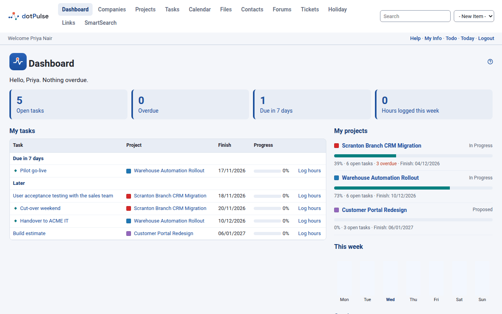

# dotPulse

dotPulse is open-source, web-based project management. You run it on your own server, and your team uses it in the browser to plan projects, share out tasks, log their work and follow progress.

dotPulse continues [dotProject](https://github.com/dotproject/dotProject). Upstream development stopped after dotProject 2.2.0 in March 2020; dotPulse carries the same code base forward on PHP 8. Existing dotProject 2.x installations upgrade in place, with their data.

{ .shot }

## Who it is for

- **Teams and small organisations** that want a self-hosted project tool, with their data on their own server.
- **Project managers** who plan with tasks, dependencies, Gantt charts and budgets, and follow PMBOK practice.
- **Administrators** of an existing dotProject site who need it to run on a current PHP version.

## What you get

- **Projects and tasks**: companies, departments and contacts; projects with their tasks, assignees, dates and dependencies.
- **Your dashboard**: the page you land on after login, with your open tasks by due date, your projects and the hours you logged this week.
- **Gantt chart and board**: the plan on a timeline, and a board with *To do*, *In progress* and *Done* columns.
- **Time and costs**: task logs, timesheets, costs and earned value warnings.
- **Calendar, files and forums** to share events, documents and discussions around a project.
- **Holiday calendars** per workplace, so task dates skip each person's public holidays.
- **Security**: two-step login, an audit log of logins and administrators' changes, and a code base that has been through a full security audit.
- **REST API** (off by default) for scripts and other tools.
- **25 languages**, a light and a dark theme, and a layout for phones.

## Where to start

- **[Getting started](getting-started/index.md)**: what your server needs, how to install or upgrade, and what to set up first.
- **[User guide](user-guide/index.md)**: how to work with projects, tasks, the calendar and the rest, day to day.

## Links

- Source code and issues: [github.com/davmont/dotPulse](https://github.com/davmont/dotPulse)
- Release notes for each version: [GitHub releases](https://github.com/davmont/dotPulse/releases)

dotPulse is free software under the GNU General Public License, like dotProject before it.
This documentation is under [CC BY-SA 4.0](https://creativecommons.org/licenses/by-sa/4.0/);
its code examples are under the GPL, like the code.
