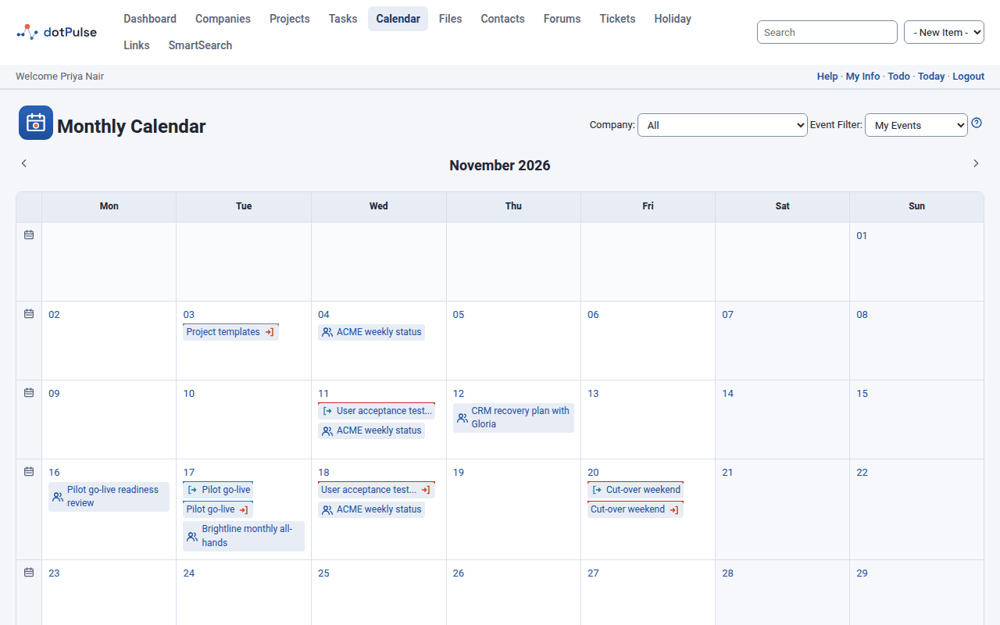
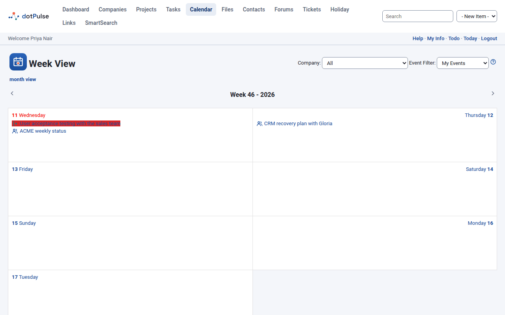
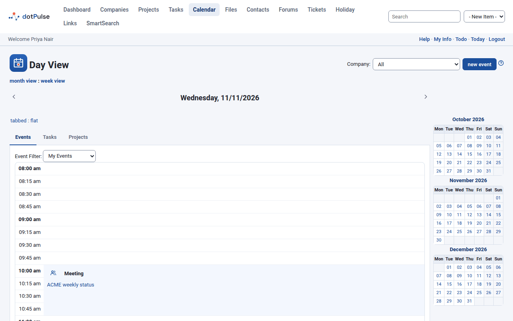
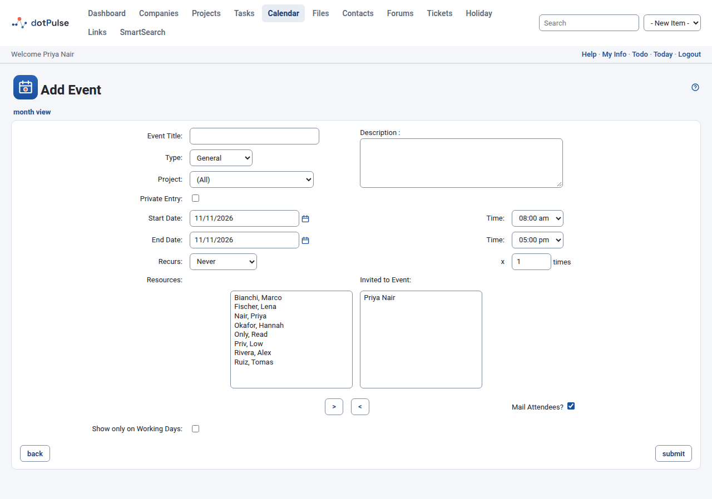

# Calendar

The calendar shows your events (meetings, appointments, reminders) together with
the tasks you are working on. Open **Calendar** in the modules menu.

## Month view

The calendar opens on the current month, in the **Monthly Calendar** view.

{ .shot }

- Use the arrows on each side of the month name to go to the previous or next
  month.
- Today is highlighted, and weekends are shaded.
- Click a day's number to open that day in the [day view](#day-view).
- Click the week icon at the start of a row to open that week in the
  [week view](#week-view).
- Below the calendar, small calendars show the previous and next months. Click a
  day in them to open it, or the month name to open that month.

Each day lists:

- **Your tasks**, in the colour of their project. A task appears from its start
  date to its finish date, with a start mark on the first day and a finish mark
  on the last.
- **Events**, each with an icon for its type.
- **Birthdays** of contacts, with a cake icon and the age they turn.

Hover over an item to see more about it, and click it to open it.

## Week view

The **Week View** shows the seven days of one week in two columns, with the
same tasks, events and birthdays as the month view. Today's date is in red.

{ .shot }

- Use the arrows to go to the previous or next week.
- Click a day's name to open it in the day view.
- Click **today** at the bottom to come back to the current week.
- Click **month view** below the title to go back to the month.

## Day view

The **Day View** shows one day in detail. Open it by clicking a day, or click
**Today** in the bar under the modules menu.

{ .shot }

- Use the arrows to go to the previous or next day.
- Click **month view** or **week view** below the title to zoom out.
- Click **new event** to add an event on this day.

The day has two tabs:

- **Events**: the day's events, laid out on a timetable by the hour. Events that
  overlap sit side by side. Birthdays are listed above the timetable.
- **Tasks**: your tasks to do.

Depending on your administrator's settings, small calendars of the surrounding
months appear beside the tabs.

## Filter the calendar

The month and week views have two filters at the top. The day view has
**Company** at the top and **Event Filter** on its **Events** tab.

- **Company**: show only the events and tasks of one company's projects, or
  **All**.
- **Event Filter**: which events to show:
    - **My Events**: events you are invited to.
    - **Events I Created**: events you created.
    - **All Events**: every event you may see.

The filter you choose stays in place until you log out. The one the calendar
starts with is your **Default Event Filter** preference. See
[Your account and preferences](preferences.md#default-event-filter).

Private events of other people never show, whatever the filter.

!!! note "Administrators"
    Administrators also get **Show Events for** on the day view, to see the
    events of another user.

## Add an event

1. Click **new event** in the day view, or choose **Event** in the
   **- New Item -** list of the top bar.
2. Fill in the form (see below).
3. Choose who to invite (see [Invite people](#invite-people)).
4. Click **submit**.

{ .shot }

The event form has these fields:

| Field | What it is for |
|---|---|
| **Event Title** | The name shown in the calendar. Required. |
| **Description** | Details of the event. |
| **Type** | **General**, **Appointment**, **Meeting**, **All Day Event**, **Anniversary** or **Reminder**. The type sets the event's icon. |
| **Project** | The project the event belongs to, or **(All)** for none. A project's events also appear on the project's **Events** tab. |
| **Private Entry** | Tick it to keep the event to yourself. Nobody else sees it, even if they are invited. |
| **Start Date**, **End Date** and their **Time** | When the event starts and ends. Click the calendar icon to pick a date: you can't type it. If you pick a start date after the end date, the end date moves with it. |
| **Recurs** and **x ... times** | Whether the event repeats, and how many times in total. See [Repeat an event](#repeat-an-event). |
| **Show only on Working Days** | Tick it for an event that spans several days but only happens on working days. The calendar then leaves it out of the days that are not working days in dotPulse's settings, usually weekends. |

Your administrator may add more fields of their own at the bottom of the form.

### Invite people

Under **Resources** is the list of people you can invite. Under
**Invited to Event** are the people invited. When you create an event, you are
invited to it.

- To invite someone, select them under **Resources** and click **>**.
- To remove someone, select them under **Invited to Event** and click **<**.

Leave **Mail Attendees?** ticked to email the invitation to the people invited.

### When someone is busy

If anyone you invited already has an event at that time, dotPulse lists them
under "The following users have clashes with the proposed event time" and offers
four choices:

- **Suggest Alternative**: dotPulse looks for the first free time slot for
  everyone. Enter the **Earliest Date**, **Latest Date**, **Earliest Start Time**,
  **Latest Finish Time** and the **Duration** in minutes, then click **submit**.
  dotPulse opens the event form with the first slot it finds, which you can
  still change. It only looks at working days.
- **Cancel**: drop the event.
- **Mail Request**: don't save the event, but email the people invited about the
  proposed meeting so they can agree a time with you.
- **Book Event Despite Conflict**: save the event anyway.

### Repeat an event

Choose how often the event repeats under **Recurs**: **Hourly**, **Daily**,
**Weekly**, **Bi-Weekly**, **Monthly**, **Quarterly**, **Semi-Annually** or
**Annually**. Then type in the box after **x** how many times it happens in
total, for example 10 for ten weekly meetings. **Never** means the event happens
once.

## View, edit or delete an event

Click an event in the calendar, or in **Coming up** on your
[dashboard](dashboard.md), to open it. The **View Event** page shows its title,
type, project, start and end, how it repeats, who is invited (**Attendees**) and
the description.

- Click **edit this event** to change it, then **submit**.
- Click **delete event** and confirm to remove it.
- Click **month view** or **day view** to see it in the calendar.

## Tasks on the calendar

The calendar shows the tasks assigned to you, in projects that are not archived.
They come from the task's start and finish dates, so to move a task in the
calendar you change its dates on the task itself. See [Tasks](tasks.md).

## Holidays

If your administrator uses the holiday module, the calendar marks the holidays
of your workplace (your holiday calendar, see
[Set up holiday calendars](../getting-started/first-steps.md#6-set-up-holiday-calendars)):

- in the month and week views, a holiday is shaded and shows its name;
- in the small month calendars, it is shaded and shows its name when you point at it;
- in the day view, its name follows the date.

Holidays also count as non-working days in the rest of dotPulse: for example,
**Suggest Alternative** skips them when it looks for a free slot.
