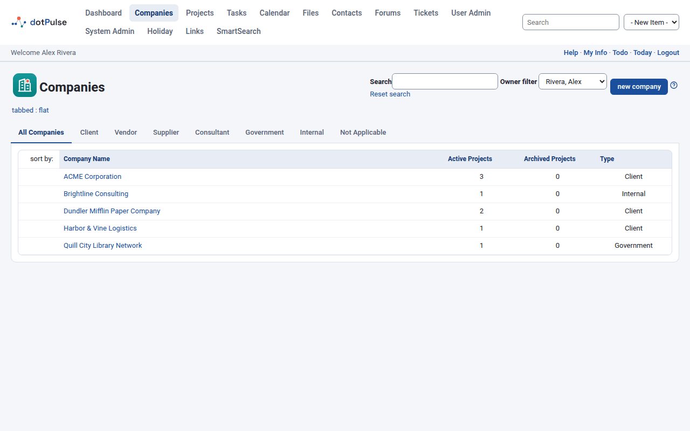
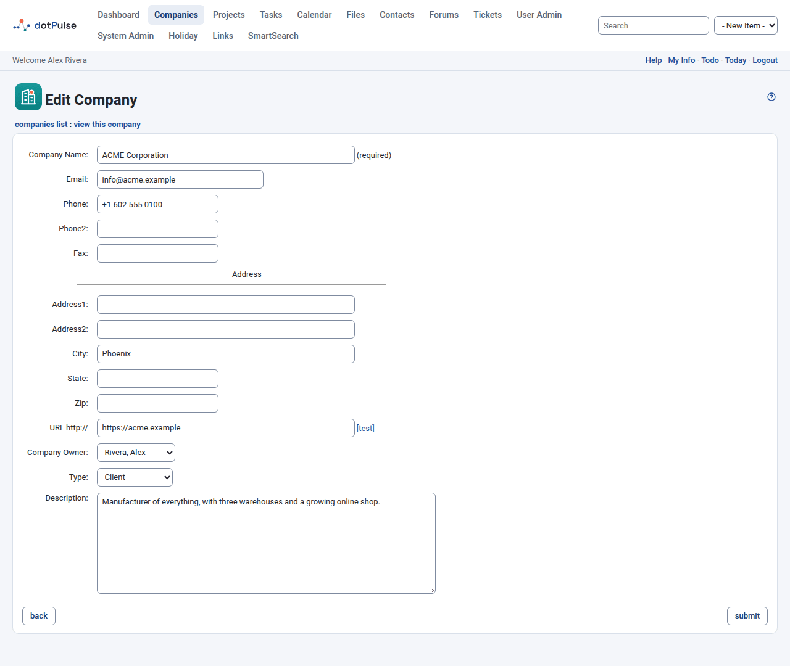
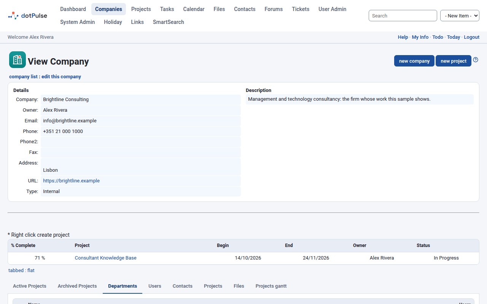
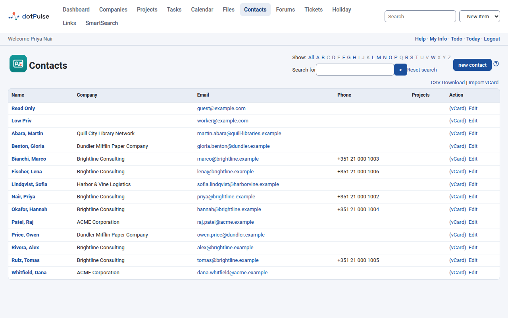
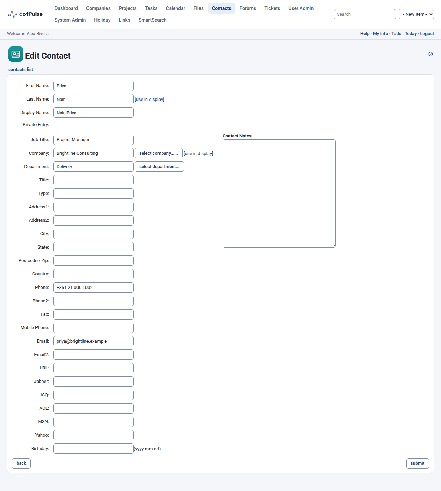

# Companies, departments and contacts

Projects are done for and by organisations and people. dotPulse keeps them in
three places:

- **Companies**: your own organisation, your clients, suppliers and so on.
- **Departments**: the units inside a company.
- **Contacts**: the people, inside or outside your organisation.

Every project belongs to a company, so companies usually come first.

## Companies

Open **Companies** in the modules menu.

{ .shot }

### Find a company

The list has one tab per company type. **All Companies** shows every company;
the other tabs show one type each: **Client**, **Vendor**, **Supplier**,
**Consultant**, **Government**, **Internal** and **Not Applicable**. Your
administrator can change this list of types.

For each company you see its **Company Name**, the number of
**Active Projects** and **Archived Projects**, and its **Type**. Click a
column heading to sort by it.

To narrow the list:

- Type part of a name into **Search** and press ++enter++. Click
  **Reset search** to show all companies again.
- Use **Owner filter** to show the companies owned by one person, or **All**.

!!! note "Missing companies?"
    The **Owner filter** starts on your own name, so at first you only see the
    companies you own. Choose **All** to see every company you may access.

### Add a company

1. Click **Companies › new company**, or choose **Company** in the
   **- New Item -** list of the top bar.
2. Fill in the form. Only **Company Name** is required.
3. Click **submit**.

{ .shot }

The form has these fields:

| Field | What it is for |
|---|---|
| **Company Name** | The name shown everywhere in dotPulse. Required. |
| **Email**, **Phone**, **Phone2**, **Fax** | How to reach the company. |
| **Address1**, **Address2**, **City**, **State**, **Zip** | The company's address. |
| **URL** | The company's website, without `http://`. Click **[test]** to open it in a new window and check it. |
| **Company Owner** | The person in your organisation responsible for this company. |
| **Type** | Client, supplier and so on. It decides which tab of the list the company appears in. |
| **Description** | Free notes about the company. |

### View a company

Click a company's name to open its page, **View Company**. The top shows its
details and description. Below are tabs:

- **Active Projects** and **Archived Projects**: the company's projects.
- **Departments**: the company's departments.
- **Users**: the dotPulse users who work for the company.
- **Contacts**: the company's contacts.

Other modules may add more tabs, for example for files or Gantt charts.

From the company page you can also click **new project** to start a project for
this company. See [Projects](projects.md).

### Edit or delete a company

On the company's page, click **edit this company**, change the form and click
**submit**.

To delete a company, click **delete company** on the company's page and confirm.
dotPulse only lets you delete a company that has no projects, departments or
users. If it still has some, hover over the delete link to see what is in the
way.

## Departments

Departments split a company into units, such as Sales or Engineering. They can
be nested: a department can have a parent department.

### Add a department

1. Open the company's page and go to the **Departments** tab.
2. Click **new department**.
3. Fill in the form and click **submit**.

{ .shot }

The form has the **Department Company**, a **Department Name** (required),
**Phone**, **Fax**, address fields, **URL**, **Department Parent**, **Owner**
and **Description**.

### View, edit or delete a department

On the company's **Departments** tab, click a department's name to open it. Its
page shows the department's details and a **Contacts** tab with the people in
it. Use **edit this department** and **delete department** on that page to
change or remove it.

## Contacts

Open **Contacts** in the modules menu.

{ .shot }

The list shows each contact's **Name**, **Company**, **Email** and **Phone**.
When a contact is linked to projects, the **Projects** column has a link that
opens a small window with those projects; click one to open it. The **Action**
column has **(vCard)**, to download the contact as a vCard, and **Edit**.

### Find a contact

- Click a letter after **Show:** to list the contacts whose name starts with it.
  Letters in grey have no contacts. Click **All** to show everyone again.
- Type a word into **Search for** and click **>**. dotPulse looks in the first
  and last names, the company, the email address and the notes. Click
  **Reset search** to clear it.

### Add a contact

1. Click **Contacts › new contact**, or choose **Contact** in the
   **- New Item -** list of the top bar.
2. Fill in the form.
3. Click **submit**.

{ .shot }

The main fields are:

| Field | What it is for |
|---|---|
| **First Name**, **Last Name** | The contact's name. The last name is required. |
| **Display Name** | How the contact is listed and sorted, for example "Smith, Anna". Click **[use in display]** next to the last name or the company to fill it in from them. Required. |
| **Private Entry** | Tick it to keep the contact to yourself. See below. |
| **Job Title**, **Title**, **Type** | The contact's role, a title such as Dr. or Ms., and a free category of your own. |
| **Company** | Click **select company...** to pick the contact's company. |
| **Department** | Click **select department...** to pick one of the company's departments. Choose the company first. |
| Address fields | **Address1**, **Address2**, **City**, **State**, **Postcode / Zip** and **Country**. |
| Phones and email | **Phone**, **Phone2**, **Fax**, **Mobile Phone**, **Email**, **Email2**. |
| **URL** | The contact's website. |
| Messaging | Jabber, ICQ, AOL, MSN and Yahoo accounts. |
| **Birthday** | Written as yyyy-mm-dd. Birthdays show in the [calendar](calendar.md). |
| **Contact Notes** | Free notes. |

### Keep a contact private

Tick **Private Entry** to make a contact yours alone. Other users don't see it in
the contacts list and can't open, edit or download it.

### Edit or delete a contact

Click **Edit** next to the contact in the list, or open the contact and click
**edit**. Change the form and click **submit**.

To delete a contact, open it and click **delete contact**, then confirm. You
can't delete the contact of a dotPulse user (see below).

### Start a project from a contact

On a contact's page, click **new project**. dotPulse opens the project form with
the contact's company already chosen. See [Projects](projects.md).

### Export contacts

- **One contact as a vCard**: click **(vCard)** next to the contact in the list.
  Your browser downloads a `.vcf` file that address books and phones can import.
- **All contacts as a spreadsheet**: click **CSV Download** at the top right of
  the list. The file uses the column names of Outlook's contact export, so most
  address books can import it.

### Import contacts from vCards

1. Click **Import vCard** at the top right of the contacts list.
2. Next to **Fetch vCard(s) File**, choose a `.vcf` file. One file can hold many
   contacts.
3. Click **submit**.

dotPulse creates one contact for each card. If a card's organisation has exactly
the same name as a company in dotPulse, the contact is linked to that company.

!!! tip
    Importing always creates new contacts. Importing the same file twice gives
    you each contact twice.

## Contacts and users

Every dotPulse user has a contact record. It holds the user's name, email,
phone numbers and address, which is why users appear in the contacts list and
in their company's **Contacts** tab.

- Change a user's phone or address by editing their contact.
- You can't delete a user's contact: dotPulse says
  "This contact belongs to a user and cannot be deleted."
- Contacts of users who are no longer allowed to log in are left out of the
  contacts list.

## Users, roles and permissions

Users are the people who can log in. Each user belongs to a company and gets one
or more roles, and the roles decide what they can see and do.

Your administrator manages users, roles and permissions in **User Admin**. You
can see your own roles and permissions on the **Roles** and **Permissions** tabs
of your [account page](preferences.md).
