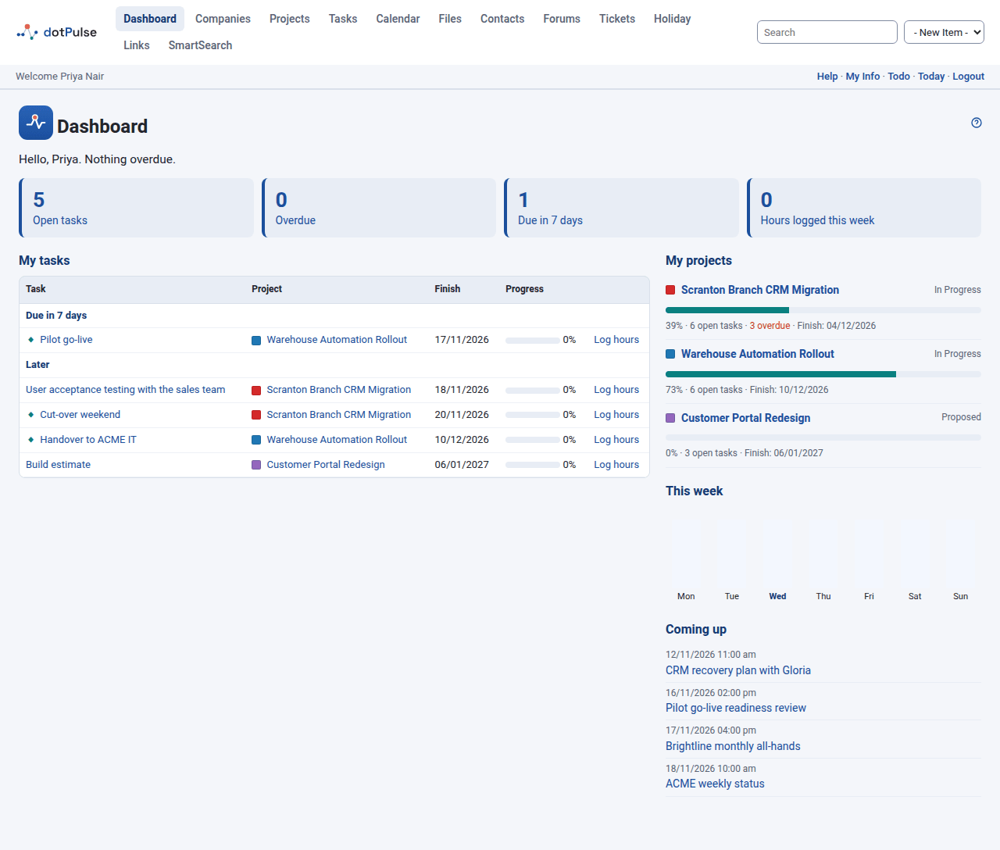
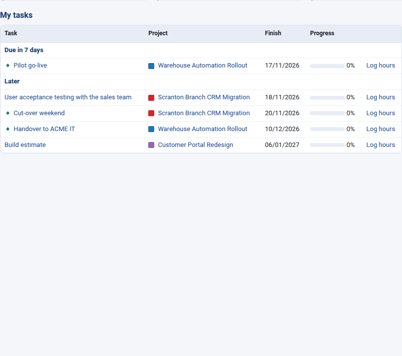
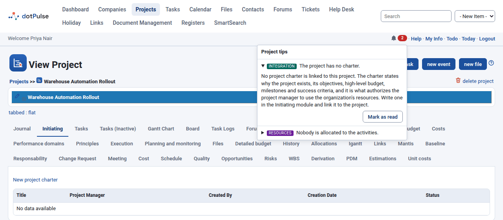

# Your dashboard

The dashboard is your personal start page. It shows what you have to do, how
your projects are going, how many hours you have logged this week and what is
coming up in your calendar. dotPulse opens it after you log in, and you can
always get back to it with **Dashboard** in the modules menu.

{ .shot }

Everything on the dashboard respects your permissions: you only see tasks,
projects and events you are allowed to see.

## The greeting

The line at the top greets you by your first name and sums up your day:

- how many of your tasks are overdue, or
- **Nothing overdue.** when you are on track, or
- **No open tasks assigned to you.** when you have nothing assigned.

## The four counters

Below the greeting, four boxes count:

| Counter | What it counts |
|---|---|
| **Open tasks** | Tasks assigned to you that are not finished. |
| **Overdue** | Your open tasks whose finish date has passed. The box is highlighted when there are any. |
| **Due in 7 days** | Your open tasks that finish within the next seven days. |
| **Hours logged this week** | The hours you have logged from Monday to Sunday of this week. |

Click a counter to jump to the matching part of the page.

## My tasks

**My tasks** lists your open tasks, soonest finish date first, in four groups:

- **Overdue**
- **Due in 7 days**
- **Later**
- **No finish date**

A task counts as open when it is assigned to you, is less than 100 % complete,
and belongs to a project that is not a template or archived. Task groups (tasks
that only add up their subtasks) are left out, because you log work on their
subtasks.

Each row shows:

- **Task**: the task name, linked to the task. A diamond marks a milestone and
  an exclamation mark a high-priority task.
- **Project**: the project, with its colour.
- **Finish**: the task's finish date.
- **Progress**: how complete the task is.
- **Log hours**: a shortcut to the task's **New Log** tab, where you record the
  time you spent. It only appears if you may log work on that task. See
  [Logging work](task-logs.md).

{ .shot }

## My projects

**My projects** lists the projects you own or have open tasks in, soonest
finish date first. Templates and archived projects are left out.

For each project you see its name and status, a progress bar, the number of open
tasks, the number of overdue tasks (if any) and the finish date. The finish date
is highlighted when it has passed and the project is not complete.

## This week

**This week** is a small bar chart of the hours you logged on each day from
Monday to Sunday. Today's bar is highlighted. Hover over a bar to see the date
and the exact hours.

## Coming up

**Coming up** lists your events from now to the end of the seventh day: the
events you are invited to and the events you created. Click an event to open it.
See [Calendar](calendar.md).

## Project tips

When you open a project, a bell may appear in the bar under the modules menu.
This is **Project tips**: dotPulse checks the project's plan against good
project management practice and lists what could be improved.

{ .shot }

The bell is part of the dotProject+ module. You only see it when that module is
active and you can view the project.

### What the tips check

The tips are grouped by area. Each area's checks only run when the modules they
need are active, so you may see only some of them.

| Area | Examples of what is checked |
|---|---|
| **Integration** | The project has no charter, the charter is not authorized, or the project ends after the date in its charter. |
| **Scope** | The WBS has very few or very many items, or work packages have no size, or a size in hours or days. |
| **Schedule** | Two activities depend on each other, a work package has a single activity, activities last more than two weeks or have very small or very large efforts, or the project is behind schedule. |
| **Cost** | There are risks but no contingency reserve, no management reserve, people without an hourly cost, or the work costs more than planned. |
| **Resources** | Nobody is allocated to the activities, or someone is allocated to activities that overlap. |
| **Risk** | A risk's response does not match its strategy, or low-priority risks have response plans. |

### Read a tip

1. Click the bell. A number on the bell shows how many tips you have not read
   yet.
2. Click a tip to open its explanation. The explanation says why it matters and
   what to do about it.

If the project is in good shape, the panel says **No tips for this project.**

### Mark a tip as read

Open the tip and click **Mark as read**. The tip moves to the bottom of the list
and no longer counts on the bell. To bring it back, open it and click
**Mark as unread**.

What you have read is kept for you and for that project only. Your colleagues
have their own read and unread tips, and the same tip on another project counts
again.

!!! note
    A tip disappears by itself once the project no longer has the problem. If
    you only have view access to the dotProject+ module, you can read the tips
    but not mark them.
