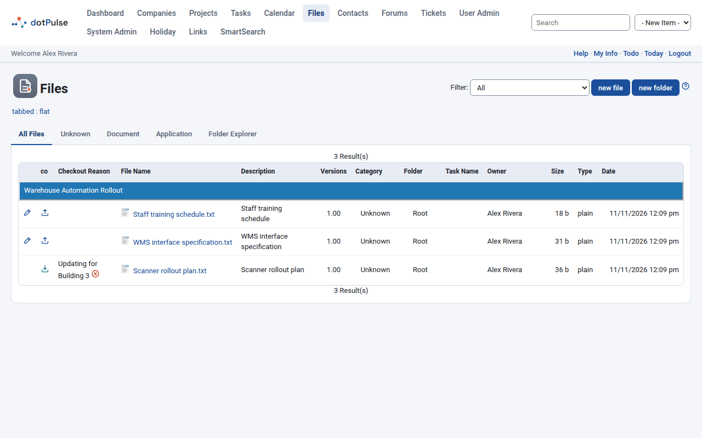
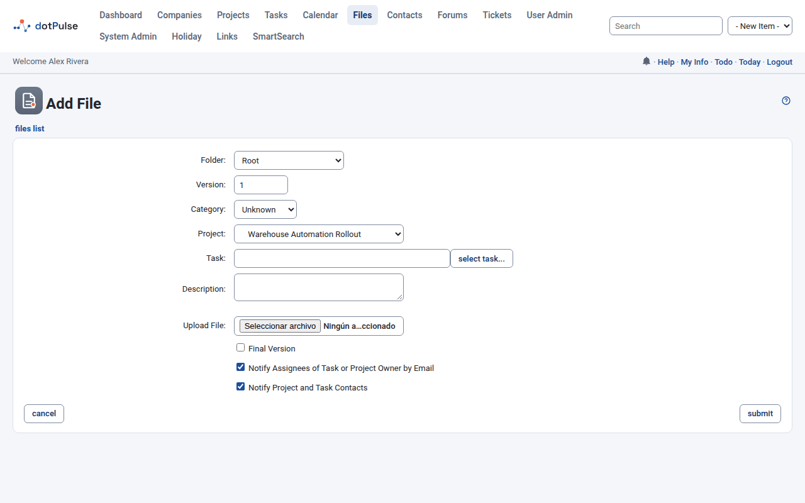
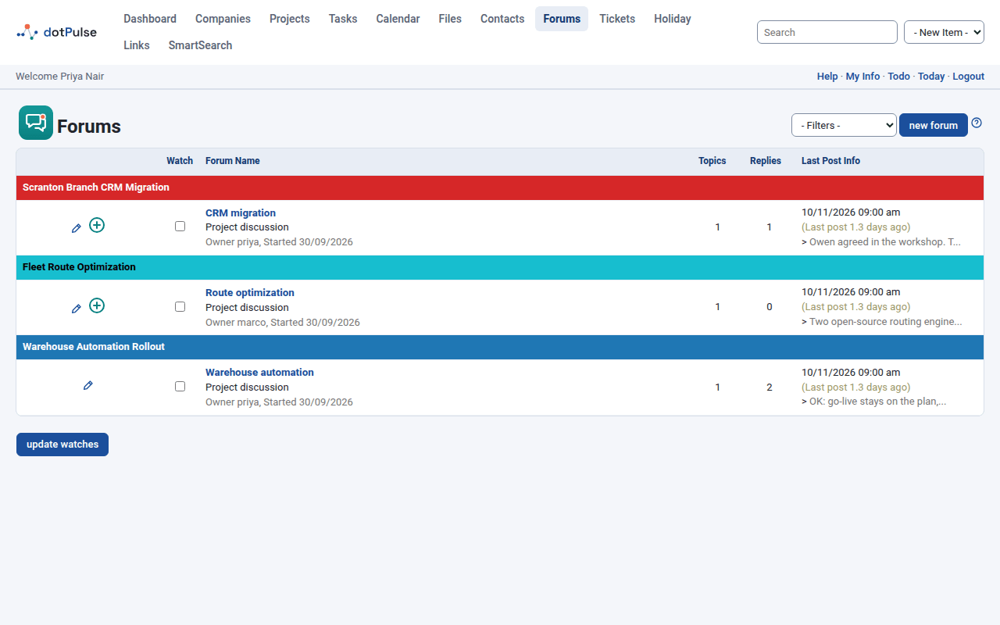
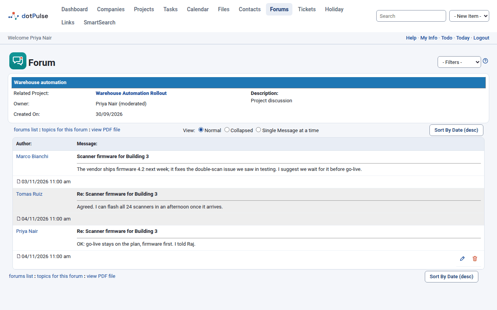
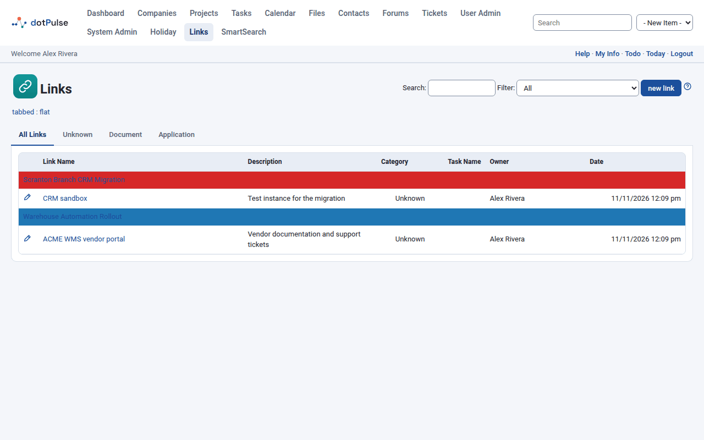

# Files, forums and links

Projects collect more than tasks. This page covers three ways to share material with your team: files (with versions and check-out), discussion forums, and web links.

## Files

Click **Files** in the top menu to see the files you have access to.

{ .shot }

The tabs sort the files by category: **All Files**, then one tab per category (**Unknown**, **Document** and **Application** on a standard site). The last tab, **Folder Explorer**, shows the files by folder. Use **Filter** to show only the files of one project.

Each row shows the file name (click it to download), its description, version, category, folder, task, owner, size, type and date. Files with older versions show the number of versions in brackets next to the version; click it to list them.

You also find files on a project's **Files** tab and on a task's **Files** tab.

### Upload a file

1. Go to **Files** and click **new file**. From a project or a task, you can also click **new file** in the title area, or **Attach a file** on the project's **Files** tab.
2. Fill in the form.
3. Click **submit**.

{ .shot }

| Field | Meaning |
|---|---|
| Folder | Where the file goes. **Root** is the top level. |
| Version | A version number for the file. It starts at 1. |
| Category | **Unknown**, **Document**, **Application** or another category set up on your site. |
| Project | The project the file belongs to. Leave it on **None** for a general file. |
| Task | Click **select task...** to link the file to a task of the chosen project. Pick the project first. |
| Description | What the file is. |
| Upload File | Choose the file on your computer. |
| Final Version | Locks the file as final (see below). |
| Notify Assignees of Task or Project Owner by Email | Emails the task's assignees, or the project owner if there is no task. Ticked by default. |
| Notify Project and Task Contacts | Emails the contacts of the project and the task. Ticked by default. |

Files linked to a task show a paper clip in the task lists. When you [move a task](tasks.md#move-a-task-to-another-project) to another project, its files move too.

### Edit or delete a file

Click the edit icon at the left of a file's row. You can change its folder, category, project, task and description. If you choose a new file in **Upload File**, it replaces the current one without keeping the old one as a version.

To delete a file, open it for editing and click **delete file**, or use the delete icon in **Folder Explorer**.

### Keep versions with check-out and check-in

Check-out tells your team that you are working on a file, and lets you save your changes as a new version.

1. Click the check-out icon in the **co** column.
2. Type a **CO Reason**, choose who to notify, and click **submit**. The file downloads, and the list shows it as checked out by you, with your reason.
3. Edit the file on your computer.
4. Click the check-in icon in the **co** column. The page **Checking in** opens.
5. Choose **Minor Revision** or **Major Revision**, pick the changed file in **Upload File**, and click **submit**.

A minor revision adds 0.01 to the version number (1 becomes 1.01). A major revision moves to the next whole number (1.01 becomes 2). The older versions stay in the list.

While a file is checked out, others see your name in the **co** column and cannot edit it. You can cancel your check-out with the cancel icon next to the reason. Administrators and the project owner can cancel it too.

!!! note
    **Final Version** marks the file as final. The **co** column then shows **final** and nobody can check the file out or edit it any more.

### Work with folders

Click **new folder** on the **Files** page. Give it a **Folder Name**, an optional **Description**, and choose its parent in **Subfolder of**.

The **Folder Explorer** tab shows the folder tree. The icons next to each folder let you add a subfolder, add a file to it, or delete it. Inside a folder you can edit it or go back to the parent folder or to the root.

To move several files at once, tick them in **Folder Explorer**, pick a target in **Move to Folder** or **Move to Project** (or **No Project Association**), and click **Go**.

## Forums

Forums are discussion boards. Each forum belongs to a project, so the talk stays next to the work.

Click **Forums** in the top menu to see the forums of active projects.

{ .shot }

The list shows each forum's project, name, owner, number of **Topics** and **Replies**, and the last post. Use the filter at the top to show **My Forums**, **My Watched**, **My Projects**, **My Company** or **Inactive Projects** (forums of archived projects).

A project's **Forums** tab lists just that project's forums.

### Create a forum

1. Go to **Forums** and click **new forum**. From a project's **Forums** tab, the **new forum** button there works too.
2. Fill in **Forum Name**, **Related Project**, **Owner** (you by default), **Moderator** and **Description**.
3. Click **submit**.

The moderator can edit and delete any message in the forum.

### Start a topic and reply

1. Click a forum's name.
2. Click **start a new topic**.
3. Type a **Subject** and your **Message**, then click **submit**.

{ .shot }

Click a topic to read it. Then:

- **Post Reply** answers the topic. The reply quotes the message you answer.
- **New Topic** starts another topic in the same forum.
- **Sort By Date** switches between oldest first and newest first.
- **View** changes the layout: **Normal**, **Collapsed** or **Single Message at a time**.

You can edit or delete your own messages with the icons next to them.

In the topic list, an icon marks topics with posts you have not read yet.

### Watch a forum or a topic

Watching sends you an email when someone posts.

- To watch whole forums, tick their boxes in the **Watch** column of the forums list and click **update watches**.
- To watch single topics, open the forum, tick the topics in the **Watch** column and click **update watches**.

Untick a box and click **update watches** again to stop watching.

## Links

The Links add-on keeps useful web addresses with your projects. If your site has it, click **Links** in the top menu.

{ .shot }

The tabs sort the links by category: **All Links**, then one tab per category (**Unknown**, **Document** and **Application** on a standard site). Use **Search** to find a link by name or description, and **Filter** to show one project's links.

A project's **Links** tab lists the links of that project.

### Add a link

1. Go to **Links** and click **new link**.
2. Fill in **Link Name**, **Category**, **Project**, **Task** (click **select task...**), **Description** and **Link URL**.
3. Click **submit**.

When you edit a link, the **go** link next to its name opens the address in a new window. Click a link's name in the list to open it.
