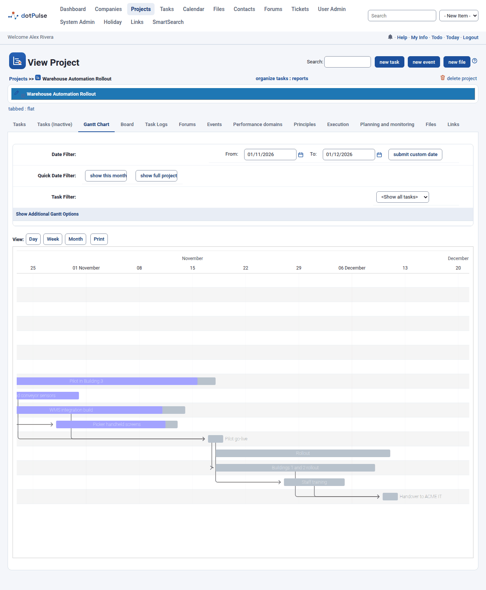
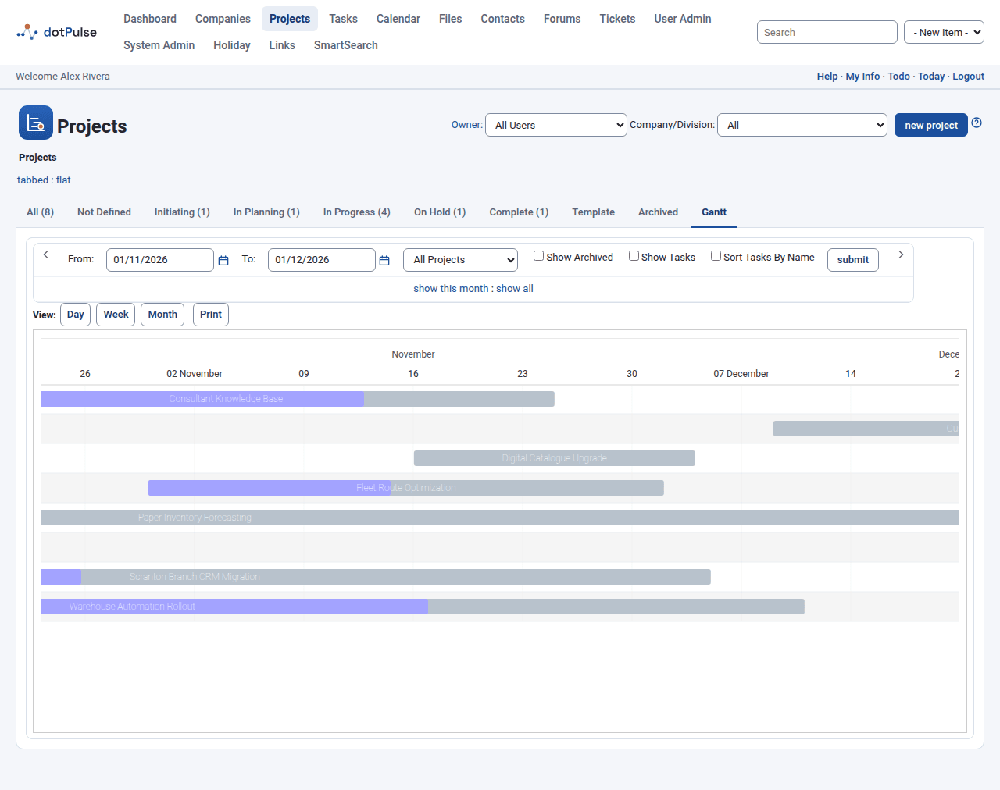
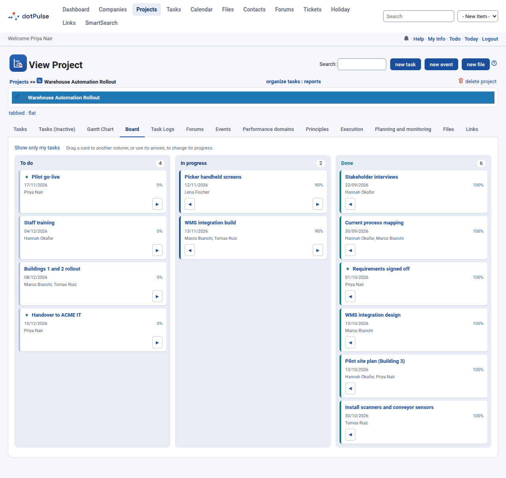

# Gantt chart and board

dotPulse gives you two visual ways to follow work: the Gantt chart shows projects and tasks on a timeline, and the board shows a project's tasks as cards by progress.

## The Gantt chart

A Gantt chart draws each task or project as a bar from its start date to its end date. The darker part of a bar shows its progress.

You find Gantt charts in several places:

| Where | What it shows |
|---|---|
| A project's **Gantt Chart** tab | The tasks of that project. |
| **Gantt Chart** button under each project in the tasks list | The same chart, on its own page. |
| **Projects** › **Gantt** tab | The projects, and optionally their tasks. |
| **Tasks** › **my todo** › **My Gantt** tab | Your unfinished tasks. |

{ .shot }

### Read and move around the chart

- Use the **View:** buttons **Day**, **Week** and **Month** to change the scale. Charts open in **Week** view.
- When the chart covers today, it scrolls so that today is in view.
- Point at a bar to see its name, dates and percent complete.
- On task charts, arrows link a task to the tasks it depends on.
- **Print** prints the page.

### Change dates and progress on the chart

If you may edit a task, you can change it on a task chart (a project's **Gantt Chart** tab, the tasks Gantt, or the projects chart with **Show Tasks**):

- **Drag a bar** to move the task: it keeps its length and its start and end times of day.
- **Drag either end of a bar** to change the start or the finish day.
- **Drag the progress handle** (the small triangle under the bar) to change the percent complete.

The change is saved at once, and the line under the chart says **Saved.** A task group's bar follows its tasks, so it cannot be dragged; nor can a project's bar. Tasks set to track their dependencies move with the task they depend on, and the page reloads to show them. If the change cannot be saved, the bar goes back and the line under the chart says why.

To cancel a drag, press **Esc** before you release the mouse button: the bar goes back and nothing is saved. After a change is saved, the line under the chart offers **Undo**, which saves the bar's previous dates or percent complete.

A bar with no start date starts today (on the projects chart, a task with no start date starts with its project). A bar with no end date, or an end date before its start, is drawn one day long.

### Filter a task chart

A project's task chart has these options above it:

- **Date Filter**: pick a **From** and **To** date with the calendar icons, then click **submit custom date**. The chart then shows only the tasks that overlap that period. The arrows at both ends move the period one month back or forward.
- **Quick Date Filter**: **show full project** removes the date limits.
- **Task Filter**: pick a task group to show only that group and the tasks under it. **&lt;Show all tasks&gt;** shows everything.
- **Show Additional Gantt Options**: opens more choices. **Sort by Name** orders the tasks by name instead of by start date. **Hide Milestones** leaves milestones out. Click **submit** to apply them.

Inactive tasks and tasks of archived projects are not shown.

On **My Gantt**, the additional options also include **To Do Options**: **Pinned Only**, **Archived Projects**, **Projects on Hold**, **Dynamic Tasks** and **Low Priority Tasks**. They work like the boxes on the [to-do list](tasks.md#your-to-do-list) and are shared with it.

### The projects chart

Go to **Projects** and open the **Gantt** tab.

{ .shot }

The options are:

- **From** and **To**, with the arrows to step a month back or forward, and **submit** to apply.
- A project filter: **All Projects**, **All w/o in progress**, **My projects**, or a single status.
- **Show Archived**: include archived projects.
- **Show Tasks**: draw each project's tasks under it.
- **Sort Tasks By Name**: order those tasks by name instead of by end date.
- **show all** removes the date limits.

The chart also follows the **Company/Division** filter of the projects list. Each project's bar shows its progress, worked out from its tasks.

## The board

The **Board** tab of a project shows its tasks as cards in three columns:

| Column | Tasks with progress |
|---|---|
| To do | 0 % |
| In progress | between 1 % and 99 % |
| Done | 100 % |

{ .shot }

Each card shows the task name, its finish date and its progress. A finish date in the past, on a task that is not done, is marked as late. Below come the people assigned to the task. A diamond (◆) marks a milestone and an exclamation mark (!) a high priority task. Click the task name to open it.

The board shows the project's active tasks. Inactive tasks and task groups are left out, because a group's progress comes from its children. Cards are sorted by finish date; tasks with no finish date come last.

Click **Show only my tasks** to keep only the tasks assigned to you. **Show all tasks** brings the others back.

### Move a card

You can move the cards of tasks you are allowed to edit. There are two ways:

- Drag the card to another column.
- Use the arrow buttons on the card (◀ and ▶) to move it one column left or right. The arrows also work from the keyboard.

Moving a card changes the task's progress:

- To **To do**: the progress becomes 0 %.
- To **Done**: the progress becomes 100 %. If the task had no finish date, today becomes its finish date.
- To **In progress**: a task coming from *To do* gets 10 %; a task coming from *Done* gets 90 %.

The card moves at once and the change is saved in the background. If dotPulse cannot save it, the card goes back to its column and a message says why.

!!! tip
    The board only sets rough values. To record real progress and the hours you spent, [log your work](task-logs.md) on the task.
