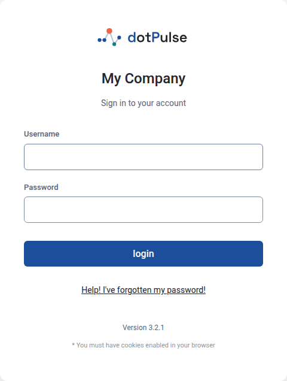
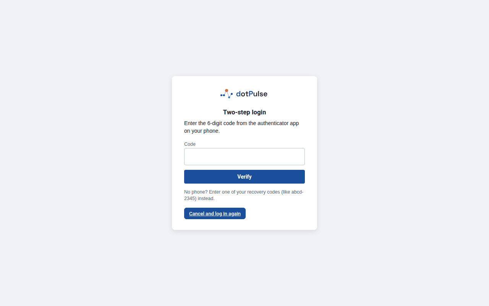
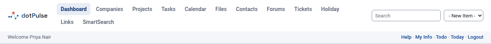
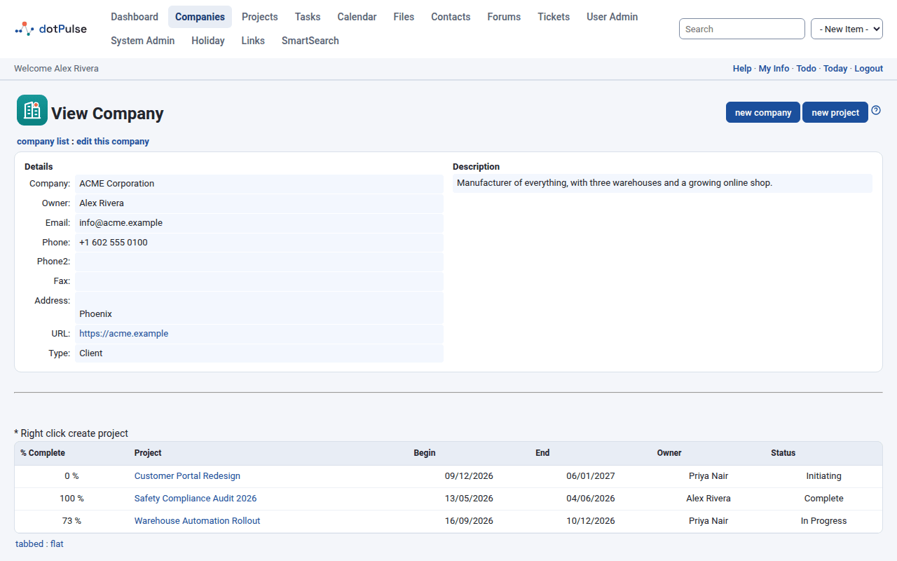
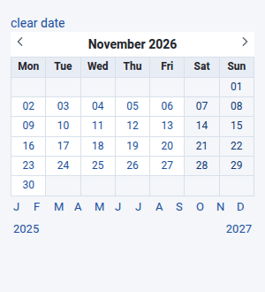
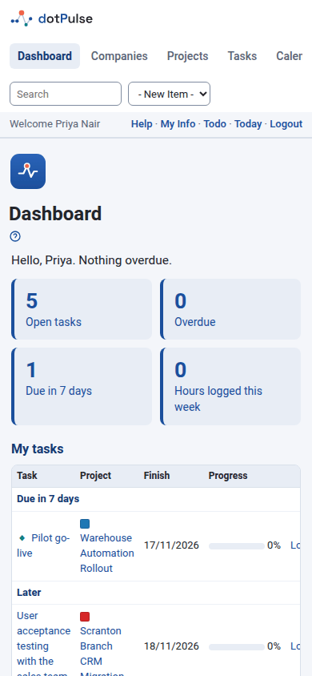

# The interface

Every dotPulse page shares the same frame: a top bar with the modules, a page
title with links and filters, and the page content below. This page explains
those common parts once, so the rest of the guide can focus on the work.

## Log in

1. Open the address of your dotPulse site in your browser.
2. Enter your **Username** and **Password**.
3. Click **login**.

{ .shot }

dotPulse needs cookies to keep you logged in. If the login page keeps coming
back, check that your browser accepts cookies from the site.

If you mistype your password several times in a row, dotPulse makes you wait
for a while before you can try again ("Too many login attempts").

After you log in, dotPulse opens your [dashboard](dashboard.md), unless your
administrator has chosen another start page.

### Log in with two-step login

If you have turned on [two-step login](preferences.md#set-up-two-step-login),
dotPulse asks for a second code after your password:

1. Open the authenticator app on your phone.
2. Type the 6-digit code it shows for dotPulse into **Code**.
3. Click **Verify**.

{ .shot }

If you don't have your phone, type one of your recovery codes (they look like
`abcd-2345`) instead of the 6-digit code. Each recovery code works only once.

You have a few minutes to enter the code. After that, or after several wrong
codes, dotPulse sends you back to the login page and you start again with your
password. To give up and start again yourself, click
**Cancel and log in again**.

!!! tip "The code is not accepted?"
    Codes change every 30 seconds and depend on the clock of your phone. Check
    that your phone's time is set automatically, and use the newest code.

### Forgot your password

1. On the login page, click **Help! I've forgotten my password!**
2. Enter your **Username** and the email address of your account.
3. Click **send password**.

If the username and email match an account, dotPulse emails you a link. Open
it within one hour, enter your new password twice (**New Password** and
**Repeat New Password**) and click **submit**. You can then log in with the new
password.

For your security, dotPulse shows the same message whether or not the account
exists. If no email arrives, check your spam folder, then ask your administrator.

## The top bar

The top bar is on every page.

{ .shot }

From left to right it holds:

- **The logo**: click it to go back to your start page.
- **The modules menu**: one link for each module you can open, such as
  **Dashboard**, **Companies**, **Projects**, **Tasks**, **Calendar**, **Files**
  and **Contacts**. The module you are in is highlighted. Which modules appear
  depends on what your administrator has installed and what you may access.
- **Search**: type a word and press ++enter++ to search all of dotPulse. See
  [Search](search.md). It only appears if you may use SmartSearch.
- **- New Item -**: a quick way to create something. Pick **Company**,
  **Contact**, **Event**, **File** or **Project** and dotPulse opens the form
  for it. You only see the items you are allowed to add.

Below it, a thinner bar greets you by name and has these links:

- **Project tips**: a bell that appears on the pages of a project. See
  [Your dashboard](dashboard.md#project-tips).
- **Help**: opens this documentation in a new tab, at the page about the part of
  dotPulse you are in (the projects list opens [Projects](projects.md), for example).
  dotPulse shows the copy of the documentation that comes with it, so it matches your
  version and needs no Internet access; the list on the left leads to every page.
- **My Info**: your account page. See [Your account and preferences](preferences.md).
- **Todo**: your list of tasks to do (**My Tasks To Do**).
- **Today**: today in the calendar's day view.
- **Logout**: ends your session.

**Todo** and **Today** only appear if you may use the calendar.

## The page title

Each page starts with a title block.

{ .shot }

- **The title** says where you are, for example **View Company**.
- **Buttons and filters** sit to the right of the title, for example
  **new company** or **new project**.
- **Links** sit on the line below the title, separated by colons. They take you
  to related pages, for example **company list : edit this company**. A link
  such as **projects list** or **contacts list** always takes you back to the
  list you came from.
- **A delete link**, such as **delete company**, sits on the right of that line
  when you are allowed to delete the item. dotPulse asks you to confirm first.
- **The help icon**, at the far right of the title, opens the documentation for the page.

## Messages

After you save, delete or do something that fails, dotPulse shows a short
message near the top of the page, for example to confirm that a record was
updated or to explain what went wrong.

## Tabs

Many pages split their content into tabs, for example the **Active Projects**,
**Departments**, **Users** and **Contacts** tabs of a company. Click a tab to
show it. dotPulse remembers the last tab you opened on each page.

Some modules add their own tabs to other modules' pages, so the tabs you see
depend on the modules installed.

Unless you changed the **Tabbed Box View** preference, you also see the links
**tabbed : flat** above the tabs. **flat** shows the content of all tabs one
after the other on a single page; **tabbed** goes back to tabs. See
[Your account and preferences](preferences.md#tabbed-box-view).

## Filters and sorting

Lists often have filters in the title block, for example **Owner filter** on the
companies list, or **Company** and **Event Filter** in the calendar. Choose a
value and the page reloads with the filtered list. Most filters keep their
value while you move around dotPulse, until you log out.

In many lists you can click a column heading, such as **Company Name**, to sort
by that column. Click it again to reverse the order.

## Pick a date

Most date fields have a small calendar icon next to them. Click it and a small
window opens with a month calendar:

- Click a day to put it in the field.
- Use the arrows to move a month back or forward. The letters below the
  calendar jump to a month of the same year, and the years jump a year back or
  forward.
- Click **clear date** to empty the field.

{ .shot }

!!! tip "Allow pop-ups"
    The date picker, the password change and some selectors open in small
    windows. If nothing happens when you click them, allow pop-ups for your
    dotPulse site in your browser.

## Expand and collapse

Some pages hide details until you ask for them. Click the expand icon (a plus sign
in a small box) to show them; it turns into a minus sign, which hides them
again. For example:

- On a project's page, the icon next to the project name shows or hides the
  project's details.
- In task lists, a task that has subtasks has an icon that opens or closes its
  subtasks.

## Use dotPulse on a phone

dotPulse works in a phone's browser. On a narrow screen:

- The modules menu stays on one line. Swipe it sideways to reach the other
  modules.
- Forms stack each label above its field.
- Lists and calendars keep their columns and scroll sideways inside themselves.
  Swipe the list, not the page.

{ .shot }

## Light and dark theme

dotPulse comes with a light theme, **dotPulse**, and a dark one,
**dotpulse-dark**. You choose yours in the **User Interface Style** preference.
See [Your account and preferences](preferences.md#user-interface-style).

## Log out

Click **Logout** in the bar under the modules menu. Always log out on a shared
computer.
