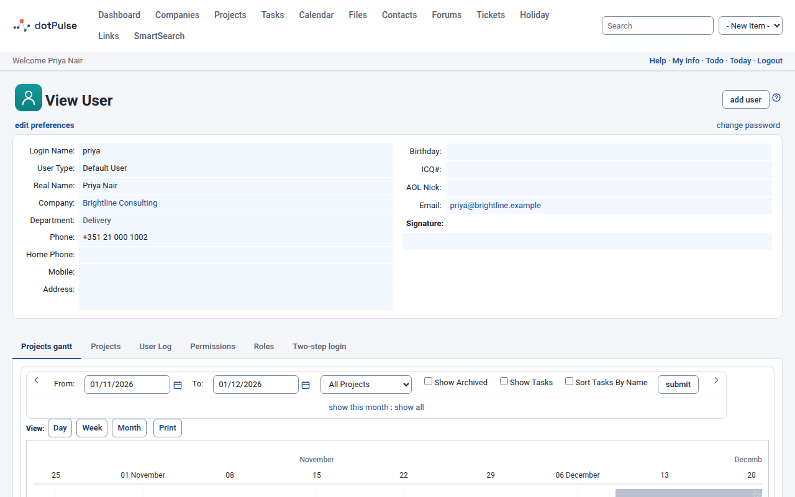
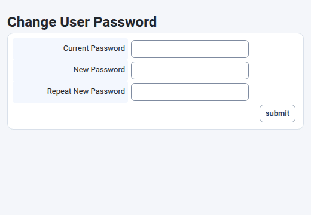
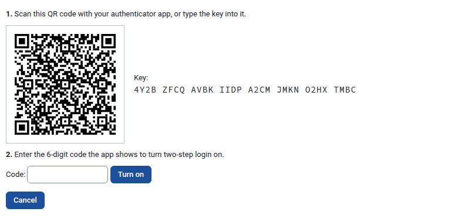
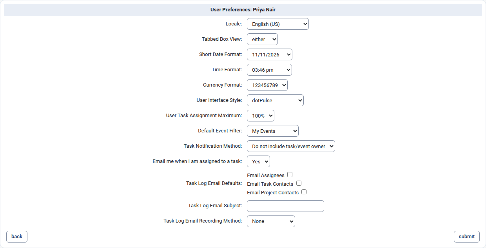
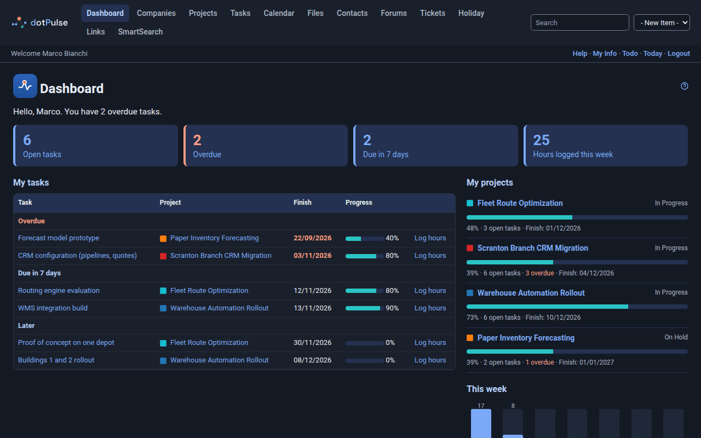

# Your account and preferences

Click **My Info** in the bar under the modules menu to open your account page,
**View User**. From there you can check your details, change your password, set
up two-step login and choose your preferences.

{ .shot }

## Your details

The top of the page shows your **Login Name**, **User Type**, **Real Name**,
**Company**, **Department**, phone numbers, **Address**, **Birthday**, **Email**
and **Signature**.

Most of these details come from your contact record: every user in dotPulse has
one (see [Companies, departments and contacts](companies-contacts.md#contacts-and-users)).

### Change your details

- If you may edit contacts, open **Contacts**, find yourself and click **Edit**.
  Change your name, phone numbers, address or email, then click **submit**.
- Your user account itself (login name, user type, company, signature) is
  managed by your administrator. Administrators see an **edit this user** link
  on this page; if you don't, ask your administrator to make the change.

## Change your password

1. Click **My Info**.
2. Click **change password**, on the right of the line below the title.
3. In the small window that opens, enter your **Current Password**, then your
   **New Password** twice (**New Password** and **Repeat New Password**).
4. Click **submit**.

{ .shot }

The new password must have at least the minimum length your administrator has
set. dotPulse tells you if it is too short or if the two entries don't match.

## Set up two-step login

Two-step login asks for a code from an app on your phone after your password.
Someone who steals your password still can't log in as you.

You need an authenticator app on your phone. Any of them works, for example
Google Authenticator, Microsoft Authenticator, Aegis, FreeOTP or 1Password.

1. Click **My Info** and open the **Two-step login** tab.
2. Click **Set up two-step login**.
3. Scan the QR code with your authenticator app. If you can't scan it, type the
   **Key** shown next to it into the app instead.
4. Enter the 6-digit code the app shows into **Code** and click **Turn on**.

{ .shot }

To stop half way, click **Cancel**.

### Save your recovery codes

As soon as two-step login is on, dotPulse shows ten recovery codes.

!!! warning "You only see the recovery codes once"
    Save them now, somewhere safe and away from your phone: a password manager
    or a printed copy. Each code logs you in once if you lose your phone.

The tab then says **Two-step login is on.**, with the date you turned it on and
how many recovery codes you have left. From now on, logging in takes your
password and a code. See [Log in with two-step login](interface.md#log-in-with-two-step-login).

### Get new recovery codes

If you have used most of your recovery codes, or think someone has seen them:

1. Open the **Two-step login** tab.
2. Enter a current code from your app (or a recovery code) into **Code**.
3. Click **New recovery codes**.

dotPulse shows ten new codes, once. The old ones stop working.

### Turn two-step login off

1. Open the **Two-step login** tab.
2. Enter a current code from your app (or a recovery code) into **Code**.
3. Click **Turn off** and confirm.

Your password alone logs you in again.

### Lost your phone and your recovery codes

Ask your administrator. They can reset two-step login for your account. You then
log in with your password and can set it up again.

## API tokens

The **API tokens** tab only appears when your administrator has turned on the
REST API. It is off by default.

A token lets a program use dotPulse on your behalf, with your permissions. To
create one, enter a **Name**, choose the **Access** (**Read only** or
**Read and write**) and when it **Expires** (30, 90 or 365 days, or **Never**),
then click **Create token**. Copy the token straight away: dotPulse shows it only
once. Click **Revoke** next to a token to stop it working.

## Other tabs

Your account page may show more tabs, depending on the modules installed and
your permissions. Common ones are:

- **Projects** and **Projects gantt**: your projects, as a list and as a Gantt
  chart.
- **User Log**: when you logged in and out, between two dates you choose.
- **Permissions** and **Roles**: what you are allowed to do. Only administrators
  can change them.

## Edit your preferences

Preferences change how dotPulse looks and behaves for you only.

1. Click **My Info**.
2. Click **edit preferences** on the line below the title.
3. Change what you need.
4. Click **submit**.

{ .shot }

Until you save this page for the first time, your preferences follow the
defaults your administrator set for everyone. Saving stores every preference on
the page as your own.

### Locale

The language of the interface, for example **English (US)** or
**English (GB)**. Each language is listed by its English name.

### Tabbed Box View

How pages with tabs are shown:

- **either**: tabs, with the links **tabbed : flat** above them so you can switch
  on any page. This is the default.
- **tabbed**: always tabs, without the switch.
- **flat**: always flat: the content of every tab shown one after the other.

Some pages, such as your account page, always use tabs.

### Short Date Format

How dates are written. Each option shows today's date in that format, for example
day/month/year or month/day/year.

### Time Format

How times are written: 12-hour with AM/PM, or 24-hour with or without seconds.
Each option shows the current time as an example.

### Currency Format

How amounts of money are written: the separators for thousands and decimals.
Each option shows the same amount formatted for one locale.

### User Interface Style

The look of dotPulse. Choose:

- **dotPulse** for the light theme.
- **dotpulse-dark** for the dark theme.

The list also has older styles inherited from dotProject. dotPulse is designed
and tested with its own two themes, so use one of those.

{ .shot }

The change applies from the next page you open.

### User Task Assignment Maximum

How much work you can take on, as a percentage of your time, from 5 % to 200 %.
The default is 100 %. When your administrator has turned on the related setting,
dotPulse uses this figure to show how much of your capacity is already taken
when someone assigns you to tasks.

### Default Event Filter

Which events the calendar shows when you open it:

- **My Events**: events you are invited to.
- **Events I Created**: events you created.
- **All Events**: every event you may see.

You can still change the filter on the calendar itself. See
[Calendar](calendar.md#filter-the-calendar).

### Task Notification Method

Whether emails about a task or event also go to its owner:

- **Do not include task/event owner**
- **Include task/event owner**

With **Include task/event owner**, the **Notify owner** box is also ticked by
default when you log work on someone else's task.

### Email me when I am assigned to a task

**Yes** (the default) sends you an email when someone else assigns you to a
task. Choose **No** to stop these emails.

### Task Log Email Defaults

Which boxes are ticked by default under **Email Log to** when you log work on a
task:

- **Email Assignees**: the people assigned to the task.
- **Email Task Contacts**: the task's contacts.
- **Email Project Contacts**: the project's contacts.

You can still change the boxes each time you log work.

### Task Log Email Subject

Text added at the start of the subject of the emails sent when you log work, for
example `[Work log]`. The task log's summary follows it.

### Task Log Email Recording Method

What dotPulse does after emailing a task log:

- **None**: nothing.
- **Append to Log**: adds a note to the task log's description saying when it
  was emailed and to whom.
