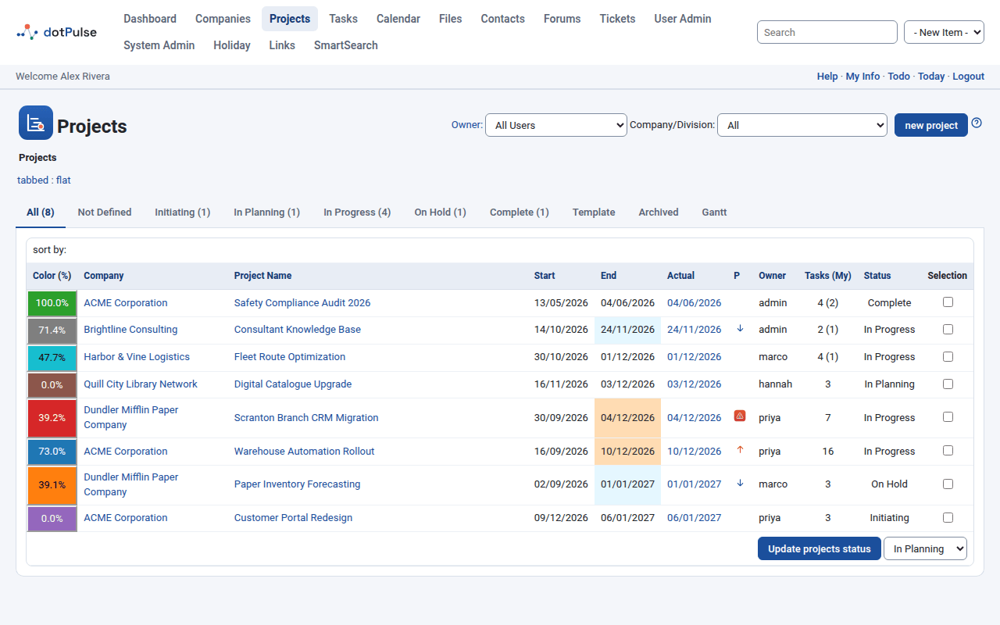
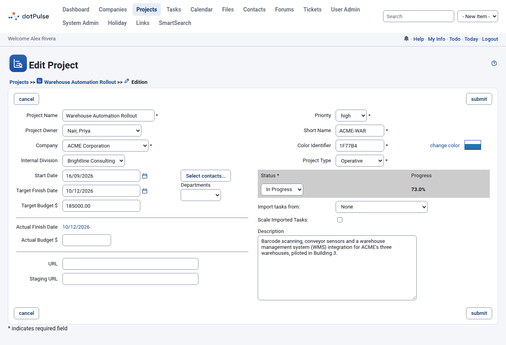
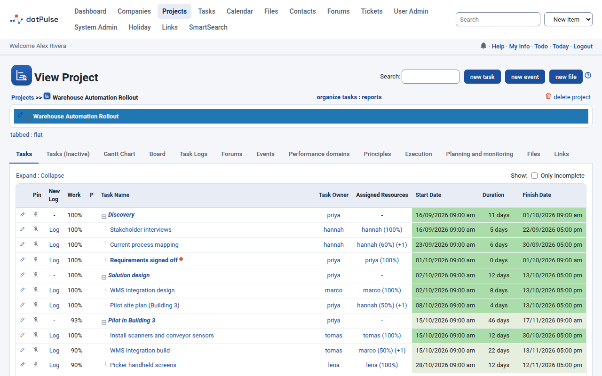

# Projects

A project groups the tasks, files, forums and work logs for one piece of work. Every project belongs to a company. This page explains how to find, create, edit, archive and delete projects.

## Find a project

Click **Projects** in the top menu. The list opens with one tab per project status. Each tab shows how many projects it holds, for example **In Progress (4)**.

{ .shot }

The tabs are:

- **All**: every project you can see, whatever its status.
- One tab per status: **Not Defined**, **Proposed** (called **Initiating** when the dotProject+ add-on is installed), **In Planning**, **In Progress**, **On Hold**, **Complete**, **Template** and **Archived**.
- **Gantt**: a chart of the projects. See [Gantt chart and board](gantt-board.md).

Two filters sit above the tabs:

- **Owner**: shows only the projects owned by one person. It starts on your own projects. Pick **All Users** to see everyone's projects. Click the **Owner:** label to jump back to your own.
- **Company/Division**: shows only the projects of one company or department. A company's list also includes the projects it runs for clients (where it is the internal company).

Click a column heading to sort by it. Click it again to reverse the order. The first column shows the project's progress on its colour. The **P** column shows a warning icon for projects with a problem reported in a task log, or else priority arrows. **Tasks (My)** counts all tasks and the tasks assigned to you.

Click a project name to open it.

## Project statuses

The status says where a project is in its life. The standard values are:

| Status | Use it for |
|---|---|
| Not Defined | A project whose status nobody has set yet. |
| Proposed (Initiating) | An idea or offer that is not approved yet. |
| In Planning | Approved work that you are still planning. |
| In Progress | Work that is under way. |
| On Hold | Work that is paused. |
| Complete | Finished work. |
| Template | A model project that you copy tasks from (see [Import tasks from another project](#import-tasks-from-another-project)). |
| Archived | Old work you want out of the way. |

!!! note
    An administrator can rename or add statuses under **System Admin**. The names on your site may differ.

Archived projects drop out of many lists. The tasks list, the to-do list, the Gantt charts and the list of projects you can move a task to all leave them out unless you ask for them.

## Create a project

You need at least one company first. If there is none, dotPulse asks you to create a company.

1. Go to **Projects** and click **new project**.
2. Fill in the form. The fields marked with `*` are required.
3. Click **submit**.

{ .shot }

You can also start a project from a company or contact page. The company or contact is then filled in for you.

### Project fields

| Field | What it means |
|---|---|
| Project Name `*` | The full name. |
| Project Owner | The person responsible. It defaults to you. |
| Company `*` | The company the project is for. |
| Internal Division | The company of yours that runs the project. Only companies of type *Internal* appear here. |
| Start Date | The day work starts. Click the calendar icon to pick it. |
| Target Finish Date | The day the project should end. If you pick a start date after it, the finish date moves to match. |
| Target Budget | The planned budget, in your site's currency. |
| Actual Finish Date | Not editable. It shows the end date of the task that finishes last, as a link to that task. It turns red when it is later than the target. On a new project it says **Dynamically calculated**. |
| Actual Budget | The money spent so far. Some add-ons calculate it from the task costs; the field is then greyed out. |
| URL | A web address for the project, such as the live site. |
| Staging URL | A second address, such as a test site. |
| Priority `*` | **low**, **normal** or **high**. |
| Short Name `*` | Up to 10 characters, used where space is tight. If you leave it empty, the first characters of the project name fill it in when you leave the name field. |
| Color Identifier `*` | A hex colour (like `FF9900`) for the project in lists and charts. Click **change color** to pick one. |
| Project Type `*` | **Unknown**, **Administrative** or **Operative**. |
| Status `*` | See [Project statuses](#project-statuses). |
| Progress | Not editable. The percentage done, worked out from the tasks. |
| Import tasks from | Copies the tasks of another project into this one. See below. |
| Scale Imported Tasks | Stretches or shrinks the imported tasks to fit this project's dates. |
| Description | Free text about the project. |

To the right of the dates you will find:

- **Select contacts...**: opens a list of contacts. The ones you tick become the project's contacts. They show on the project page and can receive task log emails.
- **Departments**: appears when the chosen company has departments. Pick the department that owns the project.

Your administrator may have added custom fields. They appear below **Staging URL**.

## Edit a project

1. Open the project.
2. Click the pencil icon (**edit this project**) at the left of the coloured title bar.
3. Change what you need and click **submit**.

## Change the status of several projects

On the projects list you can change many projects at once, if you may edit them:

1. Tick the boxes in the **Selection** column.
2. Pick the new status in the list at the bottom of the table.
3. Click **Update projects status**.

## Archive a project

Set its status to **Archived**, either in the edit form or with **Update projects status**. The project stays in the database with all its tasks, files and logs. You find it again under the **Archived** tab.

!!! tip
    Archive finished work instead of deleting it. Deleting cannot be undone.

## Import tasks from another project

You can copy all the tasks of an existing project into the project you are editing. This is handy when you keep a model project with the status **Template**.

1. Edit the target project (or create it).
2. In **Import tasks from**, pick the source project. Projects are grouped by company.
3. To fit the tasks to the new dates, tick **Scale Imported Tasks**.
4. Click **submit**.

The copies keep their parent tasks and the dependencies between them. Their dates shift by the gap between the two projects' start dates. With **Scale Imported Tasks**, dates and durations also grow or shrink in proportion to the length of the two projects. Scaling only works when both projects have a start date and a target finish date.

## The project page

Open a project to see its page.

{ .shot }

The coloured bar at the top shows the project name. Click the arrow next to it to show or hide the details:

- **Details**: company, internal company, short name, dates, target budget, owner, URLs, custom fields and description.
- **Summary**: status, priority, type, progress, and three hour totals. **Worked Hours** adds up all task logs. **Scheduled Hours** adds up the task durations. **Project Hours** weighs each duration by how much of it is assigned to people. Departments and contacts follow.

The buttons in the title area let you add a **new task**, a **new event** or a **new file** to this project. The **Search** box filters the task list by name and description.

Under the buttons you find these links:

- **organize tasks**: change many tasks at once. See [Tasks](tasks.md#organize-many-tasks-at-once).
- **reports**: the project reports, such as the task list and task log reports.
- **delete project**: see [Delete a project](#delete-a-project).

### Project tabs

The tabs below the details show the project's content. Which tabs you see depends on your permissions and on the modules your site uses.

The core tabs are:

| Tab | What it shows |
|---|---|
| Tasks | The active tasks, as a tree. See [Tasks](tasks.md). |
| Tasks (Inactive) | Tasks whose status is *Inactive*. |
| Gantt Chart | The tasks on a timeline. See [Gantt chart and board](gantt-board.md). |
| Board | The tasks as cards in *To do*, *In progress* and *Done*. See [Gantt chart and board](gantt-board.md#the-board). |
| Task Logs | All the work logged on the project's tasks. See [Logging work](task-logs.md). |
| Forums | The discussion forums linked to the project. See [Files, forums and links](files-forums-links.md#forums). |
| Files | The files attached to the project. |
| Events | The calendar events of the project. |

Add-on modules add more tabs when they are installed. The most common are:

| Tab | Add-on | Purpose |
|---|---|---|
| Links | Links | Web links attached to the project. |
| History | History | A record of changes to the project and its tasks. |
| Planning and monitoring, Execution | dotProject+ | Planning work packages and activities, and following their execution. |
| Principles | dotProject+ | Rate how well the project follows each PMBOK principle (1 to 5), with notes. |
| Performance domains | dotProject+ | Record the health of each PMBOK performance domain, with notes. |
| Risks | Risks | The project's risk register. |
| Costs, Budget | Costs | Cost estimates and the budget. |
| Journal | Journal | Dated notes about the project. |
| Initiating | Initiating | The project charter. |

## Delete a project

!!! warning
    Deleting a project also deletes all its tasks, their assignments and dependencies. It cannot be undone. Consider [archiving](#archive-a-project) instead.

1. Open the project.
2. Click **delete project**.
3. dotPulse asks you to type the project name. Type it exactly (you can copy and paste it) and confirm.

If the name does not match, nothing is deleted. You only see **delete project** if you have permission to delete it.
