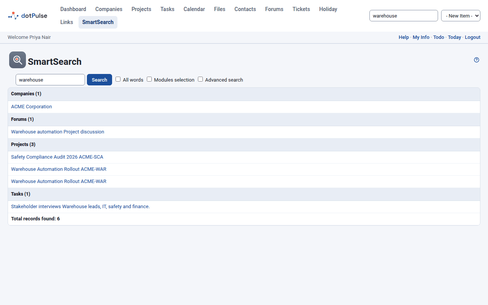

# Search

SmartSearch looks for words across dotPulse: projects, tasks, contacts, files and
more, all at once.

## Search from any page

1. Click the **Search** box in the top bar.
2. Type a word.
3. Press ++enter++.

dotPulse opens the **SmartSearch** page with the results.

You can also open **SmartSearch** from the modules menu, if your administrator
has put it there, and search from the box at the top of that page.

## Read the results

Results are grouped by kind of item, such as **Projects**, **Tasks** or
**Contacts**, with the number of matches in brackets. Each result shows the
first fields of the item, with the words you searched for highlighted. Click a
result to open it. The last line gives the **Total records found**.

{ .shot }

Results follow your permissions: you only get items from the modules and
records you may view. Private events of other people are left out.

## What is searched

| Group | What dotPulse looks in |
|---|---|
| **Companies** | Name, address, website, email and description. |
| **Contacts** | Name, title, company, type, email addresses, address and notes. |
| **Departments** | Name, address, website and description. |
| **Events** | Title, description, and start and end dates. |
| **Files** | File name, description and type. |
| **Files Content** | The words inside uploaded files that dotPulse has indexed. A result opens the file. |
| **Forums** | Forum name and description. |
| **Forum messages** | Message title and text. |
| **Projects** | Name, short name, description, web addresses, and the names and details of the project's contacts. |
| **Task logs** | Summary and description of the work logged. |
| **Tasks** | Name, description, web address and custom fields. |
| **Tickets** | Author, recipient, subject, body and other ticket details. |
| **Users** | Login name and signature. |

You only see the groups for modules you can open, so your list may be shorter.

## Search for several words

Type several words separated by spaces, commas or semicolons.

- By default, a result matches if it contains **any** of the words.
- Tick **All words** to get only results that contain **every** word.

Words match anywhere in a field, including inside longer words: searching for
`plan` also finds "planning" and "airplane".

!!! tip
    Search for plain letters and numbers. Characters such as `.` `*` `(` and `?`
    have a special meaning in the search and can give unexpected results.

## Search only some modules

1. Tick **Modules selection**. A list of the groups appears.
2. Tick the groups you want, or use **Select all** and **Deselect all**.
3. Click **Search**.

## Advanced search

Tick **Advanced search** to get more options:

- **Four search boxes** (1 to 4). Each box's words are highlighted in a different
  colour in the results, so you can tell which word matched.
- **Ignore case**: ticked by default, so `Report` also finds "report". Untick it
  to match capitals exactly.
- **Display all fields**: show every field of each result instead of the first
  two.

{ .shot }
