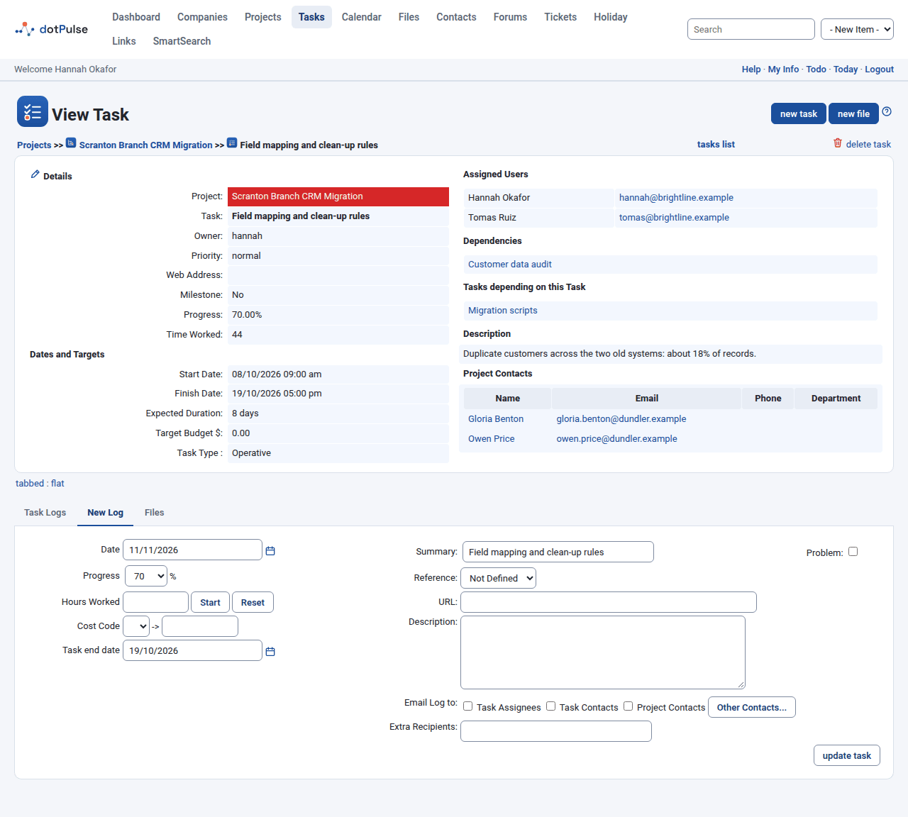
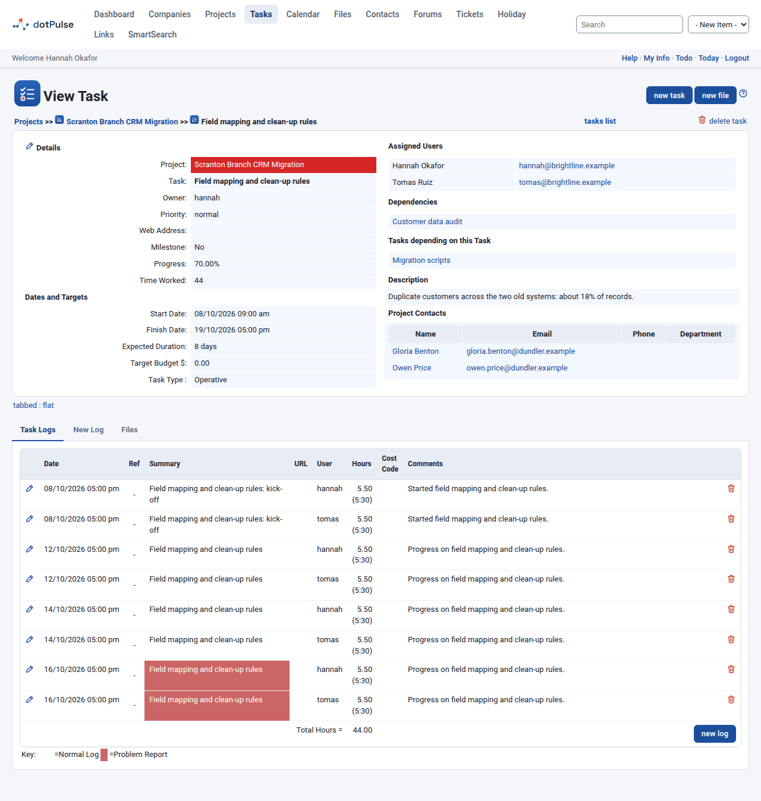
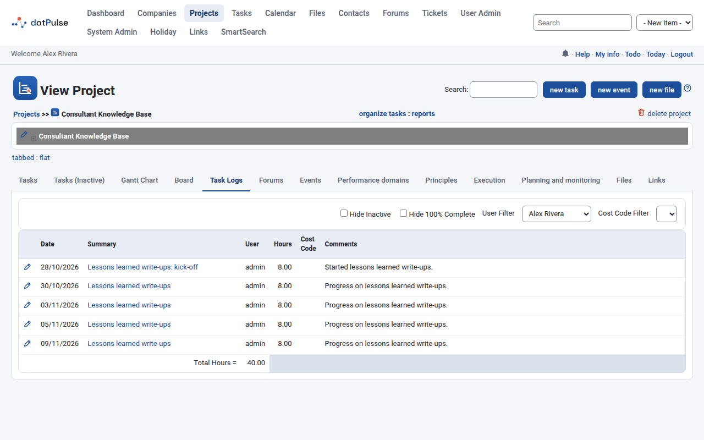

# Logging work

A task log records work you did on a task: when, how many hours, and what happened. Logging is also how you update a task's progress. Your logs feed the hour totals on your dashboard, on the project page and in the reports.

## Log time on a task

You can log work on a task you are allowed to edit.

1. Open the task. You can also click **Log** in the **New Log** column of any task list.
2. Open the **New Log** tab.
3. Fill in the form (see the fields below).
4. Click **update task**.

{ .shot }

dotPulse saves the log, updates the task and shows the **Task Logs** tab with your new entry.

!!! note
    Task groups (dynamic tasks) have no **New Log** tab. Log your work on their child tasks; the group adds them up.

### Log fields

| Field | What to enter |
|---|---|
| Date | The day you did the work. It defaults to today. Click the calendar icon to change it. |
| Progress | The task's new percent complete, in steps of 5 %. This changes the task itself. |
| Notify owner | Emails the task owner about this log. Only shown when you are not the owner. |
| Hours Worked | The time spent, as a decimal (`1.5`) or as hours and minutes (`1:30`). |
| Start / Reset | A timer. Click **Start** when you begin; the hours field counts up while it runs. Click **Stop** to pause it and **Reset** to clear it. |
| Cost Code | The billing code to charge the time to. Pick one from the list, or type a code in the box next to it. |
| Task end date | Changes the task's finish date. Only shown to the task owner, the project owner and administrators. |
| Summary | A one-line title for the log. It starts with the task name. |
| Problem | Tick it to flag a problem. See [Report a problem](#report-a-problem). |
| Reference | Where the work came from: **Not Defined**, **Email**, **Helpdesk**, **Phone Call** or **Fax**. |
| URL | A related web address. Include the `http://` or `https://`. |
| Description | What you did, in as much detail as you like. |

The cost codes in the list are the billing codes your administrator set up for the project's company, plus the ones shared by all companies.

## Update the progress of a task

Every log carries the task's progress. Set **Progress** to the new value when you log. If nothing changed, leave it as it is.

When you set **Progress** to 100 % and the task has no finish date, the date of your log becomes its finish date.

The progress of a project is worked out from its tasks, weighted by their durations. Task groups get their progress from their children. You can also change progress roughly on the [board](gantt-board.md#the-board), or directly in the task's edit form.

## Email the update

Under **Email Log to**, tick who should get a copy of the log:

- **Task Assignees**: everyone assigned to the task.
- **Task Contacts**: the contacts linked to the task.
- **Project Contacts**: the contacts linked to the project.
- **Other Contacts...**: opens a list to pick more contacts.
- **Extra Recipients**: type extra email addresses.

The email includes the project, the task, the hours and your summary and description. Which boxes start ticked comes from **Task Log Email Defaults** in your [preferences](preferences.md).

## Report a problem

Tick **Problem** when something blocks the task. The log then shows with a red background in the **Task Logs** tab. In the task lists, the task gets a warning icon in the **P** column; click it to see only the problem logs of that task. On the projects list, the **P** column can sort projects with problems first.

## See, edit and delete logs

The **Task Logs** tab of a task lists all its logs, oldest first, with a **Total Hours** line at the bottom.

{ .shot }

The columns are **Date**, **Ref** (the reference, as an icon), **Summary**, **URL**, **User**, **Hours** (as a decimal and as hours:minutes), **Cost Code** and **Comments** (the description). The key at the bottom tells a **Normal Log** from a **Problem Report**.

- To edit a log, click the edit icon at the left of its row. The form opens in the **Edit Log** tab. Change it and click **update task**.
- To delete a log, click the delete icon at the right of its row and confirm.

You need the matching permission to see these icons.

!!! warning
    Deleting a task also deletes all the logs on it and on its child tasks.

## Where logged hours appear

| Where | What you see |
|---|---|
| [Your dashboard](dashboard.md) | **Hours logged this week**: the hours you logged from Monday to Sunday of this week. |
| A task's page | **Time Worked**, and the **Total Hours** of the **Task Logs** tab. |
| A project's page | **Worked Hours** in the summary, and the project's **Task Logs** tab. |
| Project reports | For example **Task Log** (the logs of a user) and **User performance** (hours worked against hours allocated). Open them with the **reports** link on a project page or the tasks list. |
| Timesheet add-on | If installed, it lists the logs you wrote on the chosen day. |

### The project Task Logs tab

A project's **Task Logs** tab gathers the logs of all its tasks.

{ .shot }

Use the filters at the top to narrow it down:

- **Hide Inactive**: leave out the logs of inactive tasks.
- **Hide 100% Complete**: leave out the logs of finished tasks.
- **User Filter**: show one person's logs, or **All Users**. It starts on your own logs.
- **Cost Code Filter**: show only the logs with one cost code.
