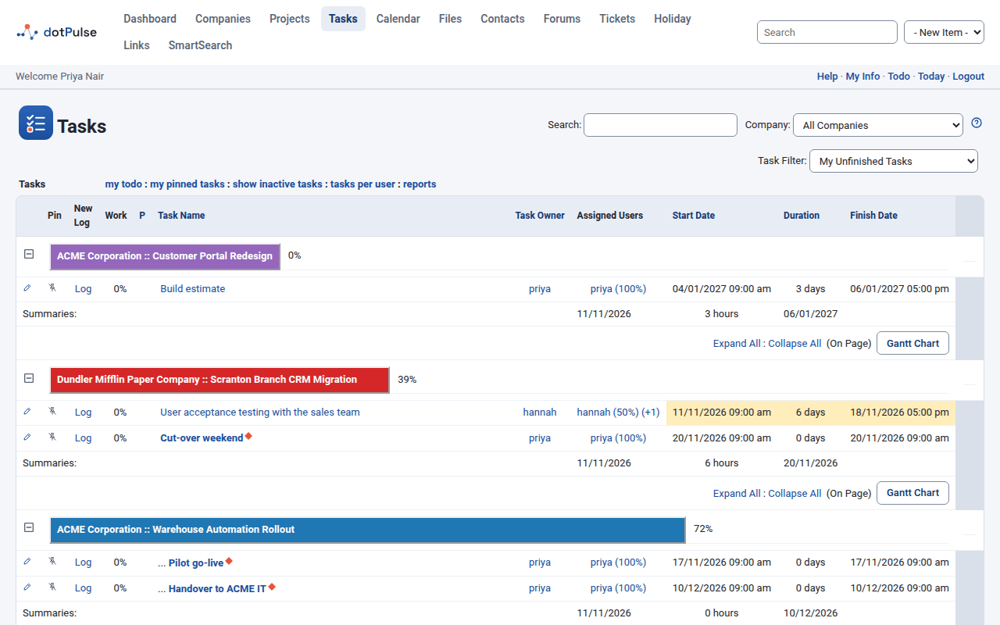
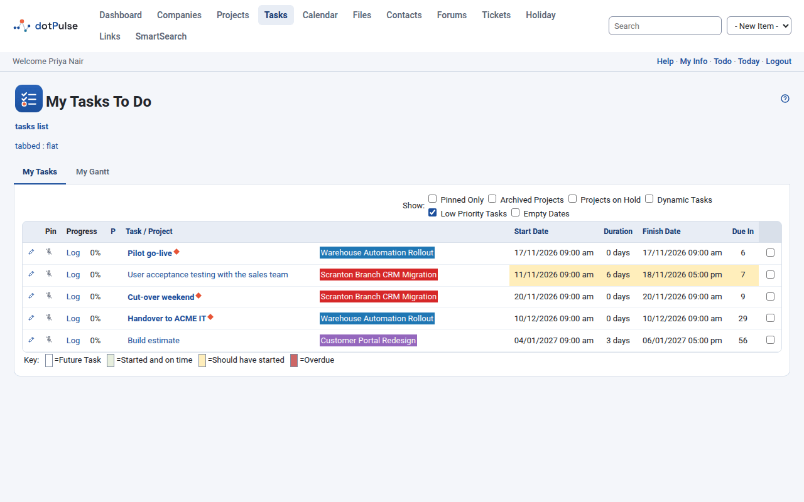
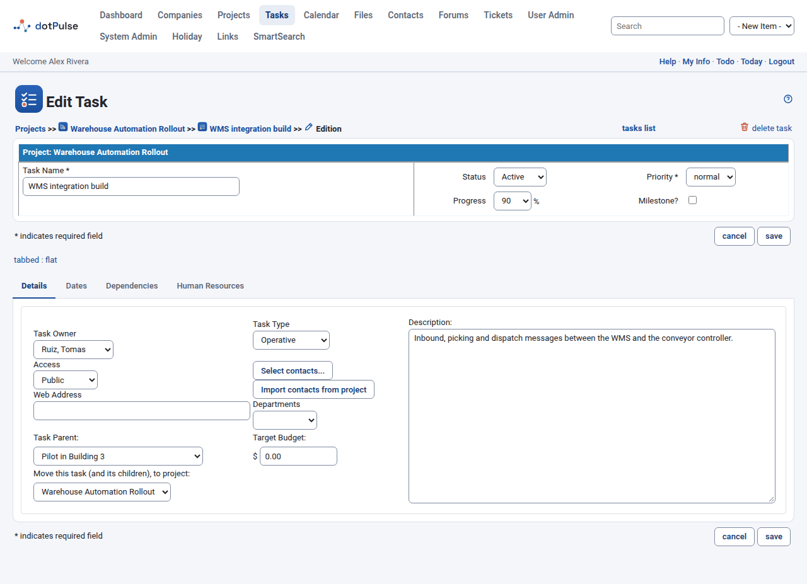
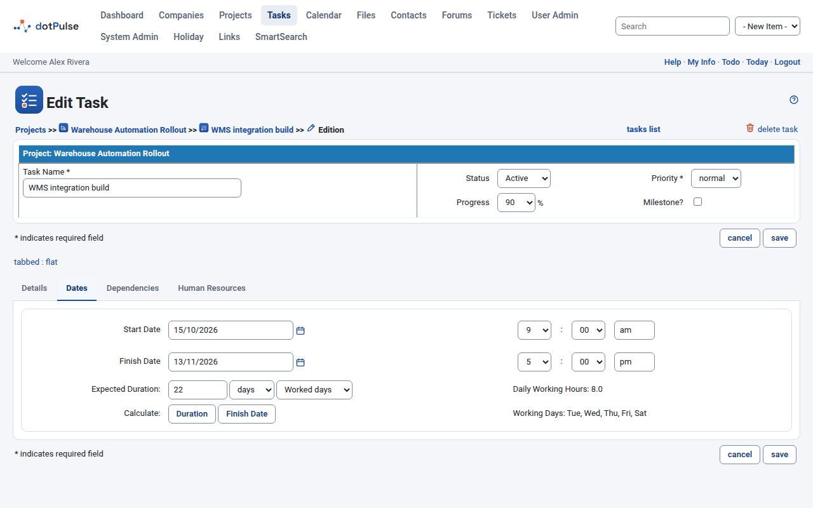
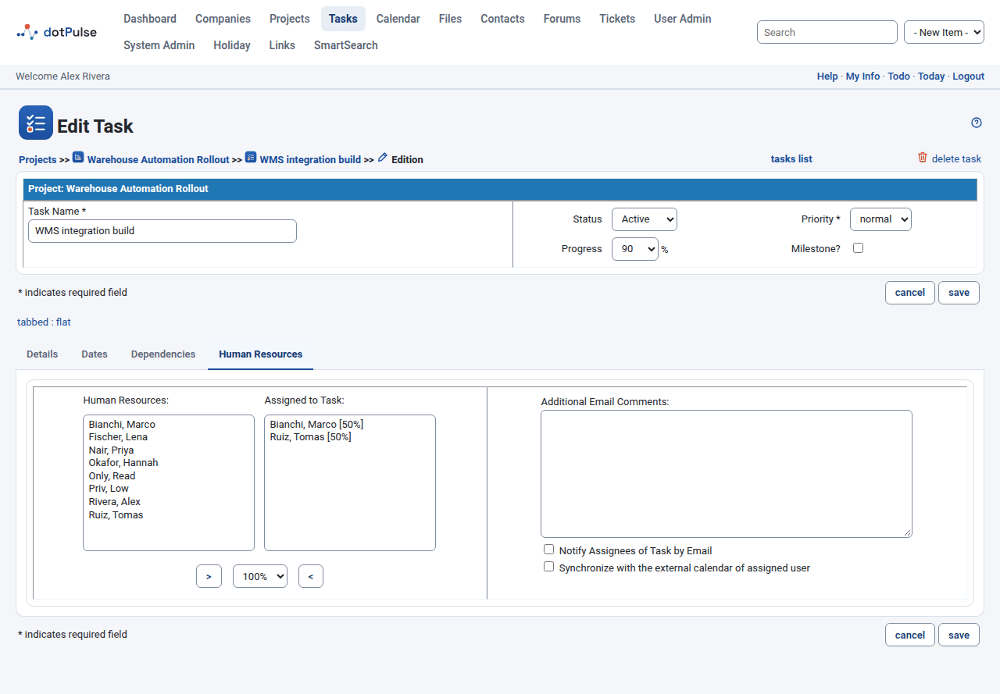
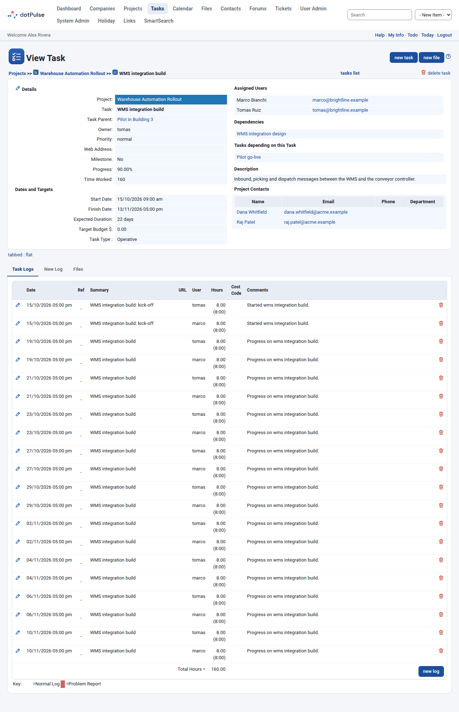

# Tasks

Tasks are the units of work inside a project. Each task has dates, a duration, people assigned to it and a progress percentage. This page covers the task lists, creating and editing tasks, and the task page.

## Find your tasks

Click **Tasks** in the top menu. The list groups tasks by project. By default it shows **My Unfinished Tasks**.

{ .shot }

Use the controls above the list to narrow it down:

- **Search**: type a word and press Enter. It searches task names and descriptions.
- **Company**: shows only the tasks of one company's projects.
- **User**: administrators can look at another person's tasks.
- **Task Filter**: picks which tasks to show:

| Filter | Shows |
|---|---|
| My Tasks | Tasks assigned to you. |
| My Unfinished Tasks | Your tasks that are not at 100 %, in projects that are not on hold, complete or archived. |
| All Unfinished Tasks | Everyone's unfinished tasks, with the same project rules. |
| My Projects | All tasks in projects you own. |
| All Tasks for my Company | All tasks in your company's projects. |
| All Tasks (unassigned) | Tasks nobody is assigned to. |
| All Tasks I Have Created | Tasks you own. |
| All Tasks | Every task you may see. |
| All Tasks Finished Last 7 Days | Tasks that reached 100 % with an end date in the last week. |
| My Tasks Finished Last 7 Days | The same, for your tasks only. |

The links under the filters open other views:

- **my todo**: your to-do list (see below).
- **my pinned tasks**: only the tasks you pinned. **all tasks** takes you back.
- **show inactive tasks** / **show active tasks**: switches between active and inactive tasks.
- **tasks per user**: a list of tasks grouped by assignee.
- **reports**: the project reports.

Click the arrow at the left of a project bar to show only that project. Click it again to show all projects.

### Read the task list

| Column | Meaning |
|---|---|
| (pencil) | Edit the task. |
| Pin | Pin or unpin the task. See [Pin a task](#pin-a-task). |
| New Log | The **Log** link opens the form to log work on the task. |
| Work | Progress in percent. |
| P | Priority arrows, or a warning icon if a task log reported a problem. A paper clip means the task has files. |
| Task Name | Child tasks are indented under their parent. |
| Task Owner, Assigned Users | Who owns the task and who works on it. |
| Start Date, Duration, Finish Date | The planned schedule. |
| Last Update | Shown when the History module is active. |

The row colour tells you how the task is doing. The key under the list explains it: **Future Task**, **Started and on time**, **Should have started**, **Overdue** and **Done**.

Use **Expand All** and **Collapse All** to open or close all parent tasks. Inside a project, tick **Incomplete Tasks Only** to hide finished tasks.

## Your to-do list

Go to **Tasks** and click **my todo**. The page **My Tasks To Do** lists the unfinished, active tasks assigned to you.

{ .shot }

It has two tabs: **My Tasks** (a list) and **My Gantt** (a chart). If the Helpdesk add-on is active, a third tab shows **My Open Requests**.

Tick the boxes under **Show** to add more tasks to the list:

- **Pinned Only**: only tasks you pinned.
- **Archived Projects**: include tasks of archived projects.
- **Projects on Hold**: include tasks of projects on hold.
- **Dynamic Tasks**: include task groups (see [Task groups](#task-groups-and-child-tasks)).
- **Low Priority Tasks**: include low priority tasks. This box starts ticked.
- **Empty Dates**: include tasks with no start date.

The **Due In** column counts the days until each task's finish date. Administrators can pick another person in **Show Todo for:**.

## Pin a task

Pinning keeps important tasks at hand. Click the pin icon in the **Pin** column of any task list. Click it again to unpin. Your pins are personal; other people do not see them.

To see only pinned tasks, click **my pinned tasks** on the tasks list, or tick **Pinned Only** on the to-do list.

## Create a task

1. Open the project.
2. Click **new task**.
3. Type the **Task Name** and fill in the tabs below.
4. Click **save**.

To create a child task, open the parent task and click **new task** there. The new task starts with that parent.

{ .shot }

The top of the form shows the project and these fields:

| Field | Meaning |
|---|---|
| Task Name `*` | A short, clear name. |
| Status | **Active** or **Inactive**. Inactive tasks leave the normal lists and appear under the project's **Tasks (Inactive)** tab. |
| Priority `*` | **low**, **normal** or **high**. |
| Progress | How much is done, in steps of 5 %. |
| Milestone? | Marks a key date. A milestone has no duration. |

The rest of the form is split into tabs. You can switch tabs before saving; dotPulse keeps what you typed.

### Details tab

| Field | Meaning |
|---|---|
| Task Owner | The person responsible for the task. It also decides which holiday calendar the dates follow (see [Working days and holidays](#working-days-and-holidays)). |
| Access | Who can see the task. See [Task access](#task-access). |
| Web Address | A link related to the task. |
| Task Type | **Unknown**, **Administrative** or **Operative**. |
| Select contacts... | Pick contacts for this task. |
| Import contacts from project | Adds the project's contacts to the task. |
| Departments | Shown when the project's company has departments. |
| Task Parent | Makes this task a child of another task. **None** keeps it at the top level. |
| Target Budget | The planned budget for the task. |
| Description | Free text. |
| Move this task (and its children), to project | Only when editing. See [Move a task to another project](#move-a-task-to-another-project). |

### Dates tab

{ .shot }

| Field | Meaning |
|---|---|
| Start Date | Day and time the work starts. |
| Finish Date | Day and time the work ends. |
| Expected Duration | A number plus **hours** or **days**, and **Worked days** or **Calendar days**. |

Under the fields, dotPulse shows the site's **Daily Working Hours** and **Working Days**.

The **Calculate** buttons fill in one value from the others:

- **Duration**: works out the duration from the start and finish dates.
- **Finish Date**: works out the finish date from the start date and the duration.

A day of duration counts as the site's daily working hours, not 24 hours.

!!! note
    Only the task owner, the project owner or a system administrator can change dates, durations and dependencies. Others see a message in place of these fields.

### Working days and holidays

When you click **Finish Date**, dotPulse counts the duration in working hours, one working day at a time. With **Worked days** it jumps over non-working days and holidays. With **Calendar days** it counts every day, weekends and holidays included.

If your site uses holiday calendars (the Holiday module), the dates follow the **task owner's** calendar. That is the calendar of the owner's own account, or else of their department or company. Change the owner and **Finish Date** uses the new owner's holidays. The same applies when dotPulse moves tasks because of dependencies, and to the reminder emails, which are not sent on the person's holidays.

### Dependencies tab

A dependency says that this task can only start after another task ends.

1. In **All Tasks**, select one or more tasks.
2. Optionally type a delay in days in the box between the arrows, such as `+2` or `-1`.
3. Click **>** to add them to **Task Dependencies**. Click **<** to remove selected ones.
4. Tick **Set task start date based on dependency** if the start date should follow the latest finish date among them.

**Dependency Tracking** controls what happens when the tasks you depend on move:

- **On**: this task's dates move with them.
- **Off**: this task keeps its dates.
- **Do not track this task**: tasks that depend on this one do not move when it changes.

dotPulse refuses dependencies that make a loop, or that tie a task to its own parent.

### Human Resources tab

Assign people to the task and say how much of their time it takes.

{ .shot }

1. Select one or more people in **Human Resources**.
2. Pick a percentage (5 % to 100 %) in the list between the arrows.
3. Click **>**. They appear in **Assigned to Task** with their percentage.
4. To remove someone, select them in **Assigned to Task** and click **<**.

On the right:

- **Additional Email Comments**: text added to the notification email.
- **Notify Assignees of Task by Email**: sends the task details to the assignees when you save.
- **Synchronize with the external calendar of assigned user**: sends the task as a calendar invitation to the assignees.

If your administrator turned on over-allocation checks, dotPulse will not assign someone beyond their free capacity. It tells you so.

### Add-on tabs

Add-on modules can add tabs to the task form. Common ones are **Other resources** (equipment and other non-human resources, with a percentage like people), **Allocations**, **Detailed budget**, **Unit costs** and **Estimations**.

## Milestones

Tick **Milestone?** for a key moment, like a delivery or a sign-off. dotPulse sets its duration to zero. Milestones get a diamond on the [board](gantt-board.md#the-board). You can hide them on the task Gantt chart.

## Task groups and child tasks

Any task can have child tasks: set **Task Parent** on the child. The parent shows as a tree in the task lists. The task page of a parent has a **Child Tasks** tab.

A **dynamic task** (a task group) takes its dates, duration, worked hours and progress from its children. To make one, tick **Dynamic Task** on the **Dependencies** tab. Keep in mind:

- A dynamic task is meant to have children. Depending on your site's settings, dotPulse refuses a dynamic task without any.
- A dynamic task cannot depend on another task.
- You do not log work on a dynamic task; you log it on its children.
- Task groups do not appear on the board, and stay out of your to-do list unless you tick **Dynamic Tasks**.

## Task access

The **Access** field limits who can see a task:

| Access | Who can see it |
|---|---|
| Public | Everyone who can see the project. |
| Protected | The owner, and assignees from the same company as the owner. |
| Participant | The owner and the assignees. |
| Privileged | The owner, the assignees, and people from the project's company. |
| Private | Only the owner. |

## Reminders

If your administrator has turned on task reminders, dotPulse emails the assignees and the owner before a task's finish date. The reminder repeats once a day until the task reaches 100 % or the set number of repeats runs out. Nobody gets a reminder on a day that is not a working day for them. The administrator sets how many days before the finish date the reminders start, and how many repeats there are.

## Move a task to another project

1. Edit the task.
2. On the **Details** tab, pick the new project in **Move this task (and its children), to project**.

The form saves straight away. The task's children and files move with it. The list only offers projects of the same company that are not archived.

## Organize many tasks at once

On a project page, click **organize tasks**. Tick the tasks in the **Select** column, then pick an **Action**: **Copy**, **Move**, **Delete**, **Mark as Finished** or one of the **set priority to** options. Only **Copy** is offered if you cannot edit tasks. For copy and move, pick the target **Project** and **Task** (the new parent). Tick **Include Children** to apply the action to child tasks too; it does not apply to delete, or to a move within the same project. Then click **update selected tasks**.

## The task page

Click a task name to open its page.

{ .shot }

The left side shows **Details** (project, parent, owner, priority, web address, milestone, progress and **Time Worked**) and **Dates and Targets** (start, finish, expected duration, target budget, task type). The right side shows **Assigned Users**, **Dependencies**, **Tasks depending on this Task**, the description, departments, **Task Contacts** and **Project Contacts**.

Use the pencil icon (**edit this task**) to edit it. The buttons **new task** and **new file** add a child task or a file to this task.

The tabs below are:

- **Task Logs**: the work logged on the task. See [Logging work](task-logs.md).
- **New Log** (or **Edit Log**): the form to log work.
- **Child Tasks**: when the task has children.
- Add-on tabs, such as **Files**, when those modules are active.

## Delete a task

1. Open the task, or its edit form.
2. Click **delete task** and confirm.

!!! warning
    Deleting a task also deletes all its child tasks and the work logged on them. It cannot be undone. To keep the history, set the task's status to **Inactive** instead.
